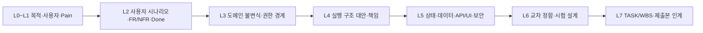

# 음악 레슨 등록 지원 · 기존 설계 체계 기반 착수 검토 (2026-11-23)

> **작업 브랜치** `r01/lesson-design-kickoff-20261123` · R01 설계 착수 검토. 이 경로는 새 설계 방법론이 아니다. 이미 있는 [기획→시스템 설계 L0~L7](../../../../docs/deliverables/PLANNING-DESIGN-INFO-MODEL.md) 및 [정보 유형·의존 모델](../../../../docs/deliverables/planning-design-info-model.json)에 이번 제품의 입력을 연결한다. **R01의 제품 범위·Must/Done·기술 구조 최종 승인과 팀원에게 실제 업무 전달은 아직 기록되지 않았다.**

## 기준·정본

- [기획안 V1.1 JSON](../../planning/lesson-registration-20261123/proposal-v1.1.json) · [읽기용](../../planning/lesson-registration-20261123/proposal-v1.1.md) — GitHub `main` 정본을 기준으로 시작
- [Notion 멘토 검토용 V1.1](https://app.notion.com/p/42149106016081fcb08eea1e70f7869c) — 2026-11-24 멘토의 자유 피드백 공간으로 수정됨. 본 브랜치의 설계 결정·TASK 제안은 아직 포함하지 않음
- [기존 L0~L7 설명](../../../deliverables/PLANNING-DESIGN-INFO-MODEL.md) · [점진적 결정 순서](../../../deliverables/PROGRESSIVE-DESIGN-ORDER.md) · [정보 모델 JSON](../../../deliverables/planning-design-info-model.json)
- [기존 작업 계약](../../../../TASK.md) · [중요 결정 기록 규칙](../../../adr/README.md)
- [기존 Step2 API 후보](../../../step2/API_설계_문서.md) · [DB 후보](../../../step2/데이터베이스_스키마_설계서.md). 과거 V0.1 입력으로 작성됐으므로 **현재 V1.1과의 불일치 검토 후에만 설계 기준선으로 승격**

## 현재 작업물

| 역할 | 기존 체계의 제품별 적용 | 상태 |
| --- | --- | --- |
| **[설계 입력](design-intake.json)** | IT-00~IT-27 중 필요한 12개 유형의 인스턴스, L0~L7 단계 연결, 출처·재검토 조건·시험 계획 | **조건부 초안**, 확정 완료 아님 |
| **[마일스톤·작업 제안](milestone-plan.json)** | 12/08 작동하는 크몽 1건 MVP, 01/04 완성품 목표의 역산 일정. 후속 TASK-033~037을 R01~R05에게 제안 | **작업 분배 검토 중**, 공식 TASK로 생성/수신된 상태 아님 |
| **[실행 중심 작업 계약 초안](MVP-WORK-PACKAGES-20261124.md)** | TASK-033~037의 구체적 입력·코드/데이터/UI·실행 증거·인수 시험·책임 경계 | **11/24 제안**, 정식 TASK/PoC 승인 전 |
| **[기존 ADR 형식의 설계 착수 결정안](../../../adr/ADR-004_레슨_등록_설계_착수_기준선.json)** | 크몽 1건 우선, 접수 확인 vs 게시 구분, 실행 구조 비교, 필요 권한·재검토 조건 | **제안**, R01 세부 선택 미채택 |
| **[기획 작업 공간](../../planning/lesson-registration-20261123/README.md)** | V1.1 정본 및 V1.0·V0.1 보존, Notion 연결 | 브랜치에서 동기화 상태만 보완 |

## 핵심 결정의 근거와 상태

| 선택 | 지지 근거 | 현재 판단 |
| --- | --- | --- |
| 최초 등록을 첫 Pain으로 검증 | R02의 크몽 최초 등록 1~2시간 회상·동료의 등록 지연·R03의 업무 흐름 | **우선 기획/설계 후보**. 반복 업무와의 효과·재구매 비교는 미실증 |
| 크몽 웹 레슨 상품 1건 | R02 실제 사례·R03 크몽 필드와 상태·R05 공개 웹 등록 경로 | **첫 수직 구현 후보**. 심사 접수 증빙과 승인·게시 상태를 혼동하지 않음 |
| F1 사실 변환 → 강사 승인 → F2 입력/사진/허용된 제출 → F3 증빙·복구 | R02 사용자 희망, R03 업무 계약·예외/unknown, R04 대안 잔여 Pain | **설계 입력 가능**. F2 실서비스 자동 제출의 운영사 허용·성공은 미확인 |
| 로컬/서버 실행 방식 | R05 1차 인증·세션·파일 전송 비교, R02 직접 로그인 조건 | **로컬 우선 설계 가설**, 구조 최종 채택 아님 |
| 12월 8일 MVP / 2027년 1월 4일 완성품 | R01이 현재 대화에서 제시한 목표 | **목표일은 사용자 입력**, 공수/달성 가능성은 미검증. 기존 Step1 WBS는 12/8 중간 발표·12/9 이후 구현으로 되어 재편 필요 |

## 기존 설계 순서에 따른 다음 작업

**공통 검증 원칙:** 문서 구조 검사·모의 실행·실서비스 접수 확인·사용자 가치 실측은 각각 다른 증거다. `planned_check_by`는 시험 계획이며, 실제 성공의 `verified_by`로 대체하지 않는다. 근거와 사용자 승인 없이 실서비스 자동 최종 제출을 수행하거나 계정 비밀번호/인증코드를 수집하지 않는다.

**소유권 및 통합:** R01만 공통 제품 기준선/범위·인터페이스 충돌을 최종 결정한다. 각 팀원은 기존 `docs/members/R0X/workspace/`를 소유한다. 본 계획의 TASK-033~037은 **정식 TASK 추가·팀원 전달·수신 전** 검토 목록이며 기존 TASK-028~032 파일과 `current.json`은 그대로 둔다. R01이 채택하면 기존 TASK 템플릿·ADR·state와 `project_docs.py` 프로젝션을 통해 정본으로 승격한다.

**이력:** 2026-11-23 작업 브랜치 최초 작성. `main`은 미수정. Notion V1.1 기획안 및 멘토 피드백 공간 동기화는 브랜치 설계 완료의 증거가 아니다.
