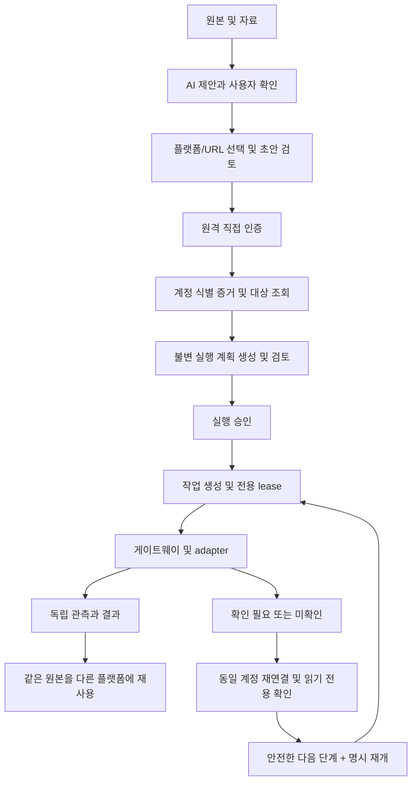

# V0.5 구현 기준선 보완 후보

R01 요청: V0.4 재검토 P01~P10 보완. 상위 DIR-01~04 유지. 공통 계약 보완 후보이며 본 구현/실환경/정식 TASK 배정 승인 아님.

V0.5의 명시 교정이 V0.3/0.4의 해당 부분을 대체한다. 나머지 V3-R01~14, 상태/효과 계약, V0.4 요구사항, 12/8·1/4 목표, mock-only PHASE 및 T1~T6 보존. V0.5는 공통 경계 명세이며 특정 원격 기술/DB/프론트 강제 없음.

## 검토 결함 보완

| ID | 문제 | 보완 | 남은 검증 | 참조 |
| --- | --- | --- | --- | --- |
| P01 | 실행 계획 생성·검토 누락 | 서버 불변 Plan 생성→GET review→plan ref+digest+명시 승인. 클라이언트가 operation/지문을 구성하지 않음. | adapter의 실제 단계/규칙 구현 | R5-01 HTTP-20/21/09 Plan |
| P02 | 인증 증거 순환 참조 | IdentityObservation은 connection 기준으로 계정/대상/job 생성 전에 저장. 계정은 이 증거에 연결. 실행 Evidence는 job/target 기준. | 실제 identity marker·권한 증거는 live gate | R5-02 identity_observations |
| P03 | 구현자 간 계약 정밀성 | 상속 타입+V5 추가 타입, 명시된 method/route/요청/응답/오류, 브라우저 port와 adapter 경계, stub 사례. 연결 방식은 구현자 선택. | 실제 코드 생성·호환성 테스트 | PORT5-01~09 |
| P04 | 재인증과 재연결 | 동일 계정·owner·환경·플랫폼 검증, 새 연결/lease binding CAS. unknown 상태에서는 읽기 재확인만. 별도 resume, 이전 연결 무효화. | 실제 경쟁/만료/브라우저 시험 | R5-04 HTTP-24 |
| P05 | 재접속 시 작업 찾기 | owner 기준 source/job 목록·detail, cursor, action reason, 재진입, stored result. 뷰어 종료와 작업 분리. | 실제 서비스 인증 및 UI 구현 | HTTP-22/23/25/26 |
| P06 | 공통 정보 재사용 | 원본 snapshot 1개를 플랫폼별 draft/plan/job과 결합. 수정은 새 원본; 이미 승인된 과거 snapshot은 재승인 정책 적용. | 동일 fixture 다중 플랫폼 시험 | R5-06 HTTP-22/23 |
| P07 | 등록 가능 상태 혼재 | registry support, policy, readiness, auth, target, approval, effect 상태 직교. 지원=실행 허용 아님. | 플랫폼 규칙/실환경 확인 | Eligibility R5-07 |
| P08 | AI 책임/수용 기준 약함 | 원본→근거 있는 사실 제안·질문→확인→draft 변환, 모델 미사용 합성 시험과 AI 기능 시험 분리. 담당/인계 명시. | 모델·비용·품질 실측 및 담당 합의 | R5-08 W19 |
| P09 | MVP·최종·운영 혼재 | 모의 MVP, URL 지원 플랫폼 E2E, live 별도 gate·조건부 상태 계약. 공개/접수/설정 구분. 실등록 불가면 최종 live 목표 미달 표기. | 실제 플랫폼 정책/인증/효과/권한 및 단계 승인 | R5-09 |
| P10 | 통합 공수 위험 | 11/27 contract/stub, 11/30 skeleton 통합 시작, 12/1~3 일별 합류, 12/4 첫 수직 경로, 12/7 보완, 12/8 MVP. R02 사전 인계, AI 별도 작업, 공수 재판정. | 실제 가용시간과 업무량 검토 | wbs-v0.5.json |

## 정상 경로

## 공통 설계 교정

### R5-01 계획 승인

source→confirm→draft→human auth→trusted identity→target→server PlanReview→explicit approval→job→worker lease. Plan digest binds source/draft/rule/media + account/slot/environment + ordered steps/permission/adapter. User receives plan, echoes digest; stale/changed scope requires new plan/approval. Do not require client to derive operation IDs.

근거: V3-R01, V3-R03, V3-R10

### R5-02 증거 계층

IdentityObservation is stored before account/target/job. TargetObservation is stored before target/job after verified account; both owner/connection scoped, typed separate from job Evidence. Plan links trusted target observations. Account evidence ref links IdentityObservation; no circular FK.

근거: V3-R01, V3-R07

### R5-03 제어권과 직렬화

human_auth view only; input fenced before system_read, which can only verify identity and resolve existing targets/preflight via trusted operations. human_review state no worker effects; only approved job/lease permits mutation. Worker and human commands pass same gateway. Revoke/cancel/CAS admission single linearization boundary. Adapter never retains raw driver; view disconnect independent. All V3 safety rules mandatory in MVP. A human intervention grant may permit only authentication or user-directed correction within registered scope. Human input that can change external state is not treated as an approved automated effect; before resuming automation, re-observe target/effect and ask for approval if scope changes. Unclassifiable pending effect blocks further automation.

근거: V3-R04, V3-R05, V3-R11

### R5-04 재연결

new connection same owner/platform/env/stable subject; no pending admitted command before new automation. Stop old controller and invalidate old grant/lease/epoch atomically; rebind allowed only needs_action/unknown/blocked with safe observation path (no terminal or running). unknown stays unknown; new session may read reconcile with same target/permission; safe next step evidence + explicit resume + current approval + fresh lease needed. Wrong account no mutation, old job retained.

근거: V3-R01, V3-R05, V3-R06

### R5-05 재접속 UX

service principal authenticates to app; owner list sources/jobs, stored detail and next action; remote grant only authorized phase. UI never guesses completion. user may log in again without resubmitting original data.

근거: V3-R10, V3-R11

### R5-06 한 번 입력·다중 대상

source version shared, platform-specific rule/draft/plan/approval/job separate; sequential jobs default; create target per account/object/slot. Reuse existing confirmed facts/media without retyping, missing fields per platform. New source changes no historic result and stale pending approval only if relevant scope changes; explicitly re-review. Separate platform outcomes.

근거: V3-R02, V3-R08, V3-R09

### R5-07 지원과 실행 판정

registry exact approved host/path/route; unsupported/invalid→no fetch. supported can still be live_blocked/info missing/auth required/target ambiguity/approval missing/unknown. can_dispatch only calculated at internal admission with V3 all guards, user API advisory false until current server validation. mock fixtures map separately, live network disabled; no arbitrary redirects/private network.

근거: V3-R04, V3-R09, V3-R11

### R5-08 AI 최소 제품 경로

model receives sanitized source and platform field spec; returns structured candidate facts/mappings/questions/provenance, deterministic schema/units/constraints checks; user confirms substantive facts. Model unavailable/invalid output visibly needs_action, manual confirmed input possible for technical tests but not AI acceptance. AI MVP test raw unstructured lesson text→candidate fields and missing/conflict question→confirmed draft. No fixed-price mock hardcode or invented rule.

근거: V3-R08, V3-R12, V3-R13

### R5-09 목표 및 release 경계

MVP mock: Kmong full first listing receipt readback mandatory; Soomgo confirmed synthetic service configuration second target by 12/8, if not completed R01 replan not falsely pass. Final URL supported platform(s) E2E, one source across Kmong+Soomgo intended baseline. No universal unknown sites. Live target_confirmed transition remains unreachable until separate phase approval after policy, account/eligibility, validated effect/goal evidence, isolation, privacy, user authorization. Future transition candidate running/stopping/unknown→target_confirmed only if live gate approved + platform goal evidence valid + no pending effect; no auto-enabling. If only mock passes, engineering mock verified; actual service objective unverified/not met. Actual scope of Soomgo save/publication remains external gate. MVP includes basic fact proposal and missing/conflict clarification (T5-08) plus per-platform mapping. Product gate can report mock registration pass independently of AI or Soomgo failure; the overall MVP is incomplete until required scope passes or R01 explicitly changes scope. Final operational target not equivalent to a dry run.

근거: DIR-03, DIR-04, V3-R07, V3-R11

### R5-10 최소 구현

공통 app + persistent store + remote runtime isolation boundary + test harness. Component IDs logical only, config version files or embedded JSON allowed; no message broker/microservices required for MVP. SQLite or PostgreSQL after atomic/owner tests; Python/FastAPI reuse candidate. Browser internal choice delegated. Use stub first, then actual local synthetic adapter and isolated runtime, progressive contract CI. Implementation package root candidate product/lesson-registration/ with app, contracts, adapters, remote, web, tests, fixtures; no files created or common dependencies modified.

근거: DIR-02, V3-R14

### R5-11 최소 실행·개발 환경

One shared contracts/ module, server-owned registry and sample fixtures, app/remote/adapters/web/test modules in product/lesson-registration/ candidate root. W01 freezes wire version, common error codes, contract package and one launch command with fake providers. Implementers can select internal technology; shared transport/dependencies changes require R01 coordination. At minimum shared contract fixtures, provider unit tests, smoke command, lint/CI, mock network allowlist; no common root dependency edit before decision.

근거: V3-R10, V3-R14, DIR-02

## 물리 데이터 교정

| 논리 저장 단위 | 변경 | 키 | 필드 | 불변식 |
| --- | --- | --- | --- | --- |
| identity_observations | add | PK ref; FK connection_ref→connections; owner scope; no job/target/account FK required | IdentityObservation | trusted observation before Account creation; accounts.verification_evidence_ref→identity_observations.ref; verified_at from observation; verified_at populated in Account from observation |
| target_observations_prejob | add logical record | PK ref; FK connection/account; owner from connection; candidate/rule ref; no job/target FK | TargetObservation | server read-only before resolving slot; freshness/version checked; plan links redacted evidence refs |
| plans | add logical record | PK(ref,version); owner derived from target; immutable | Plan + canonical review mappings/media references + target_observation_refs | approval plan ref/digest and permission ref; operations ref plan version; stable effect_key independent of plan/job |
| approvals | amend | FK plan(ref,version); target/account via plan | Approval5; approval scope immutability + revoked_at epoch | no approval without persisted review; revocation may change only revision/status |
| jobs | amend | owner via intent/target; index(owner,updated_at,ref) logical; current connection nullable; CAS revision | Job + plan_ref via approval; updated_at; binding_epoch; stop reason | rebind does not mutate plan/approval/intent, only connection ref/epoch; unknown holds |
| connections | amend | owner/route/identity binding | SessionView + candidate_ref + lease generation; runtime opaque | system_read vs worker phases; stale generation cannot use viewer/worker |
| sources | amend | PK(ref,version), owner/latest index | SourceResponse + explicit media version refs + confirmation records | one snapshot reused across independent platform drafts/jobs; no mutable data copied over approval |
| evidence | retain | job/target; attempt optional; identity evidence separate | V3 Evidence + collector_ref | after job creation only; identity observation not fabricated job |
| rules/operations/attempts | clarify | rule immutable version; stable operation effect key + attempt history; composite FK operation+plan version | V3/V4 plus StepSpec and permit admission | unknown across new plans/jobs blocked; atomic checks against current permission/lease; effect ledger survives restart |
| assets/drafts/accounts/targets/intents/permissions/results/object_observations/idempotency/users | retain logical constraints | V4 | V4 | physical grouping permitted if ownership, versioning, uniqueness, durability and traceability proved |
| route_candidates | logical registry reference | candidate ref derived server-side from platform/object/route/environment/rule version/adapter version; no arbitrary URL persisted | TargetCandidate | candidate references immutable registry entry, server lookup from ref, policy may change separately; no user-invented ref accepted |

논리 저장 단위는 실제 테이블 개수 강제가 아니다. V0.4 저장 필드와 무결성 규칙 유지, 필요한 교정만 적용. 실제 DB migration 및 트랜잭션 시험은 구현 시.

## 공개/내부 계약

V0.4 HTTP-02,14,15,17 inherit; HTTP-02 multipart MediaRequest + file, HTTP-14/15 StopRequest, HTTP-17 ReadRequest with stored ObjectObservation[]. All other IDs replaced/added by V5. HTTP-07 verify replaces handoff route. All mutations require key (except internal dispatch, bound by durable attempt); path/body ref consistency; owner server principal; GET path/query no body. Standard 401/403/404/409/422/503 and 202 async; Error5Response on errors; never silently retry effect.

| ID | 메서드 | 경로 | 입력 타입 | 출력 타입 | 가드 |
| --- | --- | --- | --- | --- | --- |
| HTTP-01 | POST | /v1/sources | SourceCreate5Request | SourceView | owner; raw source; server assigns fact IDs |
| HTTP-03 | POST | /v1/targets/resolve-url | ResolveUrlRequest | ResolveUrlResponse | owner; static registry only |
| HTTP-04 | POST | /v1/drafts | Draft5Request | Draft5Response | owner; candidate/rule/source snapshot current |
| HTTP-05 | PATCH | /v1/drafts/{id} | Draft5Edit | Draft5Response | owner; server validates immutable next version |
| HTTP-06 | POST | /v1/connections | Connect5Request | SessionView | mock only; selected route candidate bound server-side |
| HTTP-07 | POST | /v1/connections/{id}/verify | VerifySessionRequest | SessionView | body/path ref match; human input fenced before read |
| HTTP-08 | POST | /v1/targets | Target5Request | Target5Response | verified identity, candidate binding, authorized read-only target observation |
| HTTP-09 | POST | /v1/approvals | ApprovePlanRequest | Approval5 | server plan and digest; current policy and explicit consent |
| HTTP-10 | POST | /v1/jobs | Job5Request | Job | server plan/approval/current permission; intent lookup; 202 async; worker lease only after job |
| HTTP-11 | GET | /v1/jobs/{id} | ReadRequest | JobSummary | owner; stored only |
| HTTP-12 | POST | /v1/jobs/{id}/reconcile | Reconcile5Request | JobSummary | authorized read; server observation; same account; effect remains unknown if inconclusive |
| HTTP-13 | POST | /v1/jobs/{id}/resume | Resume5Request | JobSummary | safe next step + current approval + explicit resume; no direct unknown dispatch |
| HTTP-16 | DELETE | /v1/connections/{id} | StopRequest | SessionView | owner and fence; close proof; unknown retained |
| HTTP-18 | POST | /v1/connections/{id}/view-grant | ViewGrantRequest | ViewGrant | owner; lease phase/mode; no direct CDP/VNC |
| HTTP-19 | INTERNAL | gateway.dispatch | Dispatch5Request | DispatchResponse | single admission; all V3 guards |
| HTTP-20 | POST | /v1/plans | PlanRequest | PlanReview | same owner/account; current draft/rule/permission; read-only |
| HTTP-21 | GET | /v1/plans/{id}/versions/{version} | PlanRefRequest | PlanReview | owner; stored snapshot plus current readiness; no mutation |
| HTTP-22 | GET | /v1/sources | ListQuery | SourceList | owner; latest versions |
| HTTP-23 | GET | /v1/sources/{id} | VersionQuery | SourceView | owner; version optional |
| HTTP-24 | POST | /v1/jobs/{id}/rebind | RebindRequest | RebindResponse | owner; same identity; CAS; no automatic dispatch |
| HTTP-25 | GET | /v1/jobs | ListQuery | JobList | owner; stored only |
| HTTP-26 | GET | /v1/connections/{id} | ReadRequest | SessionView | owner; never raw credentials |
| HTTP-27 | POST | /v1/sources/{id}/confirm | SourceConfirmRequest | SourceView | owner; source revision; user confirmation |
| HTTP-28 | POST | /v1/proposals | ModelProposalRequest | ModelProposal | owner; safe facts only; no browser/secret |
| HTTP-29 | GET | /v1/drafts/{id} | VersionQuery | Draft5Response | owner; stored draft only |

## 구현자 간 포트

| ID | 제공자 | 동작 | 입력 | 출력 | 계약 |
| --- | --- | --- | --- | --- | --- |
| PORT5-01 | registry | resolve | ResolveUrlRequest | ResolveUrlResponse | C4-04; no network |
| PORT5-02 | prep | propose/confirm | ModelProposalRequest / SourceConfirmRequest | ModelProposal / SourceView | C4-03; external AI only on sanitized data; explicit user confirmation |
| PORT5-03 | remote_session | verify/status/rebind | VerifySessionRequest / ReadRequest / RebindRequest | SessionView / SessionView / RebindResponse | C4-06 plus coordinator atomic binding; provider runtime choice delegated |
| PORT5-04 | adapter | build_plan | PlanBuildInput | PlanProposal | C4-08; pure proposal, server canonicalizes IDs/digest/permission and stores; no raw browser. |
| PORT5-05 | adapter | preflight | PreflightRequest | PreflightResult | only restricted read-only port; no page that autosaves |
| PORT5-06 | gateway | admit_dispatch | Dispatch5Request | DispatchResponse | C4-07; sole admission, durable attempt and single-use permit |
| PORT5-07 | adapter | execute_step | StepInput | StepOutcome | inside gateway only. Restricted port commands scoped to step; no raw persistent driver or network token. Unknown/denied/unexpected stops. |
| PORT5-08 | gateway | observe | ObserveRequest | ObserveResult | read permission, same identity/target, exclusive read lease. No mutation. |
| PORT5-09 | gateway | stop | StopRequest | StopAck | same serialization/fencing; no rollback promise. |
| PORT5-10 | remote_runtime | open / change_phase / close | RuntimeOpenRequest / RuntimeLeaseRequest / RuntimeCloseRequest | SessionView / SessionView / RuntimeCloseResult | Only C4-06/gateway internal trusted calls, shared admission epoch/lease; actual transport delegated |
| PORT5-11 | remote_runtime | command / read | RuntimeCommandRequest / RuntimeReadRequest | BrowserObservation / BrowserObservation | C4-07 sole gateway; exact registered action/arguments, current permit and generation before each command; read allowlist, no arbitrary CDP/driver/URL. Any mutation outside step blocked. |
| PORT5-12 | remote_runtime | observe_identity / observe_target | IdentityReadRequest / TargetReadRequest | IdentityObservation / TargetObservation | trusted runtime server observation only; identity before account creation, target after verified account; server persists evidence; no auth input recording |

## 타입과 wire 계약

V0.3 타입을 상속하고 아래 V0.5 타입을 추가한다. 정확한 필드·필수성·enum은 [구조화 정본](contract-v0.5.json).

| 타입 | 필드(필수 *) | 의미 |
| --- | --- | --- |
| Action | kind:ActionKind*, code:Error5*, field_keys:string[]*, message:string*, related_refs:id[]* | 서버가 생성. UI 문구와 복구 판단을 구분. |
| Eligibility | support:Support*, policy:Policy*, information:Readiness*, auth:IdentityState*, target:TargetState*, approval:ApprovalState*, effect:EffectRisk*, can_dispatch:boolean*, actions:Action[]* | 정확한 can_dispatch는 현재 operation/lease/revision의 V3-G01~13 및 환경/phase까지 서버 재검사; read readiness에서는 false. URL만으로 true 금지. |
| ResolveUrlRequest | url:string*, goal:string*, environment:Environment* | 소유자는 인증에서 유도. URL parser로 exact 등록 host/path, query에 비밀값 금지. 네트워크 요청 없음. |
| TargetCandidate | ref:id*, platform:string*, object_kind:string*, environment:Environment*, route_key:string*, rule:Version*, adapter_version:string* | 서버 registry 확인된 경로. 원본 URL 대신 route_key 저장. |
| ResolveUrlResponse | candidate:TargetCandidate, eligibility:Eligibility* | 미지원/잘못된 URL은 candidate 없음. 지원과 권한 독립. |
| SourceConfirmRequest | source:Version*, decisions:FactDecision[]*, key:string* | 확인된 새 snapshot 생성. 값 수정은 새 원본, 증거/확인 주체 저장. |
| FactDecision | fact_ref:id*, accept:boolean*, corrected_value:json, unit:string | 확인한 값/거절/정정. 필드별 검증, 모델의 confirmed 주장 무시. |
| ModelProposalRequest | source:Version*, rule:Version, key:string* | Optional rule: initial common fact extraction with no rule, platform-specific mapping/questions when rule selected. Only sanitized source + applicable field specification passed to model; no credentials or browser content. |
| ModelProposal | status:ModelStatus*, source:Version*, proposed_facts:Fact[]*, mappings:Mapping[]*, questions:Action[]*, model_ref:string, prompt_version:string, input_digest:digest | proposed_facts는 unverified; deterministic validation, 없는 가격/조건 생성 금지. |
| IdentityObservation | ref:id*, connection_ref:id*, owner_ref:id*, platform:string*, environment:Environment*, stable_subject_ref:id*, observed_at:timestamp*, collector_ref:id*, verified:boolean* | job/target/account FK 없이 생성. 신뢰된 시스템 read observation, 표시명 아님. 인증 비밀 저장 없음. |
| SessionView | connection:Connection*, phase:SessionPhase*, lease:Lease, identity:IdentityObservation | human_auth→system_read→human_review→worker; system_read는 인증 종료 후 제한 조회만. worker lease는 승인 후에만 부여. |
| VerifySessionRequest | connection_ref:id*, expected_generation:positive_int*, key:string* | 사용자 인증 완료 신호; 게이트웨이가 입력을 멈춘 뒤 read-only identity 확인. |
| ViewGrantRequest | expected_generation:positive_int*, mode:GrantMode*, key:string* | owner와 connection/세대/용도 결합, 단기 grant; raw endpoint는 노출 안 함. |
| ViewGrant | grant_ref:id*, viewer_url:string*, expires_at:timestamp*, generation:positive_int*, mode:GrantMode* | viewer_url은 service-origin 단기 경로; access secret 응답 이외 로그/DB 제외. |
| PlanRequest | source:Version*, draft:Version*, rule:Version*, target:Target*, goal:string*, connection_ref:id*, key:string* | 서버가 승인 전 plan을 구성하고 저장. 인증 readback 후 target resolve; mutation 없음. |
| StepSpec | operation_ref:id*, effect_key:string*, ordinal:positive_int*, effect_class:EffectClass*, action_key:string*, allowed_origin_ref:id*, field_keys:string[]*, asset_refs:Version[]*, before_spec:id*, after_spec:id*, evidence_spec:id*, digest:digest* | 순서·안정 논리 효과·허용 동작·값/자료 스냅샷. before/after/evidence는 rule 내 사양 ID. 원시 selector/URL 코드 실행을 API로 전달하지 않음. |
| Plan | plan:Version*, source:Version*, draft:Version*, rule:Version*, target:Target*, goal:string*, media:Version[]*, adapter_version:string*, permission:Version*, steps:StepSpec[]*, digest:digest*, target_observation_refs:id[]* | server-generated immutable. digest binds full semantic scope including approved mappings/media digests, ordered steps, target/account/environment, rule/adapter/permission. 서버 동일 직렬화 계약; UI는 표시하고 opaque digest echo. |
| PlanReview | plan:Plan*, mappings:Mapping[]*, media:Media[]*, eligibility:Eligibility*, questions:Action[]* | 서버에서 실제 보여준 계획과 사용자가 승인할 범위 동일. live blocked 계획은 실행 불가. |
| ApprovePlanRequest | plan:Version*, displayed_digest:digest*, explicit_consent:boolean*, key:string* | V3 ApprovalRequest 대체; server plan 조회·전체 비교. actor 서버 도출. |
| Approval5 | approval:Approval*, plan:Version*, permission:Version*, approved_at:timestamp* | 기존 Approval의 plan_revision/operation refs는 서버 파생; 현재 허용 별도 검사. |
| RebindRequest | job_ref:id*, new_connection_ref:id*, expected_job_revision:positive_int*, expected_new_generation:positive_int*, key:string* | 명시 요청. 기존 연결/lease 무효화 및 CAS, 새 동일 계정 검증; pending effect unresolved이면 read-only. |
| RebindResponse | job:Job*, connection:SessionView*, eligibility:Eligibility* | binding만 갱신, 자동 dispatch 없음. |
| ListQuery | cursor:string, limit:positive_int, state:JobState | opaque cursor owner-scoped; limit default 20 max 100; source list state 제외. |
| SourceList | items:SourceView[]*, next_cursor:string | 소유자 최신 snapshot 목록. 개별 원본 버전 GET. |
| JobSummary | job:Job*, source:Version*, target:Target*, goal:string*, actions:Action[]*, eligibility:Eligibility*, updated_at:timestamp* | 직접 접속 후 job ID 복구, 비밀 없음. |
| JobList | items:JobSummary[]*, next_cursor:string | updated_at desc + ref tie break; owner scoped. |
| Error5Response | code:Error5*, message:string*, retry_blocked:boolean*, related_refs:id[]*, current_revision:positive_int, actions:Action[]* | 실패 이유와 사용자 조치. 외부 effect 불명은 retry_blocked=true. |
| PlanRefRequest | plan:Version* | GET path plan id/version. |
| VersionQuery | ref:id*, version:positive_int | 정확 버전 없으면 최신 소유자 snapshot, immutable version 반환. |
| PreflightRequest | plan:Version*, step:StepSpec*, connection_ref:id*, expected_generation:positive_int* | 서버 plan과 step 재대조. 읽기 전용, 외부 효과 불명 시 blocked. |
| PreflightResult | eligible:boolean*, actions:Action[]*, observation_refs:id[]* | preflight는 effect permission 아님. admission에서 재검사. |
| Dispatch5Request | job_ref:id*, operation_ref:id*, plan:Version*, expected_revision:positive_int*, expected_generation:positive_int*, digest:digest* | 내부 gateway 전용, all guards, readback current. 불변 plan에서 values/asset 허용. |
| AdmittedStep | attempt_ref:id*, job_ref:id*, operation_ref:id*, generation:positive_int*, job_revision:positive_int*, plan:Version* | durable attempt & single-use permit admission 내부 객체. 외부에 reusable token 미반환. |
| StepInput | admission:AdmittedStep*, spec:StepSpec*, mappings:Mapping[]*, media:Media[]* | adapter에게 제한된 operation context만. 자료 bytes는 scoped ref로 읽기. |
| StepOutcome | attempt_ref:id*, status:StepStatus*, evidence_refs:id[]*, actions:Action[]* | adapter 보고 후보; gateway/result validator가 독립 관측 확인 후 상태 확정. |
| ObserveRequest | job_ref:id*, target:Target*, evidence_spec:id*, connection_ref:id*, expected_generation:positive_int* | authorized read-only; unresolved effect와 goal 확인용. |
| ObserveResult | evidence_refs:id[]*, conclusive:boolean*, actions:Action[]* | 독립 검증 전 성공 아님. |
| StopAck | job:Job*, new_generation:positive_int, pending_attempts:id[]* | 이미 admission된 외부 효과 rollback 보장 아님. |
| LiveGate | platform:string*, object_kind:string*, state:LiveGateState*, policy_evidence:id[]*, acceptance_evidence:id[]*, approval_ref:id | 현재 blocked. 승인 상태 예약값은 별도 후속 phase에서만 정의/활성화. |
| Connect5Request | candidate_ref:id*, environment:Environment*, key:string* | server resolves candidate and platform; mock only |
| Target5Request | connection_ref:id*, candidate_ref:id*, object_kind:string*, existing_slot:id, distinct_intent:string, goal:string*, key:string* | candidate bound to same connection, env, platform, goal; source reuse does not determine target slot |
| Target5Response | target:Target, account:Account, eligibility:Eligibility*, target_observation_refs:id[]* | ineligible may omit target; verified identity only |
| TargetObservation | ref:id*, connection_ref:id*, account_ref:id*, candidate_ref:id*, object_kind:string*, observed_at:timestamp*, collector_ref:id*, external_object_ref:id, observation_kind:string*, redacted_values:json* | pre-job server trusted read evidence, no job/target FK; target resolution can use this before slot exists |
| Job5Request | plan:Version*, approval_ref:id*, connection_ref:id*, key:string* | server derives target/goal/kind=create, validates exact plan, owner, policy, account and current approval. Existing matching intent returns existing job/result rather than duplicate creation. |
| Reconcile5Request | expected_revision:positive_int*, connection_ref:id*, key:string* | server trusted read observations only; path job id, no client evidence |
| Resume5Request | expected_revision:positive_int*, approval_ref:id*, explicit_resume:boolean*, key:string* | path job id, safe recovery/current approval, same account; gateway acquires fresh lease server-side |
| BrowserCommand | action_key:string*, operation_ref:id*, arguments:json* | only registry-declared semantic actions; validated argument shape and approved snapshot values; no free-form script or URL |
| BrowserObservation | command_ref:id*, observed_at:timestamp*, result:json*, evidence_refs:id[]* | redacted/typed according to rule; runtime gateway controls actual browser |
| RuntimeOpenRequest | candidate:TargetCandidate*, owner_ref:id* | internal trusted principal; runtime creates isolated context; no credentials |
| RuntimeLeaseRequest | connection_ref:id*, expected_generation:positive_int*, desired_phase:SessionPhase*, job_ref:id | internal only. phase change from server state; worker requires approved job current guards, system_read has allowlist. human_auth/intervention grant scoped. |
| RuntimeCloseRequest | connection_ref:id*, expected_generation:positive_int*, reason:string* | fence+close and verify cleanup; pending effects remain unknown |
| RuntimeCloseResult | connection:SessionView*, cleanup_verified:boolean* | cleanup failure quarantine, not assumed deleted |
| RuntimeCommandRequest | admission:AdmittedStep*, command:BrowserCommand* | internal single-use step permit bound to operation; gateway validates every command, no commands after revoke, one effectful action per step |
| RuntimeReadRequest | connection_ref:id*, expected_generation:positive_int*, action_key:string*, arguments:json* | read-only registered action, permitted scope/identity; auth phase cannot be observed by model/worker |
| PlanBuildInput | source:SourceView*, draft:Draft5Response*, rule:RuleSnapshot*, target:Target*, goal:string*, adapter_version:string*, permission:Permission* | trusted internal snapshot, no remote browser |
| PlanProposal | steps:StepSpec[]* | adapter proposed ordered operations, server validates canonicalizes effect identity and digest; no authorization |
| EvidenceBundle | evidence:Evidence[]* | only trusted server observations may be persisted; target/attempt bound |
| SourceView | source:Version*, source_text:string*, facts:Fact[]*, media:Media[]*, issues:Action[]* | owner scoped snapshot, redacted as necessary; source content and asset metadata reusable across platforms. |
| SourceCreate5Request | source_text:string*, media:Version[]*, previous:Version, key:string* | raw source accepted without structured facts. Server assigns IDs; cannot set confirmed flag from client. |
| Draft5Request | source:Version*, candidate_ref:id*, goal:string*, key:string* | server resolves immutable candidate/rule, uses confirmed facts, validates model proposals; no client rule injection |
| Draft5Response | draft:DraftResponse*, questions:Action[]*, model_status:ModelStatus* | draft issues and human actions. Manual technical fallback visibly distinguished from AI; version persisted. |
| Draft5Edit | draft:Version*, edits:Mapping[]*, key:string* | copy edits only if facts unchanged; fact changes via source confirm/new snapshot. Server validates and persists new draft. |
| PlanReview5Request | plan:Version* | GET path only, no body. |
| IdentityReadRequest | connection_ref:id*, expected_generation:positive_int* | trusted internal read, human input stopped; only registered identity marker |
| TargetReadRequest | connection_ref:id*, candidate_ref:id*, expected_generation:positive_int* | trusted internal read, verified same account; no external effects |
| ViewerInputEnvelope | connection_ref:id*, generation:positive_int*, grant_ref:id*, event_seq:positive_int*, payload:json* | input payload transport-specific; runtime validates phase/allowed origin and schema; no persistence of login payload |

- **version**: lesson-registration/0.5
- **transport**: public JSON HTTP; private logical ports may be direct typed calls within process or authenticated internal RPC; common request and response shapes identical
- **primitives**: {"id":"opaque nonempty string; generated by server except fixture literals","positive_int":"integer >=1","nonnegative_int":"integer >=0","timestamp":"RFC3339 UTC","digest":"sha256:<64 lowercase hex>","string":"UTF-8 string","boolean":"JSON boolean","json":"JSON value; schema-specific additional validation","array":"ordered array; fields with [] are homogeneous"}
- **requiredness**: required fields must be present and non-null; optional absent rather than null unless explicitly documented; reject unknown fields in versioned contract; semantic error messages separate from machine codes
- **digest**: server builds canonical scope object with sorted object keys recursively, array order preserved (explicit sorted order for set-like refs), UTF-8 JSON no whitespace, integers for currency/minutes/count and decimal values as normalized string, excludes digest itself and ephemeral connection IDs; SHA-256. All hash participants use one shared helper; clients echo server digest, not recompute. Include target_observation_refs only as evidence for target identity at plan creation, not subsequent observation timestamps; stale readback triggers revalidation, not arbitrary change to approved plan. Use explicit canonical field list in shared helper implementation.
- **step_boundary**: one logical effectful action per StepSpec. Read/setup commands may be repeated only if classified read-only and authorized. Single-use effect permit bound to attempt and generation, consumed once before external action. Command dispatch after revocation blocked; previously admitted effect not assumed rollback.
- **errors**: Error5Response; retry_blocked true for pending/unknown or forbidden effect; retry only explicit safe recovery; schema errors not retry instructions
- **contract_tests**: invalid field/enum/unknown property; stale/digest mismatch; same request key; stable effect across plans; command attempts beyond approved spec
- **security**: Service authentication is separate from platform authentication. Local mock may use explicit synthetic service principals with server-side sessions; no client owner header trusted. External production auth, cookie/CSRF, TLS, secrets, retention and egress enforced before live. Browser input during human auth is permitted only for registered origin and grant/phase; human arbitrary mutations outside the task not delegated or classified as completed. If human effect possible, re-observe target; unknown blocks automation.

## UI 흐름

1. Source list/create→AI common proposal→source confirm (facts/questions)
2. Select platform/URL→AI mapping/draft→validation→user content review (no execution approval yet)
3. Remote auth→verify identity→resolve target
4. Plan review→explicit approve→job create→worker lease acquired internally
5. Job list/detail→progress/needs_action/reconnect/rebind/read-only reconcile/explicit resume
6. Result→reuse same source snapshot for another platform

## 보완 수용 시험

| ID | 문제 | 시나리오 | 기대 | 실행 |
| --- | --- | --- | --- | --- |
| T5-01 | P01 | plan absent, forged digest, stale draft, valid server plan | approval denied except exact current plan; mutation 0 | not_run |
| T5-02 | P02 | first connection with no job/target/account | identity record first, account linked; no fabricated job | not_run |
| T5-03 | P03 | contract fake providers and real adapter conformance | typed valid/invalid envelopes, stable operation IDs and no raw driver access | not_run |
| T5-04 | P04 | expired connection, same/wrong account, unresolved effect | same account binds read-only when unknown, wrong account denied, old lease fenced, explicit safe resume only | not_run |
| T5-05 | P05 | close UI and reconnect with owner/nonowner | job still tracked, owner lists, other user inaccessible | not_run |
| T5-06 | P06 | same source to two platforms | one confirmed snapshot reused, independent drafts/approvals/jobs, no overwritten facts/results | not_run |
| T5-07 | P07 | invalid/unsupported/supported but permission missing/info missing/auth missing/unknown | distinct readiness, dispatch false until every current guard true | not_run |
| T5-08 | P08 | unstructured synthetic source with missing/conflicting condition, unavailable model | candidate extraction/question, no fabricated fact, verified draft; manual fallback marked not AI pass | not_run |
| T5-09 | P09 | mock goal, reserved live request, incomplete external evidence | mock_completed only, live denied; no false service success | not_run |
| T5-10 | P10 | stub + real providers daily incremental integration | first integrated contract before final module completion; run log, failing checkpoints and replanning | not_run |
| T5-11 | P03 | source create with raw text; source list/get and draft detail; plan generation using stored versions only | raw input accepted without forged fact; same source+media refs reused, canonical stored plan and draft detail; path/body mismatch rejected | not_run |
| T5-12 | P03 | same step permit repeated or wrong action arguments, revoke before command | only allowed single effect; stale generation blocked; read commands classified; previously admitted uncertainty retained | not_run |
| T5-13 | P09 | test Soomgo category has no image step, Kmong image required | platform evidence-specific validation; legacy T1 harness mapped explicitly without synthetic fake field; no unauthorized profile change | not_run |

기존 V0.3/V0.4 및 공통 T1~T6 시험 유지. 제품 시험 미실행. [WBS](WBS-V0.5.md) · [검증](validation-v0.5.json).
