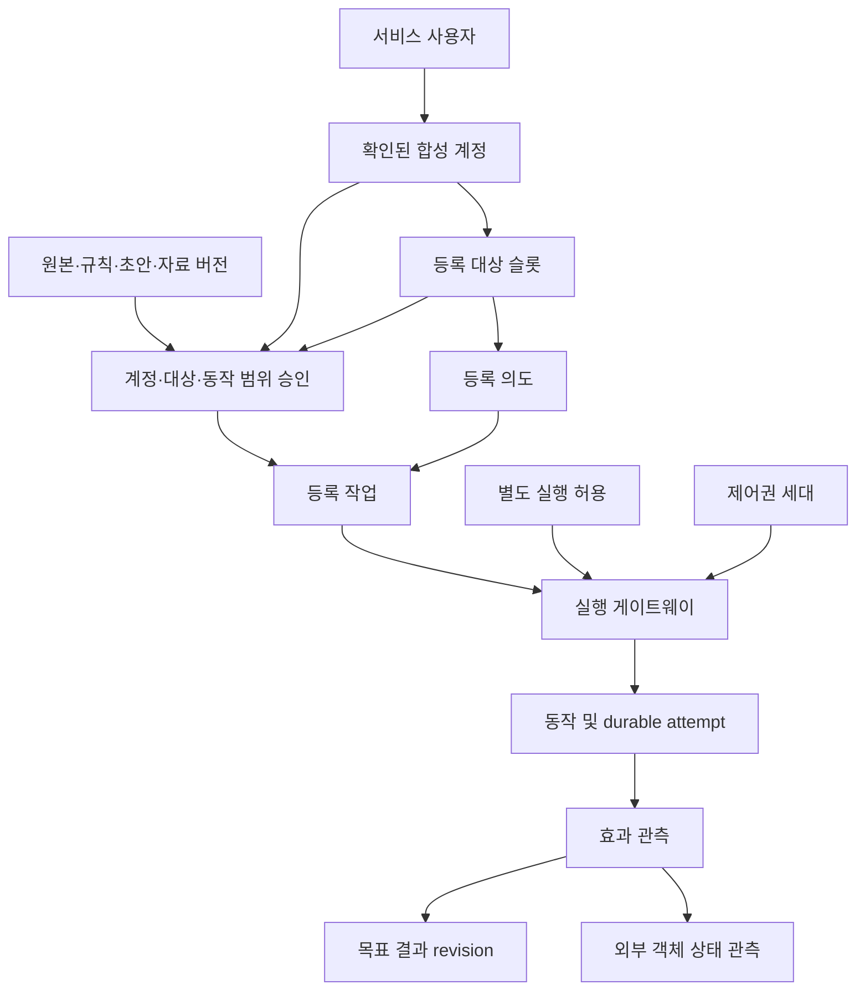

# V0.3 · 정합성 개선 계약

> 2026-11-24 · R01 검토 후보. V0.1/V0.2 보존. 명시적으로 수정한 계약만 V0.3 우선. 현 단계 합성 mock·loopback만, 실제 로그인·세션 수집·등록 금지. 제품·기술 채택 및 팀원 TASK 변경 아님.

[구조화 정본](core-contract-v0.3.json) · [데이터/API](DATA-API-V0.3.md) · [검토·결정](REVIEW-DECISIONS-V0.3.md)

## 업무 흐름

1. 원본·자료/규칙·초안 준비
2. 사용자 내용 검토
3. 합성 외부 계정 직접 인증
4. 계정 식별 및 대상/기존 효과 확인
5. 계정·대상·계획에 결합된 실행 승인
6. 작업 생성 및 제어권 인계
7. 각 동작 가드 및 실행
8. 증거·부분 효과·결과 표시
9. 필요 시 읽기 전용 재확인 및 명시 재개

## 보완 계약

### V3-R01 · 계정 특정 실행 승인

내용 검토와 실행 승인 분리. 원본·규칙·초안·자료 준비 후 사용자 직접 합성 인증, 신뢰된 어댑터가 안정적 계정 식별 근거 및 소유권을 확인하고 대상 슬롯/기존 객체를 확정한다. 표시명만으로 식별하지 않는다. 실행 승인은 사용자·계정·대상·목표·환경·계획/동작·버전·자료 지문을 모두 포함한다. 재인증에서 같은 계정인지 검사; 다른 계정/미확인이면 중단하고 기존 승인·작업 덮어쓰기 금지. 지금은 합성 식별자만.

기존 참조: E08, E09, E10, E14, U04, U05, RB03, I-02, I-03 / 결함: ISSUE-01 / 근거: S02, S03, S11

### V3-R02 · 대상 슬롯 및 동일 의도

대상 키는 environment,platform,account_ref,object_kind,slot_ref. 제목/가격/초안/작업 ID와 독립. 외부 객체 ID를 확인하면 계정·객체 종류와 함께 유일하게 슬롯에 결합. 서버가 신규 요청 전 기존 슬롯, 진행/미확인 효과를 확인하고 동일 create 완료는 결과 반환, 수정은 별도 승인 update. 다른 상품은 별개 슬롯·구별 근거·명시적 목적 필요. 동일성 불명 또는 같은 계정/종류의 미확인 생성과 구별 불가이면 보수적으로 신규 생성 차단. MVP 후보는 외부 계정 연결 소유자 1명, 타 사용자 존재 노출 금지.

기존 참조: E09, E10, A05, I-05, I-06 / 결함: ISSUE-02 / 근거: S03, S07, S12

### V3-R03 · 요청·동작·시도 식별

요청 idempotency_key는 owner+endpoint 범위, 요청 지문 같으면 이전 응답, 다르면 충돌. 새 키도 대상 검사. operation_ref는 논리 효과에 안정적으로 결합되어 새 job/plan으로 복제하지 않음. attempt_ref는 실제 시도 1회. 효과 확인/진행/미확인 시 같은 operation 재시도 금지. 효과 부재의 증거+명시 재개+현재 가드일 때만 새 attempt. 외부 exactly-once 보장하지 않음.

기존 참조: E10, E11, A05, A06, I-05 / 결함: ISSUE-02, ISSUE-04 / 근거: S05, S07

### V3-R04 · 동작별 효과

조회·폼 진입·입력·첨부도 외부 임시저장/객체/파일 생성 가능. 동작별 효과 분류, 허용 origin, 대상, 사전/사후조건, 승인 필드와 관측 기준 명세. unknown_effect는 차단. 비용·메시지·공개 변경·신원/정산 자동화는 이번 범위 밖. 실제 효과 미확인 시 합성 fixture 가설만 허용. 중간 효과는 취소로 사라지지 않음.

기존 참조: KF02, KF03, KF04, KF05, SF02, SF03, SF04, C03a, A06, I-03 / 결함: ISSUE-03, ISSUE-08 / 근거: S08, S09, S10

### V3-R05 · 단일 제어 게이트웨이와 철회

사용자 원격 입력 및 worker 명령의 단일 강제 게이트웨이 후보. worker에 우회 가능한 장기 CDP/VNC 권한 직접 노출 금지. 동일 직렬화 경계에서 가드·revision·lease generation 확인, 단일 permit 소비 및 durable attempt 기록; 이것이 내부 admission 선형화 지점. 취소/철회도 같은 경계에서 epoch 증가·lease/permit 회수·큐 취소; 이후 새 admission 금지. 이미 admission된 요청은 외부 실행 취소/rollback 보장 불가. 효과 확인 또는 unknown, 재실행 금지. 강제 수단·실제 경쟁 상태는 mock 시험 전.

기존 참조: E15, RB02, RB03, RB05, RB08, A06, A10, I-02, I-03 / 결함: ISSUE-04, ISSUE-10 / 근거: S02, S11

### V3-R06 · 상태·효과·중단·복구

job 상태와 개별 attempt 효과 상태 분리. 실행 중 취소/철회/인증 문제는 stopping, 새 admission 금지. pending 효과가 확인될 때까지 unknown 우선. 효과 없음 또는 안전한 중간 효과 확인 후 원인에 맞춰 cancelled/blocked/needs_action; 이미 목표 달성은 증거대로 완료. 이전 확인된 부분 효과는 남는다. unknown에서 단순 timeout/검색 실패/취소/새 ID로 효과 없음 간주 금지. 권한 있는 읽기 전용 재확인 후 안전한 다음 단계+명시 재개+가드 필요. crash 후 admission 기록 있고 결과 불명확이면 unknown.

기존 참조: J01, J02, J03, J04, J05, J06, J07, J08, J09, J10, J11, J12, J13, J14, ST03, ST05, ST07, A08, A09, I-05, I-06 / 결함: ISSUE-02, ISSUE-04, ISSUE-05 / 근거: S05, S07, S12

### V3-R07 · 작업 완료와 외부 객체 관측 분리

작업 목표(모의 접수/설정)·attempt 효과·외부 객체 상태(접수/심사/반려/공개) revision 분리. 접수 목표 완료를 후속 반려 때문에 실패로 덮어쓰지 않는다. 시간·대상·근거를 함께 append; stale/상충 증거로 최신 상태 자동 덮어쓰기 금지. 실제 target_confirmed는 현 단계 진입 금지. mock receipt/hash와 실제 증거 형태 구별. 효과 부재는 권위 있는 대상·동작 조회로 입증; 사용자 진술/timeout/검색 실패 단독 불충분.

기존 참조: E12, E13, P-K, P-S, KF06, SF05, ST06, U07, I-04, I-07 / 결함: ISSUE-05, ISSUE-06 / 근거: S07, S09, S10

### V3-R08 · 출처와 검증 상태 직교

origin_kind와 verification_state 독립. 파생값은 입력 fact_refs·식·단위 기록, 입력 확인·규칙·단위 동등성 검증 후 사용. 사실 변경은 새 원본 및 사용자 확인, 문구만 수정하면 새 초안. 가격/기간/분/횟수/VAT 독립. R02 최신 합성 25/40/50만원과 R03 30만원 고정 fixture 분리. 임의 반올림/무료 추가 조건 금지.

기존 참조: E03, F08, M01, M02, M03, FR-01, FR-02 / 결함: ISSUE-07 / 근거: S03, S04, S10

### V3-R09 · 필드별 규칙 버전

필수/선택/조건부/미확인, 조건·옵션·형식·단위·출처·확인일·신뢰·환경을 필드별 저장. 화면/효과/의미 있는 규칙 변화는 새 스냅샷 및 재승인, 미확인 규칙은 live 실행 금지. 크몽 단일 패키지·VAT·규격, 숨고 신규 가입·카테고리별 질문 및 실제 저장, 탈잉 단위·허용은 잔여 근거.

기존 참조: E05, E07, K01, K05, K07, K08, Sg03, Sg08, Tg03, M04, M05 / 결함: ISSUE-08 / 근거: S04, S08, S09, S10, S11

### V3-R10 · 논리 API와 소유권

별도 typed 데이터/API 계약 참조. owner/actor는 서비스 인증에서 도출; 외부 계정은 신뢰된 관측에서만. 초안/연결/대상 식별/실행 승인/작업/중단/재확인/명시 재개 분리. mutation에는 revision 또는 idempotency 검사. 읽기도 소유/권한 확인. 일반 응답/로그에 접속 비밀값 없음. HTTP/DB 물리 결정 미정.

기존 참조: A01, A02, A03, A04, A05, A06, A07, A08, A09, A10, A11 / 결함: ISSUE-01, ISSUE-09 / 근거: S03, S05, S12

### V3-R11 · 세션·보안·격리

합성 browser/context를 owner별 격리, mock origin 제한, view·worker 권한 분리, 단기 grant/세대 확인, VNC/CDP 외부 노출 금지. 로그인 중 worker/LLM 접근·기록 중단. 인증 확인은 합성 보호 페이지/안정 식별 marker. 사람에게 인계 전 worker 정지; 수동 변경 가능성은 readback/계정 확인 후 재개. 세션 만료/폐기와 작업 상태 분리, 폐기 실패는 격리·운영 기록. 실제 인증 정보/운영 TTL·보존·암호화 미확정.

기존 참조: SEC01, SEC02, SEC03, SEC04, SEC07, RB01, RB02, RB05, RB06, RB07, RB08 / 결함: ISSUE-10 / 근거: S02, S11

### V3-R12 · AI와 결정적 처리의 분리

LLM은 추출·문안·질문·예외 분석 후보만. 가격/단위/검증/권한/계정/중복/상태/판정은 결정적 코드. 알려진 화면은 승인된 adapter operation; 예상 외 화면은 중단하고 AI가 원인·대안을 제안할 수 있으나 승인 외 조작·새 URL·재시도 금지. 모델 없이도 합성 실행 검증 가능. 엔진 미채택.

기존 참조: C01a, C02a, C03a, C04a, C05a, SEC06, LR-AI / 결함: ISSUE-11 / 근거: S03, S05, S06

### V3-R13 · 가치 비교 계약

동일 원본/이미지/대상/목표/초기 상태/권한/품질에서 직접·범용 AI·전용 서비스 비교. 능동 시간은 자료/인증/검토/개입/결과 확인 합, 시스템 처리·심사 대기 별도. 오류·수정·개입·완료·비용·지불 의향 기록, 실패도 포함. 세 플랫폼 20~30분은 희망치, 단일 mock과 직접 비교 금지.

기존 참조: LR-VALUE, LR-T10, VT10, G5 / 결함: ISSUE-12 / 근거: S03, S07, S13

### V3-R14 · 정본과 기계 검증

교정 계약의 ID/참조 배열, typed 필드, 가드·전이·시험·결정 의존성을 구조화하고 재현 가능한 검사 결과 저장. 기존 V0.1/V0.2 전체 의미/제품 안전성 검증으로 확대하지 않음. 팀원 TASK/공통 시험 변경 없음.

기존 참조: LR-T11, VT11, G4 / 결함: ISSUE-13 / 근거: S01, S12

## 대상·승인·실행 관계

## 부작용 분류

| 효과 | 범위 | 설명 |
| --- | --- | --- |
| read_only | conditional | 실제 효과 없음·읽기 권한 확인 |
| local_only | allowed | 외부 자동 저장 없음 확인 |
| remote_draft_write | mock_only | 임시저장/등록 화면 진입 효과 |
| remote_asset_write | mock_only | 파일 업로드 및 잔존 확인 |
| remote_object_create | mock_only | 신규 서비스/카테고리 |
| remote_object_update | mock_only | 설정 변경 |
| remote_submit | mock_only | 심사 접수 |
| remote_public_change | out | 공개 설정 변경 |
| cost_or_message | out | 결제/견적/메시지 |
| identity_or_payment | out | 신원 인증/정산 대행 |
| unknown_effect | blocked | 효과 확인 전 차단 |

## 동작 가드

| ID | 조건 | 설명 |
| --- | --- | --- |
| V3-G01 | mock_environment | 합성 mock 환경 |
| V3-G02 | owner_verified | 소유자 확인 |
| V3-G03 | account_verified_same | 승인 계정과 실제 확인 계정 일치 |
| V3-G04 | approval_current | 승인 범위/버전/철회 검사 |
| V3-G05 | permission_current | 운영 허용 및 동작 범위 검사 |
| V3-G06 | target_resolved | 대상 및 기존 의도 확인 |
| V3-G07 | no_unresolved_effect | 미확인/구별 불가 효과 없음 |
| V3-G08 | operation_allowed | 승인된 동작·효과, out/unknown 제외 |
| V3-G09 | before_state_verified | 사전 상태·규칙·자료 대조 |
| V3-G10 | lease_current_exclusive | 현재 제어권·세대 일치 |
| V3-G11 | revision_current | 작업/권한/승인 revision |
| V3-G12 | operation_not_already_effective | 이미 효과/진행 없음; 재시도면 부재 증거 및 명시 재개 |
| V3-G13 | not_stopping | 중단/철회 pending 없음 |

단일 내부 admission 경계; 외부 서버와 원자성 보장 없음. 외부 부작용의 실제 취소나 exactly-once를 보장하지 않는다.

## 상태 전이 (V0.1 J01~J14 교정)

| ID | From | Event | To | 가드 (모두 참) | 의미 |
| --- | --- | --- | --- | --- | --- |
| V3-J01 | planned, ready, needs_action, blocked, failed | permission_blocked | blocked | no_pending_effect | 신규 동작 차단 |
| V3-J02 | planned, ready, needs_action, blocked, failed | confirmation_needed | needs_action | no_pending_effect | 인증/사실/승인 확인 |
| V3-J03 | planned, needs_action, blocked | all_preconditions_met | ready | mock_environment, owner_verified, account_verified_same, approval_current, permission_current, target_resolved, no_unresolved_effect, operation_allowed, before_state_verified, lease_current_exclusive, revision_current, operation_not_already_effective, not_stopping | 재개 시 명시 요청 추가 확인 |
| V3-J04 | ready | dispatch_admitted | running | mock_environment, owner_verified, account_verified_same, approval_current, permission_current, target_resolved, no_unresolved_effect, operation_allowed, before_state_verified, lease_current_exclusive, revision_current, operation_not_already_effective, not_stopping | durable attempt 및 permit 소비 |
| V3-J05 | running | intermediate_verified | ready | intermediate_verified, no_pending_effect, not_stopping | 다음 별개 동작 |
| V3-J06 | running | action_required | needs_action | no_pending_effect | 확인된 부분 효과 유지 |
| V3-J07 | running | definite_failure | failed | effect_absent, no_pending_effect | 해당 효과 없음 증거 |
| V3-J08 | running, stopping | effect_uncertain | unknown | pending_or_unresolved_effect | 재실행 차단 |
| V3-J09 | running, stopping, unknown | mock_goal_verified | mock_completed | mock_environment, goal_evidence_valid, no_pending_effect | 확인된 목표 기록; 취소 요청이 있어도 효과 은폐 금지 |
| V3-J10 | unknown | reconcile_inconclusive | unknown | 없음 | 차단 유지 |
| V3-J11 | unknown, failed | safe_recovery_identified | needs_action | safe_next_step_proven, no_pending_effect, not_cancelled_or_policy_revoked | 명시 재개 필요 |
| V3-J12 | planned, ready, needs_action, blocked, failed | cancel_requested | cancelled | no_pending_effect | 부분 효과 보존 |
| V3-J13 | running | stop_requested | stopping | 없음 | 새 admission 금지, 효과 확인 |
| V3-J14 | stopping | stop_resolved_cancel | cancelled | no_pending_effect, goal_not_reached, stop_is_cancel | rollback 아님 |
| V3-J15 | stopping | stop_resolved_policy | blocked | no_pending_effect, goal_not_reached, stop_is_policy | 철회/권한/규칙 변화 |
| V3-J16 | stopping | stop_resolved_human | needs_action | no_pending_effect, goal_not_reached, stop_needs_human | 재인증/개입 |
| V3-J17 | unknown | cancel_or_revoke_requested | unknown | 없음 | 중단 사유 기록, 불명확성 유지 |
| V3-J18 | unknown | reconcile_cancel_resolved | cancelled | no_pending_effect, goal_not_reached, stop_is_cancel | 확인 후 취소 |
| V3-J19 | unknown | reconcile_policy_resolved | blocked | no_pending_effect, goal_not_reached, stop_is_policy | 확인 후 차단 |

초기 planned. target_confirmed 진입 금지. mock_completed/cancelled에서는 새 mutation 없음. 이전 부분 효과는 취소로 사라지지 않으며 후속 외부 상태는 별도 관측 기록.

| 개별 효과 From | Event | To |
| --- | --- | --- |
| not_dispatched | permit_consumed | admitted |
| admitted | absence_proven | effect_absent |
| admitted | effect_proven | effect_confirmed |
| admitted | lost_or_ambiguous | effect_unknown |
| effect_unknown | absence_proven | effect_absent |
| effect_unknown | effect_proven | effect_confirmed |
| effect_unknown | inconclusive | effect_unknown |

## 플랫폼별 완료 증거

| ID | 대상·목표 | 모의 증거 | 필수 확인 | 실제 후보/한계 |
| --- | --- | --- | --- | --- |
| V3-P01 | kmong.service_listing / mock_listing_receipt | mock_receipt | account_matches, target_matches, operation_matches, receipt_retrieved, approved_fields_match, approved_assets_match, independent_readback, no_conflict | 상품 ID/관리 목록/심사 접수 증거. 실제 제공 여부 및 이미지 hash 미확인. |
| V3-P02 | soomgo.service_configuration / mock_service_configuration_saved | mock_settings_readback | account_matches, target_matches, operation_matches, category_matches, approved_fields_match, independent_readback, no_conflict | 동일 계정 서비스 목록/카테고리 설정 재열기. 신규 가입/공개/검색/견적 별개, 실제 미확인. |

- 탈잉 확장 조사 후보, 이번 실행/시험 제외.
- 숨고 서비스 질문지의 사진 필수성 미확인. 공통 T1의 이미지 조건은 별도 객체/fixture 가설로 R03/R04 협의; 이번 설계는 계약 변경 없음.
- 실제 플랫폼 상태 후속 관측은 작업 완료와 별도 revision.
