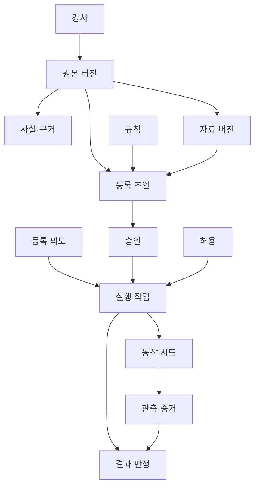
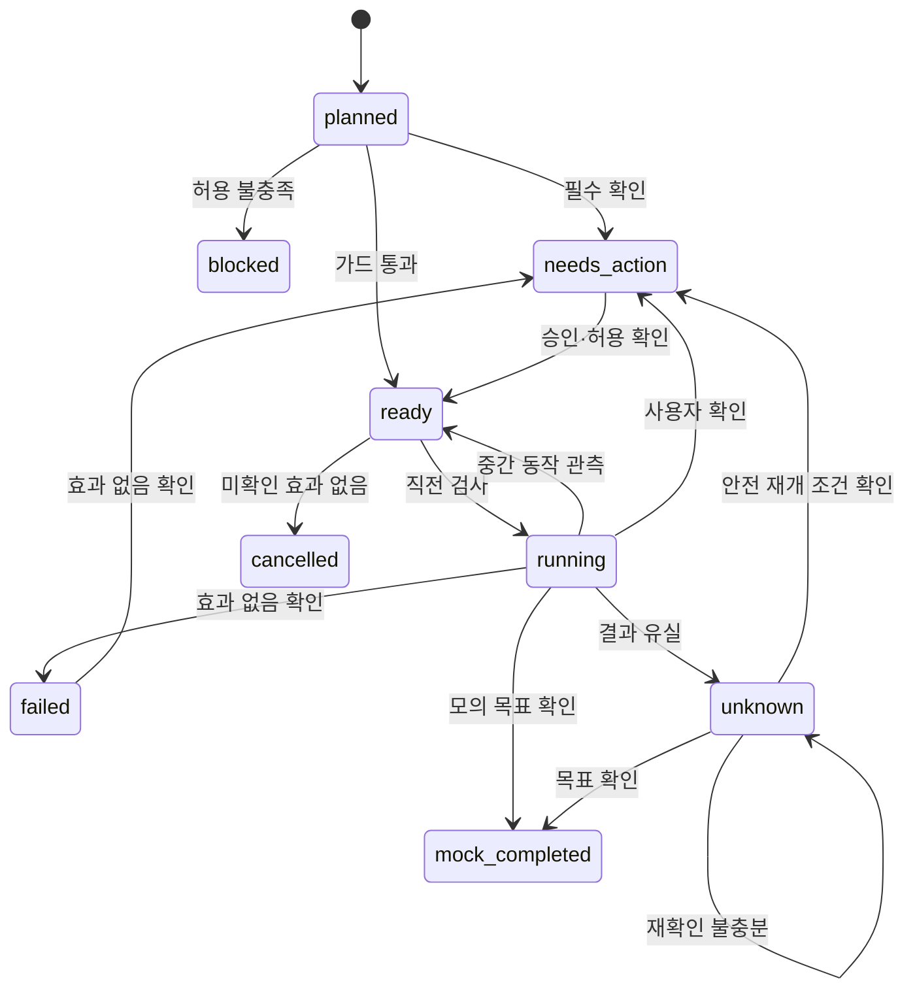

# L3/L5 · 도메인·논리 데이터·상태 전이

> 2026-11-24 · R01 검토용 논리 설계 V0.1. 최종 제품 채택·본 구현·실서비스 실행 승인 아님. 기존 기획 V1.1과 현재 모의 PoC 범위를 유지.

[구조화 정본 후보](domain-workflow-v0.1.json)

## 업무 불변식

| ID | 규칙 | 관련 요구 |
| --- | --- | --- |
| I-01 | 값·단위·출처·확인 상태 유지. 누락/충돌 임의 확정 금지 | FR-01, FR-02 |
| I-02 | 승인은 사용자·source/draft/rule/media 버전·대상/목표·환경·actions에 결합. 변경/철회 시 신규 동작에 재사용 금지 | FR-03 |
| I-03 | 부작용 직전 승인·권한·환경·대상 검사; 현재 live 차단; 사용자 승인≠운영사 허용 | FR-03, FR-04 |
| I-04 | 작업 생성·클릭·송신은 목표 완료가 아님. 대상·환경·목표에 해당하는 관측 근거 필요 | FR-05 |
| I-05 | 효과 가능·증거 부족/상충이면 unknown; 같은 의도의 부작용 반복 차단. 취소/새 ID로 우회 금지 | FR-05, FR-06 |
| I-06 | 기존 효과 확인 시 상태만 갱신; 효과 부재 또는 안전한 다음 단계 확인 + 현재 승인·허용 + 명시 재개 후 별도 실행 | FR-06 |
| I-07 | 플랫폼·객체·의도별 승인/실행/결과 독립; 타 작업 상태 덮어쓰기 금지 | FR-05, FR-06 |
| I-08 | 외부 자격증명·세션·무허용 자료 금지. 시도/관측/판정 이력을 혼합하거나 근거 없이 덮어쓰지 않음 | FR-03, FR-05, FR-06 |
| I-09 | 크몽 상품 심사 접수 후보 유지; 숨고 실제 객체/완료 미확인; 모의와 실제 목표 분리 | FR-02, FR-04, FR-05 |

## 논리 데이터 (DBMS·물리 스키마 미정)

| 업무 개념 | 논리 식별 | 의미 |
| --- | --- | --- |
| Instructor | instructor_ref | 소유·승인 주체; 외부 계정 비밀번호 아님 |
| LessonSourceVersion | source_ref+source_version | 원문·조건·출처·확인 시점·버전 |
| Fact | fact_ref | 항목·값·단위·출처·확인 상태; 패키지별 분/월 횟수/월 총액; 누락/충돌 구분 |
| MediaAssetVersion | asset_ref+asset_version | 합성/실자료·권리·참조·확인 범위; 저장 위치 미정 |
| PlatformRuleSnapshot | platform+object_kind+rule_version | 필수 필드·단위·제약·목표 증거·출처·확인 상태; 허용과 별개 |
| ExecutionPermission | permission_ref+revision | 환경·대상·허용 동작·근거·상태; mock/live 분리 |
| RegistrationDraftVersion | draft_ref+draft_version | 원본/규칙/자료 버전, 대상/목표, 매핑 값·fact_ref·규칙·이슈 |
| Approval | approval_ref | 사용자·원본/초안/규칙/자료 버전·대상/목표·환경·actions·승인/철회 |
| RegistrationIntent | intent_ref | 동일 사용자·대상·목표 등록 의도; unknown 회피 신규 ID 금지 |
| RegistrationJob | job_ref | 의도/승인/허용 참조·환경·작업 상태·마지막 관측 |
| ExecutionAttempt | attempt_ref | 작업·동작·승인/허용 스냅샷·시각/순서·오류 |
| ObservationEvidence | evidence_ref | 작업/시도·대상·환경·관측 시각/항목·출처·근거·확인 수준 |
| RegistrationResult | job_ref+result_revision | 목표/관측 단계·판정·근거·차단 사유·다음 조치; 판정 이력 |

- Instructor 1:N LessonSourceVersion
- LessonSourceVersion 1:N Fact
- LessonSourceVersion N:M MediaAssetVersion
- RegistrationDraftVersion N:1 LessonSourceVersion + N:1 PlatformRuleSnapshot
- RegistrationDraftVersion N:M MediaAssetVersion
- RegistrationDraftVersion 1:N Approval
- RegistrationIntent 1:N RegistrationJob (기존 효과/미확인 검사 전 추가 실행 금지)
- RegistrationJob N:1 Approval + N:1 ExecutionPermission
- RegistrationJob 1:N ExecutionAttempt
- RegistrationJob 1:N ObservationEvidence
- ExecutionAttempt 0:N ObservationEvidence
- RegistrationJob 1:N RegistrationResult

## 상태 계약

초안·실행 작업·플랫폼 관측 단계는 독립된 의미다.

| 초안 | 의미 |
| --- | --- |
| draft | 작성 중 |
| needs_confirmation | 필수 정보/규칙/권리 확인 필요 |
| ready_for_review | 검토 가능 |
| approved_for_scope | 정확한 스냅샷·동작 범위 승인 |
| superseded | 새 버전으로 대체, 이전 증거 보존 |

| 작업 | 의미 |
| --- | --- |
| planned | 작업 의도 생성 |
| blocked | 허용/단계 불충족 |
| ready | 동작 가드 충족 |
| running | 동작 시도/관측 |
| needs_action | 사용자 확인·승인 등 필요 |
| failed | 실패 확인, 해당 동작의 미확인 효과 없음 |
| unknown | 효과 가능·결과 미확인; 반복 차단 |
| mock_completed | 모의 목표 확인; 실제 완료 아님 |
| target_confirmed | 향후 실제 목표 증거 확인; 현 단계 금지 |
| cancelled | 추가 조작 중단; 미확인 효과는 unknown 유지 |

| 관측 | 의미 |
| --- | --- |
| none | 관측 없음 |
| input_verified | 필드/첨부 확인 |
| submit_attempted | 제출 시도; 접수 아님 |
| receipt_confirmed | 접수 증거 |
| under_review | 심사 중 |
| rejected | 반려 |
| published | 공개 증거 |
| platform_specific | 객체별 관측 단계; 미확인 가능 |

상세 전이 (현 단계 실제 목표 확인 금지):

| ID | From → To | 가드 | 효과 |
| --- | --- | --- | --- |
| J01 | planned → blocked | 현재 live/허용 미확인 | 실행 0 |
| J02 | planned → needs_action | 승인/사실/자료/규칙 누락 | 확인 요청, 실행 0 |
| J03 | planned, needs_action, blocked → ready | 유효 승인·허용·대상·환경 일치 및 미확인/중복 위험 없음; live 차단 | 스냅샷 연결 |
| J04 | ready → running | 직전 가드 및 동일 의도 기존 효과 확인 | 시도 기록 후 승인 동작 1개 |
| J05 | ready, running → needs_action | 추가 확인 필요, 이전 효과 불명확하지 않음 | 추가 조작 차단 |
| J06 | running → ready | 중간 동작 관측 확인, 목표 미달, 다음 동작 가드 별도 | 근거 기록 |
| J07 | running → failed | 실패 관측·해당 동작 효과 없음 확인 | 오류·마지막 단계 보존 |
| J08 | running → unknown | 효과 가능, 증거 부족/상충 | retry_blocked=true |
| J09 | running, unknown → mock_completed | mock 대상/목표 관측 증거 | 모의 성공만 표시 |
| J10 | running, unknown → target_confirmed | 향후 live 운영사 허용/R01 승인 및 실제 목표 증거; 현 단계 금지 | 접수/공개 구분 |
| J11 | unknown → unknown | 안전 조회/사용자 증거 불충분 | 차단 유지 |
| J12 | unknown, failed → needs_action | 효과 없음 또는 안전한 다음 단계의 증거 확보 | 명시 재개 및 승인/허용 재검사 |
| J13 | planned, ready, needs_action, blocked → cancelled | 미확인 효과 없음, 중단 요청 | 이전 기록 보존 |
| J14 | running → unknown | 취소/철회 중 이미 시도한 효과 확인 불가 | 추가 조작 중지·차단 유지 |

## 플랫폼별 완료 목표

| 플랫폼 | 객체 | 실제 목표 후보 | 상태 |
| --- | --- | --- | --- |
| kmong | 레슨 서비스 상품 | 심사 접수 확인 | 미확인·현 단계 차단 |
| soomgo | 미확인 | 미확인 | 미확인·현 단계 차단; R04 객체 확인 전 가설, 종료 마켓/견적 혼동 금지 |
| taling | 클래스(비교 후보) | 심사 접수 후보 | 미확인·이번 PoC 제외 |

R03의 mock_success와 논리 mock_completed, needs_confirmation과 needs_action은 의미 연결 후보이며 시험 계약 자체를 바꾸지 않는다.
