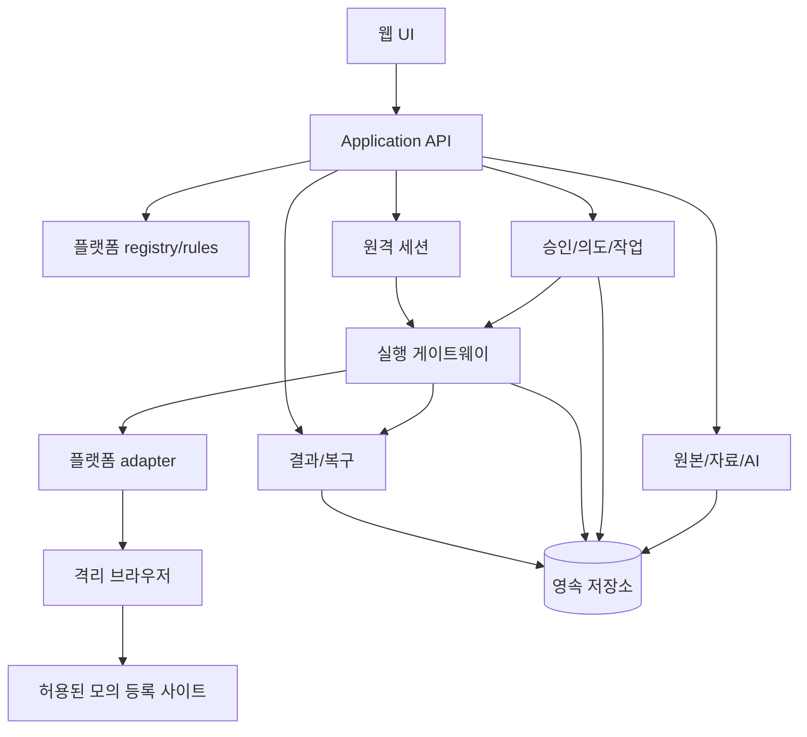

# V0.4 · 본 구현 기준선 후보

> DIR-01~04의 R01 결정은 확정. 아래 상세 인터페이스/일정/배정은 결정에 부합하는 구현 기준선 후보이며 현재 TASK의 변경·실행 지시가 아님.

현 PHASE-20261124-02 mock-only 유지. 실제 플랫폼의 접근·인증·등록은 운영사 허용, 사용자 동의, 보안 검증 및 R01 단계 승인 이후 별도. 목표는 등록 가능한 플랫폼에서 최초 등록이며 범용 미지원 URL 자동 적응을 요구하지 않음.

## 1. 요구사항 및 수용 조건

| ID | 요구 | MVP | 최종 | 수용 조건 |
| --- | --- | --- | --- | --- |
| REQ-01 | 원본·필수 정보·자료 준비 | required | required | 사용자 확인된 사실/이미지와 출처·버전, 누락/충돌 질문. 합성 90/180/270분 월4회 25/40/50만원을 변경하지 않음. |
| REQ-02 | 등록 대상 식별 | 지원 플랫폼 선택 및 등록 경로 결정 | URL로 지원 플랫폼/경로 선택 | 등록 가능한 대상 registry에 연결, 미지원/잘못된/권한 미확인 URL은 차단/안내, 임의 URL 요청 수행 금지. |
| REQ-03 | 플랫폼별 변환·검토 | required | required | 사실/단위 유지, LLM 제안과 확인값 구분, 필수 규칙/조건/권리 검사 및 확인 필요 항목 노출. AI 또는 확인된 대체 입력으로 모의 경로 가능; AI 기능 시연 별도. |
| REQ-04 | 원격 직접 인증·제어권 인계 | required | required | 일반 브라우저에서 합성 인증, 동일 세션 서버 인계, 사용자/worker 상호배타, 뷰어 종료 후 계속. 세션 폐기·타 계정 거부. 기술 내부는 위임. |
| REQ-05 | 실행 대상·승인·권한 | required | required | 계정/대상/버전/동작/환경 승인 및 운영 허용 별도, 가드 미충족이면 동작 0, 동일 효과 차단. |
| REQ-06 | 크몽 최초 등록 | first_required | required_if_supported | 크몽형 합성 상품 1건, 필드·이미지·가격 입력과 모의 심사 접수 후 독립 receipt 재조회 일치. 실제 심사 접수/공개 구별. |
| REQ-07 | 숨고 최초 등록 확장 | second_planned | required_if_supported | 숨고형 기존 합성 고수의 서비스 카테고리 및 문항 설정 저장 후 다시 조회 일치. 객체 후보이며 신규 고수·프로필·공개는 별도 결정; 12/8 통합 목표, 미충족시 R01 재계획. |
| REQ-08 | 결과·부분 효과·실패·재개 | required | required | 대상별 모의 완료/실패/차단/확인 필요/미확인 표시, 증거·다음 조치. 응답 유실 후 중복 없음, 읽기 재확인+명시 재개. 접수와 공개 분리. |
| REQ-09 | 플랫폼 확장 | registry+두 adapter 포트 | 지원 가능 플랫폼 확대 구조 | 지원 플랫폼/경로 추가는 registry·규칙·adapter·시험 단위. 공통 job/approval/DB/UI 계약 변경 최소화; 최종 지원 목록은 허용/일정/검증으로 확정. 신규 미지원 자동 적응 불필요. |
| REQ-10 | 격리·개인정보·안전한 운영 | mock 최소 보안 | 운영 허용 시 강화 검증 | owner 격리, mock/live 서버 정책 차단, login 입력/비밀 미기록, 승인 자료만, 세션 만료·폐기, 실제 배포 보안과 권한 검증 전 live 불가. |
| REQ-11 | 재현성과 서비스 가치 | 재현 가능한 통합 시연 | 비교 평가·최종 증거 | 고정 fixture/버전/환경/실행 결과, 실패 포함. 능동 시간/시스템/심사대기·오류·비용 분리. 20~30분 희망치, 측정 전 성공 주장 금지. |

## 2. 시스템 구성 및 책임

| ID | 컴포넌트 | 단위 | 책임 | 입력 | 출력 | 의존 |
| --- | --- | --- | --- | --- | --- | --- |
| C4-01 | 웹 UI | web | 원본·URL·검토·원격 인증·결과 화면, 사용자 결정만 전달 | 사용자 입력·API 상태 | API 요청·사용자 표시 | C4-02 |
| C4-02 | Application API | app | 우리 서비스 인증·owner·입력/응답·revision 검사 | HTTP/인증 주체 | 도메인 호출/정규 상태 | C4-03, C4-04, C4-05, C4-06, C4-07, C4-10 |
| C4-03 | Source/Media/AI preparation | app | 원본 버전·fact/권리·구조화/문구·질문·파생 이미지; 모델은 제안 | source/media/target rule | draft·mapping·issues | C4-04, C4-10 |
| C4-04 | Platform registry & rules | app | URL 정규화, 지원 경로/규칙 버전/adapter 등록, 목적·효과/증거 사양 | URL/플랫폼/환경 | TargetCandidate·rule snapshot·eligibility | C4-10 |
| C4-05 | Approval/Intent/Job coordinator | app | 계정/대상/버전 결합, 슬롯·멱등·승인·권한 검사, 작업 계획 및 중단 | draft, target, account, policy | job/approved plan/state | C4-04, C4-10 |
| C4-06 | Remote session boundary | remote_runtime | 사용자 인증용 뷰어, 계정 관측, 제어권·세션 lifecycle; 원격 기술 위임 | owner/target candidate/control request | opaque connection/identity/lease; view grant | C4-10 |
| C4-07 | Execution gateway & worker | remote_runtime | 승인/대상/lease/효과 원자 admission, 단일 operation, stop/fencing; gateway 안에서만 브라우저 조작 | approved job/plan/current state | attempt/observations/stop acknowledgement | C4-05, C4-06, C4-08, C4-10 |
| C4-08 | Platform adapters | remote_runtime | 대상별 사전조건·필드/동작·저장·readback·결과 후보; 원시 브라우저 권한 외부 노출 금지 | rule/approved operation/restricted browser port | observations/effect verdict candidate | C4-04 |
| C4-09 | Result/reconcile | app | 증거 검증·작업/효과/객체 상태 분리·read-only 재확인 | attempt/evidence/target goal | result revision/next action | C4-04, C4-05, C4-10 |
| C4-10 | Persistence/audit | store | owner-scoped 영속 데이터·버전·원자 guard/attempt·증거 기록; 비밀값 제외 | domain data/atomic commands | durable record/revision |  |
| C4-11 | Mock & verification harness | test | R03 기존 공통 계약 및 합성 사이트, 고정 fixture·오류 주입·재현 기록 | public contract/fixture | test observations |  |

## 3. 구현자 간 포트

| ID | 동작 | 호출→제공 | 입력 | 출력 | 조건 |
| --- | --- | --- | --- | --- | --- |
| PORT-01 | resolve_url / get_rule | C4-02 → C4-04 | raw_url, environment, goal | TargetCandidate or unsupported/blocked; rule_version | 정적 registry host/path 규칙, URL만으로 네트워크 fetch 안 함; mock URL은 별도 고정 매핑. 등록 URL/홈 URL 둘 다 허용 여부 명시. |
| PORT-02 | prepare / validate draft | C4-02 → C4-03 | source_version, rule_version, media | draft_version/mappings/issues/digest | AI 제안과 사실/검증 상태 구분; 원본 수정/재승인. |
| PORT-03 | open / verify / handoff / close | C4-02 → C4-06 | owner, target, environment, connection_ref, expected_generation | opaque connection, verified account, controller/generation, state | 사람 인증 중 자동화/모델 접근 금지; 뷰어 별도 단기 grant, 동일 인증 맥락, 원시 비밀 미노출. |
| PORT-04 | plan / preflight | C4-05 → C4-08 | rule_version, draft_version, target, goal | immutable operation plan, required fields, effect classes, evidence specs | 순수 계획 단계에서 실제 외부 효과 없음; 미확인 동작은 차단; 생성/변경 구분. |
| PORT-05 | admit / execute / observe | C4-05 → C4-07 | job_ref, operation_ref, expected_revision, lease_generation, approved digest | attempt + typed observations | V3-G01~13 검사, permit 소비/기록 원자화, 기존 효과 미확인 차단. gateway 안의 adapter만 브라우저 명령 수행. |
| PORT-06 | read-only reconcile | C4-09 → C4-07 | job_ref, target, evidence spec, current auth/permission | observations or inconclusive | 읽기 권한·동일 계정·대상·lease 필요; 자동 저장 등 효과 불명 조회 금지. |
| PORT-07 | atomic store | C4-05 → C4-10 | intent/slot, job/revision, approval/permission/lease epoch | accepted or conflict; durable attempt | single writer admission; 외부 요청과 DB는 하나의 원자 트랜잭션 아님. |
| PORT-08 | result projections | C4-02 → C4-09 | owner, job_ref, after_revision | Result, ObjectObservation | 실행/효과/외부 객체 상태 독립; unknown 유지. 읽기 전용. |

## 4. 업무 흐름

### FLOW-01 최초 등록 정상

1. UI→API 원본·자료 저장
2. 대상 선택/URL resolve→rule→draft 제안/확인
3. 원격 세션 생성→사용자 직접 합성 인증→읽기 전용 identity 확인
4. 대상 슬롯/기존 효과 resolve→immutable plan→사용자 실행 승인
5. job 생성→worker lease 인계→guard/admit→adapter 단계 실행·관측
6. 독립 readback→결과 revision→뷰어 반환/세션 종료

### FLOW-02 추가 확인·인증

1. 누락/충돌/규칙 변경은 실행 전 needs_action
2. 작업 중 추가 인증/예외는 stopping, pending 효과 확인
3. worker 제어 회수 후 사용자 직접 조작; 새 계정이면 차단
4. 원본/초안/계획 변경은 재승인; 동일 계정·유효 승인·safe next step에서 명시 재개

### FLOW-03 취소/장애/unknown

1. 승인 철회·취소→같은 admission 경계에서 epoch/lease 회수
2. 이미 허가된 요청의 효과 확인, 부분 효과 보존
3. 응답 유실/crash/효과 불명은 unknown, 동작 재발급 금지
4. 권한 있는 read-only 관측으로 효과 증명; 성공/안전 단계/불명확 구분
5. 새 mutation은 명시 재개+전체 가드 통과

### FLOW-04 URL 기반 플랫폼 확장

1. URL parse 및 등록된 host/path/environment 매칭(네트워크 불필요)
2. 지원 registry/rule/adapter revision 및 허용 확인
3. 필요 데이터·인증/업무 준비도 판정
4. 기존 FLOW-01~03 재사용
5. 미지원은 명시 안내, 신규 플랫폼은 registry/rules/adapter/증거/테스트 추가 후 검토

## 5. 플랫폼

| ID | 대상 | 우선순위 | 기존 명세 | 목표 | 미확인 |
| --- | --- | --- | --- | --- | --- |
| PLAT-K | kmong.service_listing | mvp_first | V0.2 K01~K10 / KF01~KF06 | mock_listing_receipt | 단일 패키지 토글·VAT·지원 시간/기간·이미지 규격·실제 접수/권한 |
| PLAT-S | soomgo.service_configuration | mvp_second | V0.2 Sg01~Sg09 / SF01~SF06 | mock_service_configuration_saved | 신규 고수 가입, 실제 대상/저장/공개, 카테고리별 규칙; R04 확인 |
| PLAT-T | taling.class | optional_after_mvp | V0.2 Tg01~Tg04 / 후속 설계 | 후속 | 시간 단위 충돌·정책·정산; 일정/허용 전 구현 강제 없음 |

## 6. 배포 및 결정

| ID | 단위 | 초기 선택 | 제약 |
| --- | --- | --- | --- |
| DEP-01 | web+app | 동일 origin의 단순 웹 UI 및 Python/FastAPI 모듈형 앱을 초기 통합 후보. R03/R05 코드 적합 근거. 프론트 내부 구현은 HTML/JS 또는 React 중 담당이 공수에 따라 선정; HTTP 계약 고정. | 별도 microservice/분산 agent 강제 안 함. 공통 dependency 변경은 R01 합의. |
| DEP-02 | store | 관계형 저장소 + 권리 확인 asset store. PostgreSQL 후보, 로컬 단일 프로세스 SQLite는 스키마/원자 제약 시험을 충족할 때 개발 대안. 실제 DB 선정은 공통 담당 검토 후. | 영속 상태·유일성·원자 admission, owner scope, 비밀값 제외. |
| DEP-03 | remote_runtime | 앱과 논리적 분리된 격리 실행 영역; R05 PoC 재사용 검토. 화면 전송, 브라우저, 컨테이너/프로세스 방식은 구현자 선택. | gateway 우회 불가, 사용자별 세션/자원 격리, 임시 프로필 폐기, viewer disconnect와 job 독립. 운영 강제 격리 검증. |
| DEP-04 | test | loopback isolated synthetic mock; R03 T1~T6 계약 유지. CI에서 unit/contract/test fixture, 통합은 isolated browser 환경. 제품 구현 경로 예시 product/lesson-registration/ (아직 생성/채택 안 함). | 실서비스 DNS/외부 호출 금지, 실제 계정/자료 금지. |
| DEP-05 | release | 개발/시연/운영 환경 분리. 운영은 TLS, 서비스 인증, 접근제어, egress 제한, 보존/삭제, 로그 마스킹, 백업/복구, 브라우저 자원 제한. 이미지 저장소와 DB는 내부망. | 실제 사이트 사용 가능 여부는 별도 release gate. 실제 계정 세션 및 비밀 기록 금지; 입력 중계는 민감 처리 경계. |

| ID | 상태 | 결정 |
| --- | --- | --- |
| B4-01 | decided | DIR-01~04 채택: 원격 브라우저, 구현자 세부 기술, 크몽→숨고, URL 지원 플랫폼 최초 등록. |
| B4-02 | proposed | 모듈형 앱 + 논리적으로 분리된 remote runtime, 하나의 영속 데이터 정본. 초기 지원은 플랫폼별 순차 job. |
| B4-03 | delegated | CDP/noVNC/WebRTC, 자동화 엔진/브라우저/원격 격리 구체 구현; 명시 계약/시험·보안 준수. |
| B4-04 | proposed | 공통 Python/FastAPI/관계형 DB 및 동일-origin UI 초기 기준. 구현자 검토·변경 조건 기록, 특정 프론트/DB 강제 전 검토. |
| B4-05 | external_gate | 실환경 정책/권한·계정 안정 식별·실제 효과/증거·운영 보안·비용/가치. 모의 성공과 실서비스 완료 구분. |
| B4-06 | conditional | 숨고 실제 등록 객체·완료 정의, 12/8 두 번째 경로 범위 및 1/4 지원 플랫폼 목록은 기존 조사/통합 결과로 R01 검토. 범위 축소는 명시 결정. |

## 7. 원출처 고정

- SRC-01 [docs/artifacts/design/lesson-registration-20261124/direction-v0.4.json](https://github.com/ik-e/chaja-you/blob/8d381ebcf7383a341bc148945317ec546ae87981/docs/artifacts/design/lesson-registration-20261124/direction-v0.4.json)
- SRC-02 [docs/artifacts/design/lesson-registration-20261124/core-contract-v0.3.json](https://github.com/ik-e/chaja-you/blob/8d381ebcf7383a341bc148945317ec546ae87981/docs/artifacts/design/lesson-registration-20261124/core-contract-v0.3.json)
- SRC-03 [docs/artifacts/design/lesson-registration-20261124/data-api-v0.3.json](https://github.com/ik-e/chaja-you/blob/8d381ebcf7383a341bc148945317ec546ae87981/docs/artifacts/design/lesson-registration-20261124/data-api-v0.3.json)
- SRC-04 [docs/artifacts/design/lesson-registration-20261124/DETAIL-PLATFORM-FLOWS-V0.2.md](https://github.com/ik-e/chaja-you/blob/8d381ebcf7383a341bc148945317ec546ae87981/docs/artifacts/design/lesson-registration-20261124/DETAIL-PLATFORM-FLOWS-V0.2.md)
- SRC-05 [docs/members/R02/workspace/2026-11-23_lesson-pain-priority.md](https://github.com/ik-e/chaja-you/blob/b220a6e6777928ab81c8a0852608b83f3838ff47/docs/members/R02/workspace/2026-11-23_lesson-pain-priority.md)
- SRC-06 [docs/members/R03/workspace/test/SPEC.md](https://github.com/ik-e/chaja-you/blob/b220a6e6777928ab81c8a0852608b83f3838ff47/docs/members/R03/workspace/test/SPEC.md)
- SRC-07 [docs/members/R04/workspace/2026-11-24_숨고_고수등록_교육신청_사용자흐름_서비스절차_설계분석보고서.md](https://github.com/ik-e/chaja-you/blob/926b5de7678f8984be035409d386c6347d749f56/docs/members/R04/workspace/2026-11-24_%EC%88%A8%EA%B3%A0_%EA%B3%A0%EC%88%98%EB%93%B1%EB%A1%9D_%EA%B5%90%EC%9C%A1%EC%8B%A0%EC%B2%AD_%EC%82%AC%EC%9A%A9%EC%9E%90%ED%9D%90%EB%A6%84_%EC%84%9C%EB%B9%84%EC%8A%A4%EC%A0%88%EC%B0%A8_%EC%84%A4%EA%B3%84%EB%B6%84%EC%84%9D%EB%B3%B4%EA%B3%A0%EC%84%9C.md)
- SRC-08 [docs/members/R05/workspace/2026-11-24_platform-input-skeleton.md](https://github.com/ik-e/chaja-you/blob/fc59a4b8f5e8adea3c4dc3b2264df2907131c018/docs/members/R05/workspace/2026-11-24_platform-input-skeleton.md)
- SRC-09 [docs/members/R05/workspace/remote-browser-poc/README.md](https://github.com/ik-e/chaja-you/blob/fc59a4b8f5e8adea3c4dc3b2264df2907131c018/docs/members/R05/workspace/remote-browser-poc/README.md)
- SRC-10 [docs/human/phase-intents/PHASE-20261124-02.md](https://github.com/ik-e/chaja-you/blob/b220a6e6777928ab81c8a0852608b83f3838ff47/docs/human/phase-intents/PHASE-20261124-02.md)
- SRC-11 [prototype/lesson-registration/test-harness/CONTRACT.md](https://github.com/ik-e/chaja-you/blob/b220a6e6777928ab81c8a0852608b83f3838ff47/prototype/lesson-registration/test-harness/CONTRACT.md)

[물리 상세](PHYSICAL-V0.4.md) · [WBS/시험](WBS-V0.4.md) · [구조화 원본](implementation-v0.4.json)
