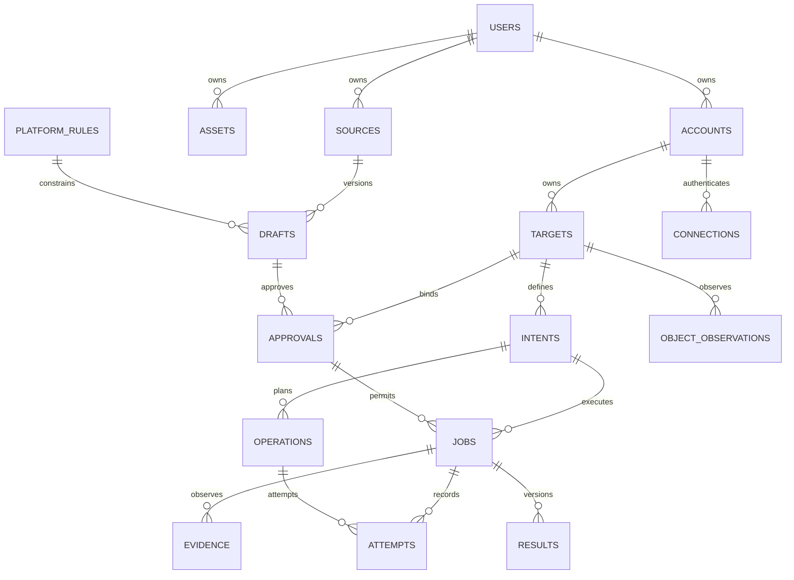

# V0.4 · 물리 데이터·API·화면 상세 설계

물리 인터페이스 초안. 제품 코드/실제 실행 아님. 원격 기술 위임. V0.3 가드 및 상태 상속.

## 데이터 구조

| 테이블 | 컬럼·타입 | 키 | 무결성 |
| --- | --- | --- | --- |
| users | id UUID; subject TEXT; created_at TIMESTAMP | PK id; UNIQUE subject | 인증 주체에서 owner 도출 |
| sources | id UUID; owner_id UUID; version INT; original_text TEXT; facts JSON; created_at TIMESTAMP | PK(id,version); FK owner_id | immutable; fact origin/verification V0.3; owner scope |
| assets | id UUID; owner_id UUID; version INT; object_key TEXT; digest TEXT; mime TEXT; bytes BIGINT; rights JSON; parent_ref JSON nullable | PK(id,version); FK owner_id | 권리/형식/크기 검사; 인증자료 저장 금지 |
| platform_rules | platform TEXT; object_kind TEXT; version INT; environment TEXT; url_rules JSON; fields JSON; effects JSON; evidence_spec JSON; enabled BOOL | PK(platform,object_kind,version,environment) | server maintained; immutable rule body; enable/permission separate |
| drafts | id UUID; version INT; owner_id UUID; source_id UUID; source_version INT; rule_ref JSON; mappings JSON; media_refs JSON; digest TEXT | PK(id,version); FK source(id,version) | snapshot immutable; rule/media references transaction validate |
| accounts | id UUID; owner_id UUID; platform TEXT; environment TEXT; stable_subject_ref TEXT; verification_evidence_ref UUID; revision INT | PK id; UNIQUE(platform,environment,stable_subject_ref) | opaque identity; no password/cookie; evidence verified |
| targets | id UUID; account_id UUID; object_kind TEXT; slot_key TEXT; external_object_ref TEXT nullable; revision INT | PK id; UNIQUE(account_id,object_kind,slot_key); UNIQUE(account_id,object_kind,external_object_ref) when nonnull | owner inherited; unknown ambiguous creation blocked |
| permissions | id UUID; version INT; scope JSON; allowed BOOL; expires_at TIMESTAMP nullable; evidence_refs JSON | PK(id,version) | server policy only; mock-only gate |
| connections | id UUID; owner_id UUID; account_id UUID nullable; platform TEXT; environment TEXT; auth_state TEXT; runtime_ref TEXT; revision INT; lease_generation BIGINT; controller TEXT; expires_at TIMESTAMP | PK id; FK owner/account | runtime_ref opaque, no browser secrets; lease epoch enforced at gateway |
| approvals | id UUID; owner_id UUID; target_id UUID; source_ref JSON; draft_ref JSON; rule_ref JSON; media_refs JSON; plan_digest TEXT; scope_digest TEXT; revision INT; revoked_at TIMESTAMP nullable | PK id; FK target | scope immutable; revoke epoch; server compare |
| intents | id UUID; target_id UUID; kind TEXT; goal TEXT; revision INT | PK id; FK target | initial create effect unique per slot; explicit update excluded MVP |
| jobs | id UUID; intent_id UUID; approval_id UUID; permission_ref JSON; connection_id UUID; state TEXT; revision BIGINT; stop_reason TEXT nullable; created_at TIMESTAMP | PK id; FK intent/approval/connection | one active or unresolved job per intent/target; V3 transitions; no live success |
| operations | id UUID; intent_id UUID; effect_key TEXT; plan_revision INT; effect_class TEXT; approved_fields JSON; before_spec JSON; after_spec JSON; evidence_spec JSON; digest TEXT | PK(id,plan_revision); UNIQUE(intent_id,effect_key,plan_revision) | stable effect key across plans; durable effect lookup across jobs; plan version immutable |
| attempts | id UUID; job_id UUID; operation_id UUID; plan_revision INT; effect_key TEXT; state TEXT; lease_generation BIGINT; approval_revision INT; admitted_at TIMESTAMP; evidence_refs JSON | PK id; FK job/operation | single admitted/unresolved effect per intent/effect; no replay; durable before dispatch |
| evidence | id UUID; job_id UUID; attempt_id UUID nullable; target_id UUID; kind TEXT; observed_at TIMESTAMP; values_redacted JSON; artifact_ref TEXT nullable | PK id; FK job/attempt/target | append-only redacted; owner scope |
| results | job_id UUID; revision INT; state TEXT; goal_evidence JSON; partial_effects JSON; unresolved_attempts JSON; reasons JSON; retry_blocked BOOL | PK(job_id,revision); FK job | append-only; status projection not source of authorization |
| object_observations | target_id UUID; revision INT; stage TEXT; observed_at TIMESTAMP; evidence_refs JSON | PK(target_id,revision); FK target | separate from job completion |
| idempotency | owner_id UUID; endpoint TEXT; key TEXT; request_digest TEXT; response_ref TEXT | PK(owner_id,endpoint,key) | same digest existing response; other digest conflict; owner scoped |

- 컬럼 표는 relational physical candidate; UUID/TIMESTAMP/JSON은 SQL 타입 계열, PostgreSQL DDL/SQLite migration은 공통 구현자 결정. FK·partial unique·transaction의 실제 지원/DDL 검증 필요. JSON ref는 위 owner/version 제약을 애플리케이션/DB에서 검증한다.
- 모든 시간 UTC 저장/KST 표시; active job/attempt 유일성은 intent와 target/effect key를 함께 직렬화하여 구현. 단순 job ID 유일성만으로 충분하지 않음.
## HTTP 및 내부 계약

| ID | 메서드 | 경로 | 요청 | 응답 | 가드 |
| --- | --- | --- | --- | --- | --- |
| HTTP-01 | POST | /v1/sources | SourceRequest | SourceResponse | owner; key |
| HTTP-02 | POST | /v1/assets | multipart file + rights + key | Media | owner; rights; size/MIME; server digest |
| HTTP-03 | POST | /v1/targets/resolve-url | url, goal, environment | platform, object_kind, supported, rule_ref, issues | owner; registry match only, no arbitrary fetch |
| HTTP-04 | POST | /v1/drafts | DraftRequest | DraftResponse | owner; source/rule revision; key |
| HTTP-05 | PATCH | /v1/drafts/{id} | DraftEdit | DraftResponse | owner; immutable new version |
| HTTP-06 | POST | /v1/connections | ConnectRequest | Connection + opaque viewer grant endpoint | owner; mock-only |
| HTTP-07 | POST | /v1/connections/{id}/handoff | HandoffRequest | Connection | owner; verified identity; exclusive lease |
| HTTP-08 | POST | /v1/targets | TargetRequest | TargetResponse | verified identity; slot resolve |
| HTTP-09 | POST | /v1/approvals | ApprovalRequest | Approval | owner; server scope digest; explicit consent |
| HTTP-10 | POST | /v1/jobs | JobRequest | Job | owner; key; approval/permission; 202 async |
| HTTP-11 | GET | /v1/jobs/{id} | after_revision optional | Job + Result | owner; no external effect |
| HTTP-12 | POST | /v1/jobs/{id}/reconcile | ReconcileRequest | Job | owner; authorized read only |
| HTTP-13 | POST | /v1/jobs/{id}/resume | ResumeRequest | Job | explicit resume; unknown cannot dispatch |
| HTTP-14 | POST | /v1/jobs/{id}/cancel | StopRequest | Job | revision; stopping/unknown |
| HTTP-15 | POST | /v1/approvals/{id}/revoke | StopRequest | Approval | owner; epoch fencing |
| HTTP-16 | DELETE | /v1/connections/{id} | expected_revision + key | Connection | close; pending effect reconcile |
| HTTP-17 | GET | /v1/targets/{id}/observations | after_revision optional | ObjectObservation[] | owner; stored records |
| HTTP-18 | POST | /v1/connections/{id}/view-grant | expected_generation | short-lived opaque grant + viewer URL | owner; one scope; no logs; runtime-defined protocol |
| HTTP-19 | INTERNAL | gateway.dispatch | DispatchRequest | DispatchResponse | never public; V3-G01~13 |

- V0.3 named schema types are inherited; additional route-specific fields as listed. JSON unless multipart. HTTP-03,18 new; others map to V3 API. 401 unauthenticated; 403 permission/live blocked; 404 absent/not owner; 409 stale/duplicate/idempotency/lease; 422 missing/conflict; 202 accepted not successful. ErrorResponse body. Actor/owner derived from service auth. Job polling default, viewer transport delegated; no forced WebSocket for viewer.
- HTTP-06 connection creation does not imply authenticated. HTTP-07 can verify/handoff for read-only identity/target preparation, but mutation is impossible until explicit execution approval and gateway admission.
- No actual production live enable route. Internal gateway and storage communicate through protected private boundary; no public CDP/VNC.
## UI

| ID | 화면 | API | 상태/행동 |
| --- | --- | --- | --- |
| UI-01 | 원본·자료 | HTTP-01, HTTP-02 | 사실·권리·누락, 저장 후 다음 |
| UI-02 | 플랫폼 선택/URL | HTTP-03 | 지원 경로/미지원/차단, mock label |
| UI-03 | 초안 검토 | HTTP-04, HTTP-05 | 원본 대비 값/단위/이미지, 누락 질문 |
| UI-04 | 직접 인증 | HTTP-06, HTTP-18, HTTP-07 | remote viewer, 인증 상태, 취소/재인증 |
| UI-05 | 대상·실행 승인 | HTTP-08, HTTP-09, HTTP-10 | 계정/대상/동작 범위/자료/환경, 명시 승인 |
| UI-06 | 진행·개입 | HTTP-11, HTTP-14, HTTP-15, HTTP-18 | 단계/가드/중단/추가 인증, 접속 종료 독립 |
| UI-07 | 결과·복구 | HTTP-11, HTTP-12, HTTP-13, HTTP-17, HTTP-16 | 목표/효과/외부 상태·증거·미확인 및 재개 조건 |

## 보안·복구

- 모든 DB/asset read/write owner scope; target owner는 account에서 유도. versioned JSON 참조는 트랜잭션 내 검증 또는 관계 테이블로 강화. FK/unique/partial unique 및 CAS는 DB 선정 후 구현과 경쟁 테스트.
- admission과 revoke를 같은 직렬화 경계에서 처리. runtime에서 lease generation 및 permit 소비를 강제; stale worker에 원시 브라우저 권한 없음. 외부 효과 unknown은 durable 기록. 재시작 때 admitted를 unknown으로 복구.
- URL은 exact host + 등록된 경로 규칙, HTTPS 운영 후보; mock loopback only. 임의 URL fetch/redirect/내부망 접근 금지. 실행 환경 egress allowlist와 DNS/IP 검증. 플랫폼 로그인 redirect 허용 범위는 승인된 정책 내 별도 등록.
- 로그인 화면/키입력/세션 토큰의 저장·모델 전달 금지. 브라우저 및 입력중계가 민감정보 처리 경계라는 사실 유지. TLS·짧은 grant·세션 폐기·격리 검증. mock fixture only.
- 개발 환경에서 데이터·브라우저 상태 초기화/fixture 재현; 운영 보존·삭제·백업·비용 기준은 별도 결정. 실환경 허용 전 활성화 금지.
## 기존 산출물 재사용

| 역할 | 근거 | 재사용/수정 |
| --- | --- | --- |
| R03 | 공통 등록/검증/승인 및 하네스 | 원본 코드에서 검증/영수증/오류 시험 참고; 고정 30만원·동일 tier 제거, 신규 browser 생성 경로를 remote port에 연결. 직접 병합 금지. |
| R04 | 숨고 흐름/질문지 | 서비스 객체와 별도 프로필 구분, 규칙/효과/증거 명세 및 adapter 구현. 실제 등록 효과 확인 전 mock만. |
| R05 | 원격 브라우저 PoC 및 크몽 필드 조사 | 원격 viewer/인계/작업 lifecycle 재사용 후보; 원시 session 토큰/메모리 task/단일 browser 공유를 제품 안전성으로 간주 금지. 기술 담당 선택. |
| R02 | 공통 사실/사용자 기준 | 확인값·합성 fixture·검수 기준 인계; 실제 개인 자료 사용 금지, 가격/VAT/옵션 미확인 명시. |

[구조화 원본](physical-v0.4.json)
