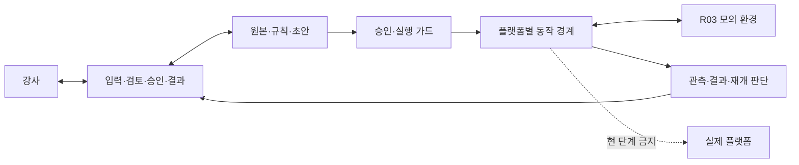

# L3~L5 · 시스템 경계·책임·논리 호출/UI

> 2026-11-24 · R01 검토용 논리 설계 V0.1. 최종 제품 채택·본 구현·실서비스 실행 승인 아님. 기존 R03~R05 TASK 및 공통 시험 계약 변경 없음.

[구조화 설계](system-contracts-v0.1.json)

## 시스템 경계

내부: 원본·변환·승인·동작 가드·관측/결과·재개. 외부: 운영사 규칙/권한·외부 인증·실제 등록 결과. 실제 호출은 현 단계 금지.

## 논리 책임 후보

| ID / 책임 | 역할 | 논리 I/O | 관련 요구 |
| --- | --- | --- | --- |
| LR-C-01 원본 사실·자료 검증 | 값·단위·출처·권리·충돌 구조화 | 원본/자료 → 사실·이슈 | FR-01, FR-03 |
| LR-C-02 플랫폼 매핑 | 규칙/대상별 초안과 미해결 항목 작성 | 사실/규칙 → 초안·이슈 | FR-02 |
| LR-C-03 승인·실행 가드 | 승인 스냅샷·동작·환경·허용·기존 효과 검사 | 초안/승인/허용 → 실행 판단 | FR-03, FR-06 |
| LR-C-04 플랫폼 동작 경계 | 승인된 동작 및 원시 관측/오류 반환 | 동작 → 시도·관측·오류 | FR-04, FR-05 |
| LR-C-05 결과·재개 판단 | 목표 증거 대조·unknown 차단·재확인 | 시도/관측/이력 → 결과·조치 | FR-05, FR-06 |
| LR-C-06 사용자 상호작용 | 입력·검토·승인·진행/결과 및 다음 조치 | 사용자 ↔ 논리 동작·상태 | FR-01, FR-02, FR-03, FR-05, FR-06 |

부모 실행 단위, 실제 모듈, 물리 배치 및 담당 배정 미확정.

## 상위 실행 구조 대안

- A 로컬: 세션 외부 전송 감소 후보; 설치/운영·화면 변경 부담
- B 혼합: 콘텐츠 처리와 인증 실행 분리; 통신/권한 책임 증가
- C 서버 브라우저: 운영 편의; 신원/세션/사진·정책 위험, 현재 미허용
- D 공식 API/위임: 허용·제공 확인 필요
- E 초안/수동 보조: 실제 실행 제약 시 별도 가치 재검증

선택 기준: 정확성·완료 단위·허용·사용자 시간·보안·재현성·공수/지원 비용 비교; 모의 성공만으로 live 선택 금지.

## 논리 호출 계약 (실제 API 아님)

| 동작 | 입력 | 출력 | 오류·정책 |
| --- | --- | --- | --- |
| prepare_source | source_text: 원문/입력; facts: 사실 후보; media_refs: 자료 버전 | source_version: 원본 버전; facts: 근거 있는 후보; issues: 누락·충돌·권리 | missing, conflict, media_rights_unknown / AI 제안과 사용자 확인 구분; 외부 실행 없음 |
| prepare_draft | source_version: 원본; platform: 대상; object_kind: 등록 객체 또는 미확인; rule_version: 규칙 | draft_version: 초안; field_mappings: 값·출처·규칙; issues: 충돌·미확인; target_outcome: 목표 또는 미정 | rule_unknown, object_unknown, mapping_conflict / 수정은 새 버전; 외부 실행 없음 |
| record_approval | source_version: 원본; draft_version: 초안; rule_version: 규칙; media_versions: 자료 버전; target: 플랫폼/객체/목표; actions: 승인 동작; environment: 환경; user_confirmation: 명시 승인 | approval_ref: 승인 참조; scope: 승인 스냅샷; issues: 확인/차단 | stale_version, unresolved_fact, unapproved_asset, scope_mismatch / 사용자 승인≠운영사 허용; 철회·버전 변경 시 다음 실행 차단 |
| plan_and_check_execution | intent_ref: 등록 의도; approval_ref: 승인; permission_ref: 허용 근거; requested_action: 동작/환경 | job_ref: 작업; job_state: 계획/준비/확인/차단; retry_blocked: 부작용 차단; reasons: 사유 | approval_invalid, permission_unknown, live_blocked, duplicate_risk / 동일 의도의 기존 효과/미확인 검사; 작업 생성은 실행 아님 |
| execute_approved_action | job_ref: 작업; action: 단일 승인 동작; approval_ref: 승인; environment: 현 mock만 | attempt_ref: 시도; observations: 관측; job_state: 상태; evidence_refs: 근거 | input_failed, attachment_failed, outcome_unknown, blocked / 직전 가드 및 시도 기록; 현 실제 실행 금지 |
| read_result | job_ref: 작업 | job_state: 작업 상태; observed_stage: 관측 단계; target_outcome: 목표; result_state: 판정; evidence_refs: 근거; next_action: 조치; retry_blocked: 차단 | not_authorized, unknown, evidence_conflict / 읽기 전용; mock/live 구분 |
| reconcile_and_request_resume | job_ref: 기존 작업; evidence_refs: 재확인 근거; user_resume_request: 명시 요청; approval_ref: 현재 승인 | job_state: unknown 유지/목표 확인/needs_action; retry_blocked: 차단 여부; reason: 근거·재개 조건 | still_unknown, already_effective, approval_invalid, permission_unknown / 부작용 없는 확인; 효과 없음/안전한 다음 단계 확인 후 별도 실행 |

## 사용자 행동과 표시

| 행동 단위 | 사용자 행동 | 표시·피드백 |
| --- | --- | --- |
| 원본 입력·대상 선택 | 원고·조건·자료·대상 입력 및 누락 응답 | 초기, 검증 중, 누락, 충돌, 준비 / 제공하지 않은 값을 확정하지 않음 |
| 초안 검토·승인 | 원본/변환값·권리·목표·동작/환경 검토 및 승인/수정 | 검토 필요, 수정, 승인 가능, 승인됨, 버전 변경 / 승인 범위 표시, 변경 시 재승인 |
| 실행·사용자 확인 | 승인 동작 요청·중단·확인 | ready, running, needs_action, blocked, failed, unknown / 상태·차단 사유·다음 조치; 현 live 금지 |
| 결과·근거 확인 | 대상별 목표·관측·근거·재확인 요청 | mock_completed, unknown, failed, 향후 실제 목표 확인, 부분 결과 / 입력 완료/제출 시도/접수/공개 구분; 재제출 차단 사유 |

화면 수·레이아웃·프레임워크 미정.

## AI·안전 경계

AI는 사실 후보와 변환·질문을 제안하며 사용자 확인 사실, 허용, 결과 판정을 단독 확정하지 않는다.

- 현 단계 loopback mock만
- 사용자 인증과 외부 플랫폼 인증 분리
- 직전 승인/허용/대상/버전 가드
- unknown 중 동일 의도 부작용 금지
- 실자료·외부 AI 전송 별도 권리 확인

잔여 위험: 인증·세션 배치·보존/삭제·외부 모델 전송·운영사 허용 미선정.
