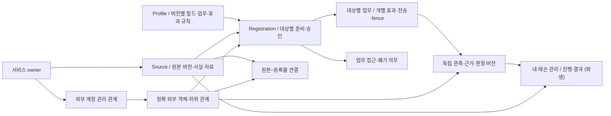

# 찾아you 논리 DB 설계 V1.0

<!-- Generated by tools/project_logical_db_v1.mjs from TASK-058-LOGICAL-DB-V1 and TASK-058-LOGICAL-DB-TRACE-V1 -->

기준 2026-11-27 · V3.1-R1 `70ae8e7169c284ba71c4dcbcc0cde4415929d079` / blob `d11f63353fd48bee4126d7fd916a6d870f55410f` · provisional_candidate_not_approved_for_physical_design

**논리 설계 후보** — 사용자 스토리 최종 승인, 물리 테이블/마이그레이션/API 및 실제 외부 실행 승인 아님. PostgreSQL 목표; 기존 SQLite 보존.

## 검토 순서

[논리 ERD 및 데이터 사전](../../../../review/lesson-registration/LOGICAL-DB-ERD-V1.0.md) · [스토리·데이터 추적 및 영향](../../../../review/lesson-registration/LOGICAL-DB-TRACE-V1.0.md) · [정본](db-design.json) · [추적 원본](db-design-trace.json)

## 목적

사용자 원본 재사용 및 다중 플랫폼 정확 등록·수정·갱신·상태 확인·오류 복구를 성립시키는 논리 데이터·식별·관계·제약·상태·수명주기 설계

- 기존 LD-01~LD-08과 Source/Profile/Registration 세 논리 aggregate 유지. 세 구조 외 논리 데이터/관계가 독립 테이블/API라는 의미 아님.
- 사용자 관점의 반복 정보/정확 업무·결과 확인을 위한 필요한 정보만. 원본 사실·플랫폼 표현·고정 승인·실제 관측·판정 분리.
- 정확 동일 owner 및 플랫폼/계정/객체/slot·업무 의도에 대한 안전 경계. 공통 BE 정본, UI 파생.
- 각 논리 레코드/값 객체/관계를 물리 테이블로 1:1 확정하지 않는다. PostgreSQL은 목표, 기존 SQLite 보존.
- 동일 명령 불명·효과 불명·분쟁·접근 차단을 지속적으로 구분. 외부 작업 실제 실행 mock-only.

## 논리 영역

| 영역 | 의미 | 논리 기록 수 |
|---|---|---:|
| 서비스 본인·권한 | 동일 owner 식별 및 본인 데이터 보호 | 3 |
| Source — 레슨 원본 | 한 번 저장하고 버전·자료·사실 재사용 | 6 |
| Profile — 플랫폼 규칙 | 7개 및 추가 플랫폼을 버전 기반으로 확장 | 5 |
| 외부 계정·등록물 식별 | 실제 대상과 원본 관계 및 공유 영향 분리 | 5 |
| Registration — 준비·승인·수락 | 묶음/대상·검증값·정확 승인·동일 명령 관리 | 8 |
| 업무용 접근·폐기 | 권한/관리 관계/폐기 독립, 비밀 미저장 | 2 |
| 개별 효과·전송·충돌 | 효과별 중복/부분 성공/지연 차단 | 5 |
| 읽기·근거·결과 | 실제 확인과 목표 및 마지막 상태 분리 | 6 |
| 내부 권리·감사 | 안전한 관리 해제·보존·최소 감사 | 2 |

총 42개 논리 기록/값 객체, 78개 명시 관계, 13개 불변조건. 물리 테이블 수 아님.

## 핵심 데이터 구조

## 핵심 사용자 흐름과 데이터

| 상황 | 필요한 데이터 |
|---|---|
| UJ-01 최초 등록 | 레슨 원본 식별 · 원본 불변 버전 · 원본–등록물 관리 관계 · 선택 대상별 업무 · 대상별 업무 결과 판정 · 정확 읽기 요청 · 내부 명령 수락·결과 원장 · 대상별 준비 버전 · 업무 의도 묶음 · 계정·객체/신규 slot 판정 · 업무 한정 외부 접근 문맥 · 내용·범위 검토/고정 승인 · 정확 업무별 개별 효과 |
| UJ-02 저장 원본 추가 등록 | 레슨 원본 식별 · 원본 불변 버전 · 원본–등록물 관리 관계 · 선택 대상별 업무 · 대상별 업무 결과 판정 · 정확 읽기 요청 · 내부 명령 수락·결과 원장 · 업무 의도 묶음 · 대상별 준비 버전 · 계정·객체/신규 slot 판정 · 업무 한정 외부 접근 문맥 · 내용·범위 검토/고정 승인 · 정확 업무별 개별 효과 |
| UJ-03 기존 등록물 수정 | 레슨 원본 식별 · 원본 불변 버전 · 원본–등록물 관리 관계 · 선택 대상별 업무 · 대상별 업무 결과 판정 · 정확 읽기 요청 · 내부 명령 수락·결과 원장 · 대상별 준비 버전 · 계정·객체/신규 slot 판정 · 업무 한정 외부 접근 문맥 · 내용·범위 검토/고정 승인 · 정확 업무별 개별 효과 |
| UJ-04 공고 갱신 | 레슨 원본 식별 · 원본 불변 버전 · 원본–등록물 관리 관계 · 선택 대상별 업무 · 대상별 업무 결과 판정 · 정확 읽기 요청 · 내부 명령 수락·결과 원장 · 대상별 준비 버전 · 계정·객체/신규 slot 판정 · 업무 한정 외부 접근 문맥 · 내용·범위 검토/고정 승인 · 정확 업무별 개별 효과 |
| UJ-05 저장 상태 확인 및 최신 조회 | 레슨 원본 식별 · 원본 불변 버전 · 원본–등록물 관리 관계 · 선택 대상별 업무 · 대상별 업무 결과 판정 · 정확 읽기 요청 · 내부 명령 수락·결과 원장 · 계정·객체/신규 slot 판정 · 업무 한정 외부 접근 문맥 · 정확 업무별 개별 효과 |
| UJ-06 기존 글 관리 연결 | 레슨 원본 식별 · 원본 불변 버전 · 원본–등록물 관리 관계 · 선택 대상별 업무 · 대상별 업무 결과 판정 · 정확 읽기 요청 · 내부 명령 수락·결과 원장 · 대상별 준비 버전 · 계정·객체/신규 slot 판정 · 업무 한정 외부 접근 문맥 |
| UJ-07 정보·규격 오류 및 인증 | 레슨 원본 식별 · 원본 불변 버전 · 원본–등록물 관리 관계 · 선택 대상별 업무 · 대상별 업무 결과 판정 · 정확 읽기 요청 · 내부 명령 수락·결과 원장 · 업무 의도 묶음 · 대상별 준비 버전 · 계정·객체/신규 slot 판정 · 업무 한정 외부 접근 문맥 · 내용·범위 검토/고정 승인 |
| UJ-08 부분 성공·실패·효과 불명 | 대상별 업무 결과 판정 · 원본–등록물 관리 관계 · 선택 대상별 업무 · 정확 업무별 개별 효과 · 업무 의도 묶음 · 대상별 준비 버전 · 계정·객체/신규 slot 판정 · 원본 불변 버전 · 정확 읽기 요청 · 업무 한정 외부 접근 문맥 · 내용·범위 검토/고정 승인 · 내부 명령 수락·결과 원장 |
| UJ-09 대행 제한·내부 작성안 | 대상별 준비 버전 · 계정·객체/신규 slot 판정 · 정확 읽기 요청 · 원본 불변 버전 · 선택 대상별 업무 · 업무 한정 외부 접근 문맥 · 내용·범위 검토/고정 승인 · 레슨 원본 식별 · 원본–등록물 관리 관계 · 대상별 업무 결과 판정 · 내부 명령 수락·결과 원장 · 정확 업무별 개별 효과 |
| UJ-10 원본 수정·삭제·연결 해제 | 레슨 원본 식별 · 원본 불변 버전 · 원본–등록물 관리 관계 · 선택 대상별 업무 · 대상별 업무 결과 판정 · 정확 읽기 요청 · 내부 명령 수락·결과 원장 · 대상별 준비 버전 · 계정·자료 권리 및 내부 관리 요청 |
| UJ-11 외부 계정·권리 | 레슨 원본 식별 · 원본 불변 버전 · 원본–등록물 관리 관계 · 선택 대상별 업무 · 대상별 업무 결과 판정 · 정확 읽기 요청 · 내부 명령 수락·결과 원장 · 계정·자료 권리 및 내부 관리 요청 · 업무 한정 외부 접근 문맥 · 계정·객체/신규 slot 판정 |
| UJ-12 이탈·재접속·복귀 | 내부 명령 수락·결과 원장 · 레슨 원본 식별 · 원본 불변 버전 · 원본–등록물 관리 관계 · 선택 대상별 업무 · 대상별 업무 결과 판정 · 정확 읽기 요청 · 대상별 준비 버전 · 계정·객체/신규 slot 판정 · 업무 한정 외부 접근 문맥 · 내용·범위 검토/고정 승인 · 정확 업무별 개별 효과 |

## 데이터 불변조건

| ID | 조건 | 요구 의미 |
|---|---|---|
| DBI-01 | owner 권한 격리 | 모든 사용자 조회/쓰기의 서버 검증 owner 일치. owner 없는 전역 외부 식별/규칙은 권한 있는 문맥 내부에서만 확인. 외부 안전 conflict는 owner간 격리하지 않되 외부 owner/관계의 존재·내용을 응답하지 않는다. |
| DBI-02 | 버전과 저장 원자성 | source head 현재 revision CAS; 같은 command 키/hash 결과와 새 immutable revision/fact/asset link 원자 커밋. 이전 버전/고정 승인 불변. 저장 응답 유실은 동일 key. 명시 저장 전 성공 표시 없음. |
| DBI-03 | 플랫폼 규칙 pin 및 확장 | 등록된 profile/object/version/environment + schema/field/operation/effect 계약 pin. 준비 완료는 필수 조건/차단 문제로 도출. 필수 후보/실제 허용/인증/사용자 승인 독립; mock-only 우선. |
| DBI-04 | 정확 계정·객체·slot | 정확 검증 계정/namespace/객체/하위 관계 또는 의도 slot, 후보/링크≠소유권. slot→actual alias 유지. 공유 관계/공개 필드의 영향범위 표시. owner 내부 연결과 현재 접근 권한 분리. |
| DBI-05 | 동일 명령·응답 불명 | 검증 principal+kind+key UNIQUE; 동일 hash 동일 결과, hash 변경 거절. 서버 정본 AX04와 FE AX05 독립. no_commit_proven은 지연 commit 봉쇄 포함; timeout/404/재접속으로 신규 명령 금지. |
| DBI-06 | 원자 수락과 고정 승인 | 하나의 검토안에 전체 선택 처분, 양 승인, 정확 source/profile/preparation/binding 및 효과/비용/검증 읽기 plan. approved 목록의 수락·snapshot·동일 command 한 경계; 일부 몰래 제외 금지. held/excluded 효과 없음. |
| DBI-07 | 권한·목적·폐기 독립 | 계정 연결≠접근 허용. 정확 access generation, 목적/읽기/쓰기 범위/권한 확인. 실패/만료/철회 때 새 접근 차단과 폐기 의무 원자 기록. 폐기 불명에서 이전 접근 복원 없음. 비밀값 저장 금지. |
| DBI-08 | 일회 전송·겹침 fence | 정확 승인 효과+모든 부수효과와 독립 읽기 계획을 물리 전송 전에 pin. 전역 정규 계정/root/slot/겹침 path claim 및 fence generation을 원자 확보. 모든 구성 효과 허용 전 전송 금지. claim 해제와 unknown/dispute 차단 독립. |
| DBI-09 | 개별 효과 및 판정 버전 | 응답과 독립 관측 분리. exact effect와 검증 근거, 이전 판단 immutable. 확인+불명→effect_unknown, 확인 일부+나머지 확정 미시도/미발생→partial_confirmed. ended 불변, 늦은 증거 새 판정만; 상충 근거 분쟁. |
| DBI-10 | 읽기·마지막 관측·목표 분리 | 명시 또는 고정 plan 목적의 허용 읽기만. 최신 요청 순번/관측 시각/수신 시각 및 last successful observation 분리. native status와 업무 완료/goal 독립. 홈은 내부 조회; 자동 모니터링 없음. |
| DBI-11 | 정확 잔여와 별도 신규 의도 | 같은 효과 재처리: 독립 미발생/안전 미시도·지연 전송 봉쇄·정확 지원 잔여 경로·새 승인. 성공 객체의 새 수정/갱신은 실제 새 조건/정확 대상·동일/경합 효과 미해결 없음·새 승인. 확인된 같은 효과 반복 없음. |
| DBI-12 | 내부 관리·보존·감사 | 원본 retire/관계 해제는 내부 효과만; 물리 삭제·백업·보존·권리 정책 승인 전 hold. 기존 수락/효과 및 감사 근거 임의 삭제 금지. 화면 이탈/결과 확인이 실행/취소/폐기의 조건 아님. 내부 작성안과 외부 성공 분리. |
| DBI-13 | 환경 및 공개 데이터 제한 | 모든 외부 업무는 mock-only; 실제 로그인을 비롯 읽기/쓰기 금지. 서비스/로그/승인/자료/근거에 password, OTP, cookie, grant, 정산 계좌·민감 증빙 금지. 공개용 연락처·주소는 명시 권리/필수 근거와 최소 공개 정책 확정 전 후보. |

## 수명주기 및 보존

| 영역 | 정본 | 보존 및 제한 | 남은 결정 |
|---|---|---|---|
| 원본/사실 | 불변 revision + 현재 head | 원본 자료/권리·정확 버전 유지; retire 시 현재 관리 접근 제한 | 물리 삭제/보존·backup 정책 DR-03 |
| 편집/준비 | working edit와 immutable 준비 revision/snapshot | 관련 미수락 준비 stale; 저장/수락 불명 문맥 보존 | 편집 임시 보존/삭제, W 인라인 UX DR-03/04 |
| 승인/명령 | 정확 key/hash·frozen 승인과 accepted target | 동일 key 확인, ended 불변, 이전 effect/승인 변경 금지 | idempotency TTL/증거 보존/복구·권리 정책 미정 |
| 외부 계정/객체 | 정규 identity + owner 관리 연결 | 관계 해제는 내부, 실제 외부 접근 철회/차단 독립 | 복수 owner·공유 root 실제 권한/관계 검증 |
| 외부 접근 | 비밀 없는 목적/계정/generation·범위 | 종료/실패/철회 시 차단 및 폐기 의무, 불명 접근 복원 금지 | 실제 자원 폐기/세션 방식/로그아웃 처리 정책 미정; 비밀 미저장 |
| 효과/관측/결과 | append-only 판정·근거 + 독립 상태/시점 | late evidence 판정 새 version, dispute 및 fence 보존 | 원문 증거 최소화·보존/삭제·backup·권리 미정 |
| 권리/감사 | 정확 내부 요청/최소 근거 | 보존/진행/불명 충돌 hold; 물리 삭제/외부 삭제/원복 없음 | 보존·삭제·권한/운영자 검토 별도 |

## 기존 계약 및 물리 DB 방향

기존 Source/Profile/Registration 계약의 의미 유지. 기존 V4.1 wire schema와 실제 DB를 자동 변경하지 않는다.

1. 기존 SQLite 합성 snapshot 및 pin 보존; 실제 실행 데이터 이관 여부 별도.
2. 최종 승인된 논리 모델을 PostgreSQL 타입·PK/FK/unique·check·상태 constraint·정확 owner 검증으로 설계. RLS 선택은 물리 설계 후보.
3. 원본/버전·계정/등록물 식별을 먼저 검증하고 준비/승인/작업·개별 효과·증거를 정확 ID/버전으로 이관 후보 mapping. 비밀/미확인 상태는 추정 변환하지 않고 격리.
4. 트랜잭션/동시성·권한·fence·일회 전송·late observation 및 오류 rollback의 합성 시험, 초기/이관 DB 검증과 복구 계획을 확정한 뒤 실제 migration.
5. PostgreSQL 설치·접속·DDL·migration·CI·실제 외부 실행은 이번 수행하지 않음.

## R01 판단 요청

### DB-D01 가입·인증·owner·보존 수명주기
- 현재 후보: OWNER/IDENTITY/SERVICE_ACCESS 분리, 구체 auth/provider/삭제/backup/retention 미정. 실제 삭제는 보류.
- 확정 조건: 실제 계정 권리·법적 보존·증거 최소화 정책 확정; 외부 비밀 저장 없음.

### DB-D02 플랫폼 필드·객체/slot·실제 관계 및 구현 순서
- 현재 후보: 7개 설계 범위·44 업무·45 효과 후보와 profile version 유지. 고유 필드/관계/정규 키/겹침 scope 검증 후 필수 규칙 정의.
- 확정 조건: 공식/독립 근거 및 허용/효과 검증, 7개 동등 구현·MVP 우선순위 별도 R01.

### DB-D03 W 인라인 원본 저장 및 공개 연락처/주소
- 현재 후보: H→E 명시 저장, 공통 사실/전용 값 분리; 민감 증빙/정산 직접, 공개 정보는 최소 권리 기준 필요.
- 확정 조건: 원본 저장 UX·공개 범위/필요성 승인; 전용 필드의 실제 필수·권리 검증.

### DB-D04 관리자 전용 오류 확인
- 현재 후보: 현재 Conflict/Evidence/Result/Rights의 보수적 운영 확인 가능 후보만. 관리자 사용자·대기열·권한 모델 추가하지 않음.
- 확정 조건: 운영자 접근권한·증거·비용·대기 흐름·판정 기준 별도 승인. 보고만 성공 처리 금지.

### DB-D05 동시성·전송·불명의 PostgreSQL 구현
- 현재 후보: 논리 원자 경계 8개, 글로벌 정규 효과 겹침과 fence. 실제 transaction isolation, locks, outbox/queue, crash consistency, RLS/constraints 선택 후 검증.
- 확정 조건: R03 등 책임자와 계약 영향 검토, 합성 migration/DB 경쟁·복구 시험, 이전 구현 재개 승인.

### DB-D06 자료/증거 최소 저장과 프로필 버전 관리
- 현재 후보: 논리 payload와 provenance; 실제 object storage vs DB, 보존/해제, evidence locator/typed reference 구현 미정.
- 확정 조건: 필요 데이터 최소화, 삭제/백업·보존/권리 충돌, profile registry 릴리스 정책 검토.

## 검증 및 제한

- 21개 구조/참조 검사; 40개 축약 가드 예시. 실제 DB/외부/CI 테스트 0건.
- 사용자 스토리 V3.1-R1 팀 검토/상위 화면·상태·업무 정본 최종 합의 전. DR-01~05와 DB-D01~06 유지.
- 42개 논리 레코드/값 객체 정의 수가 최종 테이블 수를 뜻하지 않는다. 물리 자료형·FK/RLS/index·보존/backup·API 미확정.
- 플랫폼 실제 필수/조건·객체 ID/관계·권한·독립 관측 검증 전 실행 차단. 조사 필드 모두 확정값 아님.
- 관리자 전용 기능, 일반 중단/원복/자동 재개, 장기 위임·모니터링, 재등록/유료 갱신 등 기존 미채택 유지.
- 기존 SQLite/제품 코드/DDL/migration/팀원 원본/main/Notion 변경 없음.

재생성: `node tools/project_logical_db_v1.mjs` · 최신 여부: `node tools/project_logical_db_v1.mjs --check`
