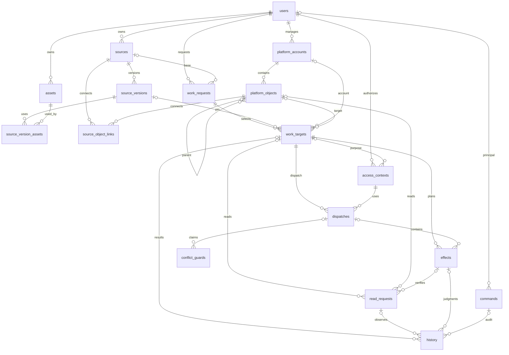

# 찾아you 최소 DB 구조 V2.0 — V3.1-R1 잠정 기준

<!-- TASK-058-MINIMAL-DB-V2; db-minimal-v2.json에서 동일 데이터로 생성한 검토용 문서 -->

**검토 후보 · 17개 실제 테이블 제안** — 기존 V1.0의 42개 논리 레코드가 42개 실제 테이블을 의미하지는 않는다. 사용자 스토리 V3.1-R1, 승인 서비스 범위 V1.0, mock-only 및 구현 보류를 유지한다.

기준: `800f6a13d7444e8a6c8b2586fca9ac8b1f46bcc9` · [V3.1-R1](v3.1/user-stories.json) · [기존 DB V1](db-design.json) · [시스템 업무](system-work-v1.0.json) · [플랫폼 업무](platform-work-v1.0.json) · [상태](logical-state-v1.0.json) · [오류](error-response-v1.0.json) · [작업 정본](db-minimal-v2.json)

## 관계도

개요도에는 주관계만 표기했다. 선택 FK 및 실제 제약은 아래 명세 우선. `?`는 조건부 nullable, UUID/JSONB 등 PostgreSQL 후보 타입.

## 테이블 명세

### 1. `users` — 서비스 사용자와 검증된 본인 식별

사용자 소유권의 독립 정본. 현재 한 사용자에 한 활성 인증 주체 후보; 다중 로그인 연결 기능 미채택.

컬럼: `id uuid PK`, `issuer text`, `subject text`, `state text`, `created_at timestamptz`, `retired_at timestamptz?`.

제약: UNIQUE(issuer,subject); 서비스 인증 서버가 검증한 subject만 사용; 상태에 따른 접근 제한.

### 2. `sources` — 재사용할 레슨 원본의 안정된 식별 및 현재 버전

원본 하나가 여러 버전·작업·외부 등록물과 연결된다. stable ID와 불변 revision을 합치면 기존 공고 연결이 버전 변경마다 이동한다.

컬럼: `id uuid PK`, `owner_id uuid FK users`, `state text`, `current_version_id uuid? FK source_versions`, `created_at timestamptz`, `retired_at timestamptz?`.

제약: 현재 버전은 동일 원본의 saved 버전만; 최초 draft shell은 저장 전 원본 목록에 표시하지 않음; head 변경 CAS; retire는 내부 효과만.

### 3. `source_versions` — 원본 편집 문맥 및 저장된 불변 버전

수정과 재사용 시점의 값을 보존한다. 편집 단계는 동일 구조의 draft 행으로 통합; 새 저장 전 버전 번호/성공 확정 없음.

컬럼: `id uuid PK`, `source_id uuid FK sources`, `base_version_id uuid? FK source_versions`, `revision_no integer?`, `edit_generation bigint`, `state text`, `content jsonb`, `extraction_request_id uuid?`, `content_digest text?`, `created_at timestamptz`, `saved_at timestamptz?`.

제약: UNIQUE(source_id,revision_no) for saved; saved 이후 내용 및 첨부 관계 불변; content에는 원문·직접 입력·공통 의미 사실·출처/불확실·편집 문제의 타입 검증; 이전 추출 결과는 generation과 요청 ID 비교.

### 4. `assets` — 권리 확인 자료 및 바이너리 보관 위치

같은 사진을 여러 원본 버전에서 재사용하고 권리 철회가 모든 새 이용에 영향을 미친다.

컬럼: `id uuid PK`, `owner_id uuid FK users`, `storage_key text`, `digest text`, `media_type text`, `size_bytes bigint`, `rights_state text`, `rights_detail jsonb`, `created_at timestamptz`, `retired_at timestamptz?`.

제약: 같은 owner의 자료만 연결; 바이너리 외부 저장소, 비공개 접근; 현재 권리 상태가 과거 스냅샷보다 우선하여 새 이용 제한.

### 5. `source_version_assets` — 원본 버전의 자료 사용 관계

자료와 원본 버전의 다대다 관계를 FK로 유지한다. 사진 ID 배열만 두면 고아·타인 자료·권리 철회 검사에 불필요한 복잡성이 생긴다.

컬럼: `version_id uuid FK source_versions`, `asset_id uuid FK assets`, `role text`, `position integer`, `usage_rights jsonb`.

제약: PK(version_id,role,position); 동일 owner; 저장된 버전의 관계 불변; FK 삭제 RESTRICT.

### 6. `platform_accounts` — 사용자별 외부 계정 관리 연결 및 정확 계정 키

사용자별 연결/해제와 여러 외부 등록물의 공통 계정. 다른 owner의 동일 외부 계정은 별도 내부 행일 수 있으나 전역 경합은 정규 외부 키로 동일하게 판단.

컬럼: `id uuid PK`, `owner_id uuid FK users`, `platform_key text`, `environment text`, `identity_namespace text`, `native_account_key text`, `management_state text`, `link_generation bigint`, `verified_at timestamptz`, `retired_at timestamptz?`.

제약: UNIQUE(owner_id,environment,platform_key,identity_namespace,native_account_key); 검증된 정규 키만 생성; 연결/해제 이력은 history; 관리 연결은 실제 접근 권한 아님.

### 7. `platform_objects` — 상품·클래스·프로필·서비스·공고 등 정확 외부 객체

외부 객체는 원본이나 작업 없이도 존재할 수 있고, 한 객체에 여러 수정·갱신·관측이 연결된다. 현재 관찰된 계층 관계만 parent로 모델링.

컬럼: `id uuid PK`, `account_id uuid FK platform_accounts`, `parent_id uuid? FK platform_objects`, `object_kind text`, `identity_namespace text`, `native_object_key text`, `verified_at timestamptz`, `locator jsonb?`, `identity_state text`.

제약: UNIQUE(account_id,object_kind,identity_namespace,native_object_key); parent 동일 계정; 실제 검증된 객체만 저장; 표시명/URL/목록 순서만으로 고유 식별 확정 금지.

### 8. `source_object_links` — 원본과 외부 객체의 내부 관리 연결

공유 프로필과 서로 다른 레슨 원본, 한 원본의 여러 플랫폼, 사용자 직접 등록물의 사후 연결을 독립적으로 관리.

컬럼: `id uuid PK`, `source_id uuid FK sources`, `object_id uuid FK platform_objects`, `role text`, `state text`, `linked_at timestamptz`, `retired_at timestamptz?`.

제약: 같은 owner 및 정확 권한 확인; UNIQUE(source_id,object_id,role) WHERE active; 해제 후 새 연결 이력 보존; 외부 삭제 없음.

### 9. `work_requests` — 한 번 선택한 작업 묶음 및 양 승인

여러 플랫폼을 한 번 선택/검토/승인하는 사용자 행동의 단위. 결과 상태는 개별 대상에서 집계.

컬럼: `id uuid PK`, `owner_id uuid FK users`, `source_id uuid? FK sources`, `environment text`, `selection_revision bigint`, `review_state text`, `approval_snapshot jsonb?`, `snapshot_digest text?`, `frozen_at timestamptz?`, `created_at timestamptz`.

제약: 선택 전체 및 대상별 실행/보류/제외와 내용승인·범위승인 구분; 수락 시 대상 행 및 명령과 같은 트랜잭션으로 동결; 동결 후 수정 금지.

### 10. `work_targets` — 선택된 플랫폼별 업무, 준비안, 대상 식별 및 독립 작업 상태

묶음 내 플랫폼별 다른 입력·오류·처분·실행·결과를 분리. 준비/입력값/승인 항목은 종속 값이므로 따로 테이블화하지 않는다.

컬럼: `id uuid PK`, `request_id uuid FK work_requests`, `platform_key text`, `operation_key text`, `selection_key text`, `disposition text`, `source_version_id uuid? FK source_versions`, `account_id uuid? FK platform_accounts`, `target_object_id uuid? FK platform_objects`, `resolved_object_id uuid? FK platform_objects`, `slot_key text?`, `prior_target_id uuid? FK work_targets`, `prep_revision bigint`, `prep_state text`, `profile_digest text?`, `preparation jsonb`, `binding_snapshot jsonb?`, `frozen_item_digest text?`, `lifecycle text`, `accepted_at timestamptz?`, `ended_at timestamptz?`.

제약: UNIQUE(request_id,selection_key); operation 및 schema 버전 pin; 같은 owner/source/account/object 일치; 정확 계정/대상 또는 slot 미확정이면 쓰기 금지; 준비 값·출처·문제·비교·계획·처분 동결 후 변경 금지; 신규 객체는 resolved_object_id로 별도 연결; 새 승인 필요 시 새 target/request.

### 11. `commands` — 저장·수락·연결·해제·권리 요청의 멱등 처리 영수증

명령 수락 응답 유실과 실제 업무 상태가 다르다. 권리 요청 영수증과 이후 처리 상태는 history로 연결.

컬럼: `id uuid PK`, `owner_id uuid? FK users`, `principal_key text`, `kind text`, `request_key text`, `request_digest text`, `state text`, `receipt jsonb?`, `fence_generation bigint`, `created_at timestamptz`, `committed_at timestamptz?`.

제약: UNIQUE(principal_key,kind,request_key); 같은 key+digest는 기존 결과, 다른 digest 거절; no_commit_proven은 지연 커밋 방지까지 확인 후; 업무 처리와 영수증 원자 기록; 첫 가입 전 principal은 검증 issuer/subject 기준.

### 12. `access_contexts` — 업무 목적 한정 인증·권한·차단·폐기 상태

작업과 접근 자원의 수명이 다르다. 한 문맥의 제한된 자원별 폐기 목록은 문맥 내 값으로 통합; 재인증이 과거 폐기 불명을 해결하지 않음.

컬럼: `id uuid PK`, `owner_id uuid FK users`, `target_id uuid? FK work_targets`, `platform_key text`, `expected_account_id uuid? FK platform_accounts`, `verified_account_id uuid? FK platform_accounts`, `purpose text`, `generation bigint`, `state text`, `scope jsonb`, `permission_proof jsonb`, `expires_at timestamptz`, `blocked_at timestamptz?`, `cleanup jsonb`.

제약: 새 인증은 새 context; 목적·정확 계정·read/write scope·generation·만료 검증; 접근 차단과 자원별 cleanup 의무 원자 기록, 폐기 확인은 별도 상태; 토큰·쿠키·비밀번호·OTP·grant 저장 금지.

### 13. `dispatches` — 하나의 실제/모의 전송 경계와 일회 실행 자격

한 번의 외부 저장/제출이 여러 독립 효과를 만들 수 있다. 전송 상태를 효과 상태와 구분해야 한다.

컬럼: `id uuid PK`, `target_id uuid FK work_targets`, `access_id uuid FK access_contexts`, `dispatch_key text`, `binding_digest text`, `permit_generation bigint`, `state text`, `reserved_at timestamptz`, `started_at timestamptz?`, `sealed_at timestamptz?`.

제약: UNIQUE(dispatch_key); 같은 대상·접근 및 승인 효과 전체 검증; 전송 전 reserve 및 fence, CAS 일회 시작; crash/timeout에서 재전송 금지; 전송 자격 비밀 원문 없음.

### 14. `effects` — 정확한 승인 효과별 시도 및 현재 판정

복수 플랫폼뿐 아니라 한 플랫폼의 단계별 부분 성공·미발생·불명을 보존. 전송 그룹의 결과로 덮어쓸 수 없다.

컬럼: `id uuid PK`, `target_id uuid FK work_targets`, `dispatch_id uuid? FK dispatches`, `prior_effect_id uuid? FK effects`, `rule_key text`, `logical_effect_key text`, `conflict_scope jsonb`, `intent_digest text`, `required boolean`, `state text`, `created_at timestamptz`, `assessed_at timestamptz?`.

제약: 같은 target의 동일 승인 효과 후보 중복 금지; dispatch는 동일 target, 한 효과 행에 한 전송만; 상태/이력 동일 트랜잭션; confirmed/unknown 재실행 금지; 새 시도는 독립 미발생/안전 미시도 및 새 승인과 fence 증거 필요.

### 15. `conflict_guards` — 전역 외부 대상의 경합 예약·미확인·분쟁 차단

외부 중복/경합은 owner별 내부 ID가 아니라 실제 같은 계정/객체 기준. 새 slot과 확인 후 객체, 공유 프로필/하위 범위까지 연결하고 서버 재시작에도 차단 유지.

컬럼: `id uuid PK`, `environment text`, `platform_key text`, `account_namespace text`, `canonical_account_key text`, `root_key text`, `scope_key text`, `active_dispatch_id uuid? FK dispatches`, `fence_generation bigint`, `unknown_block boolean`, `disputed boolean`, `alias_to_id uuid? FK conflict_guards`, `updated_at timestamptz`.

제약: UNIQUE(environment,platform_key,account_namespace,canonical_account_key,root_key,scope_key); 같은 정규 계정 잠금 하 root/경로 겹침 확인 및 claim 원자 확보; active release와 unknown/dispute 해제 분리; slot→actual alias 원자 연결; 신원/범위 불명은 보수적으로 차단; 사용자 직접 조회 금지.

### 16. `read_requests` — 사용자/준비/독립 검증 목적의 읽기 요청과 조회 성공 여부

쓰기 없이 최신 상태/대상 확인 가능; 실패한 최신 조회와 마지막 정상 관측을 구분하고 늦은 관측을 처리.

컬럼: `id uuid PK`, `owner_id uuid FK users`, `target_id uuid? FK work_targets`, `object_id uuid? FK platform_objects`, `effect_id uuid? FK effects`, `access_id uuid? FK access_contexts`, `read_key text`, `purpose text`, `scope_snapshot jsonb`, `sequence_no bigint`, `state text`, `requested_at timestamptz`, `resolved_at timestamptz?`, `failure_reason text?`.

제약: UNIQUE(owner_id,read_key); 정확 목적/계정/객체 또는 target slot 및 허용 범위; 접근 없이 외부 읽기 금지; observed/unavailable 별도; 이전 요청 늦은 결과가 최신 요청 상태를 바꾸지 않음.

### 17. `history` — 관측·근거·효과 판정·결과·권리/감사 이력의 불변 기록

F23의 과거 결과·독립 관측·근거·늦은 판정·권리 처리 기록을 공통 append 저장. 현재 work lifecycle/효과/읽기 상태는 해당 행 정본, 외부 native/goal/result는 별도 kind의 최신 적격 이력에서 투영.

컬럼: `id uuid PK`, `owner_id uuid FK users`, `kind text`, `sequence_no bigint`, `target_id uuid? FK work_targets`, `object_id uuid? FK platform_objects`, `effect_id uuid? FK effects`, `dispatch_id uuid? FK dispatches`, `read_id uuid? FK read_requests`, `access_id uuid? FK access_contexts`, `command_id uuid? FK commands`, `observed_at timestamptz?`, `recorded_at timestamptz`, `payload jsonb`, `proof_ids uuid[]`.

제약: append-only; kind별 필수 FK 및 payload schema, 모든 참조 owner/대상/목적 일치 검사; effect/result version 단조 증가; response와 independent_readback 구별; proof_ids는 이미 존재하는 적격 불변 근거만, 삭제 RESTRICT 상당의 서비스 검증; 권한 없는 cross-owner 증거 노출 금지.

## 기획·시스템 업무 대응

| 기능 | 기존 시스템 업무 | 저장 구조 | 설명 |
| --- | --- | --- | --- |
| 사용자·권한·복귀 | SW-01 · SW-02 · SW-03 · SW-35 · SW-36 | `users`, `commands`, `work_requests`, `work_targets`, `history` | 검증된 본인, 내부 읽기, 동일 명령 조회, 저장 문맥 복귀. FE 응답 인지는 영속 상태가 아님. |
| F01~F05 원본과 자료 | SW-04 · SW-05 · SW-06 · SW-07 · SW-08 | `sources`, `source_versions`, `assets`, `source_version_assets`, `source_object_links`, `commands`, `history` | 편집 보존, 불변 저장, 재사용, CAS, 내부 삭제/연결 해제. |
| F06~F11 대상 및 입력안 | SW-09 · SW-10 · SW-11 · SW-12 · SW-13 | `work_requests`, `work_targets`, `source_versions`, `commands` | 7개 플랫폼 규칙은 버전된 설정; 정확 준비값·오류·출처·대상별 보류. |
| F12~F15 계정/객체/변경 비교 | SW-14 · SW-15 · SW-16 · SW-17 · SW-18 · SW-19 · SW-20 | `platform_accounts`, `platform_objects`, `source_object_links`, `work_targets`, `access_contexts`, `read_requests`, `commands`, `history`, `conflict_guards` | 정확 권한·계정·공유 프로필/하위 대상·이전 관측·갱신 조건. |
| F16~F18 승인 및 실행 자격 | SW-21 · SW-22 · SW-23 · SW-24 | `work_requests`, `work_targets`, `commands`, `access_contexts`, `dispatches`, `effects`, `conflict_guards` | 전체 선택 처분, 논리 양 승인·pin, 수락 원자성, 전역 fence. |
| F19~F21 등록·수정·갱신 | SW-25 · SW-26 · SW-27 | `work_targets`, `platform_objects`, `source_object_links`, `dispatches`, `effects`, `conflict_guards`, `history` | 한 전송에 여러 효과; 부분 성공·불명, 기존 객체 갱신·새 의도 구분. |
| F22~F29 결과·관측·안내 | SW-28 · SW-29 · SW-30 · SW-31 · SW-32 | `work_targets`, `effects`, `read_requests`, `history`, `platform_objects`, `source_object_links` | 독립 근거, 시점별 native/goal/result 구분, 조회 실패 시 마지막 관측 유지, 내부 안내만. |
| 접근 종료·권리·제외 범위 | SW-33 · SW-34 | `access_contexts`, `platform_accounts`, `commands`, `conflict_guards`, `history` | 새 접근 차단/폐기 불명 독립; 장기 위임·자동 모니터링 없음. |

## 사용자 스토리 시나리오 대응

| 여정 | 설계상 확인 | 주요 테이블 |
| --- | --- | --- |
| UJ-01 최초 등록 | 원본 저장 후 선택 대상별 승인/실행/독립 결과; 결과가 확인되면 정확 객체 및 링크 생성. | `sources`, `source_versions`, `work_requests`, `work_targets`, `effects`, `history` |
| UJ-02 저장 원본 추가 등록 | 같은 저장 버전으로 새 요청, 기존 공고와 효과 이력 유지. | `sources`, `source_versions`, `work_requests`, `work_targets`, `platform_objects`, `source_object_links` |
| UJ-03 기존 등록물 수정 | 기존 객체 ID 유지; before/after 승인값 및 관측, 수정으로 신규 생성하지 않음. | `platform_objects`, `work_targets`, `effects`, `read_requests`, `history` |
| UJ-04 공고 갱신 | 뮬 동일 게시물 갱신 업무; 지원/조건/새 의도 확인, 다른 6개는 보류. | `platform_objects`, `work_targets`, `effects`, `conflict_guards`, `history` |
| UJ-05 저장 상태 확인 및 최신 조회 | 저장된 최신 적격 관측을 보여주며 최신 조회 실패는 별도로 표시. | `platform_objects`, `read_requests`, `history` |
| UJ-06 기존 글 관리 연결 | 권한과 정확 식별 확인 후 기존 직접 등록물을 내부 연결; 외부 변이 없음. | `platform_accounts`, `platform_objects`, `source_object_links`, `commands`, `history` |
| UJ-07 정보·규격 오류 및 인증 | 다른 정상 대상의 준비를 보존하고 해당 오류만 수정; 인증 만료 후 새 문맥. | `source_versions`, `work_targets`, `access_contexts`, `history` |
| UJ-08 부분 성공·실패·효과 불명 | 확인+불명은 effect_unknown, 확인+미발생 확정은 partial_confirmed; 기존 성공/불명 재실행 없음. | `work_targets`, `dispatches`, `effects`, `conflict_guards`, `read_requests`, `history` |
| UJ-09 대행 제한·내부 작성안 | 정확 작성안/제한 근거만 기록; 외부 effect 또는 성공 없음. | `work_targets`, `history` |
| UJ-10 원본 수정·삭제·연결 해제 | 새 버전/내부 retire/연결 해제; 고정 승인·외부 효과·기존 관측 보존. | `sources`, `source_versions`, `source_object_links`, `commands`, `history` |
| UJ-11 외부 계정·권리 | 정확 계정 연결/해제 및 권리 접수; 접근 차단과 폐기 확인 독립. | `users`, `platform_accounts`, `access_contexts`, `commands`, `history` |
| UJ-12 이탈·재접속·복귀 | 저장 또는 수락 응답 유실에서 같은 key 확인; 화면 이탈로 외부 효과 재개 없음. | `users`, `source_versions`, `work_requests`, `work_targets`, `commands`, `access_contexts`, `history` |

## 플랫폼 수용성

- PL01 크몽: 전문가 프로필→상품; 가격 패키지/첨부는 검증된 중첩 값; 상품 ID, 심사 접수와 판매 목표 분리.
- PL02 탈잉: 튜터 프로필→클래스; 회차/가격 구성은 중첩 값; 최초 일정은 조건부 미채택; 클래스 승인과 신청 가능 분리.
- PL03 숨고: 고수 프로필→제공 서비스; 공유 프로필 범위와 서비스 하위 범위를 guard에서 겹침 판정; 대표 서비스 미채택.
- PL04 프람피: 전문가 프로필→레슨 분야; 확인된 하위 객체만 parent; 이력/커리큘럼 반복 값; 고유 키 미확인 시 쓰기 차단.
- PL05 뮬: 기존 정확 게시물 유지, 신규/수정/동일 글 갱신 별도 operation; 이전 갱신 효과와 조건 비교.
- PL06 힙합플레이야: 정확 홍보 게시물/게시 상태; 미검증 수정·갱신 보류; 공개 목표 별도.
- PL07 힙합LE: 정확 장터 게시물/게시 상태; 미검증 수정·갱신 보류; 공개 목표 별도.

## 무결성/오류 처리

- **R1 소유권:** 모든 사용자의 FK 연결에서 owner를 검증(직접/상위 행의 owner 및 계정 포함). 복합 FK 또는 동일 트랜잭션 검증과 제한된 DB role/RLS 적용. 없는 ID와 타 owner ID 응답 구분 노출 금지. conflict_guards만 전역 내부 전용.
- **R2 원본·준비·승인:** 원본 head CAS, draft generation 확인, saved 버전 불변, 준비안은 승인 전 교체 가능하며 stale 응답 거절. 전체 선택 snapshot·내용/범위 양 승인·준비/대상/규칙/효과/비용/읽기 계획을 묶어 동결. 승인 이후 수정은 새 요청·새 대상.
- **R3 명령 멱등:** 같은 principal/kind/key+digest는 같은 결과, 다른 digest 거절. 작업 기록과 command 영수증 동일 트랜잭션. 응답 유실/404로 새 키 발행 금지; no_commit_proven은 지연 커밋 방지까지.
- **R4 전송·경합:** 전역 정규 외부 계정 단위 트랜잭션 잠금 후 root/경로/alias 겹침 및 불명/분쟁 확인, 모든 효과 예약, 동일 dispatch 1회 시작 CAS. 전송 시작과 외부 효과는 원자적이지 않으므로 crash 시 unknown 보존. scope 불명 시 보수적 상위 범위 차단.
- **R5 정확 효과:** dispatch 한 건→복수 effects. 응답과 독립 관측 별개. 효과 현재값과 append history를 같은 트랜잭션으로 변경; 종료된 업무 재개 금지, 늦은 증거는 해당 효과/결과 판정 새 기록만. 새 잔여 시도는 새 승인 및 미발생 증명/전송 fence.
- **R6 조회·상태:** 요청 순번과 관측/수신 시각 분리. read_requests는 조회 상태, history의 native/goal/target_result는 별도 정본. 늦은 결과·충돌 근거 처리 시 기존 적격 관측을 잘못 덮어쓰지 않음; 근거 충돌은 전역 dispute 차단.
- **R7 인증·폐기:** 매 실행 시 access purpose·account·scope·generation·만료 및 정책을 검사. 차단과 폐기 의무는 같은 트랜잭션, 완료/불명은 별도 기록. 새 인증은 기존 폐기 의무와 효과를 지우지 않음. mock-only; 비밀/민감 증빙 원문 저장 금지.
- **R8 보존:** 원본 retire, 관계 해제, 권리 요청은 내부 효과; 실제 외부 삭제·원복 없음. 기존 승인/결과/근거의 물리 삭제, 백업/보존 기간은 정책 승인 전 보류; 사용자의 권리 요청은 command 접수 및 history 처리 단계로 표현.
- **R9 JSON 경계:** JSONB는 버전 종속 사실/입력안/규칙 pin/승인 snapshot/폐기 자원 목록/typed history payload에만 사용. 사용자·원본·객체·요청·대상·효과·읽기·명령 등 독립 identity는 관계형 FK. history proof IDs는 적격·owner·scope의 참조 무결성 검사 및 append-only, 임의 ID 허용 금지. 규칙 레지스트리의 사용 버전은 릴리스 후에도 재현 가능하게 보존.

## 분리 및 통합 판단

| 후보 | 결정 | 이유 |
| --- | --- | --- |
| 원본+버전 | 분리 | 원본 안정 ID와 불변 revision, 동시 수정 CAS 및 기존 공고 연결 때문에. |
| 자료+사용 관계 | 분리 | 공유 자료에 대한 권리 제한 및 여러 버전의 사용 무결성 때문에. |
| 외부 계정+외부 객체+원본 연결 | 분리 | 계정 하나의 여러 상품/공고, 공유 프로필 및 기존 게시물 연결·해제 때문에. |
| 요청+대상 | 분리 | 전체 선택·양 승인과 플랫폼별 부분 성공을 모두 표현해야 함. |
| 전송+효과 | 분리 | 한 물리 전송이 여러 개별 효과를 만들고 각각 다른 판정을 가질 수 있음. |
| 효과+경합 가드 | 분리 | 다른 요청/owner 및 신규 slot을 넘는 전역 충돌·불명·분쟁 유지. |
| 조회+이력 | 분리 | 요청 lifecycle과 관측/증거/늦은 판정의 append-only 수명이 다름. |
| 사실/준비값/승인 항목/프로필 | 통합 또는 설정 | 독립 조회·수명주기 요구 없음; versioned payload/설정으로 표현. |
| 인증/폐기·권리/감사 | 통합 | 접근 문맥 내부의 자원 폐기 목록, 명령+불변 history에 권리/감사. 세션/토큰 저장 없음. |

## 확인 결과와 미확정

정적 ID 대조: 11/11 일치. 기존 42 논리 레코드, 36 업무, 32 오류 유형, 17 상태 축, 12 사용자 여정, 7 플랫폼에 대응하며 44 업무/45 효과 계약 수를 확인. 기능 충족은 설계상 검토이지 실제 PostgreSQL이나 외부 플랫폼 실행 성공이 아니다. 상태 배치·이전 논리 레코드 통합 매핑은 정본 JSON의 단일 항목에 수록했다.

- 인증 기술 미정. 현재 사용자당 하나의 검증된 서비스 로그인 주체를 users에 통합; 다중 인증 제공자 연결/공동 소유 기능이 채택되면 identity/link 분리 필요. 서비스 인증/세션 폐기는 인증 서비스가 책임지며 필요 비밀을 DB에 저장하지 않는다.
- 정규 외부 계정/객체 식별 키, slot 및 경합 scope는 플랫폼 실증 전 후보. 다른 owner가 같은 외부 계정을 관리하는 경우에도 전역 guard 키는 동일해야 하며 다른 owner의 정보는 노출되지 않는다.
- 현재 팀 조사에서 확인된 객체 관계는 주로 계층 1:N. 다중 부모의 독립 변경/관계 lifecycle이 증명되면 관계 테이블 추가 검토; 하위 항목 고유 ID 미확인은 JSON 값으로 보존하되 정확한 하위 수정 성공을 가정하지 않는다.
- 임시 인증 자원은 한 문맥의 제한된 자원 목록으로 관리. 자원별 독립 실행/대규모 수명주기 요구가 추가되면 분리 검토.
- 검토 중 준비는 대상 행에서 최신 버전과 generation을 관리하고 승인된 버전은 불변 대상/요청으로 보존한다. 승인 전 모든 키 입력/자동 추출 시도에 대한 무기한 이력은 요구하지 않는다.
- PostgreSQL 자료형·PK/FK/unique/check 및 트랜잭션 설계 후보. 실제 DDL/DB 실행, 기존 SQLite 이관, 공식 projection check, 플랫폼 외부 테스트 미실행; 사용자 스토리 V3.1-R1 잠정 기준 유지. 물리 삭제/보존 기간, 권한·실제 필드/효과·MVP 우선순위 미확정.

이 문서는 최종 채택, 구현 재개, 기존 SQLite 변경, 실제 migration, API 계약 변경, main 병합 및 외부 실행을 승인하지 않는다.
