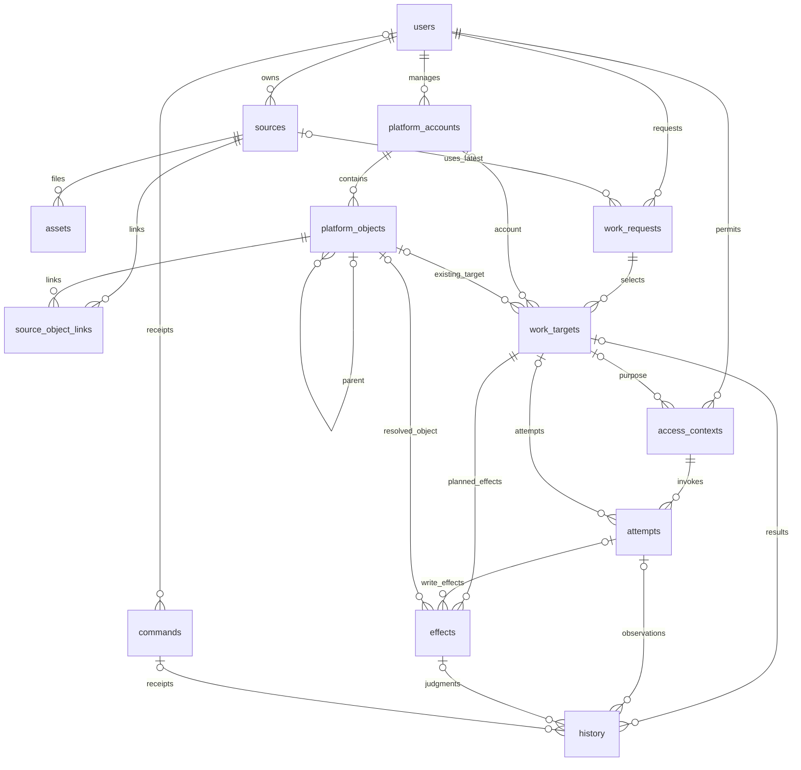

# 최소 DB 설계 V3.0 — 최신 원본 중심

<!-- DB-MINIMAL-V3.md generated from db-minimal-v3.json data in same operation -->

**13개 테이블 검토 후보** · V3.1-R2 잠정 기준 · 최신 저장 원본만 관리. [정본](db-minimal-v3.json) · [이전 V2](DB-MINIMAL-V2.md) · [R2 사용자 스토리](v3.1/user-stories.json) · [R03 검토](../../../../review/lesson-registration/USER-STORY-R03-REVIEW-V3.1-R2.md). 실제 DB/외부 실행 미검증.

## 변경의 근거

- **source_versions → sources** — 최신 명시 저장본 1개 + 현재 draft 1개 + revision 번호. 이전 버전의 전체 내용은 저장하지 않음. 승인 시 업무에 필요한 사실/입력값/자료만 고정.

- **source_version_assets → assets** — 자료를 원본에 귀속. 현재 원본/현재 draft의 첨부 역할·순서는 JSON의 검증된 asset 참조. 같은 원본에서 여러 플랫폼 재사용; 서로 다른 원본 간 첨부 공유는 미채택.

- **dispatches + read_requests → attempts** — 호출 종류와 상태를 명시적으로 분리하고 공통 식별/권한/목적/시각을 통합. readback과 write outcome을 효과 성공과 혼동하지 않음.

- **conflict_guards → effects + account-scoped DB transaction lock** — 예약/in-flight/unknown/disputed인 효과와 정규 계정/slot/객체/겹침 범위를 지속 보존. 독립 guard 행 제거. 실제 동시성/장애 실증 실패 시 재검토.

- **platform_objects + source_object_links 유지** — 관계의 연결/해제와 외부 객체의 식별/상태가 독립. 원본 하나 제한을 추가로 결정하면 source FK로 축소 후보; 현재 임의로 범위 제한하지 않음.

## 관계도



주관계만 표시; 상세 FK/조건은 아래 명세. `?`는 조건부 NULL. PostgreSQL 물리 타입 후보.

## 테이블별 상세 필드

### 1. users — 서비스의 본인과 소유권

필요성: 원본·계정·업무를 다른 강사와 격리하는 소유 주체. 인증 세션/비밀은 별도 인증 서비스.

| 필드 | 타입 | 목적 |
| --- | --- | --- |
| `id` | uuid PK | 내부 사용자 |
| `issuer` | text | 서비스 인증 제공자 |
| `subject` | text | 검증된 제공자 사용자 ID |
| `state` | text | active/restricted/retired |
| `created_at` | timestamptz | 생성 시점 |
| `retired_at` | timestamptz? | 접근 종료 시점 |

제약: UNIQUE(issuer,subject); 제공자가 검증한 식별자만 수락; 삭제/보존 정책은 미확정

### 2. sources — 최신 저장 원본과 현재 편집 중인 내용

필요성: F01~F05 현재 원본 재사용/수정. 과거 원본 전체 보존·선택·복원은 범위 아님; 승인된 업무에는 필요한 사실/입력값만 고정.

| 필드 | 타입 | 목적 |
| --- | --- | --- |
| `id` | uuid PK | 레슨 원본의 안정된 ID |
| `owner_id` | uuid FK users | 강사 |
| `content` | jsonb? | 최신 명시 저장된 원문·사실·첨부 사용 목록; 신규 미저장 shell이면 NULL |
| `revision` | integer | 저장된 변경 번호(0=미저장); 과거 버전 FK 아님 |
| `draft` | jsonb? | 현재 미저장 편집 1건, 기준 revision·편집 generation·추출 요청 ID·입력/문제·자료 |
| `state` | text | draft_only/managed/retired |
| `created_at` | timestamptz | 생성 시점 |
| `updated_at` | timestamptz | 마지막 명시 저장 시점(미저장 시 생성 시점) |

제약: 저장 시 owner·base revision·draft generation 검사/CAS 후 최신 content 교체 및 revision 증가, draft 정리와 command 영수증 원자 기록; 오래된 추출 응답은 무시; 신규 미저장 shell은 저장 원본 목록에 미표시; 한 원본당 서버 draft 하나(충돌 시 타 편집 덮어쓰기 금지)

### 3. assets — 원본에 속한 첨부 파일 및 사용 권리

필요성: 파일·권리는 원본 텍스트와 독립적으로 변경된다. 같은 원본의 여러 플랫폼에서 재사용; 현재 별도 원본 간 첨부 공유 기능은 미채택이므로 N:M 연결 테이블 없음.

| 필드 | 타입 | 목적 |
| --- | --- | --- |
| `id` | uuid PK | 불변 파일 ID |
| `source_id` | uuid FK sources | 소유 원본(사용자는 원본에서 유도) |
| `storage_key` | text | 비공개 저장소 키 |
| `digest` | text | 파일 동일성·무결성 |
| `media_type` | text | 파일 유형 |
| `size_bytes` | bigint | 파일 크기 |
| `rights_state` | text | 사용 허용/불명/철회 상태 |
| `rights_detail` | jsonb | 공개/사용 허용 범위 및 근거 |
| `created_at` | timestamptz | 업로드 시점 |

제약: 파일 변경은 새 ID; content/draft의 첨부 목록은 해당 source의 asset만 참조(역참조 검사 포함); 현재 사용 역할/순서는 content.attachments에만 기록; 승인 plan에는 필요한 asset ID·digest·사용 범위를 고정; 권리 철회 시 새 사용 제한; 현재 원본에서 제거해도 아직 필요한 승인/실행 참조를 임의 삭제하지 않음; 실제 보존/삭제 정책 별도

### 4. platform_accounts — 외부 계정 관리 연결

필요성: 계정당 여러 상품/클래스/공고를 관리하고 계정 불일치 차단. 같은 실제 계정의 다른 내부 행도 전역 정규 키로 경합 판단.

| 필드 | 타입 | 목적 |
| --- | --- | --- |
| `id` | uuid PK | 내부 계정 관리 ID |
| `owner_id` | uuid FK users | 강사 |
| `platform_key` | text | 플랫폼 |
| `environment` | text | mock/live 구분 |
| `identity_namespace` | text | 계정 ID의 유효 범위 |
| `native_account_key` | text | 정확하게 확인된 외부 계정 ID |
| `state` | text | linked/retired |
| `verified_at` | timestamptz | 계정 식별 확인 시점 |
| `updated_at` | timestamptz | 연결 상태 변경 시점 |

제약: UNIQUE(owner_id,environment,platform_key,identity_namespace,native_account_key); 연결 해제 시 기존 접근 문맥 차단 및 폐기 의무 기록; 재연결로 옛 접근 문맥을 활성화하지 않음; 관리 연결≠실제 접근 권한; 쿠키/비밀번호/토큰 없음

### 5. platform_objects — 확인된 외부 등록물과 공유 상위 객체

필요성: 외부 객체는 원본·등록 시도 없이도 존재할 수 있고 한 객체에 여러 수정/조회가 연결. 실제 객체 식별 및 부모 관계 실증 필요.

| 필드 | 타입 | 목적 |
| --- | --- | --- |
| `id` | uuid PK | 서비스 내부 객체 ID |
| `account_id` | uuid FK platform_accounts | 정확 외부 계정 |
| `parent_id` | uuid? FK platform_objects | 검증된 상위 프로필/상품 등 |
| `kind` | text | product/class/profile/service/post 등 |
| `identity_namespace` | text | 객체 식별 범위 |
| `native_object_key` | text | 검증된 외부 객체 ID |
| `locator` | jsonb? | 확인된 관리/공개 위치 |
| `verified_at` | timestamptz | 정확 식별 확인 시점 |

제약: UNIQUE(account_id,kind,identity_namespace,native_object_key); 부모 동일 계정, cycle 금지; 확인 전 후보는 target.plan에만 보존; URL/표시명/순서만으로 정확 식별 가정 금지; 현재 외부 상태는 history 적격 관측에서 조회

### 6. source_object_links — 원본과 외부 등록물의 관리 연결

필요성: 직접 등록한 글의 사후 연결과 해제, 공유 객체 관계를 외부 객체 자체와 구별. 객체당 원본 하나로 제한하는 결정이 확인되면 platform_objects에 FK를 넣어 통합 가능; 현재 그러한 제한은 없음.

| 필드 | 타입 | 목적 |
| --- | --- | --- |
| `id` | uuid PK | 관리 연결 ID |
| `source_id` | uuid FK sources | 원본 |
| `object_id` | uuid FK platform_objects | 외부 객체 |
| `state` | text | linked/retired |
| `linked_at` | timestamptz | 연결 시점 |
| `ended_at` | timestamptz? | 해제 시점 |

제약: 동일 owner 및 정확한 객체/권한 확인; 활성 (source_id,object_id) UNIQUE; 해제 및 재연결 이력 보존; 외부 객체 삭제하지 않음

### 7. work_requests — 한 번의 사용자 업무 선택 및 일괄 승인

필요성: 한 번에 여러 플랫폼을 선택하고 최초 선택·실제 수락·보류/제외를 모두 보여준다(R03-V31-03).

| 필드 | 타입 | 목적 |
| --- | --- | --- |
| `id` | uuid PK | 업무 묶음 ID |
| `owner_id` | uuid FK users | 요청자 |
| `source_id` | uuid? FK sources | 선택한 원본(원본이 필요 없는 조회/관리 업무는 NULL) |
| `source_revision` | integer? | 선택/승인 기준 원본 revision |
| `environment` | text | mock/live |
| `selection_revision` | integer | 선택·검토안 변경 번호 |
| `review_state` | text | preparing/presented/frozen/closed |
| `approval` | jsonb? | 내용 승인·범위 승인 각각의 증거/시각, 필수 직접 동의 참조, 고정 검토안 digest |
| `created_at` | timestamptz | 요청 생성 |
| `accepted_at` | timestamptz? | 쓰기 업무 수락 시점 |

제약: 전체 선택 대상의 처분과 plan은 work_targets가 정본; approval에 동일 입력값 반복 저장 안 함; 양 승인+정확한 target 집합/plan digest+command receipt를 원자 수락; 0 ready면 쓰기 수락 없음; 동결 후 선택/승인 변경 금지; 미수락 원본 변경은 revision 갱신 후 준비 재검증; 읽기/내부 업무는 쓰기 승인 요구하지 않음

### 8. work_targets — 플랫폼별 업무와 준비안/고정 실행안

필요성: 동일 원본·일괄 요청에서도 플랫폼마다 다른 입력/계정/업무/결과. 원본 과거 버전 FK 없이 고정 plan 재현.

| 필드 | 타입 | 목적 |
| --- | --- | --- |
| `id` | uuid PK | 대상 업무 ID |
| `request_id` | uuid FK work_requests | 상위 묶음 |
| `selection_key` | text | 묶음 내 선택 항목 |
| `platform_key` | text | 대상 플랫폼 |
| `operation_key` | text | CREATE/UPDATE/RENEW/READ/STATUS/LINK 등 정확 업무 |
| `disposition` | text | selected/ready/accepted/held/excluded 등 검토 처분 |
| `account_id` | uuid? FK platform_accounts | 확인된 대상 계정 |
| `object_id` | uuid? FK platform_objects | 기존 정확 대상(신규는 NULL) |
| `prior_target_id` | uuid? FK work_targets | 잔여/반려 수정 등 이전 업무 |
| `prepared_source_revision` | integer? | 입력안 계산에 사용한 원본 revision |
| `prep_generation` | integer | 늦은 준비 응답 차단 |
| `prep_state` | text | unprepared/preparing/issues/ready/held/excluded/stale/consumed |
| `profile_ref` | text? | 재현 가능한 플랫폼 업무 규칙 버전 |
| `plan` | jsonb | 검증된 해당 업무 필요 사실·실제 입력값·자료 참조·before/after·식별/신규 slot·보완/제약·효과 및 읽기 계획; 동결 후 불변 |
| `lifecycle` | text | not_accepted/accepted/running/fencing/ended |
| `ended_at` | timestamptz? | 실행 종료(결과 성공과 별개) |

제약: UNIQUE(request_id,selection_key); source revision/계정/객체/owner/env 정합; 미확인 후보는 plan 안에만, 정확 binding 전 쓰기 금지; 승인 전 stale 조건 검사, 승인 후 필요한 입력/자료만 freeze; 새 변경/재심사/갱신은 새 대상/새 승인; 결과 객체는 effects.object_id와 history에서 유도

### 9. commands — 내부 저장·연결·승인 등의 동일 요청 영수증

필요성: 원본 저장·기존 연결·승인 등 서로 다른 명령에서 응답 유실 복구. 별도 업무 행이 없거나 아직 생성되지 않아도 명령 결과 확인 필요.

| 필드 | 타입 | 목적 |
| --- | --- | --- |
| `id` | uuid PK | 명령 ID |
| `owner_id` | uuid? FK users | 사용자(최초 가입 전 검증 주체만 NULL) |
| `principal_key` | text | 검증된 서비스 주체 키 |
| `kind` | text | SAVE_SOURCE/LINK/UNLINK/ACCEPT/RIGHTS 등 |
| `request_key` | text | 호출자가 재사용할 멱등 키 |
| `request_digest` | text | 정규화된 요청 내용의 digest |
| `state` | text | pending/committed/rejected/no_commit_proven |
| `receipt` | jsonb? | 정확 결과 ID/revision/거절 사유; 과거 원본 내용 보존하지 않음 |
| `created_at` | timestamptz | 접수 시점 |
| `resolved_at` | timestamptz? | 정본 결과 기록 시점 |

제약: UNIQUE(principal_key,kind,request_key); 동일 digest만 기존 결과 확인, 다르면 거절; DB 행 잠금과 최종 상태 CAS로 업무와 영수증 동일 트랜잭션; no_commit_proven은 이전 지연 커밋을 봉쇄한 경우만; 서버 미기록이면 호출자의 owner-scoped 기존 키 보존 필요; pending 상태에서 무조건 재실행 금지

### 10. access_contexts — 업무에 한정한 인증/접근/폐기 상태

필요성: 동일 업무에서도 실패·만료 후 명시 재인증 필요(R03-V31-04). 실행 업무와 권한/폐기 수명이 다름.

| 필드 | 타입 | 목적 |
| --- | --- | --- |
| `id` | uuid PK | 접근 문맥 ID(새 인증 시 새 ID) |
| `owner_id` | uuid FK users | 요청자 |
| `target_id` | uuid? FK work_targets | 목적 업무(계정 관리 등은 NULL) |
| `platform_key` | text | 플랫폼 |
| `expected_account_id` | uuid? FK platform_accounts | 기대 계정 |
| `verified_account_id` | uuid? FK platform_accounts | 실제 확인된 계정 |
| `purpose` | text | 준비/계정 확인/업무 실행/조회 |
| `state` | text | human/verifying/verified/blocked |
| `scope` | jsonb | 허용 읽기·쓰기 범위/근거/호출 문맥 |
| `expires_at` | timestamptz | 만료 시점 |
| `blocked_at` | timestamptz? | 차단 시점 |
| `cleanup` | jsonb | 한 문맥의 자원별 폐기 의무 및 pending/confirmed/unknown |

제약: 접근 ID 및 state로 이전 문맥 차단(재활성화 금지); 기대 계정·실제 계정 일치, 목적/범위/만료/권한 매번 검사; 차단과 폐기 의무 원자 기록; 이전 폐기 불명은 새 인증으로 해소되지 않음; 자원 식별자는 비밀 아닌 메타만; 인증 비밀 저장 금지

### 11. attempts — 읽기 및 쓰기의 외부 호출 시도

필요성: 전송과 읽기는 같은 외부 호출 단위로 묶되 kind별 상태를 분리. 조회 실패와 쓰기 효과 불명은 독립.

| 필드 | 타입 | 목적 |
| --- | --- | --- |
| `id` | uuid PK | 개별 외부 호출 시도 ID |
| `target_id` | uuid? FK work_targets | 관련 업무(계정 확인만 예외) |
| `access_id` | uuid FK access_contexts | 정확 접근 문맥 |
| `object_id` | uuid? FK platform_objects | 읽기/쓰기의 기존 대상 |
| `kind` | text | read/write |
| `purpose_key` | text | 상태조회/식별/독립 readback 또는 정확 전송 경계 |
| `attempt_key` | text | 동일 호출 식별 |
| `scope` | jsonb | 고정 계정/객체/slot/목적/범위와 승인된 실행 또는 읽기 계획 |
| `sequence_no` | bigint? | 정확 조회 대상·목적 내 요청 순서(read) |
| `state` | text | read: pending/running/observed/unavailable; write: reserved/started/sealed |
| `requested_at` | timestamptz | 요청·예약 시점 |
| `started_at` | timestamptz? | 호출 시작 |
| `finished_at` | timestamptz? | 호출 종료 |
| `failure_reason` | text? | 호출 오류 코드 |

제약: UNIQUE(attempt_key); kind별 CHECK 및 목적/owner/env/account/target 일치; write는 target 필수, 승인된 효과 전체를 reserve하고 시작 상태 CAS로 같은 시도 일회 시작; read는 정확 목적/범위/순번 및 권한 검증, effect 확인 목적은 scope의 적격 effect 참조로 제한; 관측 결과 history append; read/write 결과를 외부 효과 성공으로 해석하지 않음

### 12. effects — 외부 변경의 개별 효과 및 중복/불명 차단

필요성: 한 번의 외부 전송이 여러 효과를 낼 수 있어 독립 판정 필요. 별도 conflict_guards 없이 효과 행 자체가 지속 차단의 정본; 전역 잠금과 alias/경합 검증 실증 전 조건부 설계.

| 필드 | 타입 | 목적 |
| --- | --- | --- |
| `id` | uuid PK | 개별 효과 시도 ID |
| `target_id` | uuid FK work_targets | 승인 업무 |
| `attempt_id` | uuid? FK attempts | 해당 쓰기 시도(미시도는 NULL) |
| `prior_effect_id` | uuid? FK effects | 이전 효과 시도 |
| `rule_key` | text | 승인 계획의 효과 규칙 |
| `logical_effect_key` | text | 정확 업무의 의미 효과 키 |
| `intent_digest` | text | 승인 변경 내용/조건 digest |
| `root_key` | text | 정규 대상 또는 신규 의도 slot |
| `scope_path` | text | 겹침 판정을 위한 검증된 변경 범위 |
| `object_id` | uuid? FK platform_objects | 정확 확인된 실제 효과 객체(slot→객체 연결) |
| `required` | boolean | 완료에 필수 효과 |
| `state` | text | not_attempted/reserved/in_flight/confirmed/none_confirmed/unknown |
| `disputed` | boolean | 상충 근거에 따른 차단 |
| `updated_at` | timestamptz | 현재 판정 변경 시점 |

제약: 대상 내 동일 효과 후보 중복 금지; attempt는 같은 target의 write, 여러 effects가 같은 attempt에 연결 가능; 정규 외부 계정 키를 통한 전역 잠금 하 모든 활성/불명/분쟁 효과 및 slot→확인 객체 관계와 scope 겹침 검사·원자 reserve; unknown/disputed 지속 저장; 권한 차단 뒤 시작 금지; 종료 후 늦은 증거는 history로 판정 보완만; 확인/불명 동일 효과 반복 금지, 새 시도는 새 승인+안전한 미발생/미시도 또는 새 의도 및 미해결 경합 없음

### 13. history — 불변 관측·근거·결과·권리/감사 기록

필요성: F22~F29: 심사 접수·나중 반려·모집 가능 목표·최신 조회 실패를 분리하고 근거 및 이전 결과 유지. 별도 관측/결과/감사 테이블로 나누지 않음.

| 필드 | 타입 | 목적 |
| --- | --- | --- |
| `id` | uuid PK | 기록 ID |
| `owner_id` | uuid FK users | 소유 사용자 |
| `kind` | text | response/observation/evidence/effect_judgment/target_result/goal/rights/audit 등 |
| `target_id` | uuid? FK work_targets | 관련 업무 |
| `attempt_id` | uuid? FK attempts | 관련 호출 |
| `effect_id` | uuid? FK effects | 관련 효과 |
| `object_id` | uuid? FK platform_objects | 정확 외부 대상 |
| `access_id` | uuid? FK access_contexts | 관련 접근 문맥 |
| `command_id` | uuid? FK commands | 관련 내부 명령 |
| `version_no` | integer? | 해당 판정 종류·대상별 증가 버전 |
| `observed_at` | timestamptz? | 실제 관측 시각 |
| `recorded_at` | timestamptz | 수신/기록 시각 |
| `payload` | jsonb | 종류별 검증된 최소 관측값·native 상태·결과/사유·권리 메타 |
| `proof_ids` | uuid[] | 적격 불변 근거 ID |

제약: append-only; kind별 필수 FK/값 검증; 동일 owner·대상·목적의 참조와 proof_ids 존재/적격/불변 검증(DB trigger 또는 등가 강제 검증, 실제 정책 검토); effect/result 판정 버전 원자 증가; response와 독립 observation 별개; 최신 조회 실패가 마지막 정상 관측을 삭제하지 않음; 과거 원본 전체/인증 비밀/불필요 원문 저장 안 함

## 기획 기능과 연결

| 기능 | 기존 업무 | 저장 구조 | 의미 |
| --- | --- | --- | --- |
| 사용자·권한·복귀 | SW-01, SW-02, SW-03, SW-35, SW-36 | users, commands, work_requests, work_targets, history | 검증된 본인, 내부 읽기, 동일 명령 조회, 저장 문맥 복귀. FE 응답 인지는 영속 상태가 아님. |
| F01~F05 원본과 자료 | SW-04, SW-05, SW-06, SW-07, SW-08 | sources, assets, source_object_links, commands, history | 편집 보존, 최신 저장 및 고정 업무 입력, 재사용, CAS, 내부 삭제/연결 해제. |
| F06~F11 대상 및 입력안 | SW-09, SW-10, SW-11, SW-12, SW-13 | work_requests, work_targets, sources, commands | 7개 플랫폼 규칙은 버전된 설정; 정확 준비값·오류·출처·대상별 보류. |
| F12~F15 계정/객체/변경 비교 | SW-14, SW-15, SW-16, SW-17, SW-18, SW-19, SW-20 | platform_accounts, platform_objects, source_object_links, work_targets, access_contexts, attempts, commands, history, effects | 정확 권한·계정·공유 프로필/하위 대상·이전 관측·갱신 조건. |
| F16~F18 승인 및 실행 자격 | SW-21, SW-22, SW-23, SW-24 | work_requests, work_targets, commands, access_contexts, attempts, effects | 전체 선택 처분, 논리 양 승인·pin, 수락 원자성, 전역 fence. |
| F19~F21 등록·수정·갱신 | SW-25, SW-26, SW-27 | work_targets, platform_objects, source_object_links, attempts, effects, history | 한 전송에 여러 효과; 부분 성공·불명, 기존 객체 갱신·새 의도 구분. |
| F22~F29 결과·관측·안내 | SW-28, SW-29, SW-30, SW-31, SW-32 | work_targets, effects, attempts, history, platform_objects, source_object_links | 독립 근거, 시점별 native/goal/result 구분, 조회 실패 시 마지막 관측 유지, 내부 안내만. |
| 접근 종료·권리·제외 범위 | SW-33, SW-34 | access_contexts, platform_accounts, commands, effects, history | 새 접근 차단/폐기 불명 독립; 장기 위임·자동 모니터링 없음. |

## 사용자 스토리 및 R03 추가 요구

| 여정 | 구조 | 대응 |
| --- | --- | --- |
| UJ-01 최초 등록 | sources, work_requests, work_targets, effects, history | 원본 저장 후 선택 대상별 승인/실행/독립 결과; 결과가 확인되면 정확 객체 및 링크 생성. |
| UJ-02 저장 원본 추가 등록 | sources, work_requests, work_targets, platform_objects, source_object_links | 최신 저장본으로 새 요청, 기존 공고와 효과 이력 유지. |
| UJ-03 기존 등록물 수정 | platform_objects, work_targets, effects, attempts, history | 기존 객체 ID 유지; before/after 승인값 및 관측, 수정으로 신규 생성하지 않음. |
| UJ-04 공고 갱신 | platform_objects, work_targets, effects, history | 뮬 동일 게시물 갱신 업무; 지원/조건/새 의도 확인, 다른 6개는 보류. |
| UJ-05 저장 상태 확인 및 최신 조회 | platform_objects, attempts, history | 저장된 최신 적격 관측을 보여주며 최신 조회 실패는 별도로 표시. |
| UJ-06 기존 글 관리 연결 | platform_accounts, platform_objects, source_object_links, commands, history | 권한과 정확 식별 확인 후 기존 직접 등록물을 내부 연결; 외부 변이 없음. |
| UJ-07 정보·규격 오류 및 인증 | sources, work_targets, access_contexts, history | 다른 정상 대상의 준비를 보존하고 해당 오류만 수정; 인증 만료 후 새 문맥. |
| UJ-08 부분 성공·실패·효과 불명 | work_targets, attempts, effects, history | 확인+불명은 effect_unknown, 확인+미발생 확정은 partial_confirmed; 기존 성공/불명 재실행 없음. |
| UJ-09 대행 제한·내부 작성안 | work_targets, history | 정확 작성안/제한 근거만 기록; 외부 effect 또는 성공 없음. |
| UJ-10 원본 수정·삭제·연결 해제 | sources, source_object_links, commands, history | 최신 원본만 수정·revision 증가, 내부 retire/연결 해제; 승인 업무에 필요한 고정 내용과 기존 관측 보존. |
| UJ-11 외부 계정·권리 | users, platform_accounts, access_contexts, commands, history | 정확 계정 연결/해제 및 권리 접수; 접근 차단과 폐기 확인 독립. |
| UJ-12 이탈·재접속·복귀 | users, sources, work_requests, work_targets, commands, access_contexts, history | 저장 또는 수락 응답 유실에서 같은 key 확인; 화면 이탈로 외부 효과 재개 없음. |

- SC-R03-01~03: 같은 명령 키/영수증 확인 후 기존 관계 복귀; 불명 새 연결 0; 미커밋 확정 전 새 요청 금지 (commands + source_object_links)

- SC-R03-04~07: 접수 이력과 나중 반려/목표 상태 분리; 정확 기존 객체에서 허용된 새 수정 승인만 (history + platform_objects + work_targets + effects)

- SC-R03-08~10: 최초 선택 5건 모두 보존, 수락 3건만 실행; held/excluded 이유; 0 ready면 쓰기 수락 없음 (work_requests + work_targets)

- SC-R03-11~13: 같은 준비·다른 대상 유지, 해당 대상 새 접근 ID로 명시 재인증; 계정 불일치 차단 및 폐기 (access_contexts + work_targets)

## 주요 데이터 예시

### 최신 원본 content
```json
{
  "raw_text": "1:1 대면 보컬 레슨, 회당 120분, 6회 총 15만원",
  "facts": {
    "title": {
      "value": "보컬 레슨",
      "origin": "user_text",
      "certainty": "confirmed"
    },
    "lesson_format": {
      "value": "one_to_one",
      "origin": "user_text",
      "certainty": "confirmed"
    },
    "delivery": {
      "value": "offline",
      "origin": "user_text",
      "certainty": "confirmed"
    },
    "duration_minutes": {
      "value": 120,
      "origin": "user_text",
      "certainty": "confirmed"
    },
    "session_count": {
      "value": 6,
      "origin": "user_text",
      "certainty": "confirmed"
    },
    "price": {
      "value": {
        "amount": 150000,
        "currency": "KRW",
        "basis": "total_course"
      },
      "origin": "user_text",
      "certainty": "confirmed"
    }
  },
  "attachments": [
    {
      "asset_id": "A01",
      "role": "cover",
      "position": 0
    }
  ]
}
```

### 업무 plan (합성 예시)
```json
{
  "binding": {
    "account_id": "P01",
    "object_id": null,
    "new_slot": "정규 신규 의도 키"
  },
  "facts_used": {
    "duration_minutes": 120,
    "session_count": 6,
    "total_price_krw": 150000
  },
  "input_values": {
    "lesson_format": "개인레슨",
    "delivery": "오프라인",
    "price": 150000
  },
  "asset_refs": [
    {
      "asset_id": "A01",
      "digest": "sha256:...",
      "role": "cover",
      "position": 0
    }
  ],
  "issues": [],
  "effects": [
    {
      "rule_key": "해당 업무의 확인된 효과 규칙",
      "required": true
    }
  ],
  "read_plan": [
    {
      "purpose": "independent_readback",
      "scope": "정확 계정/객체"
    }
  ],
  "approval_note": "예시 값만. 실제 필수 필드/가격 의미/규격/효과는 플랫폼 검증 후."
}
```

## 필수 제약

- **최신 원본만** — SC-04/F05/SW-07의 revision은 최신본 변경 번호로 해석. AX03·이전 V1/V2의 '저장 revision 전체 불변 보존' 물리 요구는 본 사용자 방향에 따라 변경 제안. 과거 원본 복원/선택 기능 없음. 원본 revision 번호와 승인된 필요한 사실/입력값·자료·규칙·대상은 남기되 원본 전문 전체 복사 금지. 상위 문구 개정은 R01 검토 후.

- **편집과 수락** — 원본 저장은 revision CAS, draft 생성/편집 generation CAS, 명령 결과 원자 커밋. 원본 변경 뒤 미수락 준비는 stale; 재준비 때 현재 revision으로 변경. 승인 수락 시 sources/request/targets를 잠그고 검토 selection revision 및 정확한 source revision/plan digest 확인. 승인된 plan은 최신 원본의 변경으로 재작성하지 않음; 실행 직전 권한/권리/정책 확인.

- **전역 경합** — account key=(environment,platform,identity_namespace,native_account_key); 같은 정규 키에 대해 모든 예약/판정/alias 확정/분쟁/해소가 동일 PostgreSQL transaction advisory lock 사용. effects 상태/정규 scope 및 이미 확인된 object/native parent 관계를 조인해 기존 효과와 경합을 비교; owner별 ID로 제한하지 않음. 경합/권한/정확 scope 불명은 영향 범위에서 보수적 차단; 잠금은 외부 실행 중 유지하지 않고 reserved/in_flight/unknown/disputed 행이 지속 차단. write 시작 전 상태 CAS 및 접근 확인. crash 발생 시 자동 재전송 없음. 외부 side effect의 원자성/일회 발생을 DB alone으로 보장할 수 없음.

- **read/write와 결과** — read attempt는 성공/불가, write attempt는 전송 시작/종료 상태. 외부 실제 효과는 effects에서 독립 확인. 응답/독립 관측/goal/target_result history를 분리; 늦게 도착한 조회는 해당 요청의 기록만 보완하고 최신 요청/적격 관측을 임의 덮어쓰지 않음. 확인+불명=effect_unknown, 확인+미발생 확정/미시도=partial_confirmed.

- **접근과 폐기** — 계정 관리 연결, 업무 접근, 외부 실제 권한은 별개. 각 새 인증에 새 access ID, 이전 blocked 문맥 재개 없음. 폐기 불명 별도 보존, 접속 비밀은 운영 중 제한된 휘발 세션에서만. 실제 접근/실행 mock-only.

- **참조·삭제** — 모든 사용자 FK는 상위 소유권 일치, env/account/정확 대상 및 권한 검증. history proof_ids와 JSON asset_refs는 검증된 구조/존재/owner/범위 및 역참조 삭제 제한을 강제. 실제 보존/삭제/백업 정책 결정 전 물리 삭제 보류. 내부 해제는 외부 삭제/원복 아님.

- **규칙/입력 필드** — 플랫폼별 규칙/필드/완료 기준은 버전된 설정 또는 코드로 관리하고 이전 사용 버전은 재현 가능해야 함. DB는 원본 typed common facts, platform-specific typed plan, 승인 조건/근거를 저장. 현재 실제 플랫폼별 필수 필드/계정·객체 정규 키/독립 효과는 미검증; 보류·조건부 업무는 실행하지 않음.

## 시나리오 기대 결과 (미실행)

- **최신 원본 변경** — S01 revision 1→2, 이전 원문 저장 없음. 이미 승인된 T01.plan=15만원·필요 자료 고정, 미수락 T02는 stale; 신규 등록 18만원. 타인 원본/늦은 추출/동시 저장 거절.

- **자료 변경** — 대표 사진 A01→A02 변경. 최신 content는 A02, 승인 T01은 A01 참조; 권리 철회 시 실행 차단. 미참조 자료 물리 삭제는 정책 후.

- **선택 5건·수락 3건** — 5 target rows, 3 accepted, held 1/excluded 1. 같은 승인 key 응답 유실 시 동일 receipt; 수락 0이면 효과 0.

- **쓰기 응답 유실** — write attempt 1건, 효과 2개 중 하나 confirmed·하나 unknown. 이미 확인 효과 재쓰기 금지, 새 시도 차단, 독립 read attempt와 후속 판정만.

- **공유 객체/다른 사용자 경합** — 정규 외부 계정 동일·root 또는 하위 변경 범위 겹침. 동시 예약 둘 중 한쪽 차단, 서버 재시작·slot→object 확인 후에도 unknown/dispute 차단 유지; 독립 범위 증명 시 처리 가능.

- **조회 실패 및 지연** — 이전 native=심사 접수; 새 STATUS 실패. 조회 불가 및 이전 관측 유지. 나중 반려 관측 시 과거 접수 결과와 최신 반려/목표를 구분.

- **연결·재인증** — 직접 게시물 연결 응답 유실은 같은 commands 키 확인. 인증 만료는 기존 access blocked/cleanup pending, 정확 계정으로 새 context; 불일치·폐기 불명에서 자동 재개 없음.

## 결정/제한

- 사용자당 하나의 서비스 인증 주체; 추가 인증 연결 기능 미채택.

- 한 원본당 현재 서버 draft 하나; 동시에 편집하면 generation/revision 충돌로 보존된 draft 또는 호출자 편집 내용을 정정; 여러 독립 draft 저장 기능 미채택.

- 자료는 해당 원본에 귀속; 다른 원본 간 동일 파일의 공유/독립 파일 라이브러리 기능 없음. 현재 권리와 승인 참조 보호 필요.

- 외부 객체 parent 단일 계층 후보; 실제 cardinality/외부 고유 키 미검증. 원본–객체 관계는 독립 유지; 1 객체=1 원본 제품 제한 채택 시 링크 테이블 통합 검토.

- effects 기반 경합과 attempts 통합은 PostgreSQL transaction/동시성/지연 readback/장애 검증 전 후보. 전역 guard를 없애는 것이 안전성을 포기하는 것은 아님.

- PostgreSQL 후보 타입·제약; DDL·migration·공식 CI/프로젝션 검사·실제 외부 실행 미수행. 기존 SQLite·기존 상위 명세 및 V1/V2 이력 보존. 사용자 최신본 방향과 상충하는 AX03/기존 버전 문구는 채택 시 필요한 수정 사항으로 명시.

정적 대조 9/9 통과. 실제 DB 실행 0, 실제 외부 실행 0. 기존 상위 명세/구현/main 변경 없음.
