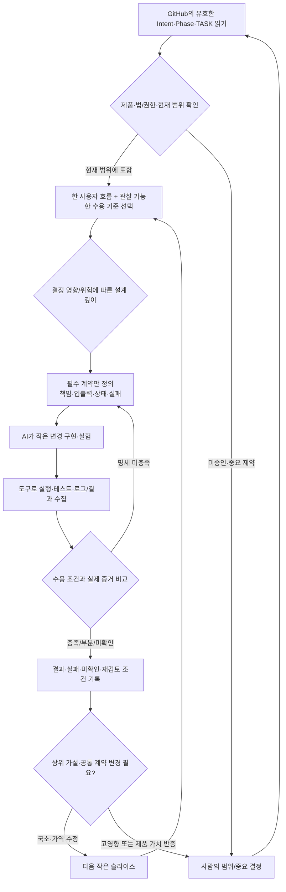
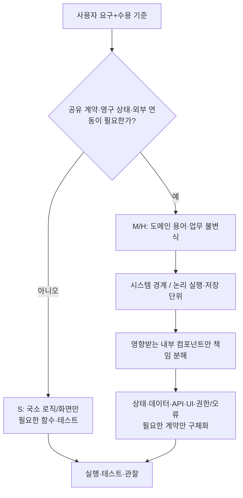

# V4 · 경량 AI 설계·실행 플레이북

> **상태: R01 검토용 제안 · 2026-11-19.** 기존 [Intent](../human/INTENT.md)·[현재 Phase](../human/phase-intents/PHASE-20261118-01.md)·CURRENT·TASK·ADR을 대체하지 않습니다. **제품 후보와 실제 구현은 아직 별도 승인 대상**입니다.
>
> **먼저 이 페이지를 읽고, 필요한 경우에만 아래의 상세 설계 사전을 엽니다.** [L0~L7 점진적 설계 순서](PROGRESSIVE-DESIGN-ORDER.md) · [설계 정보 사전](planning-design-info-model.json) · [용어집](DESIGN-GLOSSARY.md) · [구성요소 다이어그램](COMPONENT-DESIGN-VIEWS.md).

## 1. 무엇을 변경하는가

기존 V3의 17개 판단 단계·28개 정보 유형·202개 필드는 **설계 시 빠뜨릴 수 있는 정보를 찾는 사전**으로 유지합니다. 그것을 매번 AI 작업의 입력 양식이나 17번의 승인 절차로 사용하지 않습니다.

**평상시 작업의 기본 단위는 하나의 사용자 흐름/요구사항을 검증하는 작은 슬라이스(slice)**입니다. 슬라이스란 "사용자 행동 하나에서 관찰 가능한 결과 하나까지"를 대상으로 하며, 꼭 기능 출시를 의미하지는 않습니다.

- **큰 틀은 인간 의도·제품 문제·제약·시스템 경계로 유지**합니다. 장기 Target Design은 가설이며 실제 선정된 제품·도메인의 검증 결과로 갱신합니다.
- **실행은 가능한 가장 작은 수직 슬라이스부터** 합니다. 한 작업이 요구·데이터·상태·UI·API를 모두 필요로 한다면 그 부분만 연결합니다.
- **명세를 충족했는지의 Verification과 실제 사용자에게 도움이 되는지의 Validation을 분리**합니다. 구조 검사만으로 사용자 가치나 제품 채택을 승인하지 않습니다.
- **AI는 도구·코드·실행·시험·근거 정리를 자율 수행**하되, 제품 선택·공통 구조 파괴·허가되지 않은 데이터 사용·외부 비용/권한·고위험 결정은 권한 있는 사람에게 올립니다.

## 2. 기본 운영 루프 — 설계, 실행, 학습을 하나로

**피드백은 전부 상위 설계를 다시 쓰라는 뜻이 아닙니다.** API 오류만 다르면 그 계약부터 고칩니다. 사용자 문제 가설 자체가 반증됐을 때만 제품 범위·상위 전략을 다시 결정합니다.

## 3. 작업 시작에 필요한 최소 7개 정보

| 항목 | AI가 꼭 알아야 하는 질문 | 기본 기록 형식 |
|---|---|---|
| **① 상위 참조** | 어떤 Intent/Phase/승인된 TASK 또는 후보 실험인가? | 기존 ID·정본 링크 |
| **② 이번 목적** | 한 사용자 흐름에서 무엇을 확인할 것인가? | 행위자·트리거·예상 결과 한 문장 |
| **③ 범위/금지** | 이번에 하지 않을 일과 법·권한·비용 제약은? | 포함/제외·필수 제한 |
| **④ 영향을 받는 경계** | 어떤 컴포넌트·상태·데이터·API를 바꿀 수 있는가? | 기존 파일·계약 ID/없음 |
| **⑤ 수용 조건** | 성공·실패·미확인을 무엇으로 판별할 것인가? | 정상/실패 예시와 관측값 |
| **⑥ 검증 수단** | 어떤 테스트·명령·수동 관찰로 결과를 확인할 것인가? | 실행 계획; 실행 전 결과는 `not_run` |
| **⑦ 변경 권한** | 무엇은 자율 결정하고, 무엇이 발견되면 누구에게 올리는가? | owner·승인 트리거 |

이 7개는 새 문서 양식이나 기계적 필수 입력을 의미하지 않습니다. **기존 TASK/Intent/Spec/Eval에 이미 있으면 재기록하지 않고 참조**합니다. 짧은 요청이면 AI가 기존 정본에서 조합해 작업합니다. 대표 **비채택 예시**는 [AI 슬라이스 계약](pilots/2026-11-19-planning-design-v2/AI-SLICE-EXAMPLE.json) 참조.

## 4. 설계 깊이는 '문서 수'가 아니라 변경 위험으로 결정

| 모드 | 선택 조건 | 작성할 정보 | 누가 결정? |
|---|---|---|---|
| **S · 국소 변경** | 단일 소유 영역, 되돌리기 쉬움, 외부 권한/공유 계약 변화 없음 | 7개 정보 중 기존 정보 참조 + 실행·시험 결과 | 담당자·AI 자율; 인간은 결과 확인 |
| **M · 공유 계약 변경** | API·상태·데이터 정본·다른 TASK/팀원과의 경계가 변경 | 영향받는 IT 유형만 펼침: 사용자 흐름, 계약 전후, 호환성, 실패/롤백, 교차 테스트 | 관련 owner 간 확인; 충돌 미해결 때 R01 |
| **H · 고영향·비가역** | 제품/범위/Must/Done, 공식 권한·개인정보·외부 수집·유료 실행, 고비용·중대한 구조 변경 | 근거·대안·제약·작은 반증 시험·권한 있는 승인/ADR | **R01/권한자 승인 전 확정 금지** |

S/M/H는 평가 점수나 별도 승인 문서 3개가 아닙니다. **작업 도중 새 위험이 발견되면 즉시 모드를 상향**하고 이유를 기록합니다. 외부 공식 지침·데이터 이용 권한은 기술적으로 가능해도 별도 허용이 필요합니다. 무단 크롤링이나 허가 없는 실제 현장 수집은 하지 않습니다.

## 5. 슬라이스 설계에서 컴포넌트를 언제 상세화하는가

**컴포넌트 정의는 '박스의 개수'가 아닙니다.** 각 컴포넌트는 적어도 **책임(왜 존재하는가) → 입력/출력(무엇을 교환하는가) → 소유 상태·데이터(누가 정본인가) → 실패 경계 → 충족 요구/검증**을 설명할 수 있어야 합니다. 불필요한 DB, 큐, 에이전트, 서비스 분할을 미리 만들지 않습니다.

## 6. 실행 후 증거가 없으면 완료라고 하지 않는다

AI는 실행할 수 있는 도구가 있다면 **실제 시험 실행**까지 수행해야 합니다. 실행 환경·권한·도구가 없으면 막힌 이유와 `not_run`을 남깁니다.

| 관측 | 기록 | 다음 행동 |
|---|---|---|
| 테스트 실행 및 수용조건 충족 | 실행 명령/환경/커밋/실제 결과·링크 | 관련 TASK/PR 검토 |
| 일부 조건만 충족 | 통과/실패 케이스·남은 위험 분리 | 영향된 계약/기능만 수정 |
| 실패 | 재현 명령·오류/로그·실패 원인(모르면 미확인) | 국소 수정→재실행 |
| 미실행·근거 부족 | `not_run`/unknown·원인·다음 최소 검사 | 완료·효과 수치 주장 금지 |
| 상위 가치·범위 반증 | 기존 대안과 비교한 결과·조건·제약 | 사람에게 제품/전략 재검토 |

작업 결과의 지속 상태는 기존 **TASK/Run/Eval/ADR**에 기록하고, Discord는 전달·협의에만 사용합니다. AI는 임의로 새 TASK를 양산하거나 불안정한 WBS에 따라 자동 배정하지 않습니다.

## 7. 실제로 효과가 있는지 비교할 방법

**가설:** 같은 유형의 작업에서 V4 경량 계약을 사용하면 사람의 반복 교정·판단 부담이 줄어들며 품질이 유지되거나 개선된다.

- **B0 (기준선):** 기존 TASK+일반 AI 요청·테스트로 동일 난이도의 작은 작업 수행.
- **B1 (V4):** 기존 TASK+7개 최소 정보 참조+영향 범위에 따른 계약+실행 증거 루프.
- **함께 관측:** 수용 테스트 충족, 회귀·누락 오류, 사람의 반복 지시·경계 승인 횟수(구분), 완료까지 실제 소요 시간, 사용 도구/실행 실패.
- **판정:** B1이 더 긴 문서를 만들었다는 이유로 성공이 아님. 품질이 악화되거나 개입·재작업이 늘면 V4를 축소합니다.
- **실험 상태:** `not_run`. 실제 측정값·개선율·상위 10% 성과를 주장하지 않습니다. 단일 예시는 구조·실행 경로를 시험할 뿐 일반화를 증명하지 않습니다.

## 8. 적용 범위 및 외부 근거

- 기존 [WORK-MODEL](WORK-MODEL.md)의 **13개 작업 정보 영역**과 [QUALITY-GATES](QUALITY-GATES.md)의 제출·품질 구분을 유지합니다. 28개 정보 유형/202개 필드에 전면 입력 의무·추가 승인 회의를 만들지 않습니다.
- **OpenAI Harness Engineering (2026)**: 저장소의 짧은 탐색 진입점·기계적 경계 검증·실행/피드백 루프. <https://openai.com/index/harness-engineering/>
- **Anthropic Building Effective Agents**: 단순한 패턴에서 시작하고 측정 근거가 있을 때만 에이전트 복잡도를 추가. <https://www.anthropic.com/research/building-effective-agents>
- **C4 / arc42**: 시스템·논리 실행 단위·컴포넌트, 상위 전략·실행·배포의 설명 관점. <https://c4model.com/> · <https://arc42.org/>

**V4는 이 외부 자료를 재구성한 팀 내부 제안이지, '상위 10% 개발자의 인증 방법'이 아닙니다.** 이 파일을 기본 운영 진입점으로 채택할지는 R01이 검토하고, 승인된 제품/작업으로 B0/B1 비교를 수행한 뒤 판단합니다.
