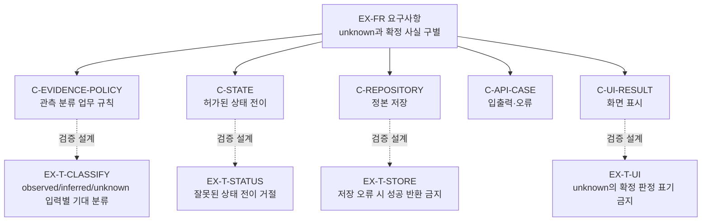
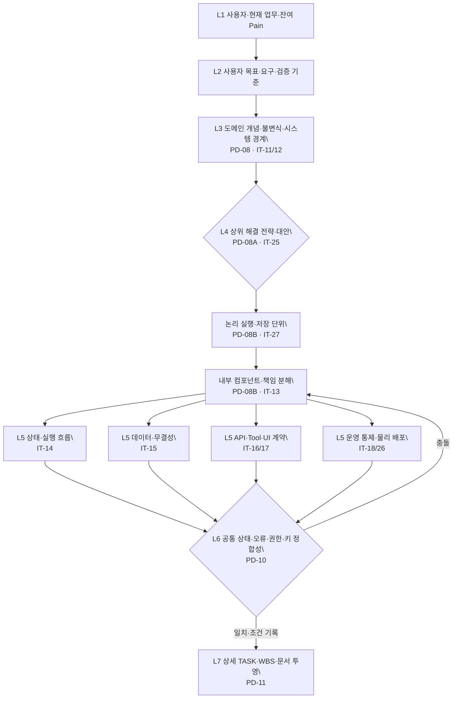
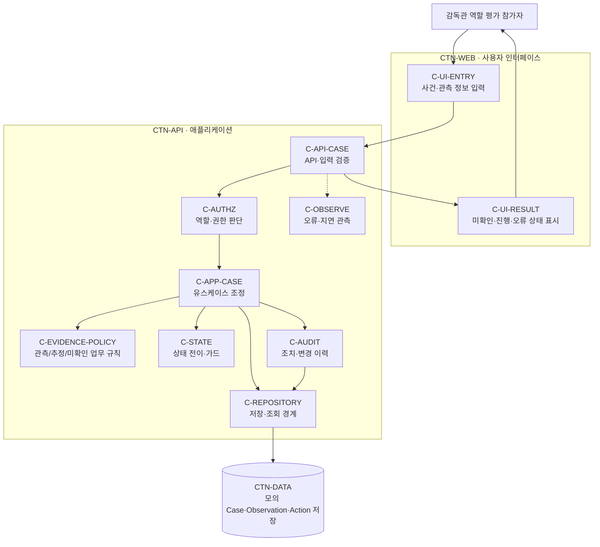
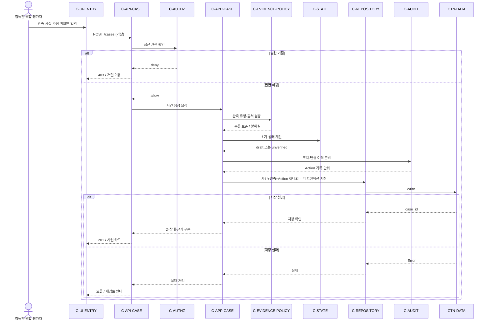
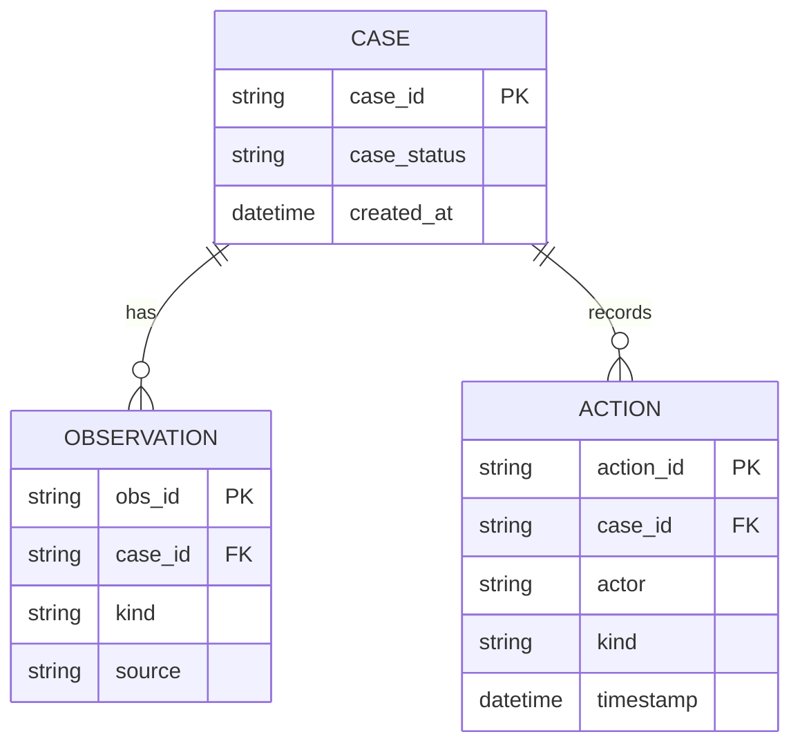

# 기획 → 구성요소 설계 순서도·구조도·실행도

> **R01 검토용 제안 · 2026-11-19.** 이 문서는 [기획→설계 결정·정보 모델](PLANNING-DESIGN-INFO-MODEL.md)의 **구체적 구성요소 및 설계 순서 시각화**입니다. 아래 CAND-016 구성은 가상 검토 사례이고 팀 제품·기술·배포/코드가 확정됐다는 뜻이 아닙니다.
> 구조화 원본: [component-design-model.json](component-design-model.json) · 단계/정보 ID의 정본: [planning-design-info-model.json](planning-design-info-model.json)

## 설계와 시험 설계는 같은 구성요소 경계를 사용합니다

이 문서는 **설계 대상의 실제 컴포넌트·실행/데이터 구조 및 시험 대상 경계**를 보여줍니다. 권한(`EX-NFR-AUTH`), 저장 원자성(`EX-NFR-ATOMIC`), 감사 추적(`EX-NFR-AUDIT`), 로그 보호(`EX-NFR-LOG`)를 독립 품질 요구로 분리했습니다. 각 컴포넌트를 정의할 때 책임·입력·출력·의존·소유 데이터와 함께 그 책임의 **검증 질문, 정상/예외 입력, 기대 결과, 통합 경계**를 정의합니다. 실행했다고 주장하지 않습니다.

대표 가상 요구 `EX-FR`: 모의 사건의 관측 정보가 `unknown`이면 확정 위반으로 표시하지 않습니다.

이는 **대표 설계·검증 관계를 설명한 예시**입니다. 요구사항·컴포넌트의 전체 추적은 [CAND-016-TRACE.json](pilots/2026-11-19-planning-design-v2/CAND-016-TRACE.json)의 관계·테스트 ID에 있고, 실제 테스트 수행 결과는 `not_run`입니다. 공통 상태/오류 의미는 [DOMAIN-CONTRACT.json](pilots/2026-11-19-planning-design-v2/DOMAIN-CONTRACT.json)을 참조합니다.

## 1. 점진적 설계 결정 순서 — 넓은 범위에서 구체 책임으로

**이 순서로 '모든 작업을 시작'하라는 뜻이 아니라, 실제 결정을 확정할 때 필요한 선행 정보를 보여줍니다.** 초안·현장 조사·기술 PoC·잠정 제출은 병렬로 진행할 수 있습니다. 지금 단계에서 고정하지 않을 사항은 [점진적 설계 결정표](PROGRESSIVE-DESIGN-ORDER.md)를 참고합니다. 용어는 [정밀 용어집](DESIGN-GLOSSARY.md)을 기준으로 합니다.

## 2. 구성요소 구조도 — 시스템을 실제로 어떻게 분해하는가?

이 그림은 CAND-016의 **모의 사건 기록** 요구사항(`EX-FR`)을 위한 가상 논리 구조입니다. 박스 각각을 별도 프로세스·서버·마이크로서비스로 만드는 지시가 아닙니다.

**각 ID의 정보 계약:** `C-...`는 [component-design-model.json](component-design-model.json)의 `example.components`이며, 각자 고유한 `CR-C-*` IT-13 레코드를 [추적 JSON](pilots/2026-11-19-planning-design-v2/CAND-016-TRACE.json)에 연결합니다. 각 구성요소에는 `parent_container`, `responsibility`, `public_operations`, `inbound`, `outbound`, `depends_on`, `owned_state`, `failure_policy`, `requirements`, `verification_refs`, 그리고 요구사항별 **실제 책임 설명**이 연결됩니다. 실제 예시는 **3개 실행·저장 단위, 10개 구성요소, 13개 연결, 3개 논리 데이터 엔터티**입니다.

## 3. 한 구성요소를 설계한다는 의미

| 설계 질문 | 가상 예: C-APP-CASE 유스케이스 조정 | 정보 정본 연결 |
|---|---|---|
| 어느 구성에 속하는가? | `CTN-API` (논리적 애플리케이션) | IT-12/13 |
| 책임은 무엇인가? | 사건 생성·상태 변경·조회 조정 | IT-09/13 |
| 어떤 입력을 받는가? | 검증된 요청·사용자 역할 | IT-16/18 |
| 어떤 내부 모듈에 의존하는가? | 관측 규칙·상태 전이·저장·감사 기록 | IT-11/14/15 |
| 어떤 정보를 소유하는가? | 유스케이스 처리 경계·트랜잭션 조정; 업무 정본 자체는 저장소 | IT-13/15 |
| 실패하면 어떻게 하는가? | 잘못된 전이 거절·저장 실패 시 성공 반환 금지 | IT-14/16/18 |
| 어떤 요구를 충족하는가? | `EX-FR` 미확인 정보 구분 (가상) | IT-09 |
| 어떻게 확인하는가? | `EX-TEST` 모의 사건 테스트 설계, 미실행 | IT-20 |

## 4. 실행 순서도 — 입력이 실제로 어떻게 처리되는가?

이것은 **작성해야 할 실행 흐름 계약의 예시**이지 실제 구현·테스트 결과가 아닙니다. 예시의 `201/403`은 설계 가정이며 운영기관 제재·자동 부정행위 판정과 무관합니다.

## 5. 데이터 구조도 — 구성요소가 소유할 정보를 별도로 설계

- 업무 상태의 단일 의미적 기준은 [DOMAIN-CONTRACT.json](pilots/2026-11-19-planning-design-v2/DOMAIN-CONTRACT.json)의 `CaseStatus` 네 값이며, IT-14·15·16·17에서 함께 참조하고 `C-REPOSITORY`로 저장합니다. 예전 시범안의 `cancelled`는 전이/요구가 없어 제외했습니다.
- 관측 분류 `observed / inferred / unknown`은 도메인 정책과 UI 응답 스키마에서 동일한 의미로 사용해야 합니다.
- 키·상태·권한·표시가 다르면 **PD-10에서 충돌로 반환**합니다.

## 6. 단계별 설계 산출과 확정 시점

| 설계 순서 | 작성할 구체 항목 | 처음 완성해야 하는 수준 | 확정 시 확인할 것 |
|---|---|---|---|
| 시스템 맥락·업무 규칙 IT-11/12 | Case/Observation·상태 의미·외부 사용자/시스템·권한 경계 | 개념·맥락 모델 | 용어·불변식·권한 누락 없음 |
| 상위 해결 전략 IT-25 | 독립 서비스/단일 앱 등 대안·품질 목표·비용·실패 모드 | 구조 전략 가설 | 요구·제약·품질의 비교 근거 |
| **논리 실행·저장 단위 IT-27** | UI·API·DB 등 논리 실행/저장 단위 | 배치 가설 | 업무 책임·동기/비동기·데이터 정본 경계 |
| 내부 컴포넌트 IT-13 | Controller/Service/Policy/State/Repository 등 필요한 책임 | 호출·소유 관계 초안 | 누락·중복 책임, 순환·권한 침해 없음 |
| 흐름 IT-14 | 정상/실패 시퀀스·상태·전이·가드 | 예외를 포함한 초안 | API 오류·UI 표시·권한 일치 |
| 데이터 IT-15 | 엔터티·속성·키·관계·무결성·보존 | 논리 모델 | 상태·API 필드·소유권 일치 |
| API/UI IT-16/17 | 요청·응답·오류·화면 상태·이벤트 | 계약 초안 | 데이터·상태·인증 규칙 일치 |
| **물리 배포·운영 IT-18/26** | 실제 환경 노드·네트워크·비밀·로그·복구 | 실현 가능성 가설 | 제약·운영비·검증 계획 연결 |
| 설계 합류 PD-10 | 전체 참조·필드·권한·오류·검증 정합성 | 관련 분야 합의·ADR | 변경 영향 범위와 미결정 분리 |

## 7. 시스템 종류에 따라 빼거나 더하는 컴포넌트

- **필수 논리적 책임:** 사용자 접점이 있다면 입력/표시, 요구사항에 따른 처리·업무 규칙, 상태·데이터 정합성, 외부 경계·권한·실패 처리.
- **조건부:** 큐/워커(장시간 비동기 작업이 실제 필요할 때), AI/에이전트(기존 수작업·규칙 대비 이득을 검증할 때), 감사·관측(위험·운영 수준에 맞춰), 외부 API 어댑터(실제 연동이 필요할 때).
- **고정하지 않을 것:** 프레임워크·DBMS·개별 서버 수·마이크로서비스 수·에이전트 수. 설명을 위한 논리 박스가 물리 실행 단위를 강제하지 않습니다.

## 8. 검증 및 시험 설계 관점

- 컴포넌트별 책임은 [추적 모델](pilots/2026-11-19-planning-design-v2/CAND-016-TRACE.json)의 `CR-*` 설계 레코드에 연결되며, 해당 `verification_refs`는 실행된 결과가 아니라 시험 설계 ID입니다. 실제 추적 관계는 `planned_check_by`로 작성하며 `verified_by`는 실제 시험 결과를 확인한 경우에만 사용합니다.
- 상태·DB·API·UI의 세부 테스트는 [점진적 설계 순서표](PROGRESSIVE-DESIGN-ORDER.md)의 L5 항목에 배치합니다.
- 전체 설계 일치 여부는 L6의 교차 정합성으로 다룹니다. 구조 검사 통과와 기능/가치 입증은 구별합니다.

## 9. 외부 근거·검증 범위

- [C4 Model](https://c4model.com/): 시스템 맥락·컨테이너·컴포넌트의 설명 수준을 참고. 설계의 시간적 순서를 규정하는 표준은 아님.
- [arc42 Building Block](https://docs.arc42.org/section-5/), [Runtime](https://docs.arc42.org/section-6/), [Deployment](https://docs.arc42.org/section-7/): 구성·행동·실행 환경 관점을 분리하는 참고 근거.
- [ISO/IEC/IEEE 42010:2022](https://www.iso.org/standard/74393.html): 이해관계자·관심사·아키텍처 기술의 개념 참고. 본 그림의 실제 구현 적합성을 인증하지 않음.

**주의:** 이 문서는 실제 구현된 시스템을 역공학한 구조도가 아닙니다. 지금 기획·설계 정보를 어느 수준까지 구성해야 하는지 확인하기 위한 **재사용 가능한 설계 질문과 가상의 사례 시각화**입니다.
