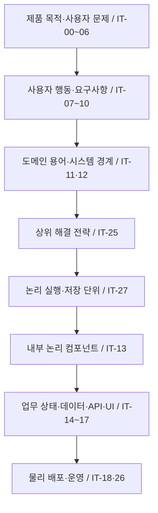

# 기획·설계 공통 용어집 — 단계별 정밀 정의

> **R01 검토용 · 기존 13개 정보 영역 유지 · 특정 기술 스택 미채택.** 용어가 애매하면 입력·결정 책임도 애매해지므로, 아래 용어를 실제 설계 정보 모델과 다이어그램의 표준 명칭으로 사용합니다.

## 1. 용어·사용 예·혼동 금지

| 용어 | 이 프로젝트에서의 의미 | 구체적 예 | 혼동하지 말 것 |
|---|---|---|---|
| 목적(Goal) | 원하는 결과를 설명하는 상위 의도 | 사용자 목표 달성·설계 제약의 근거 | 기능·화면·기술 선택과 다름 |
| 사용자 역할(Actor Role) | 대표 사용 시나리오에서 수행하는 역할 | 감독관 역할 평가 참가자 | 계정 하나나 기관 승인 주체와 같지 않음 |
| 문제(Pain/Unmet Job) | 특정 조건에서 사용자가 일을 달성하지 못해 발생하는 손실 | 인계 시 반복 설명 부담 가설 | 기능 요구사항 또는 효과 증명과 구분 |
| 제품 범위(Product Scope) | 이번 실험·구현에 포함/제외할 사용자 결과 | 모의 사건 카드; 실제 현장 탐지 제외 | 기술 스택과 구분 |
| 사용자 시나리오(Use Case) | 사용자가 목표 달성을 위해 시스템과 상호작용하는 하나의 흐름 | 관측 정보 기록→검토 요청 | API 요청 시퀀스와 구분 |
| 요구사항(Requirement) | 검증 가능한 필요 동작 또는 품질 제약 | 미확인 항목을 확정 판정으로 표시하지 않음 | 구현 방식과 구분 |
| 도메인(Domain) | 시스템이 다루는 문제 영역의 업무 개념·규칙 | 사건·관측·검토·조치 | DB 스키마 또는 소스코드 패키지와 구분 |
| 도메인 객체(Domain Concept) | 업무의 의미를 갖는 개념·관계·불변식 | Case, Observation, Action | 데이터베이스 테이블과 같다고 가정하지 않음 |
| 불변식(Invariant) | 업무 흐름의 모든 유효 상태에서 지켜야 할 규칙 | 미확인 관측을 확정 위반으로 승격 불가 | 에러 메시지·UI 색상과 구분 |
| 시스템(System) | 대상 제품이 책임지는 기능·데이터·상호작용의 전체 경계 | 가상 사건 처리 시스템 | 하나의 서버와 동일하지 않음 |
| 시스템 맥락(System Context) | 시스템 외부의 사용자·시스템·정보·신뢰 경계 | 평가자·운영기관 자료·사건 시스템 | 내부 컴포넌트 구조와 구분 |
| 상위 해결 전략(Solution Strategy) | 요구·제약·품질 목표를 충족하기 위한 핵심 구조적 접근 | 비AI 체크리스트와 사건 카드 비교하는 가설 | 개별 라이브러리/클래스 설계와 구분 |
| 논리 실행·저장 단위(C4 Container) | 단독 실행되는 애플리케이션 또는 데이터 저장소로 보는 설계 단위 | 브라우저 앱, 서버 앱, 사건 데이터 저장소 | Docker 컨테이너/물리 서버와 다름 |
| 컴포넌트(Component) | 하나의 실행 단위 내부에서 명확한 책임과 인터페이스를 갖는 코드·논리 책임 단위 | 사건 API 경계, 사건 처리 유스케이스 | 각 컴포넌트가 별도 서버일 필요 없음 |
| 애플리케이션 서비스(Application Service) | 하나의 유스케이스를 조정하는 컴포넌트 | 사건 생성·상태 변경·저장 순서 조정 | 고객이 구매하는 제품 서비스, 외부 SaaS와 다름 |
| 도메인 서비스(Domain Service) | 도메인 객체 하나에 자연스럽게 속하지 않는 업무 규칙을 수행하는 책임 | 관측 유형 분류 정책 | 모든 업무 규칙이 반드시 별도 서비스 컴포넌트일 필요 없음 |
| 인터페이스 계약(Interface Contract) | 컴포넌트/실행 단위 사이에서 합의한 입출력·권한·오류·시간 초과 규칙 | POST /cases 요청/응답, invalid_input | 함수 이름 또는 UI 화면 정의만을 뜻하지 않음 |
| 업무 상태(Domain State) | 사용자 업무 객체가 도달한 현재 단계 | CaseStatus=review_pending | UI 로딩·HTTP 200과 다름 |
| 표시 상태(UI State) | 화면이 사용자에게 보여주는 진행·오류·빈 결과 등 상태 | 로딩, 오류, 검토 완료 화면 | 업무 상태의 모든 값을 1:1 저장한다는 뜻은 아님 |
| HTTP 상태(Protocol Status) | 요청/응답 프로토콜의 처리 결과 상태 코드 | 201, 403, 409, 500 | 업무 검토 완료·위반 여부가 아님 |
| 실행 흐름(Runtime Scenario) | 실행 시 구성요소 호출·응답·분기·실패 순서 | 요청→권한→분류→저장→UI | 설계 작업 수행 순서와 구분 |
| 논리 데이터 모델(Logical Data Model) | 업무 정보를 정본 개념·속성·관계·무결성으로 표현 | Case 1:N Observation | 특정 DBMS/인덱스와 다름 |
| 물리 데이터 설계(Physical Schema) | 선택한 저장 기술에서 테이블·인덱스·타입·성능·복구를 설계 | DB 저장소가 선택된 뒤 테이블·인덱스 | 데이터 업무 개념을 처음 정의하는 단계와 다름 |
| 배포 토폴로지(Deployment Topology) | 선택한 코드/데이터 실행 단위를 클라우드/VM/서버·네트워크·스토리지에 배치한 구조 | 앱 프로세스→호스팅 노드·DB 클러스터 매핑 | C4 논리 컨테이너와 구분 |
| 설계 가설(Design Hypothesis) | 근거가 불충분하지만 실험·비교 가능한 잠정 설계 선택 | 모의 사건 카드 방식 | 제품/아키텍처 최종 승인과 다름 |
| 잠정 기준선(Provisional Baseline) | 가정·재검토 조건을 명시하고 다음 작업 입력으로 사용하는 임시 정본 | 모의 사건 상태 enum 초안 | 아무 수정 불가한 최종 확정과 다름 |
| 승인된 기준선(Approved Baseline) | 권한 있는 사람이 범위·근거·조건을 검토해 공식 채택한 설계 | 제품 선정 뒤 채택한 API 계약 | AI의 자체 점수나 파일 생성 사실이 아님 |
| 요구 충족 시험(Verification) | 설계·구현이 특정 명세와 수용 조건을 만족하는지 확인 | 모의 사건에서 잘못된 상태 승격 없음 검사 | 실제 사용자에게 가치가 있는지 확인하는 것과 구분 |
| 사용자 가치 확인(Validation) | 실제 사용자·환경에 적절한 해결책인지 비교/관찰로 확인 | 비AI 체크리스트 대비 오류·시간 개선 확인 | 구조 검증 성공과 다름 |
| 문서 투영(Projection) | 기존 정본에서 특정 공식 문서 목차에 필요한 정보를 표현 | FR→API/테스트/기획서 관련 절 | 문서가 진짜 정보 정본이 되거나 제출 완료됨을 뜻하지 않음 |

## 검증·테스트 관련 용어의 구분

| 개념 | 정확한 정의 | 설계 시점 | 예시 |
|---|---|---|---|
| 문제 타당성 확인(Problem Validation) | 특정 사용자가 실제 상황에서 겪는 손실과 기존 대안 이후의 잔여 문제를 관찰·비교로 확인 | 사용자·문제 정의부터 방법·반증 기준 설계 | 기존 체크리스트와 비교할 오류·시간 기록 방법 |
| 사용자 가치 확인(Product Validation) | 제안한 해결책이 사용자 목표에 적절한지 확인 | 목표·시나리오 정의 때 측정·기준선 설계 | 동일 조건에서 사용자 결과 개선 여부 |
| 요구/설계 적합성 확인(Verification) | 명시된 기능·품질 요구/도메인 규칙·구성요소 계약이 충족되는지 검토/분석/시험으로 확인 | 요구·각 설계 수준마다 방법과 시험 대상 정의 | 잘못된 상태 전이 거절, API·DB 계약 일치 |
| 시험 설계(Test Design) | 시험 대상·입력/테스트 데이터·조건·환경·기대 결과·판정 경계의 명세 | 요구부터 상세 설계까지 점진적 구체화 | unknown 관측을 넣으면 확정 판정 표기 없음 |
| 시험 수행(Test Execution) | 준비된 조건으로 실제 시스템/실험에 입력을 적용해 결과와 환경·버전을 기록 | 설계 검토 중 PoC 또는 구현 후 실제 수행 | 실행 커밋·로그·pass/fail를 Run/Eval에 보존 |
| 설계 정합성 리뷰(Design Review) | 서로 다른 설계 뷰·도메인 상태·오류·권한·데이터의 의미적 일치 여부 검사 | 각 수준과 L6 통합 시 | CaseStatus가 API/DB/UI에 동일한 의미인지 비교 |

**중요:** 시험 설계와 설계 검토는 **기획·설계의 일부**입니다. 시험 수행 결과는 실제로 관측했을 때만 기록합니다. 모든 검증 방법이 코드를 실행하는 테스트인 것은 아닙니다.

## 2. 레벨별 용어와 정보 ID

이 그래프의 화살표는 세부 설계를 만들기 위해 선행 정보가 필요하다는 의미이지 모든 항목을 순차로 한 번에 확정한다는 뜻은 아닙니다. 계약·구현의 세부사항은 병렬 초안 후 교차 검토합니다.

## 3. 혼동 금지 규칙

1. **C4 container != Docker container.** 기존 `CTN-WEB/CTN-API/CTN-DATA`는 논리 실행·저장 단위이지 AWS 인스턴스·Docker 이미지·Kubernetes Pod가 아닙니다.
2. **Component != 독립 배포 서비스.** `C-APP-CASE` 같은 컴포넌트는 IT-27 실행 단위 안의 책임·인터페이스를 뜻합니다. 실제 코드 파일/프로세스 개수는 그다음 결정입니다.
3. **업무 상태 != 증거 확신도 != HTTP 결과 != UI 상태.** `reviewed`는 사람이 검토를 마쳤다는 뜻이고 부정행위 확정이나 HTTP 200과 별개입니다.
4. **도메인 모델 != DB 스키마.** Case와 Observation을 업무적으로 정의한 다음 DB 저장 방식·키·인덱스를 설계합니다.
5. **Verification != Validation.** 요구 계약의 형식/실행 충족과 실제 사용자 가치 검증을 분리합니다.
6. **가설 != 잠정 기준선 != 승인된 기준선.** 제품 미선정 후보의 도면·JSON 생성 사실로 채택 상태를 올리지 않습니다.
7. **설계 순서 != 문서 제출 순서.** 요구사항과 컴포넌트 관계의 출처는 정보 정본이고, 제출 목차는 정본 정보의 프로젝션입니다.

## 4. 표준 출처·수준

- [C4 Model](https://c4model.com/) — 시스템 맥락, 실행·저장 단위(Container), 컴포넌트 등의 추상화 수준.
- [arc42 Solution Strategy](https://docs.arc42.org/section-4/), [Building Block View](https://docs.arc42.org/section-5/), [Runtime View](https://docs.arc42.org/section-6/), [Deployment View](https://docs.arc42.org/section-7/) — 상위 전략, 정적 구성, 행동, 배포 구별.
- [ISO/IEC/IEEE 42010:2022](https://www.iso.org/standard/74393.html) — 관계자·관심사·아키텍처 기술 개념의 참고.

각 용어의 적용 규칙은 **팀 내부 실용 모델의 제안**이며, 외부 표준이 실제 팀의 모든 ID와 순서를 승인한 것은 아닙니다.
