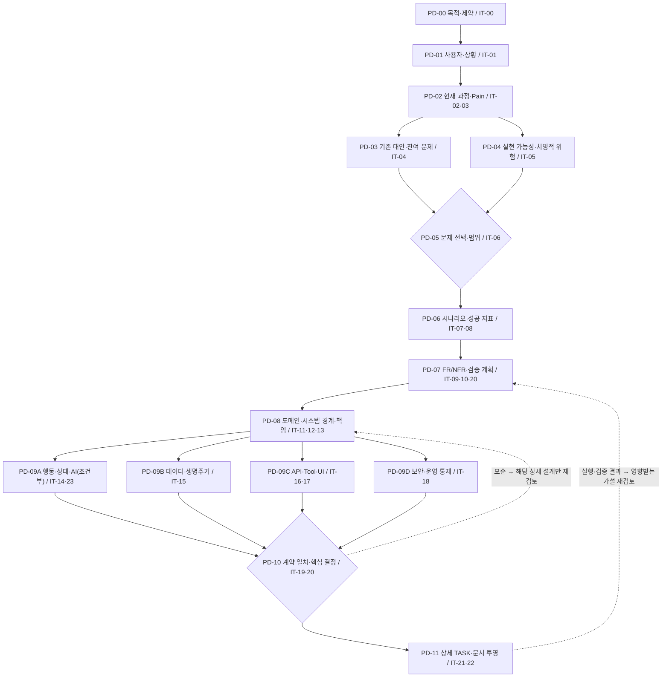

# 기획 → 설계 결정·정보 모델 V1

> **상태: 제안 초안 · 2026-11-19 · 제품/기술/구현/제출 확정 아님.**
> 기존 13개 [작업 정보 영역](WORK-MODEL.md), [Target Design](../design/TARGET-DESIGN.md), [16개 제출물 매핑](registry.json), [제출 프로젝션 계약](PROJECTION-CONTRACT.md)을 연결하는 **설계 정보 사전 + 판단 선행관계**입니다.
> 현재 [Phase Intent](../human/phase-intents/PHASE-20261118-01.md)에 따라 실제 제품은 미선정이며, 기존 찾아you 기획·WBS의 구현은 보류합니다. 이 문서는 기존 정본 및 V3 파일럿에 간섭하지 않습니다.

## 1. 모델의 목적과 계층

- **기획·설계 판단 흐름:** 어떤 질문을 먼저 해결해야 다음 판단을 확정할 수 있는가?
- **설계 정보 구조:** 사용자·As-Is·문제·대안·요구·도메인·시스템 경계·상태·데이터·인터페이스 등 무엇을 실제로 정의해야 하는가?
- **근거·변경 연결:** 어떤 정보로 도출되었고, 무엇을 검증하며, 변경 시 어디를 재검토할 것인가?
- **문서 출력:** 16개 제출물의 목차를 정보 정본 대신 사용하지 않고, 관련 정보만 목적별로 조합합니다.

설계 정보 레벨은 **(정보 영역) → (정보 유형) → (구체 필드·참조)** 입니다. 예: `interface` → `IT-16 API·Tool 계약` → 입력/출력/권한/오류/타임아웃 및 상태·데이터 참조.

## 2. 전체 흐름 — 판단과 정보가 함께 생성되는 순서

**해석:** 실선은 결정의 주요 선행 조건이며, PD-03/04와 PD-09A/B/C/D는 병렬로 초안을 작성할 수 있습니다. 점선은 **검토 피드백**이지 자동으로 과거 결정을 폐기하라는 뜻이 아닙니다. 상위 WBS·제출 준비는 PD-00 이후에도 병렬로 작성할 수 있고, PD-11에서 상세 작업과 일치시킵니다.

## 3. 단계별 결정·진입 조건·필요 정보

| 단계 | 실제 결정 질문 | 반드시 참조할 선행 단계 | 이때 생성·갱신하는 정보 | 다음 판단을 위한 최소 조건 |
|---|---|---|---|---|
| `PD-00` 목적·제약·권한 | 이 프로젝트에서 무엇이 고정이고 무엇이 보류인가? | 현재 Intent·Phase | `IT-00` | 유효한 Intent·Phase와 권한·법적/일정 제약이 구별됨 |
| `PD-01` 사용자·사용 맥락 | 누가 어떤 조건에서 어떤 일을 달성하려 하는가? | `PD-00` | `IT-01` | 사용자 역할·발생 상황·현재 행동을 특정하거나 미확인임을 표시 |
| `PD-02` As-Is·문제 가설 | 실제로 어디서 왜 실패하고 어떤 손실이 발생하는가? | `PD-01` | `IT-02`, `IT-03` | 현 상태·관찰 사실과 원인 가설·지지/반대 근거를 구분 |
| `PD-03` 기존 대안·잔여 문제 | 다른 대안을 사용해도 남는 문제는 무엇인가? | `PD-02` | `IT-04` | 같은 작업 기준의 대안 비교·잔여 문제·근거 수준 기록 |
| `PD-04` 치명적 실현가능성 | 합법적 데이터·기술·8주 일정으로 검증 가능한가? | `PD-02` | `IT-05` | 치명적 위험·중단 조건·최소 반증·대체 경로 기록 |
| `PD-05` 문제 선택·제품 가설 | 어떤 문제를 지금 해결하거나 보류할 것인가? | `PD-03`, `PD-04` | `IT-06` | 사람의 채택·보류 결정과 포함/제외 범위·재검토 조건 기록 |
| `PD-06` 사용자 가치·시나리오 | 어떤 사용자 경험·행동 변화가 성공인가? | `PD-05` | `IT-07`, `IT-08` | 시작·정상·예외·종료와 관찰 가능한 결과 정의 |
| `PD-07` 요구사항·검증 계획 | 무엇이 반드시 동작하고 어떤 품질을 충족해야 하는가? | `PD-06` | `IT-09`, `IT-10`, `IT-20` | 우선순위·수용 기준·시험 질문 및 미확인 경계 연결 |
| `PD-08` 도메인·시스템 경계 | 무엇을 누가 책임지고 어떤 개념과 규칙이 필요한가? | `PD-07` | `IT-11`, `IT-12`, `IT-13` | 도메인 불변식·시스템 내외부·구성요소 책임·주요 입출력 구분 |
| `PD-09A` 행동·상태·선택적 AI | 상태·분기·실패·중단이 어떻게 진행되는가? | `PD-08` | `IT-14`, `IT-23` | 정상/실패/보류/종료 상태와 전이 조건 표현; AI는 필요할 때만 설계 |
| `PD-09B` 데이터·생명주기 | 무슨 데이터를 누구 책임으로 보존하고 바꾸는가? | `PD-08` | `IT-15` | 엔터티·키·관계·무결성·보관/삭제·접근 규칙 표현 |
| `PD-09C` API·Tool·UI 계약 | 어떤 입력·출력과 화면 반응으로 연결되는가? | `PD-08` | `IT-16`, `IT-17` | 요청/응답/오류/권한과 주요 화면 상태 정의 |
| `PD-09D` 횡단 통제·품질 | 공통 위험·보안·운영 제약을 어떻게 보장하는가? | `PD-08` | `IT-18` | 핵심 위험에 대응하는 통제·남은 위험·검증 연결 |
| `PD-10` 계약 정합성·핵심 대안 결정 | 요구·상태·데이터·API·UI·안전 규칙이 충돌하는가? | `PD-09A`, `PD-09B`, `PD-09C`, `PD-09D` | `IT-19`, `IT-20` | 상충하는 ID/상태/권한/필드 정리; 고영향 구조 선택 근거·조건 기록 |
| `PD-11` 실행 계획·문서 프로젝션 | 이 정보를 어떤 작업과 공식 산출물로 연결하는가? | `PD-10` | `IT-21`, `IT-22` | 상세 작업 소유·의존·완료 기준과 공식 목차 매핑; 제출·접수는 별도 확인 |

**선행 조건**은 세부 조사 착수 금지가 아니라 **결정 확정의 논리적 전제**입니다. 예: 문제 가설이 있어야 동일 사용자 작업에서 기존 대안을 비교할 수 있지만, 데이터 접근 권한 조사는 병렬 착수 가능합니다. PD-05에서 근거 부족·치명적 제약이 확인되면 제품을 확정하지 않고 보류합니다.

## 4. 실질적인 정보 항목 사전

아래 항목은 '별도 문서 24개'가 아닙니다. 실제 설계 질문을 빠뜨리지 않도록 하는 **정보 유형**이며, 각 유형은 기존 정본에 기록하거나 해당 문서/코드/OpenAPI/ERD를 참조합니다. 불필요한 경우에는 미적용 사유로 충분합니다.

| ID·정보 유형 | 기존 13개 정보 영역 | 구체적으로 정의할 항목 | 주된 관계 |
|---|---|---|---|
| `IT-00` 목적·운영 제약 | `decision` | 유효한 사람 의도·권한 출처 · 이번 판단 목적 · 포함·제외 범위 · 법적·일정·자원·조직상 필수 제약 · 누가 어떤 결정을 승인하는가 · 언제 다시 확인하는가 | 상위 Intent/Phase |
| `IT-01` 사용자·이해관계자 맥락 | `problem` | 역할·이해관계자 · 이용자가 달성하려는 일 · 문제가 발생하는 계기 · 장소·시간·기기·제약 · 현재 사용하는 도구 · 사용자 맥락의 근거 | `IT-00` |
| `IT-02` 현재 수행 과정 As-Is | `problem` | 시작 상황 · 실제 수행 행동 순서 · 참여자·도구 · 현재 분기·판단 지점 · 실패·우회·반복 행동 · 시간·비용·오류 등 관찰 가능한 손실 | `IT-01` |
| `IT-03` 문제·원인·손실 가설 | `problem` | 영향받는 사용자 · 어느 상황에서 · 무엇을 달성하지 못하는가 · 손실·후속 결과 · 추정 원인과 관찰 사실 분리 · 지지 근거 · 반대 근거·범위 | `IT-01`, `IT-02` |
| `IT-04` 기존 대안과 잔여 문제 | `problem` | 기존 제품·수작업·일반 AI·무대응 · 같은 사용자 작업·조건 · 대안이 해결하는 부분 · 여전히 해결하지 못한 부분 · 도입·전환 비용 · 실사용·문서 근거와 한계 | `IT-02`, `IT-03` |
| `IT-05` 실현가능성·치명적 위험 | `risk` | 핵심 데이터·도구·인력 · 접근·수집·저장·재사용 권한 · 미검증 기술 전제 · 일정과 외부 의존 · 진행할 수 없는 조건 · 가장 저렴한 반증 방법 · 대체 경로·범위 축소 | `IT-03`, `IT-04` |
| `IT-06` 문제 선택·제품 범위 결정 | `decision` | 선택한 문제·대안 비교 참조 · 의도한 변화 · 이번 제품에서 해결하는 범위 · 명시적인 제외 범위 · 선택·보류·거절 대안 · 사람 결정권·결정 기록 · 재검토 조건 | `IT-03`, `IT-04`, `IT-05` |
| `IT-07` 사용자 가치·성공 지표 | `requirements` | 사용자가 얻어야 할 결과 · 관찰할 행동·결과 · 현 상태 또는 측정 전 표기 · 목표값·임시 가설 구분 · 측정 방법·대상 · 실패·미확인 경계 | `IT-06` |
| `IT-08` 사용자 시나리오·유스케이스 | `requirements` | 행동 주체 · 시작 이벤트 · 성립 조건 · 정상 행동·시스템 반응 · 예외·취소·우회 경로 · 완료·부분·실패 상태 · 검증할 가치 지표 | `IT-01`, `IT-06`, `IT-07` |
| `IT-09` 기능 요구사항 | `requirements` | 주체와 관찰 가능한 필수 동작 · 문제·유스케이스와의 근거 연결 · 필요한 입력 · 기능 규칙·예외 · 반환 결과·상태 · Must·Later·제외 사유 · 수용 기준과 예시 조건 | `IT-08`, `IT-07` |
| `IT-10` 비기능·품질 시나리오 | `requirements` | 성능·안전·사용성 등 특성 · 품질 요구가 발생하는 자극 · 시험할 환경과 조건 · 요구되는 반응 · 측정 가능한 수준 또는 가설 · 측정·판정 방법 · 상위 제약 근거 | `IT-00`, `IT-08`, `IT-07` |
| `IT-11` 도메인 개념·업무 불변식 | `architecture` | 개념·정의·동의어 · 업무 객체와 관계 · 항상 성립해야 할 규칙 · 업무 이벤트 · 예외·충돌 처리 · 규칙이 필요한 요구사항 | `IT-09` |
| `IT-12` 시스템 경계·외부 맥락 | `architecture` | 시스템 책임 · 외부 이용자·조직 · 외부 서비스·도구 · 시스템 내·외부 포함 범위 · 권한·데이터 신뢰 경계 · 주요 입출력·정보 흐름 | `IT-06`, `IT-09`, `IT-10` |
| `IT-13` 구성요소·책임·의존관계 | `architecture` | 구성요소 이름 · 소유하는 기능·판단 · 들어오고 나가는 정보 · 상태·데이터 소유 · 외부·내부 의존 · 실패 시 책임과 대체 경로 | `IT-12`, `IT-11` |
| `IT-14` 행동 흐름·상태 전이 | `workflow` | 활동·실행 순서 · 상태와 의미 · 전이 조건·이벤트 · 권한·검증·제약 가드 · 외부 작업·변경 효과 · 오류·재시도·멱등성 · 성공·부분·보류·실패·종료 | `IT-08`, `IT-11`, `IT-13` |
| `IT-15` 논리 데이터·생명주기 | `data` | 엔터티·필드·타입 · 키·식별자 · 관계·카디널리티 · 무결성·일관성 불변식 · 읽기·쓰기 소유·권한 · 보관·삭제·변경 이력 · 정본·파생·캐시 구별 | `IT-11`, `IT-13`, `IT-10` |
| `IT-16` API·Tool·컴포넌트 계약 | `interface` | 동작·목적·호출자·대상 · 요청 필드·제약 · 응답 필드·상태 · 인증·인가·도구 권한 · 오류 코드·미확인·부분 결과 · 타임아웃·재시도·멱등성·버전 · 연결할 상태·데이터 계약 | `IT-09`, `IT-13`, `IT-14`, `IT-15` |
| `IT-17` 화면·상호작용 상태 | `interface` | 사용자에게 보이는 화면·접점 · 사용자 역할·달성 목표 · 입력·행동·검증 · 화면 이동·완료 경로 · 로딩·빈 결과·부분·오류 · 진행·실패·재시도 안내 · 필요한 접근성·환경 제약 | `IT-08`, `IT-09`, `IT-14`, `IT-16` |
| `IT-18` 보안·운영·품질 통제 | `risk` | 위협·운영·신뢰성 문제 · 대상 데이터·기능 · 통제·완화 수단 · 권한·신뢰·책임 경계 · 탐지·경보·복구 · 남은 위험 · 실제로 확인할 시험 | `IT-05`, `IT-10`, `IT-12`, `IT-13` |
| `IT-19` 설계 대안·선택 기록 | `decision` | 무엇을 선택하는가 · 비교한 대안 · 요구·품질·제약 기준 · 비용·복잡성·위험 비교 · 선택안과 이유 또는 보류 · 결정권자·ADR 참조 · 전제 붕괴·재검토 신호 | `IT-09`, `IT-10`, `IT-13`, `IT-18` |
| `IT-20` 요구·설계 검증 계획 | `test` | 검증 대상 요구·계약·가설 · 입력·환경·전제 · 예상 결과 또는 비교 기준선 · 관찰할 로그·출력·지표 · 테스트 방법·샘플 · 성공·실패·미확인 기준 · 실행 후에만 연결할 실측 근거 | `IT-09`, `IT-10`, `IT-07` |
| `IT-21` 작업 패키지·선행관계 | `task` | 작업 목적·범위 · 필요한 설계·결정 참조 · 실제 완료를 막는 선행 조건 · 단일 책임자·협력자 · 제출·구현·검증 산출 · 완료·검증 기준 · 공수·기한·제약 | `IT-09`, `IT-19`, `IT-20` |
| `IT-22` 공식 문서 투영·상태 | `submission` | DLV-01~16 식별자 · 공식 목차의 출처·검증 상태 · 원본 설계 정보·커밋 · 목차별 정보 필드 연결 · 내용·근거 검토 상태 · 제출·접수 상태 별도 기록 · 출력 기준 버전·일시 | `IT-21` |
| `IT-23` AI·에이전트 역할·도구 설계 (조건부) | `workflow` | AI 사용이 필요한 실제 작업 · 모델·에이전트의 책임·한계 · 도구 계약·권한·금지 작업 · 컨텍스트·저장·유효기간 · 역할 인계·분기·감독 · 중단·사람 개입·대체 경로 · 단순 방식 대비 품질·비용 검증 | `IT-09`, `IT-10`, `IT-14`, `IT-16`, `IT-18` |

**AI 설계 `IT-23`은 선택적입니다.** 사용자 요구나 설계 대안 비교에서 필요성이 드러난 경우에만 모델 역할, 도구 권한, 컨텍스트·기억, 핸드오프, 실패 대응과 평가를 구체화합니다. 단일/다중 에이전트·RAG 등은 제품 결정 없이 고정하지 않습니다.

## 5. 최소 레코드와 관계 의미

기존 [Work Record 템플릿](work-record-template.json)의 공통 메타데이터와 충돌하지 않도록 새 스키마를 강제하지 않습니다. 권장 최소 공통 요소는 `id`, `kind`, `title`, `owner`, `phase_intent_ref`, `status`, `source_refs`, `assumptions`, `uncertainties`, `updated_at`이며, **의사결정 상태·증거 수준·문서 상태는 구별**합니다.

- **결정:** open / proposed / adopted / deferred / rejected — AI 추천은 adopted가 아니며, 중요 결정에는 사람 권한·ADR을 연결합니다.
- **근거:** observed / sourced / synthetic / hypothesis / unknown / contradicted — 검증되지 않은 값을 성공·실측으로 표시하지 않습니다.
- **문서 내용:** draft / reviewed / superseded — 제출 여부와 분리합니다.

| 관계 | 뜻 |
|---|---|
| `prerequisite_for` | 선행 결정이 없으면 후속 확정을 할 수 없음; stage blocking_on에 사용 |
| `derived_from` | 상위 문제·시나리오·근거에서 도출 |
| `satisfies` | 설계 요소가 요구사항·품질 목표를 충족하도록 책임 |
| `constrains` | 법적·운영·품질 조건이 설계 선택을 제한 |
| `verified_by` | 가설/요구/계약을 검증 계획과 실제 실행 근거로 연결 |
| `materialized_in` | 동일 정보가 특정 공식 산출물의 절에 재사용 |
| `impacts` | 변경 시 재검토할 설계 요소 또는 문서; 자동 무효화가 아닌 영향 후보 |

**연결의 최소 단위:** 동일한 핵심 정보에는 안정적인 ID를 부여하고 필요할 때만 `source_refs`, `requirement_refs`, `decision_refs`, `test_refs` 등으로 참조합니다. 요구사항 하나를 위해 새 JSON을 여러 개 만들지는 않습니다.

## 6. 결정의 우선순위와 상세 설계의 병렬화

1. **필수 제약·선행 관계:** 법·권한·안전·외부 마감이나 후속 결정을 실제로 막는 조건이 먼저입니다.
2. **고영향·고불확실 판단:** 문제 선택·Must/Done·시스템 책임처럼 파급력이 크면 최소 비용의 반증 또는 비교 근거를 확보합니다.
3. **가역적 세부사항:** 독립적인 데이터·API·UI 초안은 병렬로 진행하되, 서로의 가정과 미결 항목을 기록합니다.
4. **정합성 합류:** `PD-10`에서 상태·키·소유권·권한·오류·수용 기준을 대조하고 영향이 큰 구조 결정만 ADR로 격상합니다.
5. **시간 제약:** 상위 WBS와 잠정 제출본은 먼저 작성할 수 있으나 제품 선택·구현·제출 완료의 증거로 오해하지 않습니다.

판정은 **진행 가능 / 가정 명시 후 조건부 진행 / 보류 / 수정 필요** 중 하나로 기록할 수 있습니다. 이 표는 새 승인 회의나 자동 점수제를 요구하지 않습니다.

## 7. 문서로 출력하는 방법 — 정보 정본과 제출 목차 분리

목차와 실제 작성 순서는 다릅니다. 출력을 만들 때는 공식 목차의 `DLV ID`와 원본 정보 ID·commit을 연결합니다. 아래는 모델과 산출물의 **주요 예시**이며, 공식 양식별 필수 항목의 최종 검증을 대신하지 않습니다.

| 산출물 | 주로 가져올 정보 |
|---|---|
| `DLV-01` 기획서(요구사항 포함) | `IT-00`, `IT-01`, `IT-02`, `IT-03`, `IT-04`, `IT-05`, `IT-06`, `IT-07`, `IT-08`, `IT-09`, `IT-10` |
| `DLV-02` WBS | `IT-00`, `IT-06`, `IT-21` |
| `DLV-03` API 설계 | `IT-09`, `IT-12`, `IT-13`, `IT-14`, `IT-16`, `IT-18`, `IT-19` |
| `DLV-04` DB 스키마 | `IT-11`, `IT-14`, `IT-15`, `IT-18` |
| `DLV-05` 상태 전이 설계 | `IT-09`, `IT-14`, `IT-16` |
| `DLV-07` 멀티 에이전트 설계(해당 시) | `IT-13`, `IT-14`, `IT-16`, `IT-19`, `IT-23` |
| `DLV-08` AI 보안 가드레일 | `IT-05`, `IT-10`, `IT-18`, `IT-20` |
| `DLV-11` 통합 테스트 결과 | `IT-09`, `IT-10`, `IT-20` |

**변경 예시:** (가상의) 기능 요구 `IT-09/FR-X`가 '미확인 근거를 별도로 표시'로 바뀌면 `IT-14`(상태), `IT-15`(저장 상태), `IT-16`(응답 스키마), `IT-17`(화면 표시), `IT-20`(테스트)를 **영향 후보**로 표시합니다. 합의·검증 전에는 자동으로 확정이나 폐기를 처리하지 않고, 관련 DLV의 절만 새 버전으로 갱신합니다.

## 8. 실제 적용: 기존 저장소 기준

- **권위·상태 정본은 그대로:** `docs/human/INTENT.md`, 현재 Phase Intent, `CURRENT.md`, TASK/Spec/ADR/Run/Eval이 우선입니다. 이 모델이 새로운 제품·요구사항·기술을 채택하지 않습니다.
- **기존 13개 영역 재사용:** 새로운 상위 영역을 만들지 않고 `IT-xx`를 각 영역의 하위 정보 유형으로 해석합니다.
- **원형 자료 보존:** OpenAPI, SQL, Mermaid, 테스트코드, 실행 로그 등은 원래 형식으로 관리하고 이 모델에서 참조합니다.
- **도입 시작점:** 먼저 현재 또는 선택된 제품 후보의 사용자 1명·시나리오 1개·요구사항 1~2개로 PD-01→PD-10 추적을 수동 시험합니다. 새로운 입력 폼·전면 데이터 마이그레이션은 하지 않습니다.
- **자동화는 다음 단계:** 먼저 필요한 정보가 실제로 빠지거나 중복되는지 관찰합니다. 이후 ID 존재·순환·FR→검증·API↔DB↔상태 일관성 같은 실제 실패를 막는 검사만 도입합니다.
- **제출과 독립:** 원본·프로젝션·실제 제출·접수는 별도 상태입니다. 현재 V3 문서들은 잠정 파일럿이며, 11/21 제품 선정 이후 관련 설계와 WBS를 재평가합니다.

## 9. 모델 데이터와 한계

- [구조화 정보 모델 JSON](planning-design-info-model.json): 정보 유형·필드·관계·단계·논리적 선행·주요 산출물 매핑을 기계가 읽을 수 있게 정리한 **제안 데이터**입니다.
- [기존 WORK-MODEL](WORK-MODEL.md): 13개 영역과 원본 소유 원칙의 현 기준.
- [기존 QUALITY-GATES](QUALITY-GATES.md): 별도 G0~G5의 제출·품질 검토 기준. 본 문서의 PD 단계 조건을 공식 게이트로 오인하지 않습니다.

**미구현:** 실제 레코드 자동 생성·기존 JSON 마이그레이션·전체 설계 의존 그래프 런타임·16개 산출물 자동 생성·의미적 설계 정합성 검증. 이 모델은 실제 구조와 흐름의 **초안/계약 제안**이지 수행 검증 결과가 아닙니다.
