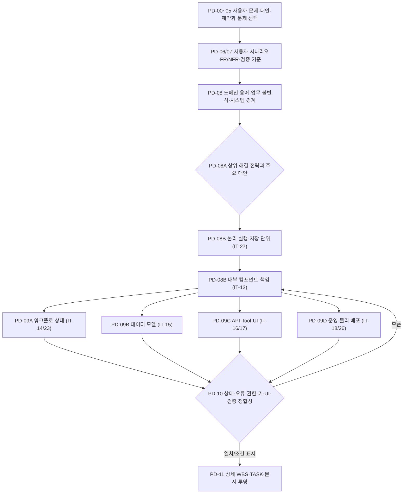

# 기획 → 설계 결정·정보 모델 V3

> **상태: R01 검토용 수정 제안 · 2026-11-19 · 현재 제품 미선정·실제 구현 승인 아님.**
> [기존 13개 정보 영역](WORK-MODEL.md)과 [16개 공식 산출물](registry.json)을 유지합니다. **기획·설계에서 실제로 무슨 정보를 정의하고, 왜 그 정보가 필요하며, 언제 다음 결정을 할 수 있는지**를 하나로 읽기 위한 자료입니다.
> 자세한 필드형·필수 조건·참조·관계 정의는 [V3 정보 모델 JSON](planning-design-info-model.json)이 관리합니다. V1·V2는 이 PR의 이전 커밋에서 보존됩니다.

**가장 먼저 읽을 단계별 판단 기준:** [점진적 설계 순서표](PROGRESSIVE-DESIGN-ORDER.md) · [정밀 용어집](DESIGN-GLOSSARY.md). 

**구성요소 설계의 상세 시각화:** [구성요소 설계 순서도·구조도·실행도·데이터 관계도](COMPONENT-DESIGN-VIEWS.md) · [구성요소·컨테이너·계약 JSON](component-design-model.json). 기획→설계 흐름 다음에는 여기서 시스템을 실행 단위·컴포넌트·데이터·계약으로 실제 분해합니다.

## 1. 먼저 읽는 전체 흐름 — 큰 틀에서 구체 책임으로



**핵심 규칙:** 처음부터 API·DB·기술·에이전트 수를 전부 정하지 않습니다. **지금 정할 것/아직 정하지 않을 것**을 L0~L7 정보 단계별로 분리하고, 중요한 큰 틀의 결정에서 시작해 하위 상세 설계를 도출합니다. 조사·상위 WBS·PoC·병렬 설계 초안은 필요시 앞서 진행할 수 있지만 제품·기술의 공식 채택을 의미하지 않습니다. [단계별 결정·보류 표](PROGRESSIVE-DESIGN-ORDER.md) 참조.

## 2. 실제로 무엇을 정의하는가 — 정보 영역별 실질 항목

| 구간 | 정보 유형(ID) | 반드시 검토할 실제 내용 |
|---|---|---|
| 목적·맥락 | IT-00 목적·제약 | 장기 Intent/현재 Phase, 이번 작업 목적, 법/시간/자원 제약, 결정 권한, 재검토 계기 |
| 사용자·이해관계자 | IT-01 사용자·상황, IT-24 관심사 | 사용자 역할·달성할 일·발생 계기·환경·현재 도구, 도입자·운영자·보호 대상의 기대·권한·상충 관심사 |
| 현행 업무 | IT-02 As-Is | 시작 조건, 실제 행동 순서, 참여자·도구, 판단 분기, 실패·우회, 관찰 가능한 손실 |
| 문제·가치 | IT-03 문제 가설, IT-04 대안, IT-05 가능성, IT-06 선택 | 손실·원인 가설·근거·반대 증거, 기존 서비스/수작업/LLM의 해결 범위, 남은 문제, 접근/법/일정 제약, 채택/보류·포함/제외 결정 |
| 목표·유스케이스 | IT-07 성과 지표, IT-08 시나리오 | 목표 행동·결과·대조군·측정법, 행위자·트리거·사전 조건·정상/예외 흐름·종료 상태 |
| 요구사항·시험 | IT-09 FR, IT-10 NFR, IT-20 테스트 | 입력·업무 규칙·출력·Must/Later·수용 기준, 품질 자극/환경/측정, 테스트 조건·예상 결과·실측 전 상태 |
| 상위 해결 전략 | **IT-25 해결 전략**, IT-19 핵심 결정 | 구성 방식 대안, 중요한 품질·법·운영 제약, 책임 분해 접근, 비교 비용·위험·가정, 잠정 결정·재검토 조건 |
| 도메인·시스템 경계 | IT-11 도메인·불변식, IT-12 시스템 맥락 | 공통 용어·핵심 객체·업무 규칙·도메인 이벤트, 내외부/신뢰 경계, 구성요소 책임·입출력·상태 소유·의존성 |
| 상위 실행·저장 단위 및 컴포넌트 | **IT-27 논리 실행·저장 단위, IT-13 내부 컴포넌트** | C4 실행/저장 단위의 책임·정본 소유·통신 경계, 컴포넌트 내부 책임·입출력·검증 연결; Docker·물리 배포와 다름 |
| 실행·상태 | IT-14 워크플로, IT-23 AI(조건부) | 단계·상태·전이·가드·종료·재시도/복구·부작용, AI 역할·도구 권한·컨텍스트·인계·실패 대응(필요할 때) |
| 데이터 | IT-15 데이터 모델 | 엔터티·속성·키·관계·카디널리티·무결성·소유·접근·보존·삭제·출처·파생/캐시 |
| 인터페이스·UI | IT-16 API/Tool, IT-17 UI | 명령·입력·출력·스키마·인증·권한·오류·시간초과·멱등성, 화면/내비게이션/입력 검증/로딩·미확인·부분 결과 표시 |
| 횡단 우려·배포 | IT-18 위험·보안·운영 통제, **IT-26 물리 배포 토폴로지** | 보호할 대상, 권한/신뢰 경계, 위협·실패, 감지·대응·복구, 잔여 위험, 검증 방법 |
| 실행·문서 | IT-21 작업 패키지, IT-22 투영 | 단일 담당·선행관계·완료 기준·예상 공수, 원본 ID와 공식 문서 목차·기준 커밋·검토/제출 상태 연결 |

여기서 '검토'는 모든 프로젝트에서 모든 필드를 의무로 채우라는 뜻이 아닙니다. 정보 유형이 실제 설계에서 필요해질 때 최소 항목만 확정하고, 해당하지 않거나 아직 모르는 사항은 **N/A·미확인·조건부**로 남깁니다. 모든 항목을 위한 별도 문서나 DB를 강제하지 않습니다.

## 3. 결정 순서의 이유와 조건

| 결정 구간 | 확정의 선행 조건 | 초안 작성·병렬 진행 범위 |
|---|---|---|
| 사용자→문제→대안 | 실제 역할·상황·관찰 근거가 필요하며, 기존 대안을 이용한 뒤 남는 손실을 구분 | 사용자 조사와 접근 권한·기술 가능성 조사를 병렬 진행 가능 |
| 문제 선택 PD-05 | 잔여 Pain과 치명적 실행 제약, 선택/보류 권한 판단 | 문제 후보의 후속 구현을 임의 승인하지 않음 |
| 시나리오→요구 PD-06/07 | 목표 행동·성공 지표가 있어야 검증 가능한 FR/NFR 설정 가능 | 미측정 성능 목표는 임시 가설로 표시 |
| 상위 전략 PD-07A | 중요 요구·품질 목표·제약을 보고 해결 방식 후보 비교 | 선택이 가역적이면 잠정 구조로 진행 가능 |
| 상위 구조 PD-08 | 전략과 요구를 바탕으로 도메인·시스템 경계·책임 정의 | 도메인 개념과 초기 컴포넌트 구조 반복 조정 |
| 상세 PD-09A/B/C/D | 상위 책임·시스템 경계가 있어야 상태·데이터·인터페이스 정합성을 따질 수 있음 | **병렬 초안 가능**. 서로 참조하는 계약은 가정 표시 |
| 합류 PD-10 | 상태/오류/타입/키/인가/UI 표시/검증 조건이 충돌하지 않음 | 고영향 대안만 ADR 승격; 미해결이면 일부 계약 확정 보류 |
| 실행 PD-11 | 설계·수용 기준을 실제 태스크로 분해 | 상위 WBS·잠정 제출 준비는 초기부터 병렬 가능 |

**설계의 핵심:** 상위 해결 전략의 결정은 상세 설계를 완성하기 위한 *방향 가설*입니다. 상세 설계·실험에서 부적절함이 확인되면 상위 전략과 요구·범위를 다시 검토합니다. 절대적인 순차 워터폴이 아닙니다.

## 4. 정보의 세부 구조 — 필드 계약과 관계

### 공통 레코드

```json
{
  "id": "FR-EXAMPLE",
  "type_id": "IT-09",
  "status": "draft_hypothesis",
  "evidence_level": "hypothesis",
  "source_refs": [
    "docs/artifacts/candidates/CAND-016.json"
  ],
  "fields": {
    "statement": "근거 미확인 상태를 확정 사실과 구분해 표시한다",
    "reason_ref": "UC-EXAMPLE",
    "priority": "must",
    "acceptance": "unknown만 포함된 입력에 위반 확정 표시가 없을 것"
  }
}
```

- 각 IT-유형의 **202개 필드**에 `value_type`과 `required_for_baseline`을 부여했습니다. 자료형은 `string`·`string[]`·`object`·`ref`·`ref[]`·`enum`이며, 요구사항의 우선순위처럼 선택값이 정해진 경우 허용값을 명시합니다.
- 미확정 초안은 전부 채울 필요가 없습니다. `provisional/adopted`처럼 실제 기준으로 활용하는 단계에서만 해당 유형의 필수 필드를 검사합니다. 제품 후보의 `deferred`를 실제 제품의 `adopted`로 승격시키면 안 됩니다.
- `source_refs`와 `evidence_level`을 분리해 공식 문서·관찰·가상 데이터·미확인을 같은 수준의 증거로 취급하지 않습니다.

### 관계의 실제 의미

| 관계 | 출발 → 도착 | 용도 |
|---|---|---|
| `prerequisite_for` | 선행 판단 → 후속 판단 | 확정 전제. 작업 착수 금지와 다름 |
| `derived_from` | 근거·문제·결정 → 파생 정보 | 요구·전략·설계가 나온 이유 |
| `satisfies` | 요구 → 해당 요구를 충족하는 설계 | 요구를 실제 구현 책임에 연결 |
| `constrains` | 제약·규칙·타 계약 → 제한받는 설계 | 법·권한·상태/데이터 계약의 영향 |
| `verified_by` | 요구·가설 → 검증 항목 | 수행 전 계획과 수행 후 실측을 구별 |
| `impacts` | 변경된 정보 → 영향 후보 | 실제 폐기·확정이 아니라 **재검토 대상** |
| `materialized_in` | 정보 → 공식 제출 문서 DLV | 동일 정보를 여러 문서에 재사용 |

V3 JSON에는 이 관계 중 정보 유형 간 연결 **67개**를 명시하고, 예시에서는 실제 정보 레코드 간 **89개** 관계를 기록했습니다. 예시에서 공식 문서와 연결하는 **6개 `materialized_in` 관계**도 추가했습니다. 이 6개는 `preview_only`이며 제출하거나 강사 목차를 검증한 결과가 아닙니다. 특히 `IT-14 상태`와 `IT-15 데이터`는 `IT-16 인터페이스`를 제약하되, 이 관계는 `baseline_reconcile`로 표시하여 병렬 초안을 막지 않습니다.

## 5. 실제 후보 한 건을 적용한 추적 실험

출처: [CAND-016 V1.2](../artifacts/candidates/CAND-016.json) · [후보 조사 기록](../artifacts/candidates/CAND-016-evidence-review-2026-11-16.md). 적용 파일: [CAND-016-TRACE.json](pilots/2026-11-19-planning-design-v2/CAND-016-TRACE.json).

| 정보 | 적용 내용과 증거 수준 | 결론 |
|---|---|---|
| 사용자 | 대면시험 감독관·운영기관·전담요원, CAND-016 기록 | 사용자 유형·책임 맥락 확보(실제 현장 인터뷰와 구분) |
| Pain | 부적절 개입·인계/사후 재구성 부담 가능성 | **잔여 업무 규모 미검증** |
| 대안 | 공식 감독 규정·비AI 체크리스트·기존 상용 서비스 | 기존 기능의 존재 확인, 증분 가치 미검증 |
| 실현 가능성 | 실제 현장 허가·실기기·실측 경로 미확인 | 실환경 구현 확정 불가 |
| 제품 선택 | `EX-CHOICE = deferred` | **팀 공식 주제 미채택** |
| 후속 상세 설계 | 모의 사건 카드·상태·데이터·API·UI 예시 | 전부 **가상의 draft_hypothesis**, 기능 승인·실행 근거 아님 |

가상의 `EX-FR` 요구사항이 '미확인 정보 구분 표시'라고 할 때, 모델에서 `EX-FR → EX-WF/EX-DATA/EX-API/EX-UI/EX-TEST`를 **변경 시 재검토 후보**로 기록했습니다. 이것은 불확실한 실제 사용자 Pain을 임의 확정하지 않고도 '모델 자체'의 관계 구조를 시험하기 위한 예시입니다.

**반증 가능 주장:** 제품 후보가 미채택 상태여도 사용자→문제→대안→가상의 요구→상위 전략→상태/데이터/API/UI→테스트를 연결할 수 있어야 합니다. 관계 검증에 실패하면 정보 모델을 수정해야 합니다. 다만 통과하더라도 제품 효용이나 실제 구현 품질이 입증되지는 않습니다.

## 6. 검사: 자동으로 확인할 수 있는 것과 없는 것

검증 스크립트: [`tools/validate_planning_design_model.py`](../../tools/validate_planning_design_model.py) (Python 표준 라이브러리만 사용).

```bash
python tools/validate_planning_design_model.py
```

검사 범위: 단계 ID/출력 참조, 선행 그래프 순환, 13개 정보 영역 정합성, 202개 필드 계약, 유형 간 관계의 허용 여부, 예시 레코드의 필드형·상태, 후보 채택 방지, 실제 관계를 통한 추적 경로, 요구사항 변경의 지정된 5개 재검토 대상, `not_run` 보존.

**자동 판정 불가능:** 사용자 문제가 실제로 존재하는지, 기술 대안이 최선인지, 실험 품질·정확도·도입 효과가 충분한지, 강사의 공식 제출을 통과했는지. 이 부분은 실제 관찰·대조·사람 검토가 별도로 필요합니다.

## 7. 적용 및 문서화 순서

현재 제품 미선정 상태에서는 기존 [Phase Intent](../human/phase-intents/PHASE-20261118-01.md)를 유지합니다. V2가 실제 제품의 DB·API 채택을 승인하는 것은 아닙니다.

1. 팀 후보 중 하나의 실제 사용자 문제·기존 대안·증거를 IT-01~IT-06에 연결합니다.
2. 채택·보류 판단 후 필요한 대표 사용자 시나리오만 IT-07~IT-10으로 발전시킵니다.
3. 요구사항 이후 도메인 용어와 시스템 경계 IT-11/12를 먼저 정의하고, 상위 해결 전략 IT-25와 논리 실행·저장 단위 IT-27, 내부 컴포넌트 IT-13의 책임을 순차 구체화합니다.
4. IT-14~18 및 IT-26의 해당 상세 설계를 병렬 초안으로 작성하되, [단일 도메인 계약](pilots/2026-11-19-planning-design-v2/DOMAIN-CONTRACT.json)을 기준으로 PD-10에서 상태·오류·권한·데이터·UI 계약을 맞춥니다.
5. 동일 정보 ID를 기존 [PROJECTION-CONTRACT](PROJECTION-CONTRACT.md)와 공식 목차에 연결합니다. 제출·접수 상태는 별개입니다.

**도입 부담 제한:** 26개 유형을 각각 문서로 만들지 않습니다. 기존 작업 정본·ADR·OpenAPI·SQL·Mermaid·테스트에 레퍼런스를 부착하며, 실제로 발생한 반복 누락에 대해서만 자동 검사를 강화합니다.

## 8. 외부 방법론·표준과의 관계

- [ISO/IEC/IEEE 29148:2018](https://www.iso.org/standard/72089.html) — 상위 필요와 요구사항·검증의 추적 관점 참고. 유료 본문 인증·준수를 주장하지 않습니다.
- [ISO/IEC/IEEE 42010:2022](https://www.iso.org/standard/74393.html) — 아키텍처 설명의 이해관계자·관심사·관점 구조를 참고하되, 특정 개발 순서를 지정하는 기준으로 오독하지 않습니다.
- [arc42 — Solution Strategy](https://docs.arc42.org/section-4/) — 품질 목표·제약에 따른 상위 전략을 상세 설계 앞에 배치할 논리적 근거.
- [arc42 — Runtime View](https://docs.arc42.org/section-6/) — 정상·예외 실행과 상태 관점 참고.
- [C4 model](https://c4model.com/) — 시스템/컨테이너/컴포넌트 경계의 설명 수준 참고. 모든 도면 의무화는 아님.
- [NASA Systems Engineering Handbook](https://www.nasa.gov/reference/system-engineering-handbook-appendix/) — 필요·요구·검증 관계의 참고.

V2는 위 자료들을 **팀 프로젝트에 맞게 재구성한 내부 제안**입니다. 외부 표준이 이 JSON의 구체 필드·16개 판단 단계·49개 관계를 승인했다는 의미는 아닙니다.

## 9. 앞으로의 한계

V2는 (1) 실제 제품 주제 선택, (2) 모든 16개 산출물 자동 생성, (3) 실시간 의존 그래프 엔진, (4) 실제 사용자 가치 측정, (5) 자동 설계 타당성 판정을 **수행하지 않았습니다.**

다음 채택 게이트는 **R01이 판단 단계·필수 설계 항목·경계·반례를 검토하고, 실제 제품 선정 이후 별도의 승인된 대표 흐름 한 건에 적용**하는 것입니다. 이때까지 본 자료는 기존 운영 정본을 대체하지 않습니다.
