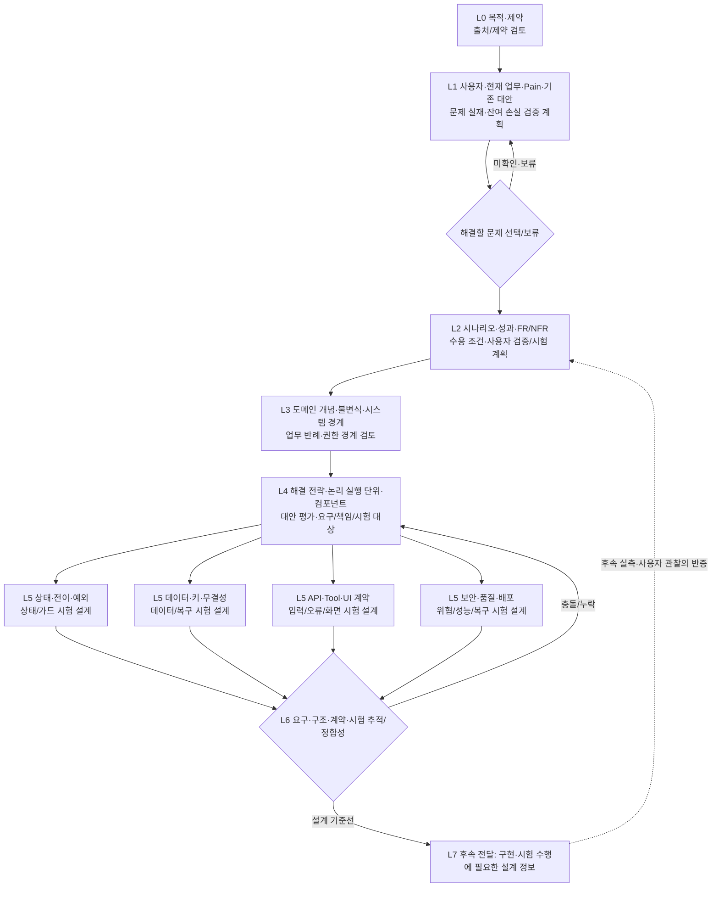
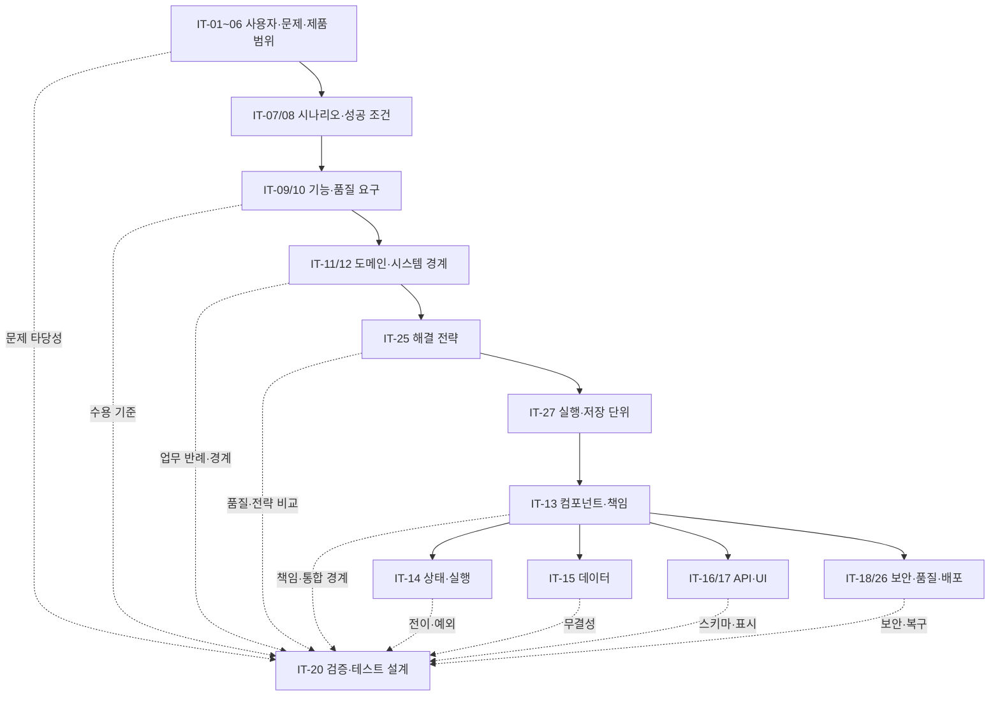

# 기획→시스템 설계 통합 정보 모델 (설계 전용 V4)

> **R01 검토용, 2026-11-19.** 상위 틀에서 하위 틀로 정보가 구체화되는 순서와 **각 설계 수준의 검증·테스트 설계**를 한곳에 묶었습니다. AI 위임·자동 TASK 할당·실제 테스트 실행은 본 문서의 범위가 아닙니다.
> 구조화 기준: [정보 유형/관계 JSON](planning-design-info-model.json) · [정밀 용어집](DESIGN-GLOSSARY.md) · [구성요소·시퀀스·ERD](COMPONENT-DESIGN-VIEWS.md)

## 1. 왜 이 순서인가?

문제·가치·요구를 모른 채 DB·API·컴포넌트를 확정하면 가정으로 설계가 고정됩니다. **상위 결정이 하위 결정의 정보·제약을 제공하는 순서로** 내려가고, 각 수준에서 '검증할 기준'도 함께 정의해야 합니다. 의존관계는 **결정 확정의 순서**이지 조사·초안의 강제 순서가 아닙니다.

## 2. 전체 설계 정보·검증 설계 순서도

**핵심:** 검증 질문은 L0부터 시작하며, L1~L6에서 확인 방법·수용 기준·상세 시험으로 점진적 구체화됩니다. 실제 시험 수행과 성능 실측은 추후 Run/Eval에서 기록합니다. 예시 결과를 실제 제품 검증으로 해석하면 안 됩니다.

## 3. 각 단계에서 결정하는 정보와 검증·테스트 설계

| 설계 수준 | 지금 결정할 실제 내용 | 그 수준에서 함께 설계할 검증·테스트 | 지금 미룰 것 |
|---|---|---|---|
| **L0 목적·제약의 최상위 경계** | 문제 해결의 목적 · 현재 유효한 의도와 승인권자 · 필수 법·자원·기한 제약 | 기획 원본·요건의 출처/모순 점검 | 제품 기능 · 화면·DB·프레임워크 |
| **L1 사용자 문제와 잔여 손실** | 사용자 역할·업무 상황 · As-Is와 관측 가능한 손실 · 기존 대안의 해결 범위 · 법적·기술적 불가능 조건 · 채택·보류할 문제 | 관측 자료·인터뷰/대안 비교·반증 시나리오 | 제품 기능 전체 목록 · AI·DB·아키텍처 · 예쁜 화면 시안 |
| **L2 제품 수준 동작과 성공 조건** | 대표 사용자 목표/유스케이스 · 핵심 기능 요구·품질 목표 · 수용 조건·검증 데이터의 종류 · MVP 포함/제외 | 대표·예외 시나리오, FR/NFR별 판정 조건·시험 데이터 개요 | 클래스·테이블·API 경로·화면 픽셀 · 단일/다중 에이전트 수 |
| **L3 업무 개념과 시스템 경계** | 도메인 객체·용어·핵심 규칙 · 외부 사용자·시스템·법/권한 경계 · 내부/외부 책임 | 반례·신뢰 경계·역할별 접근 규칙·용어 충돌 | DB 테이블·컬럼 · 외부 API 구현 코드·배포 방식 |
| **L4 상위 해결 전략과 실행·저장 단위** | 모놀리식/외부 서비스 등 접근 대안 · 앱·저장소별 책임과 정보 흐름 · 어느 단위가 어떤 정본 데이터를 책임지는지 · 중요 컴포넌트 책임 | 전략 비교·요구/책임 매핑·컴포넌트 인터페이스 및 시험 대상 | 메서드 목록·DB 인덱스 · 특정 클라우드·컨테이너 오케스트레이터 |
| **L5 동작·데이터·인터페이스 상세 설계** | 상태/전이/가드·예외 · 논리 엔터티·키·무결성 · API 요청/응답/권한/오류 · 화면별 사용자 행동·상태 · 위험 통제·최소 배포/운영 제약 | 상태 전이·무결성·계약·권한·오류·회복·사용자 경로별 예상 결과 | 미검증 구현 세부 최적화 · 기능과 무관한 부가 컴포넌트 |
| **L6 계약 합류와 고영향 확정** | 요구→컴포넌트→테스트의 책임 · 상태·API·DB·UI/실패 교차 정합성 · 보류 가정과 ADR · 선택된 기술·비용의 근거 | 요구/계약/상태/데이터/UI/테스트의 연결 및 누락·미확인 | 기여도 낮은 세부 구현 선택까지 사람 승인 |
| **L7 설계의 후속 전달(작업 분해·산출물)** | 확정/가정/미확인 설계 기준선 전달 · 시험 실행에 필요한 데이터·환경·판정 규칙 · 공식 문서로 정보 참조 연결 | 시험 환경·데이터·실행 조건과 산출물 매핑(실제 결과는 Run) | 수행하지 않은 테스트 결과 · 구현 없이 근거 없는 성능 수치 |

**L7은 실제 제품 설계의 추가 레벨이 아니라 후속 전달 단계**입니다. WBS 운영·AI 할당·제출/접수는 정보 정본과 연결만 유지하고 별도 절차로 둡니다.

## 4. 정보 객체와 실제 관계

관계 유형은 `derived_from`, `constrains`, `satisfies`, `planned_check_by`, `impacts` 등입니다. `planned_check_by`는 검증·시험 **계획**이고, `verified_by`는 실제 수행 증거가 확인된 후에만 사용합니다. ID/관계가 연결된 것은 **구조적 정합성의 필요조건**이지 실제 사용자 가치나 실행 동작의 입증이 아닙니다.

## 설계의 탄력성: 선행 결정과 피드백을 구분

**강하게 유지할 것:** `derived_from`·`constrains`·`satisfies`의 상위→하위 선행관계는 비순환으로 유지합니다. 그래야 어떤 정보를 먼저 정해야 하는지 알 수 있습니다.

**유연하게 허용할 것:** L2에서 업무 용어 초안을 만들거나 L5에서 발견한 반례로 L2·L3의 가정을 변경하는 것은 허용합니다. 이는 `impacts`로 재검토할 정보를 표시하며 모든 상위·하위 결정을 자동 폐기하지 않습니다.

**검증 수준:** L0 확인 질문 → L1 관찰·비교 방법 → L2 수용 기준 → L3~L5 상세 시험 입력·기대 결과·pass/fail/unknown 판정으로 발전합니다. 실제 실행 결과는 별도의 Run/Eval에서 관리합니다.

**문제 발생 시:** 충돌 지점 확인 → 영향 범위 추적 → 해당 정보의 가설/미확인 표기 → 필요한 부분만 수정 → 영향받는 계약·시험 계획 재검토. 치명적 제약·제품 선택의 반증일 때만 상위 범위를 다시 정합니다.

## 5. 검증과 시험의 정확한 구분

| 용어 | 설계에서 무엇을 정의하는가? | 주의 |
|---|---|---|
| 문제 타당성 검증 | 실제 사용자의 현행 행동·손실·기존 대안 대비 잔여 Pain을 어떻게 조사/반증할 것인가 | 인터뷰 계획만으로 문제 존재를 입증하지 않음 |
| 사용자 가치 확인(Validation) | 제안한 해결책이 실제 사용자 목표에 적합한지 확인할 비교·관찰 방법 | 테스트 통과가 자동으로 사용자 가치 증명은 아님 |
| 요구·설계 적합성 확인(Verification) | 요구·규칙·상태·인터페이스가 정의한 명세와 일치하는지 확인할 리뷰·분석·시연·시험 | 도면의 형식 검사만으로 기능 충족을 주장하지 않음 |
| 시험 설계(Test Design) | 입력·경계·환경·절차·예상 결과·합격/미확인 기준을 구체화 | 테스트 작성과 실제 실행을 구분 |
| 시험 수행(Test Execution) | 실제 시스템·실험에 입력을 적용하고 결과/로그/환경/버전을 관측 | 실제 결과는 Run/Eval에 기록; 미실행은 `not_run` |

## 6. 한 요구사항이 단계별로 어떻게 구체화되는가?

가상 사례: `unknown` 관측을 확정 위반으로 표시하지 않는다. 제품 후보 CAND-016은 **미채택**, 실제 구현 및 시험은 **미실행**입니다.

| 수준 | 설계 내용 | 함께 설계할 시험·검토 질문 |
|---|---|---|
| L1 | 감독관의 정보 확인·기록 부담이라는 가설, 현행 공식 지침/체크리스트 | 잔여 손실을 비교할 기준과 반증 방법은? |
| L2 | `EX-FR`: unknown이 확정이 아님; `EX-NFR`: 개인·위반 단정 금지; `EX-NFR-AUTH`: 무권한 전이 금지 | 정상/반례 입력과 관찰 가능한 수용 조건은? |
| L3 | `Case`, `Observation`, `CaseStatus`, `ObservationKind` 및 핵심 불변식 | unknown→확정 등 금지되는 의미 변환은? |
| L4 | 웹·API·저장 실행 단위, 분류/상태/저장 컴포넌트 책임 | 요구를 어느 컴포넌트가 충족하며 검증할 경계는? |
| L5 | 상태 전이, 키·무결성, API 오류, UI 표시·권한, 배포/복구 제약 | 입력·오류·저장 실패·화면 상태별 예상 결과는? |
| L6 | 동일한 용어·상태·오류 계약의 교차 정합성 | 설계와 시험 계획에 누락·충돌이 있는가? |

시범 예시 자료: [정보 추적](pilots/2026-11-19-planning-design-v2/CAND-016-TRACE.json) · [공통 계약](pilots/2026-11-19-planning-design-v2/DOMAIN-CONTRACT.json).

## 7. 범위 및 기존 자료

**포함:** 기획 정보, 요구사항, 상위 전략, 도메인·구성요소·상태·데이터·API/UI·보안/배포, 각 수준의 검증 계획과 교차 정합성. **제외:** AI 작업 운영, 개발 업무 할당, 실제 실행·성능 측정·제출 접수.

기존 [13개 작업 정보 영역](WORK-MODEL.md)과 공식 산출물 매핑은 유지하며, 시험 설계의 `IT-20`이 더 구체화된 것입니다. [구성요소 구조·실행·ERD](COMPONENT-DESIGN-VIEWS.md)에서 컴포넌트별 책임을 확인할 수 있습니다.

참고: [NASA SE Handbook](https://www.nasa.gov/reference/systems-engineering-handbook/) · [SEBoK Verification](https://sebokwiki.org/wiki/System_Verification) · [ISO/IEC/IEEE 29148](https://www.iso.org/standard/72089.html) · [C4](https://c4model.com/) · [arc42](https://arc42.org/). 이 출처들이 팀 내부 순서·정보 ID를 공식 인증하는 것은 아닙니다.

## 2026-11-24 보완: 설계 중 실제 검증

검증 계획 작성만으로 해당 설계 수준의 정합성이 확인되지는 않는다. 영향을 받는 슬라이스에서 상위 의무 보존(정제), 관련 계약 결합(합성), 변경 후 근거 최신성 검사를 실제 실행하고 실패를 수정·재검증한다. [공통 검증 루프와 실행 방법](DESIGN-VERIFICATION-LOOP.md). 선택한 규칙 통과는 전체 단계 승인이나 제품 시험 통과가 아니다. 초안 병렬 작성과 기존 권한 기준은 유지한다.
