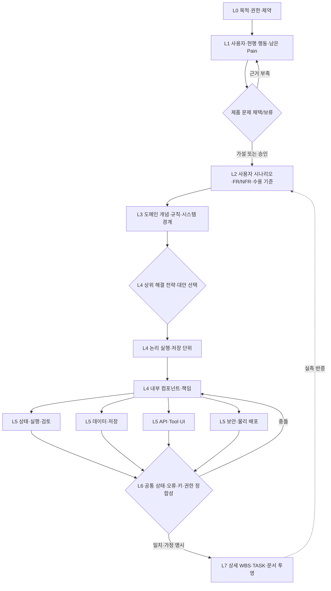

# 점진적 설계 순서 V3 — 큰 틀을 먼저 정하고 필요한 만큼 상세화

> **2026-11-19 · R01 검토용.** 전체를 한 번에 확정하지 않기 위한 **결정의 논리적 선행관계**입니다. 실제 제품 선정·구현 승인은 아닙니다.
> [정밀 용어집](DESIGN-GLOSSARY.md) · [정보 모델](planning-design-info-model.json) · [구성요소 도식](COMPONENT-DESIGN-VIEWS.md) · [단일 도메인 계약](pilots/2026-11-19-planning-design-v2/DOMAIN-CONTRACT.json)

## 1. 전체 설계 결정 순서

**화살표의 의미:** 뒤의 설계를 확정하는 데 앞의 정보가 필요하다는 뜻입니다. 이 순서로 모든 파일을 작성하라는 뜻이 아닙니다. 기술 실험·문제 조사·상위 WBS는 필요 시 병렬 진행할 수 있습니다. L5의 네 상세 분야는 병렬 초안 작성 후 L6에서 계약을 일치시킵니다.

## 2. 단계별 '이번에 정할 것'과 '아직 정하지 않을 것'

| 레벨 | 지금 결정할 구체 내용 | 지금 고정하지 않을 내용 | 다음 단계로 넘어가는 조건 |
|---|---|---|---|
| **L0 목적·제약의 최상위 경계** | 문제 해결의 목적 · 현재 유효한 의도와 승인권자 · 필수 법·자원·기한 제약 | 제품 기능 · 화면·DB·프레임워크 | 현재 의도·권한·제약의 정본을 참조할 수 있다 |
| **L1 사용자 문제와 잔여 손실** | 사용자 역할·업무 상황 · As-Is와 관측 가능한 손실 · 기존 대안의 해결 범위 · 법적·기술적 불가능 조건 · 채택·보류할 문제 | 제품 기능 전체 목록 · AI·DB·아키텍처 · 예쁜 화면 시안 | 근거·반대 근거·미확인을 구분하고 제품 문제를 선택/보류 |
| **L2 제품 수준 동작과 성공 조건** | 대표 사용자 목표/유스케이스 · 핵심 기능 요구·품질 목표 · 수용·반증 조건 · MVP 포함/제외 | 클래스·테이블·API 경로·화면 픽셀 · 단일/다중 에이전트 수 | 대표 시나리오와 FR/NFR·검증 계획을 일대일 또는 명시적 다대다 연결 |
| **L3 업무 개념과 시스템 경계** | 도메인 객체·용어·핵심 규칙 · 외부 사용자·시스템·법/권한 경계 · 내부/외부 책임 | DB 테이블·컬럼 · 외부 API 구현 코드·배포 방식 | 다른 설계자가 동일 의미로 업무 객체와 경계를 설명 |
| **L4 상위 해결 전략과 실행·저장 단위** | 모놀리식/외부 서비스 등 접근 대안 · 앱·저장소별 책임과 정보 흐름 · 어느 단위가 어떤 정본 데이터를 책임지는지 · 중요 컴포넌트 책임 | 메서드 목록·DB 인덱스 · 특정 클라우드·컨테이너 오케스트레이터 | 상위 책임이 겹치지 않고 실행 단위/컴포넌트의 입력·출력·의존을 추적할 수 있음 |
| **L5 동작·데이터·인터페이스 상세 설계** | 상태/전이/가드·예외 · 논리 엔터티·키·무결성 · API 요청/응답/권한/오류 · 화면별 사용자 행동·상태 · 위험 통제·최소 배포/운영 제약 | 미검증 구현 세부 최적화 · 기능과 무관한 부가 컴포넌트 | 상태·오류·키·권한·UI 표현이 서로 대응되는 초안 |
| **L6 계약 합류와 고영향 확정** | 요구→컴포넌트→테스트의 책임 · 상태·API·DB·UI/실패 교차 정합성 · 보류 가정과 ADR · 선택된 기술·비용의 근거 | 기여도 낮은 세부 구현 선택까지 사람 승인 | 서로 다른 설계가 하나의 도메인 계약을 설명하고 미결사항·재검토 조건 명시 |
| **L7 실행 단위의 작업 분해와 산출물** | 작업 담당·의존·완료 기준 · 테스트 실행 방법 · 정본→제출 문서 필드 투영 | 아직 수행하지 않은 결과값 작성 | 실행 가능한 TASK/검증 계획과 독립적인 제출 상태 |

## 3. 용어가 애매하면 결정 시점도 애매해집니다

| 애매한 표현 | 용어를 확정한 뒤 설계할 대상 | 결정 단계 |
|---|---|---|
| 서비스 | 제품 서비스 / 애플리케이션 유스케이스 서비스 / 외부 SaaS / 독립 배포 서비스 구별 | L1/L2 또는 L4 |
| 컨테이너 | C4 논리 실행·저장 단위(IT-27)와 Docker 컨테이너/클라우드 배포(IT-26) 구별 | L4 / L5 |
| 상태 | 업무 상태(CaseStatus), 화면 표시 상태, HTTP 상태 분리 | L3 / L5 |
| 데이터 모델 | Case·Observation 업무 개념과 DB 스키마·인덱스 구별 | L3 / L5 |
| 컴포넌트 | 하나의 논리 실행 단위 안에서 책임과 인터페이스를 가진 코드·역할 단위 | L4 |
| 검증 | 명세를 만족하는지 Verification, 실제 사용자에게 가치가 있는지 Validation 구별 | L2 / L6 / Run |

정의·예시·혼동 주의사항은 [DESIGN-GLOSSARY.md](DESIGN-GLOSSARY.md)에 기록했습니다.

## 4. 실제 후보에 적용하면

| 단계 | CAND-016 모의 사건 카드 가상 사례 | 지금 결정하지 않은 내용 |
|---|---|---|
| L1 문제 | 감독관의 불확실한 징후·이관 부담, 기존 지침/비AI 체크리스트와 비교 | 실제 잔여 Pain 규모·제품 채택 보류 |
| L2 요구 | 관측·추정·미확인 구분 표시; 합격 조건 정의 | UI 프레임워크·DBMS |
| L3 업무 개념 | Case, Observation, Action; reviewed는 사람 검토 완료 | 테이블 수·인덱스 |
| L4 논리 구조 | 웹 앱·서버 앱·데이터 저장소(IT-27), 그 내부 API/권한/유스케이스/분류·상태·저장 컴포넌트 | Docker/클라우드·마이크로서비스 수 |
| L5 상세 계약 | 공유 CaseStatus 네 상태, ErrorCode 다섯 오류, 관측 분류를 API·DB·UI에 반영 | 실제 성능 수치·구현 기술 |
| L6 합류 | 상태·권한·오류·저장 결과·UI 표현의 일치 확인 | 사용자 가치 검증 완료로 해석 금지 |
| L7 실행 | TASK·테스트·문서 관계와 실패 재검토 범위 | 미실시 테스트 결과·제출완료 |

관련 가상 컴포넌트의 구조도·시퀀스·ERD는 [COMPONENT-DESIGN-VIEWS.md](COMPONENT-DESIGN-VIEWS.md)에 있습니다.

## 5. 기존 정본과의 관계

새로운 상위 정보 영역이나 문서 승인 회의를 추가하지 않습니다. 기존 13개 정보 영역의 하위 타입을 상세화한 것입니다. 각 단계에 요구하는 것은 **후속 선택을 위해 필요한 최소한의 정보**이고, 확정이 어렵다면 근거·미확인·재검토 조건을 기록합니다. 설계·구현 도중 반증이 나오면 관련된 상위 결정으로만 되돌아갑니다.

참고 개념: [C4 Model](https://c4model.com/)의 추상화 계층, [arc42](https://arc42.org/)의 전략/구성/실행/배포 관점, [ISO/IEC/IEEE 42010](https://www.iso.org/standard/74393.html)의 관계자·관심사 설명. 이 자료들이 특정 개발 순서를 공식 규정하는 것은 아닙니다.
