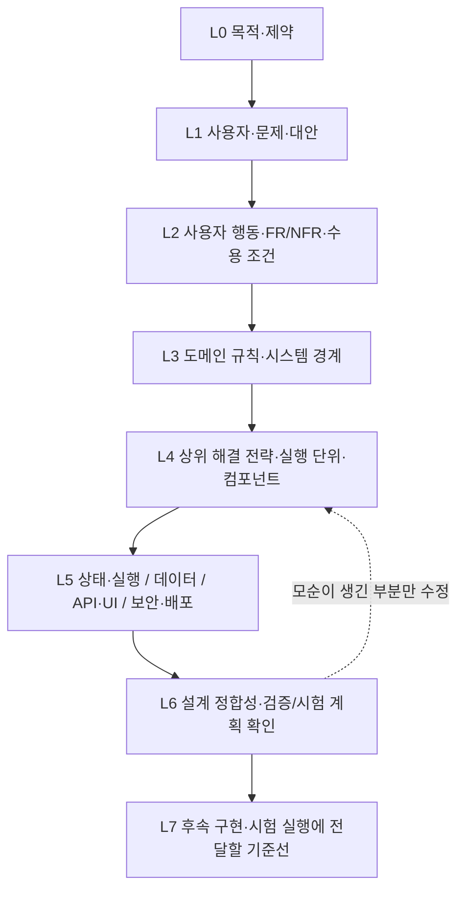

# 점진적 기획·설계 순서 — 결정할 틀과 검증할 내용

> **설계 전용 V4 · 검토 초안.** 상위 틀부터 하위 틀까지 무엇을 확정하고, 무엇을 보류하며, 각 수준의 검증·시험 계획을 어떻게 만드는지를 정리합니다. [전체 모델](PLANNING-DESIGN-INFO-MODEL.md) · [용어집](DESIGN-GLOSSARY.md) · [구성요소](COMPONENT-DESIGN-VIEWS.md)

## 1. 상위 틀 → 하위 틀: 설계 결정 순서

각 화살표는 **나중 결정을 확정하기 위한 선행 정보**입니다. 초안·탐색적 설계는 병렬로 할 수 있습니다. L7은 WBS 및 실행·제출 작업으로 연결하기 위한 전달 경계일 뿐 설계에 포함할 구현 작업은 아닙니다.

## 2. 단계마다 결정·유보·검증을 같이 정의

| 수준·실제 정보 | 지금 정할 것 | 지금 미룰 것 | 동시에 설계할 검증·시험 | 다음 수준의 입력 조건 |
|---|---|---|---|---|
| **L0 목적·제약의 최상위 경계** | 문제 해결의 목적 · 현재 유효한 의도와 승인권자 · 필수 법·자원·기한 제약 | 제품 기능 · 화면·DB·프레임워크 | 기획 원본·요건의 출처/모순 점검 | 현재 의도·권한·제약의 정본을 참조할 수 있다 |
| **L1 사용자 문제와 잔여 손실** | 사용자 역할·업무 상황 · As-Is와 관측 가능한 손실 · 기존 대안의 해결 범위 · 법적·기술적 불가능 조건 · 채택·보류할 문제 | 제품 기능 전체 목록 · AI·DB·아키텍처 · 예쁜 화면 시안 | 관측 자료·인터뷰/대안 비교·반증 시나리오 | 근거·반대 근거·미확인을 구분하고 제품 문제를 선택/보류 |
| **L2 제품 수준 동작과 성공 조건** | 대표 사용자 목표/유스케이스 · 핵심 기능 요구·품질 목표 · 수용 조건·검증 데이터의 종류 · MVP 포함/제외 | 클래스·테이블·API 경로·화면 픽셀 · 단일/다중 에이전트 수 | 대표·예외 시나리오, FR/NFR별 판정 조건·시험 데이터 개요 | 대표 시나리오와 FR/NFR·검증 계획을 일대일 또는 명시적 다대다 연결 |
| **L3 업무 개념과 시스템 경계** | 도메인 객체·용어·핵심 규칙 · 외부 사용자·시스템·법/권한 경계 · 내부/외부 책임 | DB 테이블·컬럼 · 외부 API 구현 코드·배포 방식 | 반례·신뢰 경계·역할별 접근 규칙·용어 충돌 | 다른 설계자가 동일 의미로 업무 객체와 경계를 설명 |
| **L4 상위 해결 전략과 실행·저장 단위** | 모놀리식/외부 서비스 등 접근 대안 · 앱·저장소별 책임과 정보 흐름 · 어느 단위가 어떤 정본 데이터를 책임지는지 · 중요 컴포넌트 책임 | 메서드 목록·DB 인덱스 · 특정 클라우드·컨테이너 오케스트레이터 | 전략 비교·요구/책임 매핑·컴포넌트 인터페이스 및 시험 대상 | 상위 책임이 겹치지 않고 실행 단위/컴포넌트의 입력·출력·의존을 추적할 수 있음 |
| **L5 동작·데이터·인터페이스 상세 설계** | 상태/전이/가드·예외 · 논리 엔터티·키·무결성 · API 요청/응답/권한/오류 · 화면별 사용자 행동·상태 · 위험 통제·최소 배포/운영 제약 | 미검증 구현 세부 최적화 · 기능과 무관한 부가 컴포넌트 | 상태 전이·무결성·계약·권한·오류·회복·사용자 경로별 예상 결과 | 상태·오류·키·권한·UI 표현이 서로 대응되는 초안 |
| **L6 계약 합류와 고영향 확정** | 요구→컴포넌트→테스트의 책임 · 상태·API·DB·UI/실패 교차 정합성 · 보류 가정과 ADR · 선택된 기술·비용의 근거 | 기여도 낮은 세부 구현 선택까지 사람 승인 | 요구/계약/상태/데이터/UI/테스트의 연결 및 누락·미확인 | 서로 다른 설계가 하나의 도메인 계약을 설명하고 미결사항·재검토 조건 명시 |
| **L7 설계의 후속 전달(작업 분해·산출물)** | 확정/가정/미확인 설계 기준선 전달 · 시험 실행에 필요한 데이터·환경·판정 규칙 · 공식 문서로 정보 참조 연결 | 수행하지 않은 테스트 결과 · 구현 없이 근거 없는 성능 수치 | 시험 환경·데이터·실행 조건과 산출물 매핑(실제 결과는 Run) | 실행 가능한 TASK/검증 계획과 독립적인 제출 상태 |

## 3. 모든 수준에서 시험을 한다는 뜻인가?

**아닙니다. 모든 수준에서 검증·시험의 대상과 방법을 설계한다는 뜻**입니다. 문제/가치 수준에서는 사용자 관찰·기존 대안 비교·반증 조건을 정의합니다. 기능 요구 수준에서는 수용 조건을 정하고, 도메인·상위 구조에서는 업무 반례와 설계 리뷰를 계획하며, 컴포넌트·상태·데이터·인터페이스에서는 실제 입력·예상·오류·환경을 구체화합니다. 설계 통합 수준에서 연결과 누락을 확인합니다.

설계 중에도 리뷰·정적 검사·모의 PoC를 수행할 수 있으나, 계획 문서에 '실제 테스트 통과'를 임의로 작성하지 않습니다. 실제 시험 수행/관찰은 수행 이후의 Run/Eval 근거로 분리합니다.

## 4. 상세 설계의 구체적 하위 구성

| 상위 개념 | 하위 설계 항목 | 동반 검증·시험 설계 |
|---|---|---|
| 도메인·시스템 경계 IT-11/12 | 업무 용어, 엔터티·관계, 불변식, 이벤트, 외부 사용자/시스템, 신뢰·권한 경계 | 금지 규칙의 반례, 외부 접근 시나리오, 누락된 사용자 역할 검토 |
| 상위 해결 전략 IT-25 | 구조 대안, 장단점, 품질 제약, 실패 모드, 선택과 재검토 조건 | 기준선 대비 대안 시나리오, 비용·품질 위험 평가 계획 |
| 실행·저장 단위 IT-27 | 앱·서버·저장소 등 단위의 책임, 통신 계약, 데이터 정본 | 실행 단위 경계·권한·정보 흐름과 통합 시험 경계 |
| 내부 컴포넌트 IT-13 | 이름/역할, 부모 단위, 제공 동작, 입출력, 의존성, 소유 상태·데이터, 실패 경계 | 요구 충족 항목·컴포넌트 계약 시험·목킹 경계 |
| 상태/워크플로 IT-14 | 상태값, 이벤트, 전이 조건, 예외·취소, 가드, 종료, 재시도 | 정상/거부/경계/재시도·멱등성 전이 케이스 |
| 데이터 IT-15 | 엔터티·필드·타입, 키, 관계, 카디널리티, 무결성, 접근·삭제·보존 | 유효/무효 키, 트랜잭션 실패, 접근·보존 시험 조건 |
| API·Tool IT-16 | operation, input/output schema, 인증·권한, 오류, 버전, timeout·retry | 계약·권한·오류·호환성·부분 결과 케이스 |
| UI IT-17 | 화면 구조, 이동, 입력/검증, 표시 상태, 빈/로딩/오류, 접근성 | 주요 사용자 흐름, 빈/오류/복구/접근성 시험 시나리오 |
| 보안/품질/배포 IT-18/26 | 위협·권한·감사, 실행 환경·통신, 성능·확장, 복구·롤백 | 오용·성능·가용성·권한 및 롤백 시나리오 |

## 5. 용어·관계

**용어:** [DESIGN-GLOSSARY.md](DESIGN-GLOSSARY.md)의 제품 문제/도메인/시스템/논리 실행 단위/컴포넌트/물리 배포를 구별합니다.

**검증 용어:** 문제·사용자 가치 적절성은 Validation, 명세와 설계의 충족 여부는 Verification, 입력·환경·기대 결과의 구체화는 Test Design, 실제 실행 기록은 Test Execution입니다.

**정본:** [planning-design-info-model.json](planning-design-info-model.json)에는 단계별 `verification_design`, 각 L단계의 검증 설계와 `IT-20` 참조를 기록합니다. 실제 제품 범위·기술·개발 결과는 승인되지 않았습니다.
