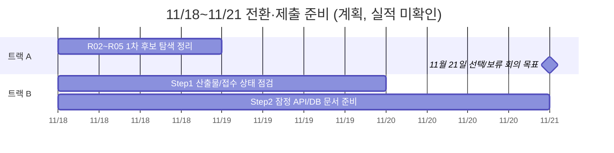

# Step 1 WBS — 산출물별 피드백 우선 V2 (과거 계획과 투 트랙 구분)

> **개정 검증용 초안 · 실행 일정 확정 아님 · 미제출** · 적용 기준: 2026-11-18 · 문서 ID: `DLV-02`
>
 >
> 이 문서는 기존 찾아you 기획의 **트랙 B 제출 대응용 잠정 시연본**입니다. 프로젝트 주제·기능·기술 채택 및 실제 구현·제출을 의미하지 않습니다.

- **기준:** (v2) 산출물별 강사 피드백의 유효 조건을 우선 적용; 기존 찾아you는 제출용 잠정 예시이며 현재 제품 미선정
- **목차 근거:** 강사 산출물 L27: 선정 전 1~2번 우선, 선정 후 3~6번 조건부; 교육 예시의 간트·일정 규칙·작업 계획·마일스톤; DOCX 원본 미대조
- **생성 입력:** [파일럿 정본](model.json) · 기준 커밋 `53b73584069042225298c97c6c5688f8b429f56b`
- **Phase:** [PHASE-20261118-01](../../../human/phase-intents/PHASE-20261118-01.md)

## 문서·근거 경계

기존 기획/설계 원본을 변경하지 않고 동일 기준 데이터에서 생성한 **검토용 Markdown**입니다. 해당 커밋이 당시 참고 자료이며, 현재 제품의 승인/개발/제출 상태는 아닙니다.

| 기준 원본 | 원본 고정 커밋 |
| --- | --- |
| [`docs/artifacts/planning/WBS.json`](https://github.com/ik-e/chaja-you/blob/53b73584069042225298c97c6c5688f8b429f56b/docs/artifacts/planning/WBS.json) | `53b735840690` |
| [`docs/artifacts/state/current.json`](https://github.com/ik-e/chaja-you/blob/53b73584069042225298c97c6c5688f8b429f56b/docs/artifacts/state/current.json) | `53b735840690` |
| [`docs/artifacts/state/legacy_task_closeout_20261118.json`](https://github.com/ik-e/chaja-you/blob/53b73584069042225298c97c6c5688f8b429f56b/docs/artifacts/state/legacy_task_closeout_20261118.json) | `53b735840690` |
| [`docs/artifacts/tasks/TASK-026.json`](https://github.com/ik-e/chaja-you/blob/53b73584069042225298c97c6c5688f8b429f56b/docs/artifacts/tasks/TASK-026.json) | `53b735840690` |
| [`docs/artifacts/tasks/TASK-027.json`](https://github.com/ik-e/chaja-you/blob/53b73584069042225298c97c6c5688f8b429f56b/docs/artifacts/tasks/TASK-027.json) | `53b735840690` |

## 1. 간트 차트 (주차별 계획·실적)

### 1.1 기존 WBS는 과거 기준으로 보존 (L27-2)

| 기존 WBS | 과거 예정 또는 표시 | 현재 상태 해석 | 변경 전 원본 |
| --- | --- | --- | --- |
| W01/W04/W06 | 11/10~13, 당시 완료 | 해당 당시 범위의 완료만 인정. 새 제품 결정·실제 제출 접수 아님 | 기존 WBS JSON/Step1 이력 |
| W07/W09 | 11/16~18 예정 | 이전 APP 구현 일정은 **보류**, 자동 재착수 금지 | 기존 WBS JSON |
| W08 | 11/16~20 기존 API·DB/서버 뼈대 예정 | 서버 구현은 보류, 11/20 문서 제출 의무만 현 TASK-027로 관리 | 기존 WBS JSON |
| W13/W17/W20/W24 | 11/25~12/16 구 구현·시험 계획 | 실제 주제 선택 후 일정/공수/내용 재산정 | 기존 WBS JSON |

**원본 기록 보존:** 당일 과거 WBS를 직접 수정하거나 과거 완료 상태를 새로운 프로젝트의 완료로 옮기지 않습니다. 근거 없는 실제 시작/종료일·진척률은 **미확인**입니다.

### 1.2 실제 주제 미선정 상태의 가까운 일정 (L27-1, 계획과 실적 구분)

| 날짜 | 기존 배정된 업무 | 예상 출력 | 결과/관측 상태 |
| --- | --- | --- | --- |
| 11/18 | TASK-022~025 후보 탐색·근거 기록 | 팀원별 1개 후보의 Pain·대안·반증 | GitHub 원본 TASK는 모두 '할 일', result 미기록 |
| 11/18~20 | TASK-026/027 R01 운영·제출 관리 | 피드백 반영표, 잠정 Step1·2 문서 및 링크 확인 | 파일럿 문서와 실제 제출을 구분 |
| 11/20 | API·DB 산출물 마감(대시보드) | 잠정 API/DB·열람/제출 확인 | 제출·접수 미확인 |
| 11/21 | 팀 오프라인 후보 채택/보류 목표 | 실제 문제·제품 방향 결정 및 근거 | 아직 미래 계획 |
| 11/23 이후 | 선정 결과를 받아 재기획·재WBS | 신규 구현 TASK와 추정 일정 | 선행 결정을 기다림, 지금 할당하지 않음 |

**이 간트는 현 시점의 운영·제출 초안**입니다. 기존 개발 WBS의 실행 시작을 승인하지 않으며, 완료 여부는 해당 TASK/대시보드에서만 판정합니다.

## 2. 일정 관리 규칙

1. **두 계획 층을 분리:** (가) 기존 찾아you W01~W34 이력, (나) 현재 PHASE-20261118-01의 신규 후보 탐색·잠정 제출. 구 W07~W09를 자동 재개하지 않습니다.
2. **선정 전 우선(L27-1~2):** 11/21 사람 결정 시점, 담당, 후보 비교 근거, 구 계획의 완료 범위·대기 사유를 재시작 준비표에서 관리합니다.
3. **실적 허위 생성 금지:** 계획일, 예상일, 실제 수행일, 확인한 파일·PR/로그, 증빙 없는 미확인을 각각 분리합니다. 이번 문서는 11/18~20 미래 일정을 실제 수행으로 채우지 않습니다.
4. **제출 단계 구분:** 작성 → 검토 → 읽기 권한 → 대시보드 링크 등록 → 상태 '제출완료' → 실제 접수 확인. 11/13 Step1은 현재 '작성중', 11/20 Step2는 '미착수'로 보입니다.
5. **11/21 이후에만 적용(L27-3~6):** 선택된 문제의 구현 WBS·담당·시간·검토·리허설·실험·회복 절차를 다시 산정합니다. 단, 11/20 마감에 필요한 **문서 작성·내부 검토·제출**만 현재 트랙 B에서 수행합니다.
6. **협의 대상:** 실제 일정 충돌·제출 방식은 강사/매니저와 확인합니다. 강사가 현 2트랙 일정 변경을 승인했다고 단정하지 않습니다.
7. **타인 작업 보호:** 팀원 TASK 소유권·업무 계약·기획 방향은 본 파일럿을 근거로 수정하지 않습니다. R01이 문서와 제출을 관리하고 기술 검토는 적임자에게 요청합니다.

## 3. 작업 계획표

| 작업 | 원본 책임 | 완료 조건 / 검토 증거 | 당일 원본 상태 | 제출·재계획과의 관계 |
| --- | --- | --- | --- | --- |
| TASK-022 | R02 | 한 후보의 사용자·Pain·기존 대안·반증 | 할 일 / 결과 미기록 / 11/18 | 실제 제품 탐색 |
| TASK-023 | R03 | 한 후보의 사용자·Pain·기존 대안·반증 | 할 일 / 결과 미기록 / 11/18 | 실제 제품 탐색 |
| TASK-024 | R04 | 한 후보의 사용자·Pain·기존 대안·반증 | 할 일 / 결과 미기록 / 11/18 | 실제 제품 탐색 |
| TASK-025 | R05 | 한 후보의 사용자·Pain·기존 대안·반증 | 할 일 / 결과 미기록 / 11/18 | 실제 제품 탐색 |
| TASK-026 | R01 | 운영·과거 TASK 정산/멘토 요약·선정 안건 관리 | 할 일 / 결과 미기록 / 11/18. 일부 작업은 별도 PR 증거 존재 | 운영 관리 |
| TASK-027 | R01 | 기존 찾아you 기준 잠정 API/DB 초안, 제출·접수 상태 분리 | 할 일 / 결과 미기록 / 11/20 | 제출 관리 |
| 제품 선택 이후 WBS(아직 TASK 아님) | 사람 결정 후 조정 | 사용자 문제·범위·기술/인력·가용 시간을 반영한 새 계획 | 미착수, 미배정 | 선정 전 구현 약속 금지 |

**작업 산출물과 책임의 구분:** 기술 문서의 작성/검토 전문성은 R05 등 적임자에게 협조받을 수 있지만 R01이 모든 구현 기술을 확정할 필요는 없습니다. 본 표는 기존 할당을 설명할 뿐 새 배정은 아닙니다.

### 11/20 제출을 위한 최소 점검 단위(기존 TASK-027의 하위 체크, 새로운 TASK 발행 아님)

- 입력·출력·상태·오류와 요청 ID가 동일 흐름을 표현하는지
- API와 DB 엔터티/키 관계가 일치하는지
- 문서에 미확정 기술과 미구현·미검증 범위를 표시했는지
- 공식 제공 양식·문서 열람 권한·대시보드 제출·접수 동작을 별개로 확인했는지

## 4. 마일스톤

| 산출물/의사결정 | 대시보드 마감 또는 팀 목표 | 11/18 확인 상태 | 지금 필요한 조치 |
| --- | --- | --- | --- |
| Step1 기획서·WBS | 공식 표시 11/13 | 두 행 '작성중', 링크 등록, 접수 미확인 | 산출물 L26/L27 사전 피드백 반영 및 제출 확인 |
| Step2 API 설계·DB 스키마 | 공식 표시 11/20 | 두 행 '미착수', 개별 강사 의견 공란 | 잠정 계약과 개념 ERD를 **최소 형식으로** 준비·검토, 기술 확정 금지 |
| 제품 방향 선택/보류 | 팀 목표 11/21 | 최종 결정 없음 | 후보별 근거·보류 사유·현 WBS 교체 필요성 결정 |
| Step3 상태 전이 / 자기 성찰 | 공식 표시 11/27 · 12/04 | 미래 산출물 | 선정된 주제에서 재평가 |
| 중간 발표 | 공식 표시 12/08 | 미래 산출물 | 실제 진척·검증 근거만 사용 |
| Step4 협업/가드레일/복구 | 공식 표시 12/11 · 12/18 | 미래 산출물 | 선정 후 설계·구현·실측 연결 |
| Step5 웹 앱/통합·배포 | 공식 표시 12/24 · 12/31 | 미래 산출물 | 실제 제품·릴리스 기준 |
| 최종 발표·코드·영상 | 공식 표시 2027/01/04 | 미래 산출물 | 결과·접근·재현 확인 |

### 위험과 조건부 작업의 우선순위

| 위험 | 지금 대응 | 선정 후 대응 |
| --- | --- | --- |
| 11/20 제출이 11/21 결정보다 앞섬 | 이전 찾아you 기준 잠정 설계로 제출 대응, 공식 마감/협의 결과 확인 | 선정 제품에 맞게 문서 개정 필요 여부 판단 |
| 지난 APP 일정이 현재 일처럼 보임 | 구 WBS와 현재 실행 목록을 분리, 구 계획의 의미 보존 | 새 WBS 수립 |
| 실제 진척률/근거 없음 | 미확인 유지, 담당·확인 시점 명시 | 실제 run/검토 결과만 기록 |
| 11/13 링크만 존재하고 제출·접수 미확인 | 최신 문서·권한·대시보드 상태 확인 | 변경된 제출본은 새 버전 기록 |
| 예시/수정본 양식 차이 | 공식 제공 양식 확보 전 G0 미통과 | 새 주제에서 목차와 내용 재대조 |

**수행 기준:** 강사 산출물 L27의 선정 전 1·2번은 지금, 3~6번의 구체적인 새 구현/시험/WBS 수립은 선정 후입니다. 단 11/20 API/DB **문서 준비 의무**는 현재 시점에도 유효합니다.

---

**검토 상태:** 공식 수정본 필수 목차 직접 대조(G0) 미완료 · 기술/구현 승인 미완료 · 제출·접수 미완료
