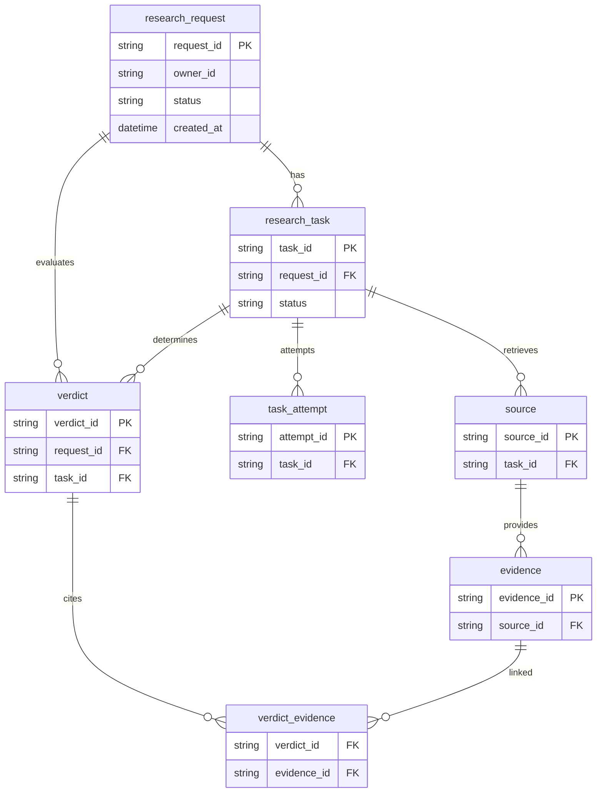

# Step2 DB 스키마 V3 — ERD·컬럼·RLS·세션/벡터 결정 기록

> **개선 검증용 V3 · 미제출 · 실제 제품 미선정** · 작성기준 2026-11-18 · DLV-04
> 기존 찾아you의 **잠정 제출용 설계**로 실제 제품 선정·구현·실측·공식 제출·접수를 뜻하지 않습니다.

- **기준:** 현재 두 트랙 + 원본 강사 가이드 + 산출물별 최신 피드백에 따른 찾아you 잠정 예시 (제품 승인/구현 아님)
- **가이드/목차 근거:** Step2 DB 작성 가이드 6개 영역 (개별 산출물 피드백 없음)
- **검증 범위:** 원본 HTML 작성 가이드 비교; 단독 DOCX 샘플 없음
- **단일 프로젝션 입력:** [model.json](model.json) · [API-DB 계약](contract.json)
- **기준 커밋:** `53b73584069042225298c97c6c5688f8b429f56b` · [현재 두 트랙 Phase](../../../human/phase-intents/PHASE-20261118-01.md)

## 문서 근거와 적용 제한

아래 원본은 당시 저장소의 **고정 참조**입니다. 사실·가설·합성 검증·실측을 구분하며 과거 정본이나 타인 TASK를 수정하지 않습니다.

| 참조 원본 | 커밋 |
| --- | --- |
| [`docs/artifacts/tasks/TASK-006.json`](https://github.com/ik-e/chaja-you/blob/53b73584069042225298c97c6c5688f8b429f56b/docs/artifacts/tasks/TASK-006.json) | `53b735840690` |
| [`docs/artifacts/planning/기획서_초안.json`](https://github.com/ik-e/chaja-you/blob/53b73584069042225298c97c6c5688f8b429f56b/docs/artifacts/planning/%EA%B8%B0%ED%9A%8D%EC%84%9C_%EC%B4%88%EC%95%88.json) | `53b735840690` |
| [`docs/artifacts/specs/focus_apps.json`](https://github.com/ik-e/chaja-you/blob/53b73584069042225298c97c6c5688f8b429f56b/docs/artifacts/specs/focus_apps.json) | `53b735840690` |

## 1. ERD와 관계 명세

**문서 상태:** 임시 APP-A 관계 모델, DBMS 미선정, 테이블 생성/마이그레이션·자료 수집 미실행. [contract.json](contract.json)이 API와 공유하는 단일 의미 원본입니다. 기술 선택은 실제 프로젝트가 선정된 뒤 검토합니다.

### 개념 ERD



### 관계 명세표

| 자식 FK | 부모 PK/유일 키 | 의미·검증 |
| --- | --- | --- |
| research_task.request_id | research_request.request_id | parent 1:N child; 같은 요청 범위는 추가 제약으로 확인 |
| task_attempt.task_id | research_task.task_id | parent 1:N child; 같은 요청 범위는 추가 제약으로 확인 |
| source.task_id | research_task.task_id | parent 1:N child; 같은 요청 범위는 추가 제약으로 확인 |
| evidence.source_id | source.source_id | parent 1:N child; 같은 요청 범위는 추가 제약으로 확인 |
| verdict.request_id | research_request.request_id | parent 1:N child; 같은 요청 범위는 추가 제약으로 확인 |
| verdict.task_id | research_task.task_id | parent 1:N child; 같은 요청 범위는 추가 제약으로 확인 |
| verdict_evidence.verdict_id | verdict.verdict_id | parent 1:N child; 같은 요청 범위는 추가 제약으로 확인 |
| verdict_evidence.evidence_id | evidence.evidence_id | parent 1:N child; 같은 요청 범위는 추가 제약으로 확인 |

**ERD의 기본 FK 외 필수 불변식:** (1) `verdict.request_id`와 `verdict.task_id`가 동일 요청을 가리켜야 하며, (2) 판정에 연결된 `evidence.source.task.request_id`가 같은 요청과 일치해야 합니다. 단순 FK 두 개만으로 두 번째 조건이 충족되지는 않습니다. 복합 FK 또는 서버 트랜잭션/트리거 검증이 필요합니다.

**요청 소유:** JWT의 검증된 subject로 생성 시 `research_request.owner_id`를 할당합니다. API가 소유권을 검사한다면 DB도 이를 추적할 수 있어야 합니다.

## 2. 엔터티별 컬럼 타입·제약·의미

원본 DB 작성 가이드가 요구하는 **컬럼별 4칸(테이블/컬럼/타입·제약/의미)**을 테이블별로 분리해 표시합니다. 7개 테이블, 총 48개 컬럼은 **개념 설계**이며 SQL 실행/DB 생성 완료가 아닙니다.

### research_request (PK: `request_id`)

| 컬럼 | 타입 | 제약(제안) | 의미 |
| --- | --- | --- | --- |
| `request_id` | TEXT | PK NOT NULL | server assigned request ID |
| `owner_id` | TEXT | NOT NULL | verified subject identity, no client override |
| `domain` | TEXT | NOT NULL | research domain |
| `targets` | JSON | NOT NULL | candidate list |
| `criteria` | JSON | NOT NULL | condition list with importance |
| `discovery_rule` | TEXT | NOT NULL | specified_candidates_only or conditional_discovery |
| `status` | TEXT | NOT NULL CHECK status IN request_status | request lifecycle |
| `idempotency_key` | TEXT | NULL | per-user deduplication key |
| `created_at` | TIMESTAMPTZ | NOT NULL DEFAULT now() | creation timestamp |

추가 UNIQUE: owner_id+idempotency_key.

### research_task (PK: `task_id`)

| 컬럼 | 타입 | 제약(제안) | 의미 |
| --- | --- | --- | --- |
| `task_id` | TEXT | PK NOT NULL | assigned task ID |
| `request_id` | TEXT | NOT NULL FK research_request.request_id | parent request |
| `goal` | TEXT | NOT NULL | task goal |
| `role` | TEXT | NOT NULL | assigned agent role (proposal) |
| `depends_on` | JSON | NOT NULL DEFAULT [] | predecessor task IDs in same request |
| `run_if` | TEXT | NULL | execution guard (proposal) |
| `status` | TEXT | NOT NULL CHECK status IN task_status | task lifecycle |
| `created_at` | TIMESTAMPTZ | NOT NULL DEFAULT now() | creation timestamp |

추가 UNIQUE: request_id+task_id.

### task_attempt (PK: `attempt_id`)

| 컬럼 | 타입 | 제약(제안) | 의미 |
| --- | --- | --- | --- |
| `attempt_id` | TEXT | PK NOT NULL | unique per try |
| `task_id` | TEXT | NOT NULL FK research_task.task_id | parent task |
| `attempt_no` | INTEGER | NOT NULL CHECK >0 | retry order |
| `status` | TEXT | NOT NULL CHECK status IN attempt_status | attempt state |
| `error_code` | TEXT | NULL | safe failure code |
| `started_at` | TIMESTAMPTZ | NULL | actual start |
| `finished_at` | TIMESTAMPTZ | NULL | actual finish |
| `created_at` | TIMESTAMPTZ | NOT NULL DEFAULT now() | creation timestamp |

추가 UNIQUE: task_id+attempt_no.

### source (PK: `source_id`)

| 컬럼 | 타입 | 제약(제안) | 의미 |
| --- | --- | --- | --- |
| `source_id` | TEXT | PK NOT NULL | source id |
| `task_id` | TEXT | NOT NULL FK research_task.task_id | which task retrieved |
| `uri` | TEXT | NULL | approved source URI |
| `access_status` | TEXT | NOT NULL CHECK status IN access_status | retrieval status |
| `retrieved_at` | TIMESTAMPTZ | NULL | retrieval time |
| `created_at` | TIMESTAMPTZ | NOT NULL DEFAULT now() | creation timestamp |


### evidence (PK: `evidence_id`)

| 컬럼 | 타입 | 제약(제안) | 의미 |
| --- | --- | --- | --- |
| `evidence_id` | TEXT | PK NOT NULL | evidence id |
| `source_id` | TEXT | NOT NULL FK source.source_id | parent source |
| `locator` | TEXT | NULL | passage/screen/record reference |
| `finding` | TEXT | NOT NULL | bounded excerpt or observation |
| `checked_at` | TIMESTAMPTZ | NULL | verification time |
| `created_at` | TIMESTAMPTZ | NOT NULL DEFAULT now() | creation timestamp |


### verdict (PK: `verdict_id`)

| 컬럼 | 타입 | 제약(제안) | 의미 |
| --- | --- | --- | --- |
| `verdict_id` | TEXT | PK NOT NULL | verdict ID |
| `request_id` | TEXT | NOT NULL FK research_request.request_id | parent request |
| `task_id` | TEXT | NOT NULL FK research_task.task_id | task responsible for decision |
| `candidate_id` | TEXT | NOT NULL | candidate within request |
| `condition_id` | TEXT | NOT NULL | criterion within request |
| `status` | TEXT | NOT NULL CHECK status IN verdict_status | fulfilled/not_fulfilled/unknown |
| `unknown_reason` | TEXT | NULL | missing evidence or access failed |
| `created_at` | TIMESTAMPTZ | NOT NULL DEFAULT now() | creation timestamp |

추가 UNIQUE: request_id+candidate_id+condition_id.

### verdict_evidence (PK: `verdict_id`, `evidence_id`)

| 컬럼 | 타입 | 제약(제안) | 의미 |
| --- | --- | --- | --- |
| `verdict_id` | TEXT | PK FK verdict.verdict_id | verdict ref |
| `evidence_id` | TEXT | PK FK evidence.evidence_id | evidence ref |
| `created_at` | TIMESTAMPTZ | NOT NULL DEFAULT now() | creation timestamp |


### DB 제약의 실제 구현 전 확인

- **I-OWNER:** request.owner_id equals validated JWT.sub for API-02/03/04; nested records cannot be read without same parent scope. 적용 방식: authorization middleware + parent-scoped queries; optional RLS if PostgreSQL adopted.
- **I-TASK:** verdict.request_id equals research_task.request_id for verdict.task_id. 적용 방식: composite FK (request_id,task_id) referencing unique research_task(request_id,task_id), or equivalent transactional validation.
- **I-EVIDENCE:** for verdict_evidence row the evidence.source.task.request_id equals verdict.request_id. 적용 방식: transaction/trigger or equivalent validated write path; plain two FKs insufficient.
- **I-VERDICT:** fulfilled or not_fulfilled verdict requires verified evidence, else unknown; source access failure never proves not_fulfilled. 적용 방식: server validation and test fixtures; SQL FK alone insufficient.
- **I-IDEMPOTENCY:** POST retry with same owner,key,payload returns existing request; same key with different payload yields 409. 적용 방식: atomic unique key + stored payload fingerprint, to be defined before implementation.

APP-A 전용 후보·조건 ID는 요청 JSON의 targets/criteria와 연결하는 임시 모델입니다. 수정을 허용하는 verdict 버전 기록·청크 인덱스/권한·삭제 정책은 선택 후 재결정해야 합니다.

## 3. API·DB 매핑과 결과 조회

| API | DB 읽기·쓰기(제안) | 권한·정합성 |
| --- | --- | --- |
| API-01 POST | `research_request` 생성 후 `research_task` 연계 | JWT subject→owner_id, (owner_id,idempotency_key) 중복 보호 |
| API-02 GET | `research_request.status`, `research_task` 집계 | 요청 owner 먼저 검사 |
| API-03 GET | `verdict→verdict_evidence→evidence→source` | 동일 요청의 verdict.task와 evidence.source.task만 허용 |
| API-04 GET | `research_task→task_attempt` | parent request owner 검사, 재시도는 attempt_id 새로 부여 |

### 문서상 일관성 픽스처 (실측 데이터 아님)

```json
{
  "research_request": {
    "request_id": "req_example_001",
    "owner_id": "user_example_001",
    "domain": "focus_apps",
    "targets": [
      "PomoToki",
      "Focus To-Do"
    ],
    "criteria": [
      {
        "id": "C-OFFLINE",
        "name": "offline_timer",
        "importance": "must"
      }
    ],
    "discovery_rule": "specified_candidates_only",
    "status": "queued"
  },
  "research_task": {
    "task_id": "task_example_001",
    "request_id": "req_example_001",
    "goal": "inspect allowed source",
    "role": "researcher",
    "status": "queued"
  }
}
```

실제 GET 결과에서 요청 소유자와 하위 객체 범위를 일관되게 검사하는 **통합 테스트는 아직 수행하지 않았습니다.**

## 4. RLS 접근 정책과 JWT·Redis 세션 생명주기

### 역할별 권한 표 (설계 후보, 미구현)

| 주체 | SELECT | INSERT | UPDATE | DELETE |
| --- | --- | --- | --- | --- |
| anonymous | deny | deny | deny | deny |
| authenticated_owner | own request and child rows | POST via authorized API | server-controlled only | server-controlled policy TBD |
| service_worker | scoped assigned request | allowed retrieval/evidence transaction | task status with server guard | no default |

- **JWT:** 사용자가 검증 가능한 JWT를 제공하는 다중 사용자 방식을 **임시 가정**합니다. 서버는 서명·만료·issuer/audience·`sub`를 검증하고 DB owner_id와 대조합니다. 현재 인증 서버는 미구현입니다.
- **RLS:** PostgreSQL/Supabase 도입 시 `owner_id=auth.subject` 정책 후보. 하위 테이블은 부모 request 범위를 따라야 하고 내부 서비스 권한은 최소화해야 합니다. 실제 정책 SQL·권한 시험은 아직 없습니다.
- **Redis:** 지금 선택된 저장소가 아니므로 실제 키/TTL을 허위로 기재하지 않습니다. **선택할 경우** `session:{id}` 키, TTL/갱신·로그아웃 폐기·JWT 검증 경계를 정의하고 감사·테스트합니다.
- **대안:** 단일 사용자 데모만 채택되면 JWT/다중 사용자 RLS를 유지할 이유가 없는지 판단하고, 그 대신 실제 로컬 접근 경계·보안 정책을 문서화합니다. 교육 가이드의 기술 적용/대체는 강사·매니저에게 협의할 항목입니다.

**현재 금지 표현:** RLS를 적용했다, JWT를 발급했다, Redis 세션을 운영한다. 모두 실제 증거가 없습니다.

## 5. pgvector·문서/청크·보관·삭제 설계 판단

### pgvector 및 RAG 저장 판단 — 조건부 미선정

현재 APP-A의 **지정 후보 2개와 조건별 출처/근거 추적**에는 임베딩 검색이 반드시 필요하다는 요구나 실제 검색량 근거가 없습니다. 따라서 `pgvector`는 **미선정**이고 차원 수·연산자·임베딩 모델을 임의 확정하지 않습니다.

다만 새 도메인에 대규모 문서 검색/RAG가 필요해지는 경우 `documents(document_id, source_uri, title, created_at)` 및 `document_chunks(chunk_id, document_id, chunk_index, content, embedding VECTOR(n), created_at)` 별도 모델을 설계합니다. 선택 모델의 실제 임베딩 차원과 검색 연산자/코사인 거리 인덱스를 같게 정의하고 실측 성능을 비교해야 합니다. `n`은 **미확정 변수**입니다.

**자료 취급:** 이용조건이 허용된 공개 출처만 접근·보관, 원문 복제가 불허되면 source URI/locator/확인 시각만 유지합니다. 외부 자료 삭제·TTL·감사 로그·개인정보 보존은 선정된 사용자/기술에 맞춰 별도 결정합니다.

### 기술 결정을 바로 확인할 수 있는 표

| 기술 | 현재 판단 | 선정 전 이유 | 채택 시 문서 내용 | 협의 |
| --- | --- | --- | --- | --- |
| pgvector | conditional_not_selected | the APP-A fixed-candidate source-linking flow does not yet require embedding search | document/quote chunk tables, embedding model, dimension/vector operator and index/search evaluation required | confirm educational applicability with instructor/manager after selected domain |
| Redis | conditional_not_selected | current prototype does not establish a distributed session/cache need | session:{id} key, TTL, revocation, cache invalidation and auth separation | confirm on selected backend/auth approach |
| JWT/RLS | provisional_multiuser_proposal | API promises resource ownership, so a design must show subject and row relationship | verified JWT sub, request owner_id; optionally RLS for PostgreSQL | if single-user/anonymous prototype chosen replace both with a concrete alternative access boundary |

미선정 기술은 *불필요하다고 확정*한 것이 아닙니다. 가이드 요구를 표에 드러내고 적용·대체 판단을 보존하는 접근입니다.

## 6. 인덱스·조회·검증 계획

| 인덱스 후보 테이블 | 키 | 대응 API·조회 패턴 |
| --- | --- | --- |
| research_task | `request_id` | API-04 tasks by request |
| source | `task_id` | source by task |
| verdict | `request_id, candidate_id, condition_id` | API-03 filter result |
| evidence | `source_id` | evidence by source |

**검증 방법:** 실제 DB가 생성된 다음 같은 입력/데이터셋을 기준으로 조회 SQL과 실행 계획(`EXPLAIN ANALYZE`)을 확인하고 인덱스 전후 비용·검색 결과를 비교합니다. **현재 DB와 실측 결과가 없으므로 성능 개선률을 작성하지 않습니다.**

### 수용 시험(실행 전 계획)

| ID | 실패·권한·정합성 조건 | 현재 상태 |
| --- | --- | --- |
| T-INPUT | invalid empty targets → 422 | 계획·미실행 |
| T-OWNER | different JWT sub cannot read request or nested result → 404 | 계획·미실행 |
| T-TRACE | foreign task/evidence request scope is rejected, never linked to another user's verdict | 계획·미실행 |
| T-UNKNOWN | failed source cannot be marked fulfilled/not_fulfilled without verified evidence | 계획·미실행 |
| T-IDEMPOTENCY | same key same input → same ID; changed input → 409 | 계획·미실행 |

**핵심:** 관계와 자료형을 문서로 명시했어도 DB에 자동 적용된 것은 아닙니다. API/DB/Tool의 선택된 운영 환경, 시크릿·실제 시험, 주제 전환 후 적합성은 후속 판단입니다.

---

**현재 완료 판정:** V3 내용/계약/렌더 검토 대상 · 실제 제품 미선정/미구현 · 산출물 미제출 · 공식 제출 전 최종 검토 별도
