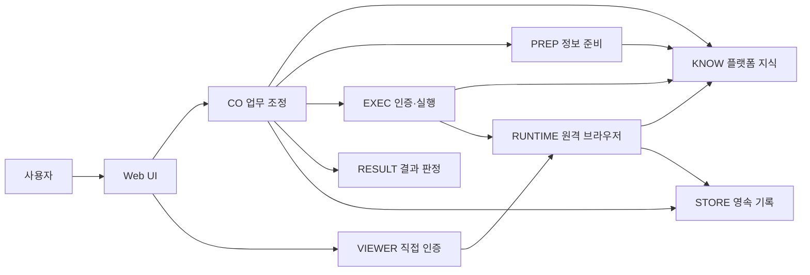

# 레슨 등록 지원 서비스 · 팀 설계 검토 홈

> 정본에서 생성한 읽기 전용 검토 뷰. 기준 커밋 `197987047ea9a305072bba3fdff816c5c37b0157`. 설계 채택/구현/실서비스 승인 아님.

[검토 홈](README.md) · [AI 인덱스](MANIFEST.json) · [전체 이력](12-HISTORY.md)

운영 정본: [현재 단계](https://github.com/ik-e/chaja-you/blob/9b6ff0463722372d577747e89cb853e773c78591/docs/human/phase-intents/PHASE-20261124-03.md) · [작업 검토](https://github.com/ik-e/chaja-you/blob/9b6ff0463722372d577747e89cb853e773c78591/docs/review/README.md). 설계 정본: [재설계 기준선](https://github.com/ik-e/chaja-you/blob/197987047ea9a305072bba3fdff816c5c37b0157/docs/artifacts/design/lesson-registration-20261124/README.md).

## 현재 적용 상태 확인

이 문서는 고정된 설계 검토 스냅샷이다. 채택 및 배정 이후의 권한·작업·담당·일정은 [설계 채택 기록](../../artifacts/design/lesson-registration-20261124/adoption-20261125.json), [CURRENT](../../../CURRENT.md), [제품 WORKSPACE](../../../product/lesson-registration/WORKSPACE.json)를 우선한다. 아래 당시 후보 상태 및 이전 일정은 역사적 기록이다.

## 1. 목표와 범위

확인된 원본과 사용자 인증/승인을 기반으로 등록 가능한 플랫폼에 최초 등록을 수행하고 근거와 다음 행동을 제공하여 강사의 직접 재가공·조작·재확인 부담을 줄인다. 가치 실측 전.

- 12/8 크몽 우선·숨고 확장 MVP 목표, 1/4 지원 URL 최초 등록 및 결과 확인 목표. 실제 플랫폼 권한 별도, 현재 mock-only.
- 사전 확보 프로필로 등록 대행; 범용 사이트 자동 적응·AI 자유 재계획 불필요.
- A2: 수락 후 사용자 중단/변경/재개/rollback 없음. 오류 시에만 시스템 중단 및 결과 반환.

## 2. 논리 아키텍처



화살표는 논리 의존 관계이며 물리 서비스 분리 강제가 아니다. Source(불변 원본), Profile(고정 규칙), Registration(준비·인증·승인·실행·결과) 세 구조. 원본/대상 지정 → 준비/질문 → 직접 인증 → 최종 승인 → 작업 수락 → 실행·관측 → 결과 조회.

## 3. 업무 계약

| 포트 | 호출→제공 | 입력→출력 |
| --- | --- | --- |
| I1 | CO → KNOW | selector:string → ResolveOutput |
| I2 | CO → PREP | PrepareInput → Preparation |
| I3 | CO → EXEC | AuthInput → AuthOutput |
| I4 | CO → EXEC | ExecuteInput → ExecutionReport |
| I5 | CO → RESULT | EvaluateInput → Result |

| ID | HTTP | 역할 |
| --- | --- | --- |
| H1 | `POST /v1/sources` | 원본/첨부 생성 |
| H2 | `GET /v1/sources` | 원본 목록 |
| H3 | `GET /v1/sources/{id}` | 원본 조회 |
| H4 | `POST /v1/registrations` | 등록 요청 생성 및 준비 |
| H5 | `PATCH /v1/registrations/{id}` | 등록 전 답변/수정 |
| H6 | `POST /v1/registrations/{id}/authentication` | 직접 인증 및 대상 확인 |
| H7 | `POST /v1/registrations/{id}/start` | 최종 승인 및 작업 수락 |
| H8 | `GET /v1/registrations/{id}` | 등록 상세 및 결과 조회 |
| H9 | `GET /v1/registrations` | 등록 목록 |

## 4. 주요 결정

| ID | 선택 | 근거 |
| --- | --- | --- |
| CS-01 | 기존 5개 업무 포트 및 버전 고정 registry; 값 스키마·절차·목표·작업 정의를 동일 참조로 조회. 새로운 업무 API/AI 재계획 없음. | S04/S09/S10의 필드·객체 차이를 독립 프로필로 보존하고 준비/실행/판정 규칙이 달라지지 않게 함. |
| CS-02 | 기존 /v1 API 9개 유지. H5는 현재 이슈 답변 외에 승인 전 표시 필드의 명시적 수정 제안을 허용. 서버가 현재 질문→field→answer&#95;id를 확정하여 PREP에 전달하고 다시 검사. 원본 사실 변경은 새 Source, 플랫폼별 선택은 등록 요청에만. | V4 Answer에는 issue&#95;id만 있어 PREP가 어떤 필드 답인지 모를 수 있고, 이슈 없는 표시값을 수정할 경로가 없다. 작은 타입 보완 2개로 최종 승인 1회와 원본 불변성 유지. 추가 계획 API 불필요. |
| CS-03 | 원본/준비/인증 확인은 요청 내 완료 또는 명시적 오류/준비 이슈. 실행 H7은 durable 수락 직후 202, H8/9 저장 상태 조회. 오류 코드와 status mapping 통일. 준비·인증 시간 제한 수치는 구현 실험 후 설정. | 긴 브라우저 업무 수명을 UI 연결과 분리해야 하나 준비를 별도 job으로 만들 실측 근거 없음. 정상 업무 차단과 시스템 오류 구분. |
| CS-04 | AuthOutput 내부 binding 고정; public AuthResponse는 grant와 안전한 표시 정보만. runtime 담당 viewer mount/dispose 인터페이스 제공, UI는 인증 완료 버튼·현재 grant만 사용. finish에서 인간 입력 차단 후 identity/target 확인; 실행 승인 후 동일 binding의 worker lease. | R05 로컬 합성 PoC의 동일 맥락·뷰어 종료 독립 근거, 외부 계정과 실행 세션 불일치 방지. 제품 UI와 remote 내부 전송 기술을 결합하지 않음. |
| CS-05 | CO만 업무 상태 전이 소유, STORE 원자 accept/admit/fence/observe/terminal; runtime gateway에 등록된 Operation만 허용. 같은 key 재조회; 다른 key로 동일 효과 재발급 차단. 오류에만 stopping→stopped, 새 admission 금지, pending unknown 보존, user cancel/resume/rollback 없음. | 상위 I2/I3·A2 요구를 만족하는 최소 직렬화. 승인 범위와 실제 operation을 일치시키고, 브라우저 효과의 exactly-once는 주장하지 않음. |
| CS-06 | EXEC가 실제 관측·EvidenceRecord를 기록, RESULT는 profile goal/method/target/payload/asset 확인, CO가 판정 저장. 두 mock은 독립 readback, 다른 지원 profile은 신뢰 가능한 응답 증거 허용. 완료와 게시 구분, stopped 이후 확인 근거 추가 가능하지만 상태 재개 없음. | S04/S07의 접수 ID 및 재조회 대조가 필요하다는 근거, 숨고는 설정 저장 대상이 다름. 근거가 부족하면 unknown. |
| CS-07 | 한 제품 root와 공통 계약, 서버/준비/브라우저/플랫폼/UI/테스트 경계. 저장소 하나의 논리 정본과 runtime 격리. 모듈 경계·호출과 소유권·stub 우선 결정; 언어/DB/패키지/물리 배포·launch 구현은 11/27 근거 후. | 5인 팀, 단일 등록 업무, 원자 수락과 상태 일관성이 중요. 기존 WBS W01 및 독립 작업 그대로, 별도 서비스 배포/동기화 비용을 먼저 지지 않음. |
| CS-08 | 22개 기존 제품 mock gate 유지 및 최신 의미로 갱신; T1~T6 독립 시험은 변경 없음. 동일 build/contract/fixture/environment 근거만, T5-08 실제 모델 시험 필수. stub을 기능 검증과 구분, 단계별 연결 기록. 12/8 크몽 우선/숨고 확장 미충족은 R01 판단. | 기존 test gate와 단계별 검증 체계 재사용. 다른 후보/환경/수동 대체 성공을 현재 전체 제품 성공으로 합산하지 않음. |
| CS-09 | IT-19 결정 기록으로 원문/버전/요구/선행/대안/선택/검증/작업을 연결. V0.6 추적 이력 보존, V0.9 현재 투영 및 supersession. 과거 근거 부족은 unknown/후속 해석으로 표기. 작업 배분은 실제 phase 이후 단일 책임자로 확정. | 기존 설계 정보 모델과 trace가 이미 목적을 충족하며 재설계로 링크만 끊겼음. 원본 중복·상태 승격 방지. |

## 5. 상세 검토 뷰

| 순서 | 문서 |
| --- | --- |
| 1 | [목표·요구사항·상위 결정](01-GOALS.md) |
| 2 | [논리 설계 및 상태 모델](02-LOGIC.md) |
| 3 | [상위 데이터와 상세 공통 계약](03-DATA.md) |
| 4 | [공통 타입과 스키마 V4.1](04-SCHEMA.md) |
| 5 | [플랫폼 프로필 V2](05-PLATFORMS.md) |
| 6 | [HTTP API·업무 포트·오류](06-API-PORTS.md) |
| 7 | [실행·저장·인증·뷰어·UI](07-EXECUTION.md) |
| 8 | [통합 구조·작업 공간·책임 후보](08-INTEGRATION.md) |
| 9 | [수용 시험·검증·미확인 사항](09-TESTS.md) |
| 10 | [결정·근거·대안·영향 추적](10-DECISIONS.md) |
| 11 | [WBS 및 통합 일정 이력](11-WBS.md) |

[전체 원본 98개](12-HISTORY.md) · [AI 인덱스](MANIFEST.json). AI는 고정 commit/blob/JSON Pointer를 사용하여 원본을 조회하고 사람용 Markdown을 별도 정본으로 취급하지 않는다.

## 6. 팀원 검토 요청 (담당 후보, 배정 아님)

| 팀원 | 중점 영역 |
| --- | --- |
| R02 | 원본·정보/AI 준비·fixture·인계와 사용자 요구 |
| R03 | 서버·API·상태/원자 저장·멱등성·시험 |
| R04 | UI·사용자 흐름·뷰어 연동·숨고 |
| R05 | 인증·원격 실행·동일 연결·격리·adapter |
| R01 | 전체 목적·공통 경계·통합·결정/근거 |

누구나 전체 설계에 의견 가능. 실제 환경/언어/DB/의존성/실행 명령/담당·공수는 11/27 목표 게이트에서 검토할 후보이며 확정 또는 신규 TASK 아님. 기존 정산 TASK 유지.

## 7. 검증 한계

- 선정 공통 설계 검사 14/14, V4 합성 사례 31/31은 해당 입력에 한정. 실제 통합 제품 22개 시험 모두 미실행, T5-08 실제 모델 필수. 개인 PoC 및 stub을 제품 성공으로 승격하지 않는다.
- 실제 운영사 허용, DB 경쟁, 원격 격리, 모델 및 사용자 가치 미검증. mock-only 유지.

## 8. 의견 제출

```text
검토 대상: 문서/설계 ID/JSON Pointer + 기준 커밋
의견 유형: 동의 | 변경 제안 | 문제 발견 | 추가 검증 필요
의견 및 근거:
대안/검증 방법(선택):
영향 계약/작업(선택):
```

채택·부분 채택·미채택·보류와 사유는 기존 설계 결정/IT-19 체계에 반영. 새 ISSUE/PR/TASK 자동 생성 없음.

## 9. 갱신

```sh
node tools/generate_lesson_design_review.mjs --check
node tools/generate_lesson_design_review.mjs --source <설계커밋> --main <운영커밋>
```

정본 변경 시 그룹/우선순위도 검토하고 재생성. --check는 생성물 및 HEAD 설계 원본 변경을 대조한다. 제품 시험과 별개.
