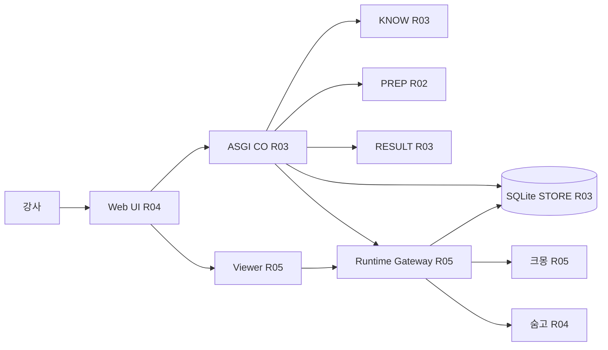
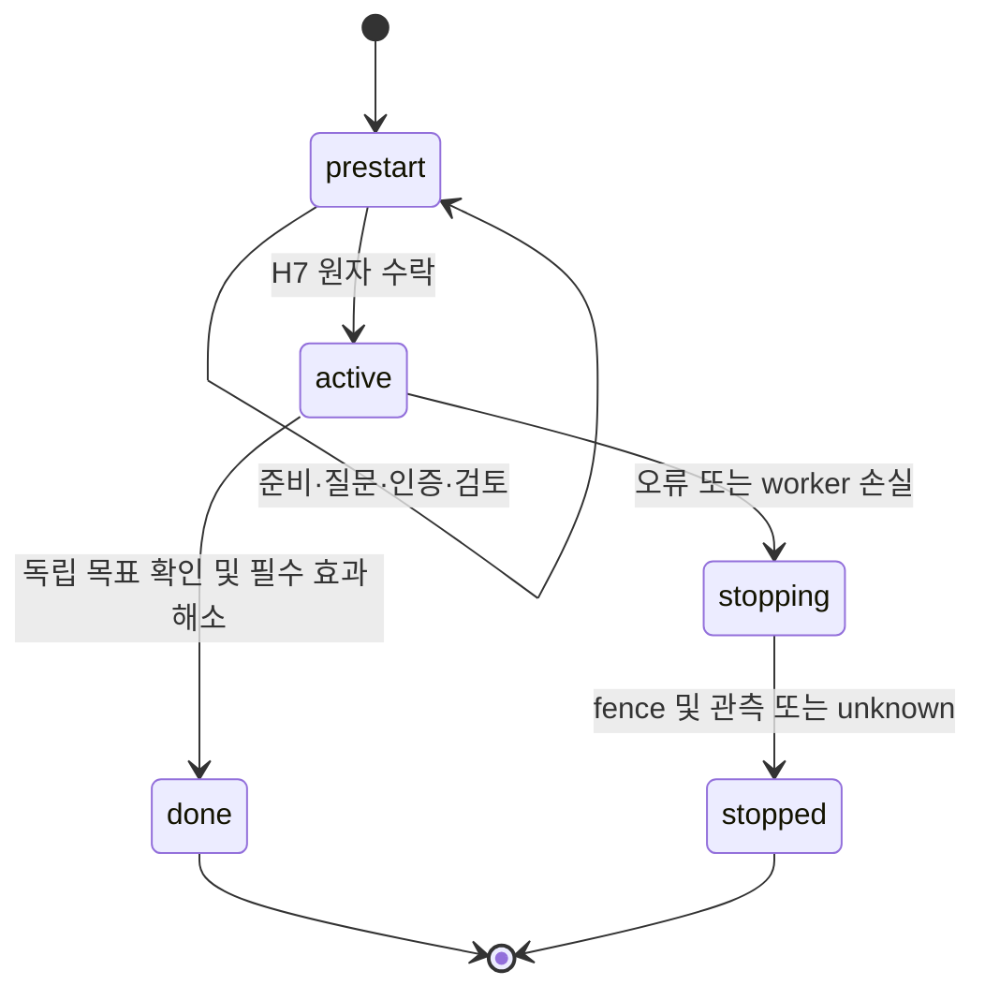

# 레슨 등록 지원 서비스 · 현행 시스템 설계 열람 요약

> 기준 main f5e6857, 채택 정본의 사람용 뷰이며 별도 정본/승인 아님. [현행 인덱스](CURRENT-DESIGN.md) · [AI 인덱스](CURRENT-DESIGN.json) · [문서 매핑](CURRENT-DOCUMENTS.md).

## 1. 논리·물리 구조

R01 공통 schema/lock/계약/명시적 provider 조립·통합. Python 3.12/FastAPI/ASGI/SQLite/Playwright Chromium, CDP+WebSocket. 모듈형 모놀리스와 격리 runtime. 실제 factory/launch·bridge 및 설정은 담당자 확인. [IB](https://github.com/ik-e/chaja-you/blob/f5e685716a5ed4fb36159d215b3cc861ef3d5e79/product/lesson-registration/contracts/IMPLEMENTATION-BINDING.json) · [PD](https://github.com/ik-e/chaja-you/blob/f5e685716a5ed4fb36159d215b3cc861ef3d5e79/product/lesson-registration/contracts/PHYSICAL-BINDING.json) · [WORKSPACE](https://github.com/ik-e/chaja-you/blob/f5e685716a5ed4fb36159d215b3cc861ef3d5e79/product/lesson-registration/WORKSPACE.json).

## 2. 업무 상태와 데이터

prestart는 설명용, wire job_state=null. Source 불변·플랫폼별 preparation/target/review/binding/AcceptedScope 분리. CO만 lifecycle 소유. 수락 이후 사용자 취소·변경·재개·rollback 금지. terminal 읽기 근거 추가는 재개가 아니다. [공통 V1](https://github.com/ik-e/chaja-you/blob/f5e685716a5ed4fb36159d215b3cc861ef3d5e79/docs/artifacts/design/lesson-registration-20261124/common-integration-v1.json) · [V4.1](https://github.com/ik-e/chaja-you/blob/f5e685716a5ed4fb36159d215b3cc861ef3d5e79/docs/artifacts/design/lesson-registration-20261124/data-schema-v4.1.json).

## 3. 실행 및 보안 경계

H1~H9/I1~I5, 등록 operation만, 승인 scope/current verified binding. STORE 원자 accept/admit/observe/fence/finalize; 독립 readback 없이는 성공 아님. Viewer human grant와 worker lease 분리, detach는 실행 취소 아님. 원격 인증 세션은 자격증명으로 취급. 실제 사이트·계정 사용 금지. [PR #44 D01~D06](https://github.com/ik-e/chaja-you/pull/44) · [세션 보안 후보](https://github.com/ik-e/chaja-you/blob/24a1c3579e84ae6a8e76e4b78135288babc5f51b/product/lesson-registration/contracts/SESSION-SECURITY.md)는 담당자 검토 중, 제품/운영 보안 합격 아님.

## 4. 상세 열람

- [기획·요구사항](../../step1/기획서_제출본.md) · [API](../../step2/API_설계_문서.md) · [DB](../../step2/데이터베이스_스키마_설계서.md)
- [PREP 단일 에이전트 흐름 후보](../../step3/단일에이전트_상태전이그래프_설계서.md): I2 내부 판단/검증/보정 후보, R02 확인 전.
- [검증 안내](VALIDATION.md), 실제 22개 gate 및 별도 독립 검증. R03 물리 DDL은 main 고정 커밋 관찰; 실제 통합 후 갱신.
