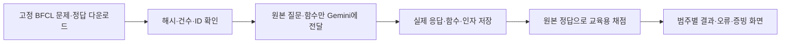

# BFCL 공통 30문항과 팀별 자체 30문항 평가 준비

> 작성·보완일: 2026-11-11. 기준: [현재 주제·팀 구성](../SUBJECTS-4TEAM.md), [4팀 BFCL 활용안](BFCL-USE-PLAN-4TEAM.md) 및 강사와의 질의응답. 0절은 개념·운영 기준, 1~8절은 2팀의 첫 5문항 시험, 9~13절은 BFCL 원본 실행·채점·증빙, **14절은 팀 자체 30문항 설계**다.
>
> 상태: Codex는 원본 준비·오프라인 코드 검증을 수행했으며 실제 모델 추론은 수행하지 않았다. 사용자는 `team2_probe.py`의 결과를 확보했다고 알렸다. BFCL 원본 30문항의 실제 모델 실행 완료 여부와 결과는 아직 확인하지 않았다.

## 0. 지금까지의 질문에 대한 기준부터 정리하기

### BFCL은 모델인가요? 무엇을 측정하나요?

**BFCL은 LLM 모델이 아니라 함수 호출 능력을 평가하는 데이터셋·벤치마크입니다.** 실제 문제에 답하는 모델은 Gemini 같은 LLM입니다. BFCL은 질문·함수 후보·정답을 제공하고, 평가 코드는 모델의 선택을 기대값과 비교합니다.

| 구성 | 역할 |
|---|---|
| BFCL 원본 | 어떤 질문에 어떤 함수를 어떤 인자로 호출해야 하는지 평가할 입력·정답 제공 |
| Gemini 등 LLM | 질문·함수 설명·문맥을 보고 호출할 함수와 인자, 또는 비호출 선택 |
| 도구·함수 정의 | 함수 이름·하는 일·필수 인자·자료형을 설명하는 계약 |
| 이 문서의 Python 코드 | 모델 요청·실제 응답 보관·교육용 채점·결과 저장 |
| 실제 서비스 도구 | 조회·저장·예약·복구 등을 실행하는 구현. 현재 예제의 선택 평가와 별도 |

이 문서의 실행기는 **LLM API 요청이 성공했는지에 더해, LLM이 어떤 도구를 어떤 값으로 사용하려 했는지** 확인합니다. 함수 호출을 생성한 것과 실제 업무가 완료된 것은 구분합니다. BFCL 전체가 항상 선택만 평가한다는 뜻은 아니며, 여기서 사용하는 v3 일부 범주와 교육용 실행기의 범위를 설명한 것입니다.

### team2_probe.py와 bfcl_original.py는 다른가요? 누가 만들었나요?

**두 코드 모두 이 저장소의 요청을 처리하며 Codex가 작성한 교육용 코드입니다. 공식 BFCL 평가기에서 제공한 코드는 아닙니다.**

| 항목 | `team2_probe.py` | `bfcl_original.py` |
|---|---|---|
| 목적 | 2팀 학교 안내 도구 선택의 첫 적용 시험 | BFCL 원본을 사용한 공통 함수 호출 평가 |
| 문제·도구 | Codex가 제안한 학교 안내 질문·도구 | BFCL 원본 문제별 질문·함수 후보 |
| 문항 수 | 현재 문서 예제 5개 | simple·multiple·irrelevance 각 10개, 총 30개 |
| 정답 | 직접 정의한 기대 함수·인자 | BFCL 원본 정답과 irrelevance 비호출 기준 |
| 모드 | mock 또는 Gemini | prepare·self-test, 실제 Gemini 실행 |
| 제공 방식 | 4절의 코드를 저장해 사용하는 예제. 사용자는 결과를 확보했다고 알림 | 저장소에 실행 파일 제공 |
| 결과 구분 | `team_domain` | `bfcl_subset`·`instructor_baseline` |
| 한계 | 학교 업무 완료나 협업 검증을 대신하지 않음 | 공식 AST 평가기와 동일한 점수로 볼 수 없음 |

`prepare`의 `Prepared 30 cases ...; no model called`는 **오류가 아닌 정상 준비 완료 메시지**입니다. 실제 추론은 스크립트만 실행하거나 `run`을 붙여 실행해야 합니다. 10~11절의 명령을 사용합니다.

### 실제 팀 도구가 미정인데도 BFCL 원본 평가를 할 수 있나요?

가능합니다. **원본 평가에서는 질문과 도구 후보가 모두 BFCL에 들어 있으므로 팀이 새로 정할 필요가 없습니다.** 학교·리서치·복구 등 팀 서비스의 도구를 대신 넣지 않고 원본을 그대로 사용합니다. 실행할 함수의 실제 서버가 없어도 모델의 호출 생성과 인자는 평가할 수 있습니다.

반면 **팀 자체 평가에서는 질문과 도구를 함께 설계**합니다. 앞서 제시한 팀별 도구는 제안이며, 이름·인자·권한·응답 계약까지 팀이 검토해야 합니다. 질문 30개만 정하고 임의 답변을 수집하면 통과 기준이 불명확합니다.

### 서로 다른 4팀에게 공통 BFCL이 도움이 되나요?

공통 원본 30문항은 사용할 LLM의 기본 함수 호출 능력을 사전 점검하는 데 도움이 됩니다. 사용자·업무가 다른 각 팀의 서비스 품질은 **팀 자체 시나리오로 추가 평가**해야 합니다.

| 팀 | 도구 선택 평가가 연결되는 부분 | 별도로 검증할 프로젝트 핵심 |
|---|---|---|
| 1팀 찾아you | 검색·출처 확인·보고서 도구 선택 | 전문가 에이전트 분담·출처 신뢰성·보고서 품질 |
| 2팀 학교 안내 | 학사 안내·상담 조회·민원 인계 선택 | 학부모 권한·상담 조율·정확한 담당자 전달 |
| 3팀 혼잡도 API 복구 | 원본·대체 데이터·복구 상태 조회 선택 | 장애 감지·복구 흐름·데이터 최신성·서비스 유지 |
| 4팀 스마트폰 관리 전환안 | 학습 현황·자료·퀴즈 도구 선택 | 보호자 권한·퀴즈 품질·학습 흐름·기획 확정 후 단말 제어 |

4팀은 아직 세부 기획을 수정 중입니다. 위 연결은 초안이며 실제 잠금 방식·구독 범위 등을 확정했다는 뜻이 아닙니다. BFCL 원본 점수만으로 멀티에이전트 협업·복구·서비스 완성도를 판정하지 않습니다.

### 모델에 따라 결과가 달라지나요? 모든 팀이 같은 30문항을 써도 되나요?

**모델·버전·프롬프트·설정에 따라 도구 선택과 인자 결과가 달라질 수 있습니다.** 같은 모델도 반복 실행에서 달라질 수 있으므로 최초 결과를 남깁니다. 모델을 비교할 때는 같은 원본 30문항·도구 정의·변환 규칙·채점기를 사용하고 모델 ID·설정·실행일·코드 해시를 함께 기록합니다. 속도·토큰·API 오류도 정답률과 나누어 봅니다. 30문항만으로 모델 전체 성능의 우열을 단정하지 않습니다.

모든 팀이 동일 30문항을 사용할 수 있습니다. 실행 방식은 다음처럼 구분합니다.

| 방식 | 기록 기준 |
|---|---|
| 강사가 한 번 실행하고 4팀이 공동 분석 | 강사 공통 기준 결과로 표시. 각 팀은 자기 프로젝트 적용점·오류 분석을 별도로 작성 |
| 각 팀이 선택한 모델·설정으로 직접 실행 | 팀별 실행자·모델·설정·run_id를 남기고 같은 30문항으로 비교 |

공통 결과를 복사해 각 팀이 직접 실행한 결과처럼 표시하지 않습니다. 동일 모델·설정을 쓰는 모든 팀이 반드시 같은 실행을 반복해야 한다고 이 문서에서 요구하지는 않습니다. 팀별 개별 실행이 필수인지는 운영진 제출 기준에 따릅니다.

### 11월 18일에는 무엇을 준비하면 되나요?

권장 준비는 **공통 BFCL 원본 30문항의 실제 모델 실행·채점 근거 + 팀별 적용 초안과 분석**입니다. 모델 하나의 실제 결과부터 확보하고, 여러 모델 비교와 팀 서비스 연동은 준비 상황에 따라 확장합니다.

- 공통 근거: 고정 원본·해시·30개 ID, 모델·실행자·실행일, 실제 요청·응답, 채점 결과·오류 분석, 화면 3종.
- 팀별 적용: 사용자·핵심 시나리오, 도구 후보·인자·기대 결과. 처음 3~5문항에서 출발해 자체 30문항으로 확장하는 계획과 실제 완료 범위를 구분.
- 미정 사항: 도구 확정·연동·협업 시험이 준비되지 않았다면 그대로 기록하고 후속 검증 일정 제시.

실제로 실행하고 위 기록을 남기면 **BFCL 원본 활용 근거로 제시할 수 있습니다.** 다만 운영진의 최종 인정 여부와 요구 범위를 이 문서가 보장하지는 않습니다. 원본 결과만으로 각 팀 서비스를 검증 완료했다고 표현하지 않습니다.

권장 읽기 순서: 개념은 0절 → 공통 활용 근거 확보는 9~13절 → 2팀 첫 적용은 1~8절 → 각 팀의 30문항 설계는 14절입니다.

### 향후 보고서 작성 시 반드시 언급할 사항

사용자 요청에 따라, 이후 BFCL 활용·검증 보고서를 작성할 때 아래 내용을 확인해 포함합니다.

- **BFCL 원본 전체가 30문항인 것은 아닙니다.** 현재 고정 revision에서 읽는 세 범주만 simple 400개·multiple 200개·irrelevance 240개로 총 840문항이며, 다른 범주의 자료도 있습니다. 840을 BFCL 전체 문항 수로 표현하지 않습니다.
- **30문항은 11월 18일까지 실행·분석·증빙을 준비하려고 자체 선정한 소규모 부분 집합**입니다. BFCL이 정한 필수 평가 문항 수가 아닙니다. 범주별 10개·고정 ID·선정 기준·revision을 밝힙니다.
- 보고서에는 **“BFCL 원본 30문항 부분 집합 평가”**라고 적고, 전체 BFCL 평가나 공식 리더보드 점수로 표현하지 않습니다. 교육용 채점기 사용과 표본의 한계를 함께 명시합니다.
- 실제 실행 문항 수·모델·run_id·오류·완료 상태는 보고서 작성 시 결과 파일로 다시 확인합니다. 이후 840문항이나 다른 범주로 확장했다면 그때의 실제 범위로 갱신하며, 현재의 30문항을 그대로 복사하지 않습니다.
- 내부 API·멀티에이전트 협업·업무 완료의 통합 검증과 구분하고, 원본 공통 평가와 팀 자체 평가의 결과도 별도로 보고합니다.

실제 30문항 실행 완료가 확인된 뒤 사용할 문구 예시: “BFCL 원본 중 simple·multiple·irrelevance 세 범주 840문항에서 범주별 10개씩 총 30문항을 선정하여 교육용 부분 집합 평가를 수행했다. 이는 전체 BFCL이나 공식 리더보드 평가를 의미하지 않으며, 해당 표본에서의 관측 결과다.”

## 1. 먼저 무엇을 해 보면 좋을까요?

**강사님이 학생 서비스와 분리된 작은 Python 프로그램으로, 학부모 질문 5개에 대한 AI의 도구 선택을 먼저 확인하는 것이 좋습니다.** 웹 화면·DB·학교 API·n8n이 없어도 시작할 수 있습니다.

처음 확인할 것은 다음 세 가지입니다.

1. 방학 일정 질문에 학사 안내 함수를 고르는가?
2. 상담 가능 시간 질문에 교사·날짜를 정확히 전달하는가?
3. 민원 전달 요청과 단순 인사를 구분하는가?

1~8절의 예제는 **BFCL의 평가 방식을 참고한 2팀 자체 평가(`team_domain`)**입니다. 이 5개 결과를 BFCL 공식 점수라고 부르지 않습니다. **BFCL 원본 활용 근거를 확보하려면 9절부터 진행**해 고정 원본 문제와 정답으로 모델을 실행하고 채점해야 합니다.

## 2. 시험은 두 번으로 나눕니다

| 순서 | 실행 모드 | 필요한 것 | 알 수 있는 것 |
|---|---|---|---|
| 1 | `mock` | Python·uv | 파일 저장·채점 흐름이 작동하는지. AI 성능은 알 수 없음 |
| 2 | `gemini` | Gemini API 키·함수 호출 지원 모델 ID·인터넷 | 실제 모델이 고른 함수와 인자가 기대값과 맞는지 |

환경변수 `GEMINI_API_KEY`, `GEMINI_MODEL`을 재사용하기 쉽도록 Gemini REST 방식으로 예제를 구성했습니다. 2팀이 Gemini를 최종 채택해야 한다는 뜻은 아닙니다. 모델이 정해지면 호출 어댑터만 교체합니다.

**예제는 도구 호출을 생성·기록하는 데서 멈춥니다.** 학사 조회·상담 예약·민원 전달 함수를 실제로 실행하지 않습니다. 따라서 학교 시스템·학생 정보·실제 민원 계정은 필요하지 않습니다. 이 단계에는 모델에 가상 조회 결과를 다시 보내는 대화도 없습니다.

## 3. 먼저 넣어 볼 5문제

각 문제는 이전 대화 없이 독립 실행하며, 아래 도구 3개를 모두 제공합니다. 학교·교사·날짜는 가상 값입니다. 시험 문맥에서 보호자는 `SCH-DEMO-01` 학교와 `T-DEMO-01` 교사에 대한 안내·상담 조회를 할 수 있다고 가정합니다. 실제 권한 검증은 후속 시험입니다.

| ID | 학부모 질문 | 기대 결과 |
|---|---|---|
| T2-01 | SCH-DEMO-01 학교의 겨울방학 일정을 찾아줘. | `lookup_school_notice`, 학교 ID·`winter_vacation` |
| T2-02 | T-DEMO-01 선생님과 2026-11-20에 상담 가능한 시간을 확인해줘. | `get_consultation_slots`, 교사 ID·날짜 |
| T2-03 | 급식 불편 문의를 담당자에게 전달할 요청으로 남겨줘. 전달 요약은 ‘급식 관련 불편 문의’로 적어줘. | `request_school_handoff_stub`, `school_meal`·지정 요약 |
| T2-04 | 고마워. | 함수 호출 없이 응답 |
| T2-05 | 7 곱하기 8은 얼마야? | 함수 호출 없이 응답. 학교 전용 도구에는 계산 기능이 없음 |

T2-03은 첫 시험의 채점을 쉽게 하려고 **요약 문구를 지정**했습니다. 이후에는 자유로운 민원 표현으로 바꾸고 의미 보존 여부를 사람이 검토합니다. T2-04·05의 자동 판정은 비호출만 확인하며 응답의 친절함·계산 정답까지 평가하지 않습니다.

## 4. 복사해서 실행할 Python 예제

저장소 루트에서 다음 폴더를 만들고, 아래 Python 코드 전체를 `Lecture/FinalProject/Data/BFCL-PREPARE/team2_probe.py`에 저장합니다. **이미 저장해 실행한 파일이 있다면 그대로 보존하고, 아래 예제와의 차이를 확인한 뒤 사용합니다.** 테스트 데이터·영문 인터페이스를 포함한 단일 파일이며 외부 Python 패키지는 필요 없습니다. 이 예제는 5문항의 단일 선택 시험으로, 14절의 자체 30문항·다단계 협업 실행기는 아직 아닙니다.

```bash
mkdir -p Lecture/FinalProject/Data/BFCL-PREPARE
```

```python
import argparse
import copy
import csv
import hashlib
import json
import os
from pathlib import Path
import urllib.error
import urllib.parse
import urllib.request
from datetime import datetime, timezone


def tool(name, description, properties):
    return {"name": name, "description": description, "parameters": {
        "type": "OBJECT", "properties": properties, "required": list(properties)}}


TOOLS = [
    tool("lookup_school_notice", "Read school notices; do not reserve appointments.", {
        "school_id": {"type": "STRING"},
        "topic": {"type": "STRING", "enum": ["winter_vacation"]}}),
    tool("get_consultation_slots", "Read available consultation times; never book.", {
        "teacher_id": {"type": "STRING"},
        "date": {"type": "STRING", "description": "Explicit date in YYYY-MM-DD"}}),
    tool("request_school_handoff_stub", "Prepare a school complaint handoff; never send.", {
        "category": {"type": "STRING", "enum": ["school_meal"]},
        "summary": {"type": "STRING", "description": "Preserve the requested summary"}}),
]
CASES = [
    {"id": "T2-01", "question": "SCH-DEMO-01 학교의 겨울방학 일정을 찾아줘.",
     "expected": [{"name": "lookup_school_notice", "args": {
         "school_id": "SCH-DEMO-01", "topic": "winter_vacation"}}]},
    {"id": "T2-02", "question": "T-DEMO-01 선생님과 2026-11-20에 상담 가능한 시간을 확인해줘.",
     "expected": [{"name": "get_consultation_slots", "args": {
         "teacher_id": "T-DEMO-01", "date": "2026-11-20"}}]},
    {"id": "T2-03", "question": "급식 불편 문의를 담당자에게 전달할 요청으로 남겨줘. 전달 요약은 '급식 관련 불편 문의'로 적어줘.",
     "expected": [{"name": "request_school_handoff_stub", "args": {
         "category": "school_meal", "summary": "급식 관련 불편 문의"}}]},
    {"id": "T2-04", "question": "고마워.", "expected": []},
    {"id": "T2-05", "question": "7 곱하기 8은 얼마야?", "expected": []},
]
SYSTEM = (
    "You are a school information desk. Use only the supplied tools when relevant. "
    "Test authorization permits school SCH-DEMO-01 and teacher T-DEMO-01. "
    "Do not invent missing dates or IDs. Ask for missing required information. "
    "For greetings or arithmetic, respond in English without tools. "
    "Do not claim a booking, lookup result, or handoff was completed; no tool has executed."
)


def grade(expected, calls, status="ok"):
    if status != "ok":
        return "ERROR"
    if not isinstance(calls, list):
        return "ERROR"
    # Each starter case expects zero or one call; dict equality ignores key order.
    for call in calls:
        if not isinstance(call, dict) or set(call) != {"name", "args"}:
            return "ERROR"
        if not isinstance(call["name"], str) or not isinstance(call["args"], dict):
            return "ERROR"
        if not all(isinstance(v, str) for v in call["args"].values()):
            return "FAIL"
    return "PASS" if calls == expected else "FAIL"


def self_test():
    expected = CASES[1]["expected"]
    wrong = copy.deepcopy(expected)
    wrong[0]["args"]["teacher_id"] = "WRONG-ID"
    assert grade(expected, expected) == "PASS"
    assert grade(expected, wrong) == "FAIL"
    assert grade(expected, expected * 2) == "FAIL"
    assert grade(expected, []) == "FAIL"
    assert grade([], []) == "PASS"
    assert grade([], [], "api_error") == "ERROR"
    assert grade([], [{"name": "unknown", "args": {}}]) == "FAIL"
    assert grade([], None) == "ERROR"
    print("Grader self-test passed")


def gemini(question, key, model, raw_path):
    payload = {
        "systemInstruction": {"parts": [{"text": SYSTEM}]},
        "contents": [{"role": "user", "parts": [{"text": question}]}],
        "tools": [{"functionDeclarations": TOOLS}],
        "toolConfig": {"functionCallingConfig": {"mode": "AUTO"}},
    }
    model_path = urllib.parse.quote(model, safe="")
    url = "https://generativelanguage.googleapis.com/v1beta/models/" + model_path + ":generateContent"
    request = urllib.request.Request(url, data=json.dumps(payload).encode(), headers={
        "Content-Type": "application/json", "x-goog-api-key": key}, method="POST")
    with urllib.request.urlopen(request, timeout=60) as response:
        body = json.load(response)
    raw_path.write_text(json.dumps(body, ensure_ascii=False, indent=2), encoding="utf-8")
    candidates = body.get("candidates", [])
    if not candidates or candidates[0].get("finishReason") != "STOP":
        raise ValueError("Missing or incomplete candidate; inspect raw response")
    parts = candidates[0].get("content", {}).get("parts", [])
    visible = [p for p in parts if not p.get("thought")]
    calls = [{"name": p["functionCall"].get("name"),
              "args": p["functionCall"].get("args")} for p in visible if "functionCall" in p]
    text = "\n".join(p.get("text", "") for p in visible).strip()
    if not calls and not text:
        raise ValueError("Empty response is not a successful no-call response")
    return calls, text


def main():
    parser = argparse.ArgumentParser()
    parser.add_argument("--mode", choices=["mock", "gemini"], default="mock")
    parser.add_argument("--self-test", action="store_true")
    args = parser.parse_args()
    if args.self_test:
        self_test()
        return
    key, model = os.getenv("GEMINI_API_KEY"), os.getenv("GEMINI_MODEL")
    if args.mode == "gemini" and (not key or not model):
        parser.error("Set GEMINI_API_KEY and GEMINI_MODEL before live execution")
    run_id = datetime.now(timezone.utc).strftime("%Y%m%dT%H%M%S%fZ")
    out = Path(__file__).resolve().parent / "results" / (run_id + "-" + args.mode)
    out.mkdir(parents=True)
    metadata = {"evaluation": "team_domain", "mode": args.mode,
                "model": model if args.mode == "gemini" else "mock-no-model",
                "system": SYSTEM, "tools": TOOLS, "cases": CASES,
                "script_sha256": hashlib.sha256(Path(__file__).read_bytes()).hexdigest()}
    (out / "run.json").write_text(json.dumps(metadata, ensure_ascii=False, indent=2), encoding="utf-8")
    rows = []
    for case in CASES:
        calls, text, status = [], "", "ok"
        try:
            if args.mode == "mock":
                calls = copy.deepcopy(case["expected"])
                text = "Mock response; no model used."
            else:
                calls, text = gemini(case["question"], key, model, out / (case["id"] + "-raw.json"))
        except urllib.error.HTTPError as error:
            status = "http_" + str(error.code)
        except (urllib.error.URLError, TimeoutError, ValueError, TypeError, KeyError):
            status = "response_or_network_error"
        verdict = grade(case["expected"], calls, status)
        rows.append({"case_id": case["id"], "mode": args.mode,
                     "question": case["question"],
                     "expected": json.dumps(case["expected"], ensure_ascii=False),
                     "actual": json.dumps(calls, ensure_ascii=False),
                     "text": text, "status": status, "verdict": verdict})
        print(case["id"], verdict, status)
    with (out / "results.csv").open("w", newline="", encoding="utf-8-sig") as stream:
        writer = csv.DictWriter(stream, fieldnames=list(rows[0]))
        writer.writeheader()
        writer.writerows(rows)
    print("Mode:", args.mode, "Passed:", sum(r["verdict"] == "PASS" for r in rows), "/", len(rows))
    print("Results:", out)


if __name__ == "__main__":
    main()
```

## 5. 모델 없이 먼저 동작 확인하기

저장소 루트에서 실행합니다. uv가 필요하면 Python 환경을 준비하며, 첫 실행에는 Python 다운로드가 필요할 수 있습니다.

```bash
uv run --python 3.12 Lecture/FinalProject/Data/BFCL-PREPARE/team2_probe.py --self-test
uv run --python 3.12 Lecture/FinalProject/Data/BFCL-PREPARE/team2_probe.py --mode mock
```

예상 출력은 `Grader self-test passed`, 모의 실행은 `Mode: mock Passed: 5 / 5`입니다. **mock은 기대값을 그대로 반환하므로 5/5가 나오는 것이 정상입니다.** 채점기·파일 출력을 확인하는 용도이며 AI 성능 증빙에 쓰지 않습니다.

## 6. 실제 모델로 시험하기

`GEMINI_API_KEY`에는 본인 API 키, `GEMINI_MODEL`에는 본인 계정에서 사용할 수 있는 **함수 호출 지원 모델의 정확한 ID**를 설정합니다. 키는 문서·Git·캡처에 적지 않고 셸 환경이나 기존 비밀 관리 방식으로 제공합니다. 이미 외부에 두 변수가 설정되어 있으면 그대로 사용합니다. 특정 모델을 문서에서 자동 선택하지 않습니다.

예제는 `.env` 파일을 자동으로 읽지 않습니다. 변수가 실제 실행 셸에 전달되어 있어야 합니다.

모델 변수만 없다면 `export GEMINI_MODEL="YOUR_FUNCTION_CALLING_MODEL_ID"`에서 예시 문자열을 실제 모델 ID로 바꿔 설정합니다. 두 변수의 존재 여부만 확인하려면 다음처럼 실행합니다. 키와 모델의 값은 출력하지 않습니다.

```bash
uv run --python 3.12 python -c 'import os; print({name: bool(os.getenv(name)) for name in ("GEMINI_API_KEY", "GEMINI_MODEL")})'
```

```bash
uv run --python 3.12 Lecture/FinalProject/Data/BFCL-PREPARE/team2_probe.py --mode gemini
```

한 번 실행하면 문항별로 1회씩 **총 5회 모델 API 요청**을 보냅니다. 재시도는 자동으로 하지 않습니다. 모델·계정에 따른 사용료·쿼터가 적용됩니다. `AUTO` 모드로 두어 불필요한 호출을 하지 않을 선택도 허용합니다. 호출을 강제하면 비호출 두 문항을 제대로 평가할 수 없습니다.

모델이 함수명·인자를 내는 단계까지만 확인하므로, AI가 “민원을 전달했습니다”라고 말했는지는 사람이 응답 열도 읽어 확인합니다. 올바른 함수 선택과 허위 완료 발언 여부는 별도입니다.

| 문제가 보일 때 | 먼저 확인할 것 |
|---|---|
| 환경변수 오류 | 두 변수가 현재 셸에서 설정되었는지. 값 자체를 출력하지 않고 존재 여부 확인 |
| HTTP 400 | 도구 스키마·모델의 함수 호출 지원·요청 형식 |
| HTTP 401/403 | API 키와 프로젝트 접근 권한 |
| HTTP 404 | 모델 ID와 해당 API 제공 여부 |
| HTTP 429 | 요청량·쿼터 확인 후 나중에 다시 실행 |
| `ERROR`와 빈 호출 | API·파싱·미완료 응답 오류. 비호출 정답으로 인정하지 않음 |
| 올바른 의미인데 `FAIL` | 첫 예제는 엄격한 기대값 비교. 원문을 보고 별도 검토하되 기존 실행 결과를 덮어쓰지 않음 |

일부 모델의 요청 형식·응답 종료 사유가 다르면 실제 응답을 확인해 어댑터를 조정해야 합니다. 예제는 모든 공급자·모델을 지원하는 공식 BFCL 평가기가 아닙니다.

## 7. 무엇이 저장되고 어떻게 읽으면 되나요?

매번 `Data/BFCL-PREPARE/results/<UTC시각>-<모드>/` 아래 새 폴더가 생깁니다. 이전 결과는 덮어쓰지 않습니다.

| 파일 | 보는 이유 |
|---|---|
| `run.json` | 평가 구분·모드·모델·질문·기대값·도구·프롬프트·코드 해시 확인. API 키는 저장하지 않음 |
| `results.csv` | 문항별 실제 함수·인자·텍스트·정오답·오류 비교 |
| `T2-01-raw.json` 등 | 실제 모델 응답 원문·사용량·종료 상태 확인. 모델 요청에 응답이 왔을 때 저장 |

먼저 `mode=gemini`인지 확인하고, `PASS`뿐 아니라 `FAIL`·`ERROR`도 함께 셉니다. 선택 함수가 맞아도 날짜가 틀리거나 추가 함수가 호출되면 첫 예제에서는 실패입니다. 5문항의 `PASS/5`는 **2팀 자체 시험의 관측값**일 뿐 서비스 전체 품질이나 BFCL 원본 점수가 아닙니다.

로그는 검토 후 필요한 파일만 명시적으로 Git에 추가합니다. 실제 학생·학부모 자료로 바꾸기 전에는 가상 데이터 실험과 별도 환경으로 분리합니다.

## 8. 그다음 2팀과 무엇을 해 보면 좋을까요?

> 지혜님, 제가 학교 안내·상담 시간·민원 요청 세 가지로 먼저 작은 시험을 해 봤다고 가정하고 같이 볼게요. 영민님은 AI가 고른 함수와 인자를 확인해 주시고, 태웅님은 가상 응답을 붙여 주세요. 인혜님은 실패 응답을, 성주님은 결과표를 준비하면 돼요. 먼저 실제 결과를 같이 보고 기능 범위를 넓혀 봅시다.

위 멘트는 **후속 코칭 예시**이며 실제 모델 시험을 이미 했다는 보고가 아닙니다. 현재 역할을 기준으로 한 협업 제안입니다.

1. 날짜 없는 상담 질문에 날짜를 지어내지 않고 추가 질문하는지 별도 사례로 확인합니다. 비호출만 맞았다고 추가 질문까지 잘했다고 판단하지 않습니다.
2. 가상 학사 문서·빈 상담 시간표·민원 연습 저장소를 붙여 선택 이후 응답과 오류 처리를 확인합니다.
3. 자유 표현·다른 학교 ID·다중 요청·권한 없는 조회를 추가합니다. 인증된 학교 범위는 코드에서 검사합니다.
4. BFCL 원본 공통 30문항은 아래 9~13절의 별도 실행기로 실행해 원본 revision·ID·정답·모델 응답을 남깁니다. 이 예제의 5문항 결과와 합산하지 않습니다.

공식 확인 자료: [Gemini 함수 호출](https://ai.google.dev/gemini-api/docs/function-calling), [generateContent API](https://ai.google.dev/api/generate-content), [BFCL 데이터 카드](https://huggingface.co/datasets/gorilla-llm/Berkeley-Function-Calling-Leaderboard).

## 9. BFCL 원본 활용 근거는 어떤 순서로 확보하나요?

**BFCL 원본 문제 → Gemini의 실제 함수 호출 → BFCL 원본 정답과 비교 → 결과·출처 저장**까지 진행해야 합니다. 학교 안내용 5문제 실행과 별개이며, 이 단계에서는 학교 전용 프롬프트나 학교 도구를 사용하지 않습니다.



이번에는 실행 명령의 대상인 [bfcl_original.py](BFCL-PREPARE/bfcl_original.py)를 **실제 파일로 함께 제공**합니다. 앞의 `team2_probe.py` 복사 작업과 무관하게 실행할 수 있습니다. Python 표준 라이브러리만 사용하며, 모든 경로는 `Lecture/FinalProject` 안에 있습니다.

| 순서 | 무엇을 하나요? | 실제 모델 요청 |
|---|---|---|
| 준비 | BFCL 원본 5파일 다운로드·해시 검사·30개 ID와 정답 결합 | 없음 |
| 자체 점검 | 스키마 변환·별칭·정답 비교·오류 처리를 오프라인 확인 | 없음 |
| 연결 시험 | simple·multiple·irrelevance 각 1문항, 총 3문항 실행·채점 | 최대 3회 |
| 본 실행 | 같은 고정 세트 30문항 실행·채점 | 최대 30회 |
| 증빙 정리 | 원본 명세·모델 응답·CSV·요약·화면을 묶음 | 없음 |

명령을 생략하거나 `run`을 지정하면 실제 모델로 **30문항 전체**를 실행합니다. `prepare`·`self-test`는 모델 요청을 보내지 않으며, `--smoke`를 명시한 경우에만 3문항 연결 시험으로 줄입니다. 자동 재시도는 없고, 스키마 변환에 실패한 문항은 API 요청 없이 `ERROR`로 남깁니다. 연결 시험과 본 실행은 별도 run_id로 보존하며 합산하지 않습니다. 실행기는 선택한 함수를 실제로 실행하지 않습니다.

## 10. 원본 문제와 정답 준비하기

### 사용할 원본

- 데이터셋: [BFCL 공식 데이터셋](https://huggingface.co/datasets/gorilla-llm/Berkeley-Function-Calling-Leaderboard).
- 고정 revision: **`61fc0608cfd831fcfbbaa676ebdfef0ed963eeda`**. 최신 main을 매번 받지 않습니다.
- 문제: `BFCL_v3_simple.json` 400건, `BFCL_v3_multiple.json` 200건, `BFCL_v3_irrelevance.json` 240건.
- 정답: `possible_answer/BFCL_v3_simple.json` 400건, `possible_answer/BFCL_v3_multiple.json` 200건.
- irrelevance는 별도 정답 파일을 읽는 대신 **정상 응답에서 호출이 0개**여야 한다는 기준을 사용합니다.
- 확장자가 `.json`이어도 한 줄씩 JSON 객체를 읽습니다. 문제와 정답은 행 번호가 아닌 **ID로 결합**합니다.

고정 원본과 5파일의 SHA-256·건수는 [상세 계획 3~4절](BFCL-USE-PLAN.md)에 정리되어 있으며, 실행기에 동일한 값을 넣었습니다. 파일이 이미 있으면 다시 다운로드하지 않지만 해시·건수를 다시 검사합니다. 불일치는 중단하며 임의로 원본을 고쳐 맞추지 않습니다.

저장소 루트에서 실행합니다.

```bash
uv run --python 3.12 Lecture/FinalProject/Data/BFCL-PREPARE/bfcl_original.py prepare
uv run --python 3.12 Lecture/FinalProject/Data/BFCL-PREPARE/bfcl_original.py self-test
```

정상 출력은 각각 `Prepared 30 cases ...; no model called`, `Offline self-test passed: 30 original cases; no model called`입니다. **두 명령이 성공해도 BFCL 원본을 이용한 실제 모델 실행 증빙은 아직 아닙니다.** 데이터를 준비하고 채점기 흐름을 확인한 상태입니다.

`self-test`는 원본 정답에서 뽑은 허용값으로 채점기를 점검합니다. 이 정답 기반 입력은 실제 모델 시험에 사용하거나 정답률로 보고하지 않습니다.

### 고정된 30문항

| 범주 | 사용할 원본 ID |
|---|---|
| simple | simple_149, simple_170, simple_181, simple_221, simple_242, simple_257, simple_302, simple_309, simple_367, simple_399 |
| multiple | multiple_123, multiple_134, multiple_14, multiple_16, multiple_170, multiple_178, multiple_20, multiple_24, multiple_53, multiple_69 |
| irrelevance | irrelevance_134, irrelevance_16, irrelevance_170, irrelevance_178, irrelevance_20, irrelevance_203, irrelevance_32, irrelevance_68, irrelevance_86, irrelevance_87 |

원본 문제·정답은 `Data/BFCL-PREPARE/raw-data/`에 저장합니다. `SOURCE-MANIFEST.json`은 파일별 다운로드 URL·revision·크기·건수·SHA-256·라이선스 표기·선택 ID를, `SUBSET.json`은 선택한 문제·함수·정답을 보관합니다. 모델 입력 생성은 이 파일 전체를 보내지 않고 `question`과 `function`만 읽습니다.

## 11. BFCL 원본을 Gemini에 실행하기

6절처럼 `GEMINI_API_KEY`, `GEMINI_MODEL`을 실행 셸에 설정합니다. 원본 실행기도 `.env`를 자동으로 읽지 않으며, 키를 파일이나 결과에 저장하지 않습니다.

### 먼저 3문항 연결 시험

```bash
uv run --python 3.12 Lecture/FinalProject/Data/BFCL-PREPARE/bfcl_original.py run --smoke
```

연결 시험 ID는 `simple_149`, `multiple_123`, `irrelevance_134`입니다. 결과가 저장되는지, 실제 함수 이름과 인자가 보이는지, 오류가 아닌 정상 응답인지 확인합니다. 점수가 낮다는 이유로 ID를 바꾸지 않습니다.

### 그다음 전체 30문항

아래처럼 **스크립트만 실행하면 30문항 전체 평가**를 진행합니다. 18일 검증 자료는 이 전체 실행의 결과로 준비합니다.

```bash
uv run --python 3.12 Lecture/FinalProject/Data/BFCL-PREPARE/bfcl_original.py
```

기존처럼 끝에 `run`을 붙여도 동일하게 30문항을 실행합니다. 시작 전에 simple·multiple·irrelevance의 고정 ID가 각각 10개씩 총 30개인지 검사하며 누락·중복·잘못된 범주는 중단합니다. 진행은 `[1/30]`부터 `[30/30]`까지 표시하고 마지막에 통과·오답·오류 수를 출력합니다.

원본 영어 질문과 함수 설명은 번역하거나 학교 문제로 바꾸지 않습니다. 모델에는 정답 `ground_truth`를 전달하지 않습니다. 함수 호출은 `AUTO` 모드이므로 irrelevance에서 비호출을 선택할 수 있습니다.

| 원본과 공급자 형식의 차이 | 실행기가 하는 처리 |
|---|---|
| 원본 `dict`, `float` 등 타입 | 중첩 properties·items까지 재귀적으로 Gemini 타입으로 변환 |
| 점 등이 있는 함수 이름 | 충돌 없는 영문 별칭으로 전달하고 응답은 원본 이름으로 복원 |
| `required`, 설명·enum·default | 변환 요청에 유지. `optional` 표시는 공급자 필드에서 제외하고 required는 원본대로 유지 |
| 여러 후보 함수 | 원본 후보 전체를 전달. 정답 함수만 추려 주지 않음 |
| 지원하지 않는 구조 | adapter_error로 기록. 조용히 삭제하거나 정답에 맞춰 변형하지 않음 |

문항별 `*-request.json`에 실제 요청과 별칭표를 남깁니다. 여기에는 정답이나 API 키가 들어가지 않습니다. `*-raw.json`에는 모델의 실제 응답·종료 상태·사용량을 남깁니다. 정상 완료 후보가 없거나 응답이 비어 있으면 비호출 정답으로 채점하지 않습니다.

**이번 문서 보완에서는 위 `run` 명령을 실제로 실행하지 않았습니다.** 계정에서 모델 ID와 요청 가능 상태를 확인한 뒤 강사님이 실행하면 실제 결과가 생성됩니다. 모델별 스키마 지원 차이는 adapter/API 오류로 드러날 수 있으며, 그 결과도 숨기지 않고 보존합니다.

## 12. 원본 정답으로 어떻게 채점하나요?

동봉 실행기의 채점기 이름은 **`educational-bfcl-v3-subset-1`**입니다. BFCL 원본 정답의 인자별 허용값을 읽는 교육용 채점기이며, 공식 AST 평가기와 동일한 구현·점수가 아닙니다.

| 항목 | 판정 |
|---|---|
| simple·multiple | 호출이 정확히 1개이고, 원본 정답의 함수 이름이 맞는지 확인 |
| 인자 구조 | 필수 인자·추가 인자·중첩 타입·enum을 검사. 문자열 숫자를 실제 숫자로 자동 변환하지 않음 |
| 허용값 | 정답의 값 목록 중 하나와 비교. 배열은 순서를 유지하고 문자열은 대소문자·공백까지 정확히 비교 |
| 선택 인자 생략 | required가 아니며 정답 목록에 빈 문자열 생략 표지가 있을 때만 생략 허용. 실제 빈 문자열을 무조건 정답으로 인정하지 않음 |
| 불리언·숫자 | true와 1을 구분. float에는 정수형 숫자도 허용하되 integer에는 정수만 허용 |
| irrelevance | 정상 완료 응답이고 함수 호출 0개면 통과. 답변 내용의 사실성은 별도 |
| API·변환·파싱 실패 | ERROR. 결과 분모에는 남기며 비호출 정답으로 계산하지 않음 |

예를 들어 `multiple_123`의 정답에는 `round_to` 생략 또는 숫자 2가 허용됩니다. 따라서 단순히 정답 JSON과 문자열이 같은지 비교하지 않고, 선택 인자 생략과 허용값을 해석합니다. 날짜나 ID 등이 잘못되면 올바른 함수를 골랐어도 인자 전체 통과는 실패합니다.

**한계:** 공식 평가기의 문자열 정규화·복잡한 AST 동등성·여러 호출 순서 처리 등을 모두 재현하지 않습니다. 이번 30건의 단일 호출/비호출 범위만 대상으로 삼고, 배열 순서와 문자열을 더 엄격하게 비교합니다. 더 넓은 범주나 공식 점수가 필요하면 [공식 평가기](https://github.com/ShishirPatil/gorilla/tree/main/berkeley-function-call-leaderboard)의 버전·입출력·데이터 호환성을 별도로 고정해야 합니다. 최신 평가기에 v3 파일을 넣었다고 자동으로 같은 평가가 되지는 않습니다.

첫 실행은 그대로 보존하고, 프롬프트·변환·채점기를 바꿀 경우 코드 해시와 새 run_id로 다시 실행합니다. 같은 30문항으로 개선한 결과는 회귀 비교로 표시합니다.

## 13. 무엇을 남겨야 BFCL 활용 근거가 되나요?

원본 실행 결과는 `Data/BFCL-PREPARE/results/<UTC시각>-bfcl-original/`에 저장하며, 2팀 5문항 결과와 구분됩니다.

| 파일 | 증명하는 내용 |
|---|---|
| `SOURCE-MANIFEST.json` | 어떤 원본 revision·파일·해시·ID를 사용했는가 |
| `run.json` | `bfcl_subset`, `instructor_baseline`, `run_mode=full_30` 또는 `smoke_3`, 선택 건수·모델·채점기·코드 해시·실행 ID 목록 |
| `*-request.json` | 실제 모델에 준 원문 질문·변환 함수·별칭. 정답 제외 여부 |
| `*-raw.json` | 실제 모델 응답 원문·사용량. API 응답을 받지 못한 경우에는 생성되지 않을 수 있음 |
| `*-result.json`, `RESULTS.csv` | 원본 정답·복원된 호출·인자·판정·오류·지연 |
| `SUMMARY.md` | 선택/결과 건수, 전체 통과·오답·오류 수, 범주별 통과/선택 문항 수와 오류 수. 연결 시험이면 각 1개, 본 실행이면 각 10개 |

`raw-data/`와 `results/`는 동봉 `.gitignore`로 버전관리에서 제외했습니다. 검토한 제출용 자료만 별도 위치에 복사해 필요한 항목을 명시적으로 추가합니다. 원본 배포 시 출처와 Apache-2.0 표기 및 해당 배포물의 고지 조건도 함께 확인합니다.

### 강사님이 실행 후 마무리할 일

- [ ] 30문항 실행의 `run.json`에 선택 ID가 30개인지 확인한다. 3문항 연결 시험과 혼동하지 않는다.
- [ ] 실제 모델 응답과 문항별 결과가 남았는지 확인하고, 오류 문항도 분모에서 빼지 않는다.
- [ ] `SUMMARY.md`에 실행자·실행일·교육용 채점의 한계·대표 정답/오답 설명을 추가한다. 자동 생성 요약의 코드·모델 정보도 확인한다.
- [ ] 데이터 출처·실행 명령, 범주별 결과, 대표 정오답의 원문·기대값·실제 호출을 보여 주는 화면 3종을 준비한다.
- [ ] BFCL 원본 결과와 팀 자체 결과(현재 2팀 예제 5문항, 이후 팀별 30문항)를 **별도 표·별도 분모**로 제출한다.

보고 문구 예시: “고정 revision의 BFCL v3 원본 30문항을 Gemini에 실행하고 원본 정답을 이용한 교육용 채점기로 평가했다. 실행 범위는 강사 기준 독립 평가이며 팀 서비스 전체나 공식 리더보드 점수를 의미하지 않는다.” 이 문구는 **실제 실행이 끝난 뒤에만** 사용합니다.

실행 전에는 “원본 5파일 무결성·30개 ID 결합·오프라인 채점기 검증 완료, 실제 모델 실행 대기”라고 기록합니다. 준비만 끝낸 것을 실제 BFCL 활용 실행 완료로 표시하지 않습니다.

## 14. 각 팀의 자체 질문 30개도 평가하기

### 공통 30문항과 팀별 30문항은 목적이 다릅니다

**각 팀의 실제 사용자 시나리오로 만든 30문항은 프로젝트 개선에 직접 의미가 있습니다.** BFCL 원본은 공통 함수 호출 능력의 기준으로, 팀 자체 문항은 서비스 업무·도구 선택·협업·실패 처리를 확인하는 데 사용합니다. 자체 문항을 BFCL 원본 문제나 공식 BFCL 점수로 부르지 않습니다.

| 평가 묶음 | 문항 | 판단할 것 | 결과 구분 |
|---|---|---|---|
| 공통 원본 | 동일 BFCL 30문항 | 모델의 공통 도구 선택·인자·비호출 능력 | `bfcl_subset` |
| 팀 자체 | 팀별 사용자 시나리오 30문항 | 해당 프로젝트의 업무 판단·협업·오류 처리 | `team_domain` |
| 서비스 연동 | 같은 시나리오를 구현된 서비스에서 실행 | 권한·저장·외부 연동·상태·업무 결과 | `team_e2e` |

공통 30건과 4팀 자체 30건씩을 모두 준비하면 **시나리오 수는 150개**입니다. 여러 팀·모델이 공통 문제를 반복 실행하거나 한 시나리오에 여러 모델 호출이 필요한 경우 실제 API 요청 수는 더 많아집니다. 150개 전체가 18일까지 반드시 완료되어야 한다는 요구는 아닙니다.

### 팀당 30문항의 구성 제안

| 유형 | 문항 수 | 확인할 것 |
|---|---:|---|
| 정상 단일 업무 | 10 | 적절한 함수·필수 인자·호출 수 |
| 여러 업무가 연결된 요청 | 8 | 처리 순서·중간 상태·에이전트 인계 |
| 정보 부족·모호한 요청 | 4 | 값 추정 억제·필요한 추가 질문 |
| 장애·실패 상황 | 4 | 재시도·대체 경로·실패 안내 |
| 권한 제한·범위 밖 요청 | 4 | 권한 거부·업무 범위 판단·불필요한 호출 방지 |
| **합계** | **30** | 사용자 경험과 도구·협업 판단 |

이 비율은 설계 제안입니다. 팀의 실제 요구사항에 맞춰 조정하고, 실행 전에 버전과 기대값을 고정합니다. 모델의 결과를 본 뒤 쉽게 통과하도록 문항·정답을 교체하지 않습니다.

### 각 팀은 어떤 시나리오를 만들면 좋을까요?

| 팀 / 사용자 | 자체 문항 예시 | 함께 고정할 상황·기대 동작 |
|---|---|---|
| 1팀 / 조사 요청자 | “자료를 조사하고 출처를 확인해 요약 보고서로 만들어줘.” | 허용 검색 범위·자료 목록·출처 상태를 정하고 조사→검증→작성 단계와 실패 시 처리를 기대값으로 지정 |
| 2팀 / 학부모 | “상담받고 싶은데 가능한 시간을 알려줘.” | 교사·날짜 누락 여부와 인증 문맥을 정함. 누락 시 추가 질문, 정보가 있으면 시간 조회. 예약 완료와 구분 |
| 3팀 / 혼잡도 서비스 이용자·운영자 | “원본 API가 끊겼는데 현재 혼잡도를 알려줘.” | 원본 장애·대체 소스 허용 여부·데이터 시각에 따라 대체 조회 또는 제공 불가 안내를 다르게 지정 |
| 4팀 / 부모·학생 | “아이의 학습 진행을 보고 다음 퀴즈를 준비해줘.” | 보호자 연결 관계·가상 학습 현황·허용 자료·기획 초안을 정하고 조회→자료 선택→퀴즈 준비를 기대. 단말 제어는 기획 확정 후 추가 |

아래 코칭은 현재 기획에 맞춘 대화 예시이며, 팀의 확정 업무 배정이나 대시보드에 입력한 피드백은 아닙니다.

> 지효님, 리서치가 잘됐다는 답변만 보지 말고 어떤 자료를 찾고 검증한 뒤 보고서를 만들었는지 남겨 주세요. 자료가 없거나 출처 확인이 안 되는 질문도 넣어 보면 좋아요.

> 지혜님, 학사 안내·상담·민원으로 나눠 질문을 만들어 주세요. 교사나 날짜가 빠졌을 때 다시 묻는지, 조회를 하고 예약까지 됐다고 말하지 않는지 같이 보면 돼요.

> 유빈님, 같은 질문도 원본 정상·장애·대체 데이터 만료 상황에서는 기대 동작이 달라져요. 질문과 함께 그때의 상태를 고정해서 비교해 주세요.

> 병훈님, 지금은 스마트폰 관리 쪽 초안이니까 학습 현황·자료·퀴즈부터 질문을 잡아 보세요. 보호자 권한과 실제 단말 제어는 기획이 정해지는 범위에 맞춰 따로 늘려 가면 돼요.

### 질문만 만들지 말고 시험 명세를 같이 적습니다

팀 자체 문항마다 다음 항목을 준비합니다. 자연어 답변만 수집하면 도구 선택·협업 성공 여부를 재현하기 어렵습니다.

| 항목 | 적을 내용 |
|---|---|
| 식별 정보 | 사례 ID·유형·명세 버전·평가 단계 |
| 사용자·질문 | 누가 어떤 업무를 원하는지 |
| 제공할 도구 | 영어 함수명·설명·인자·자료형·응답 계약 |
| 시험 상황 | 인증된 역할·허용 자원·날짜·가상 자료·API 정상/장애 상태 |
| 기대 동작 | 함수·인자·순서, 비호출 또는 추가 질문, 담당 에이전트 인계 |
| 금지 동작 | 권한 없는 조회·값 지어내기·미실행 업무 완료 주장 등 |
| 기대 업무 결과 | 조회 결과·가상 저장 기록·실패 상태·응답 내용 등 |
| 판정 | 자동 검사할 항목·사람이 읽을 항목·통과 조건 |

예를 들어 2팀에서 날짜가 빠진 상담 질문은 다음처럼 설계할 수 있습니다. **아래 JSON은 새 자체 평가 명세의 제안이며, 기존 두 실행기에 바로 넣는 입력 형식이 아닙니다.**

```json
{
  "case_id": "T2-DOMAIN-011",
  "evaluation": "team_domain",
  "stage": "decision_only",
  "type": "missing_information",
  "question": "T-DEMO-01 선생님과 상담 가능한 시간을 알려줘.",
  "context": {"authorized_teacher_ids": ["T-DEMO-01"], "date": null},
  "available_tools": ["get_consultation_slots"],
  "expected_calls": [],
  "expected_response_action": "ask_for_date",
  "forbidden_actions": ["invent_date", "claim_booking_completed"],
  "review": "호출이 없고, 날짜를 확인하는 질문을 실제로 했는지 함께 검토"
}
```

이 사례에서 호출 0개는 통과 조건의 일부일 뿐입니다. 대답을 하지 않거나 엉뚱한 말을 해도 비호출만으로 성공 처리하면 안 됩니다. 역할·권한은 모델의 주장에 맡기지 않고 서비스 코드에서도 검사합니다.

### 구현 전후의 평가 범위를 나눕니다

| 단계 | 가능한 시험 | 아직 입증하지 못하는 것 |
|---|---|---|
| 1. 판단 평가 | 정의된 도구 메뉴와 고정 문맥으로 호출·인자·추가 질문·예상 계획 확인 | 실제 도구 실행·에이전트 협업·업무 완료 |
| 2. 가상 연동 | 가상 도구 응답과 장애를 주입하고 다음 호출·인계·상태 전이 확인 | 운영 시스템과의 실제 연동·성능 |
| 3. 서비스 연동 | 구현된 도구·권한·DB·외부 API·UI로 동일 시나리오 실행 | 시험하지 않은 모든 사용자·장애에 대한 보장 |

도구가 구현되지 않았으면 **도구 계약을 먼저 정의하고 판단 평가부터** 합니다. 고정된 상태를 질문에 제공한 시험을 실제 장애 감지나 복구 성공으로 보고하지 않습니다. 모델이 다음 단계를 설명한 것만으로 여러 에이전트가 협업했다고 평가하지 않습니다. 가상 응답을 쓰면 그 사실도 기록합니다.

**현재 코드의 지원 범위:** `bfcl_original.py`는 고정 BFCL 원본 30문항 전용입니다. 팀 자체 문항으로 바꿔 끼우지 않습니다. `team2_probe.py` 문서 예제는 5개 단일 호출/비호출만 평가합니다. 자체 30문항을 실행하려면 팀별 명세 로더·판정기를 확장하고, 다단계 문제에는 도구 응답을 다음 모델 입력으로 연결하는 실행 루프·인계 로그가 추가로 필요합니다. 이번 문서 개정에서 4팀용 120문항이나 해당 실행기를 새로 구현하지는 않았습니다.

### 결과를 어떻게 해석하고 보관하나요?

- 도구 이름·인자·불필요 호출은 자동 비교하고, 추가 질문의 적절성·민원 요약·보고서·퀴즈 품질 등은 사전에 정한 기준으로 별도 검토합니다.
- 다단계 문항에는 호출 순서·에이전트·중간 응답·최종 상태를 남깁니다. 계획 설명과 실제 실행 로그를 구분합니다.
- 비호출·추가 질문·권한 거부가 기대되는 문항은 그 행동이 성공입니다. 도구를 많이 호출했다고 높은 점수를 주지 않습니다.
- 결과에는 실제 모델·설정·스키마·명세 버전·가상 자료 버전·실행 단계·날짜·실행자·정오답·오류를 남깁니다. 모델·단계가 다르면 별도 실행으로 비교합니다.
- BFCL 원본 30건, 각 팀 자체 30건, 실제 서비스 연동 결과는 별도 표와 분모로 유지합니다. 주제와 난이도가 다른 팀끼리 자체 정답률만으로 순위를 매기지 않습니다.
- 아직 5건만 실행했다면 5건의 결과로 보고하고, 남은 25건은 미실행으로 표시합니다. 동일 시나리오를 다음 단계에서 반복할 때도 실행 완료 범위를 명확히 적습니다.

프로젝트 검증의 중심은 팀별 사용자 시나리오와 멀티에이전트 협업·실패 복구입니다. 공통 BFCL은 그중 함수 호출 능력을 확인하는 기준으로 사용합니다.
