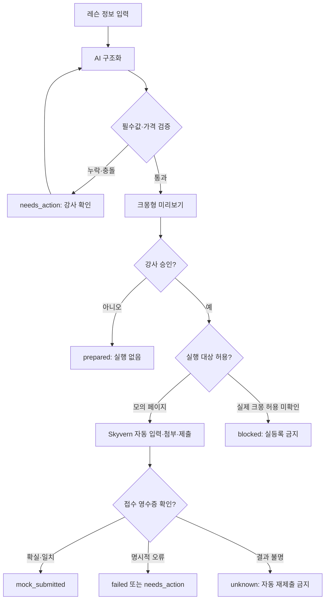

# 음악 레슨 등록 지원 서비스 — 크몽 1곳 PoC 상세 설계서

> **상태:** 기술 검증용 설계 초안 · **화면 반영:** 2026-11-24 제공한 크몽 등록 화면 캡처 7장 · **기준:** 2026-11-23 「음악 레슨 강사 등록 지원 서비스 기획서 및 요구사항 명세서 — 개정 제출 후보」 · **범위:** 기존 레슨 공고 1건 × 크몽형 등록 흐름 1곳
> 이 문서는 새로운 *구현 제안*이다. 구현·시험·크몽 허가·실제 심사 접수·팀 최종 승인 여부를 의미하지 않는다.

## 0. 한눈에 보는 결론

- **이번에 검증할 질문:** 기존 레슨 소개글·사진·가격을 입력하면, AI가 내용을 구조화하고 크몽형 양식에 맞게 변환한 뒤 Skyvern으로 필드 입력·이미지 첨부·최종 제출까지 수행하고 결과를 증거로 확인할 수 있는가?
- **1차 실험 환경:** 우리 팀이 만든 **크몽형 모의 등록 페이지**. 전체 제출은 모의 페이지 안에서만 수행하며, 결과는 `mock_submitted`로 분명히 표기한다.
- **실제 크몽 연결:** 외부 AI의 접근·입력·최종 심사 접수에 대한 **허용 경로와 인증·세션 안전성**이 확인되고 팀에서 승인할 때에만 별도 실험으로 전환한다. 크몽의 공개 API·외부 자동 심사 접수 허용은 본 기획서에서 미확인 상태다.
- **가격 통일 규칙:** STANDARD·DELUXE·PREMIUM 패키지의 **금액(VAT 포함 입력 칸)은 모두 300,000원**으로 입력한다. 이 값은 모의 테스트의 고정 입력값이며, 실제 유료 판매 가격·세무 처리 또는 크몽의 동일 가격 패키지 허용을 확인한 것은 아니다.
- **아직 하지 않을 것:** 당근·다른 플랫폼, 유료 결제, 수강생 지도, 반복 갱신, 무인 대량 제출, 범용 다중 에이전트 시스템, 운영용 정식 관리자 페이지.

## 1. 범위 및 완료 정의

| 구분 | 이번 PoC | 비고 |
|---|---|---|
| 공고 입력 | 기존 소개글 1건·사진 1장 이상·가격·횟수·시간·공개 지역 | 강사가 제공한 사실만 사용 |
| F1 / FR-01 | LLM 원본 구조화, 누락 표시 | 누락 정보 자동 창작 금지 |
| F1 / FR-05 | 가격·패키지 단위의 결정적 검증 | STANDARD·DELUXE·PREMIUM **각 300,000원**; 세 패키지 모두 4회·회당 90분을 테스트 데이터로 동일하게 사용; 시간당 환산 50,000원. 체험 판매가 임의 생성 금지 |
| F1 / FR-02 | 크몽형 제목·설명·절차·준비물·이미지 매핑, 미리보기 | 실제 화면의 필수 필드·글자 수는 실험 직전 재확인 |
| F2 / FR-03 | 모의 페이지에 Skyvern으로 입력·첨부·제출 | 실제 사이트 제출 기능은 기본 비활성화 |
| F3 / FR-04 | 제출 결과·오류·미확인·중복 위험 표시 | Skyvern 작업 완료와 실제 게시 성공 구분 |
| FR-06 | 사용자 원본·AI 변환·검증·승인·작업 이벤트 로그 | 비밀번호·세션·개인정보를 로그에 기록하지 않음 |

**모의 실험의 완료 판정:** 모의 사이트가 서버에서 발급한 고유 `mock_submission_id`를 반환하고, 조회했을 때 동일 공고·가격·이미지 식별자가 보존된 경우만 `mock_submitted`로 판정한다. 화면에 ‘성공’이라는 문구만 보이거나 Skyvern 실행이 `completed`인 것만으로 제출을 확정하지 않는다.

**실제 크몽 실험의 완료 판정(조건부):** 허용된 접근 경로로 강사의 본인 인증·권한·사전 승인 범위를 충족한 뒤, 크몽 측에서 **심사 접수**를 확인할 수 있는 증거를 확보한 경우 `review_pending`으로 판정한다. 실제 게시 공개를 의미하는 `posted`와 구별한다.

## 2. 단일 사용자 시나리오

1. 강사가 기존 레슨 소개글, 사진, 월 가격·횟수·회당 시간을 입력한다.
2. 시스템이 정보 추출을 수행하고, 누락·상충 값을 검증한다.
3. 크몽형 양식의 제목·설명·진행 절차·준비물·이미지·STANDARD/DELUXE/PREMIUM 패키지 미리보기를 생성한다. 세 패키지의 금액을 각각 **300,000원**으로 맞춘다.
4. 강사가 가격·지역·사진·문구 및 **이번 1건의 제출 범위**를 확인하고 승인한다.
5. 백엔드가 작업을 생성한다. 모의 등록 실행기가 Skyvern에 정해진 테스트 URL과 승인된 값을 전달한다.
6. Skyvern이 모의 사이트의 각 필드를 입력하고 사진을 첨부하며 제출한다.
7. 모의 사이트의 영수증(고유 ID)을 재조회해 내용 일치를 검증한다. 서버는 이벤트·상태를 저장한다.
8. 사용자는 `mock_submitted`, `needs_action`, `failed`, `unknown` 중 하나와 근거·조치 안내를 본다.

### 예외 분기



## 3. 구성 요소와 책임

| 구성 요소 | 책임 | 이번 PoC 구현 수준 |
|---|---|---|
| 강사 입력 UI | 텍스트·사진 입력, 미리보기 수정, 명시 승인, 결과 조회 | 3~4개 화면 또는 단일 페이지의 4단계 화면 |
| FastAPI | 요청 검증, 작업 생성, 승인 이력·상태 조회, Skyvern 호출 조정 | REST API 4개 |
| 정보 추출/변환 LLM | 자유 형식 공고 → JSON 추출, 플랫폼별 문안 제안 | 단일 모델 또는 하나의 AI 처리 서비스 |
| 검증기(Pydantic/Python) | 월 가격·횟수·분·이미지·필드 규칙 검사 | 결정적 코드; 가격을 LLM 판단에 맡기지 않음 |
| Skyvern 실행 어댑터 | 허용된 테스트 페이지 이동·필드 입력·첨부·제출·화면 정보 추출 | Skyvern Python SDK 활용; 백엔드에서 호출 |
| 모의 크몽형 페이지 | 입력 폼·첨부·가상 인증 만료·가상 접수 영수증 | 자체 구현; 실제 크몽 디자인 복제 불필요 |
| 저장소 | 원본·변환본·작업·승인·이벤트·모의 접수 기록 | 첫 PoC는 SQLite + 로컬 파일 또는 테스트용 객체 저장소 |

**권장 판단:** 첫 PoC에는 `총괄 에이전트 1 + 등록 에이전트 1` 정도면 충분하다. 데이터 검증·상태 전이·재시도 여부는 일반 코드가 통제한다. LangGraph나 RAG는 필수 전제 조건이 아니다.

```text
[강사 UI]
    | 1. 공고/사진 업로드    | 3. 미리보기 승인
    v                      v
[FastAPI] --[AI 구조화·변환]--[규칙 검증]
    |
    | 4. 승인된 작업과 고정된 테스트 URL
    v
[Skyvern 실행 어댑터] ----> [크몽형 모의 사이트]
    |                               |
    | 6. 실행 기록·관찰값          | 5. 모의 접수 ID
    v                               v
[작업 상태 저장소] <---- [모의 접수 조회·대조]
    |
    v
[결과 화면: mock_submitted / needs_action / failed / unknown]
```

## 4. 데이터 설계 — 필수 필드만

### 4.1 공통 레슨 데이터 `Lesson`

```json
{
  "lesson_id": "lesson_001",
  "source_text": "기존 레슨 소개글 원문",
  "title": "1:1 랩 레슨",
  "category": "music_rap",
  "location_public": null,
  "price": {
    "currency": "KRW",
    "billing_unit": "month",
    "amount": 300000,
    "sessions_per_month": 4,
    "minutes_per_session": 90,
    "trial_price": null
  },
  "asset_ids": ["asset_001"],
  "source_version": 1
}
```

- `location_public=null`은 **확인 필요**를 뜻하며 임의의 장소를 넣지 않는다.
- `trial_price=null`은 체험 수업의 판매가가 정해지지 않았다는 의미다. 정규 월 가격에서 임의 환산해 판매가로 등록하지 않는다.
- `hourly_rate=50000`은 파생 계산값이다. 원본 `amount=300000`, `sessions_per_month=4`, `minutes_per_session=90`을 보존한다.
- 원본 레슨·가격·사진의 **사용자 제공 값**과 AI가 새로 작성한 문구를 구분 저장한다.

### 4.2 변환 결과 `PreparedListing`

```json
{
  "lesson_id": "lesson_001",
  "target": "mock_kmong",
  "preview_version": 1,
  "fields": {
    "service_title": "1:1 랩 레슨",
    "service_description": "AI 변환 문안(사용자 확인 전)",
    "process": "진행 절차 문안(사용자 확인 전)",
    "requirements": "준비 사항 문안(사용자 확인 전)",
    "packages": [
      {"tier": "STANDARD", "price_krw_vat_included": 300000, "sessions": 4, "minutes_per_session": 90, "work_days": null, "revision_count": null},
      {"tier": "DELUXE", "price_krw_vat_included": 300000, "sessions": 4, "minutes_per_session": 90, "work_days": null, "revision_count": null},
      {"tier": "PREMIUM", "price_krw_vat_included": 300000, "sessions": 4, "minutes_per_session": 90, "work_days": null, "revision_count": null}
    ],
    "trial_package_price": null,
    "cover_asset_id": "asset_001"
  },
  "missing_fields": ["location_public", "work_days", "revision_count", "recruitment_type", "package_titles_descriptions"],
  "validated": false,
  "template_version": "mock_kmong_v1"
}
```

**주의:** 실제 크몽의 패키지 필수 여부, 설명 길이·제목 길이·첨부 형식은 실험 시점의 화면을 근거로 별도 설정값으로 관리한다. 이 예시는 공식 크몽 API 스키마가 아니다.

### 4.3 등록 작업 `RegistrationJob`

- `job_id`, `lesson_id`, `preview_version`, `target`, `target_url`, `mode`(`mock`/`live`), `status`, `submitted_at`, `updated_at`
- `approved_by`, `approved_at`, `approved_preview_version`, `approval_scope`(플랫폼 1곳·공고 1건·허용된 제출 단계)
- `idempotency_key`, `skyvern_run_id`, `mock_submission_id`, `verified_evidence`, `error_code`, `error_message_safe`
- 이벤트 로그 `JobEvent`: `timestamp`, `job_id`, `event_type`, `actor`, `before`, `after`, `evidence_ref`

**최소 저장 테이블:** `lessons`, `assets`, `prepared_listings`, `registration_jobs`, `job_events` (모의 사이트용 `mock_submissions` 별도). 초기에는 SQLite로 시작하고 동시 사용자 확장 시 PostgreSQL 전환을 검토한다.

## 5. 우리 서비스 REST API 명세 (제안)

> 아래 네 개는 **우리 팀이 개발할 API**다. Skyvern 또는 크몽이 공식적으로 제공하는 엔드포인트가 아니다. 파일은 `multipart/form-data`, 구조화 데이터는 JSON을 사용한다.

### API 1 — 공고·파일 등록

`POST /api/v1/lessons` · `multipart/form-data` · **201 Created**

- 입력: `source_text`(필수), `monthly_price`, `sessions_per_month`, `minutes_per_session`, `location_public`, `images[]`(1장 이상; 테스트 정책으로 제한)
- 응답 예시:

```json
{
  "lesson_id": "lesson_001",
  "source_version": 1,
  "asset_ids": ["asset_001"],
  "status": "draft"
}
```

- 오류: `400` 누락·형식 불량, `413` 파일 크기 제한 초과, `415` 허용하지 않는 이미지 형식

### API 2 — AI 분석·크몽형 변환·검증

`POST /api/v1/lessons/{lesson_id}/prepare` · **200 OK**

- 요청 예시:

```json
{ "target": "mock_kmong", "source_version": 1 }
```

- 응답 예시:

```json
{
  "lesson_id": "lesson_001",
  "preview_version": 1,
  "target": "mock_kmong",
  "status": "needs_action",
  "fields": {
    "service_title": "월 4회 1:1 랩 레슨 과정",
    "package_prices": {
      "STANDARD": 300000,
      "DELUXE": 300000,
      "PREMIUM": 300000
    },
    "sessions_per_package": 4,
    "minutes_per_session": 90,
    "trial_package_price": null
  },
  "calculated_hourly_rate": 50000,
  "missing_fields": ["location_public", "work_days", "revision_count", "recruitment_type", "package_titles_descriptions"],
  "can_submit": false
}
```

- 동작: LLM 분석 결과는 Pydantic으로 검증하고, 가격·횟수·시간은 원본과 대조한다. 필드가 빠지면 `can_submit=false`를 반환한다.
- 미리보기 수정은 화면에서 원본/변환본을 다시 확정하는 내부 처리로 구현한다. 네 개 API만으로 복잡한 편집까지 운영하려는 설계는 아니며, 필요하면 별도 `PATCH`를 추가한다.

### API 3 — 명시 승인 후 등록 작업 생성

`POST /api/v1/jobs` · **202 Accepted**

- 헤더: `Idempotency-Key: <고유요청키>`
- 요청 예시:

```json
{
  "lesson_id": "lesson_001",
  "target": "mock_kmong",
  "mode": "mock",
  "preview_version": 2,
  "confirmed_by_user": true,
  "approval_scope": "one_listing_one_submission"
}
```

- 응답 예시:

```json
{
  "job_id": "job_001",
  "target": "mock_kmong",
  "mode": "mock",
  "status": "queued",
  "skyvern_run_id": null
}
```

- 서버 검증: 로그인된 **우리 서비스 사용자**가 미리보기 **현재 버전**을 실제 확인·승인했는지 저장한다. `confirmed_by_user=true`라는 값만으로 실행 권한을 인정하지 않는다.
- `mode=live` 요청은 **기본 거부**한다. 플랫폼의 허용 증거·인증 방식·내부 승인·릴리스 플래그가 모두 충족될 때에만 별도 구현한다.
- 동일 공고·대상에 활성 또는 결과 미확인 작업이 있으면 새 제출을 생성하지 않는다. 동일 멱등성 키 재요청은 같은 `job_id`를 반환한다.
- 오류: `409` 승인 버전 불일치·중복 위험, `422` 누락 정보, `403` 허용되지 않은 실등록 경로

### API 4 — 진행·결과 조회

`GET /api/v1/jobs/{job_id}` · **200 OK**

```json
{
  "job_id": "job_001",
  "target": "mock_kmong",
  "mode": "mock",
  "status": "mock_submitted",
  "skyvern_run_status": "completed",
  "evidence": {
    "type": "mock_receipt_verified",
    "mock_submission_id": "msub_001",
    "matched_fields": ["service_title", "packages.STANDARD.price_krw_vat_included", "packages.DELUXE.price_krw_vat_included", "packages.PREMIUM.price_krw_vat_included", "cover_asset_id"]
  },
  "requires_user_action": false,
  "error_code": null
}
```

- 결과 조회 시 ‘Skyvern 실행 성공’과 ‘등록 영수증 검증 성공’을 **별도 필드**로 제공한다.

## 6. Skyvern 연동 방식

- 초기 기술 검증은 Python SDK의 `Skyvern.local()` 또는 자체 Skyvern API 서버로 수행한다. Skyvern Cloud를 쓰면 구독·크레딧·모델 처리·데이터 전송 범위를 별도로 점검한다.
- 실행기 입력은 `mock_page_url`, **검증·승인된** 크몽형 필드, 이미지 경로/임시 URL, 예상 완료 조건이다.
- LLM이 운영 URL이나 제출 대상을 임의 결정하지 못하도록 **서버 측 테스트 대상 URL을 고정**한다.
- `page.fill_form()` 또는 `page.fill()`/`page.act()`/`page.upload_file()`를 사용하고, 제출 후 `page.extract()`·`page.validate()` 및 모의 사이트의 서버 영수증 조회로 검증한다.
- 모의 사이트에서는 최종 제출 버튼을 실제로 누른다. **실제 크몽에서는 허용 여부 확인 전 자동 클릭·전송 코드를 실행하지 않는다.**
- 실행 시간을 기록하되 결과 불명확(`unknown`) 상태의 제출을 자동 재시도하지 않는다.

### 간단한 실행기 의사코드 (구현 예시, 실행 검증 전)

```python
async def execute_registration(job, prepared_listing, skyvern, mock_receipt_api):
    assert job.mode == "mock"  # PoC 실험용 제한
    assert job.target == "mock_kmong"
    assert job.is_approved_for(prepared_listing.preview_version)
    assert prepared_listing.can_submit

    page = await skyvern.get_test_page(ALLOWED_MOCK_URL)  # 프로젝트에서 구현할 래퍼
    assert all(p["price_krw_vat_included"] == 300000 for p in prepared_listing.fields["packages"])
    await page.fill_form(data=prepared_listing.fields, prompt="세 패키지 금액을 모두 300000원으로, 검증된 값만 해당 칸에 입력")
    await page.upload_file(prompt="대표 이미지 첨부 영역", files=prepared_listing.cover_file)
    await page.act("모의 등록 페이지의 최종 제출 버튼 클릭")

    receipt = await mock_receipt_api.lookup(job.idempotency_key)
    if receipt and receipt.matches(prepared_listing):
        return "mock_submitted", receipt.id
    return "unknown", None  # 제출 결과 미확인: 재클릭하지 않음
```

이 코드는 **API 계약과 책임을 설명하는 의사코드**다. `get_test_page`, `receipt.matches`는 팀이 별도 구현할 래퍼이며 Skyvern SDK에 그대로 존재하는 함수가 아니다.

## 7. 상태 전이 및 오류 처리

| 상태 | 의미 | 다음 동작 |
|---|---|---|
| `draft` | 입력 저장 | 분석 가능 |
| `needs_action` | 누락·충돌·인증 문제 | 강사 확인 후 새 미리보기/재개 |
| `prepared` | 미리보기 생성·검증 통과 | 승인 대기 |
| `queued` | 승인 후 작업 대기 | 실행 시작 |
| `running` | Skyvern 브라우저 조작 중 | 실시간/주기 상태 조회 |
| `mock_submitted` | **모의** 제출 영수증·데이터 확인 | 모의 실험 성공 |
| `submitted` | **실제** 사이트에 제출 사실 확인 | 사이트의 심사 접수 판정 대기 |
| `review_pending` | 실제 크몽 **심사 접수 확인** | 승인/반려 추적은 후속 범위 |
| `posted` | 실제 외부 공개 확인 | 이번 PoC 범위 밖 |
| `failed` | 제출되지 않았다는 명확한 실패 근거 | 원인 해결 후 새 승인/재실행 검토 |
| `unknown` | 제출 여부 불명확 | **재제출 금지**·상태 확인·사람 확인 |
| `blocked` | 권한·정책·인증 등 제약으로 실행 불가 | 사유 안내·실행 중단 |

**재실행 규칙:** `queued/running/unknown`의 동일 공고·동일 대상은 새 제출 금지. 모의 제출의 `mock_submission_id`는 고유하게 관리한다. 실제 실등록에서는 조회 가능한 공식 접수 ID나 사용자 확인 증거가 없으면 성공으로 기록하지 않는다.

## 8. 테스트 환경

- **프론트:** React 또는 단일 HTML 테스트 페이지. ① 정보 입력 ② AI 미리보기/수정 ③ 명시 승인 ④ 작업 상태의 4단계를 제공한다.
- **백엔드:** FastAPI. 4개 API, 결과 영수증 검증, 멱등성·감사 로그를 제공한다.
- **모의 크몽 페이지:** `http://localhost:<port>/mock-kmong` 등에 입력 필드, 사진 첨부, 가상 로그인 세션, `제출` 버튼, 접수 완료 화면을 구현한다. 실제 크몽의 상표·UI를 그대로 복제하지 말고 필드 구조와 단계만 실험한다.
- **실험 옵션:** 서버에서 ‘필수 항목 누락’, ‘파일 업로드 실패’, ‘세션 만료’, ‘제출 뒤 응답 유실’을 강제로 재현할 수 있어야 한다.
- **데이터:** 실제 강사의 식별정보와 학생 사진 대신 테스트용/권리 확인된 샘플만 사용한다.
- **관측:** 실행 시작·종료 시간, 강사 직접 클릭/수정/추가 지시 횟수, 등록 필드 일치 여부, 모델/API 비용, 브라우저 대기 시간 및 오류를 각각 기록한다.

## 9. 수용 테스트 케이스

| ID | 입력/상황 | 예상 결과 | 성공 근거 |
|---|---|---|---|
| TC-01 | 정상 데이터 1건, 이미지 준비, 승인 완료 | 모의 등록 완료 | `mock_submission_id` 발급·영수증 조회 일치 |
| TC-02 | 월 가격 미입력 또는 월 횟수 누락 | `needs_action`, 실행 안 함 | AI가 가격을 임의 생성하지 않음 |
| TC-03 | 월 30만원·4회·90분, 체험가 미지정 | STANDARD·DELUXE·PREMIUM에 각 300,000원, 4회, 90분 입력; 별도 체험가 생성 금지 | 3개 패키지 값 동등·원본 값 일치 |
| TC-04 | 이미지 업로드 실패 | `failed` 또는 `needs_action` | 제출 없음·오류 안내·관련 로그 |
| TC-05 | 모의 로그인 만료 | `needs_action`, 실행 중단 | 인증 우회 없음, 비밀정보 로그 없음 |
| TC-06 | 제출은 받았으나 브라우저 응답 유실 | `unknown`→영수증 조회 후 판정 | **추가 제출 0건** |
| TC-07 | 같은 `Idempotency-Key`로 작업 재요청 | 기존 작업 반환 | 중복 접수 없음 |
| TC-08 | 실제 크몽 주소/`mode=live` 요청(허용 미확인) | `blocked` / `403` | 외부 사이트 접속·제출 0건 |
| TC-09 | 승인 후 공고 문구/가격 수정 | 기존 승인 무효 | 새 미리보기·재승인 필요 |
| TC-10 | 브라우저가 완료라고 보고했지만 영수증 없음 | `unknown` | 실행 성공과 접수 성공 분리 |
| TC-11 | 세 패키지 중 1개 금액을 290,000원으로 잘못 입력 | 제출 전 차단·값 수정 | 모든 `package.price`가 정확히 300,000원 |
| TC-12 | 작업 기간·수정 횟수·모집 형태 등 필수값 미확인 | `needs_action`, 실행 안 함 | 필수값 임의 생성 없음 |
| TC-13 | 대표 이미지 미첨부 또는 지원되지 않는 이미지 | `needs_action`, 실행 안 함 | 대표 이미지 최소 1장·형식 검사 |

**PoC 합격(제안):** TC-01~13의 기대 동작을 재현하고, 정상 사례에서 공고·가격·사진이 모의 접수 영수증과 일치하며, 모의 중복 제출이 0건인 것을 확인한다. 이 숫자는 실제 사용자 효율의 합격선이 아니라 **기능 안전성 테스트의 확인 기준**이다.

## 10. 구현 순서 및 담당 검토

| 단계 | 개발 산출물 | 완료 판정 |
|---|---|---|
| 1 | 크몽형 모의 등록 페이지·모의 영수증 조회 | 사람 손으로 1건 모의 접수 가능 |
| 2 | 공고 입력/저장·AI 구조화·검증·미리보기 | 누락·가격 검증 케이스 통과 |
| 3 | Skyvern 자동 입력·이미지 첨부 | 제출 전 필드 값이 원본과 일치 |
| 4 | 승인 후 모의 제출·영수증 대조 | TC-01 통과 |
| 5 | 상태·예외·중복 방지·이벤트 저장 | TC-02~13 통과 |
| 6 | 직접 등록 / 범용 AI / 전용 서비스 비교 | 세 방식 동일 조건 비교 기록 작성 |
| 조건부 | 실제 크몽 허용 경로·인증 보호·R01 승인 검토 | 검증 전에는 **실제 제출 없음** |

**팀 논의가 필요한 미결정 사항:**

1. 단일 원본 샘플의 사용·사진 공개 권한 및 실제 입력 데이터 확정. 이번 모의 가격은 패키지 3개 모두 300,000원으로 고정.
2. 크몽형 모의 폼 필드·제약의 근거 화면 및 확인 날짜 확정.
3. Skyvern 로컬 실행 vs 자체 서버/클라우드 선택, 모델 API 비용 상한.
4. 테스트 사용자의 사전 승인 방식과 세션 유지/폐기 기준.
5. 실제 크몽의 외부 AI 등록·심사 접수 권한 조사 주체와 증거 기준.
6. 1개 플랫폼 PoC의 성공이 여러 플랫폼 제품 가치 검증이 아니라는 결과 보고 원칙.

## 11. 원 기획서와의 대응 및 사실 구분

- **원 기획서에서 확인되는 사실:** FR-01~06, 크몽 입력·심사 접수 흐름, 가격의 임의 생성 금지, 외부 자동 등록 허용 여부 미확인, 직접 등록·범용 AI·전용 서비스 비교 계획.
- **이 문서에서 새로 제안한 설계:** 4개 REST API의 URL·요청/응답, `mock_kmong` 모의 경로, `mock_submitted` 상태, SQLite 테이블, Skyvern 래퍼, TC-01~13, 단계별 개발 순서. 2026-11-24 캡처와 사용자 지시를 반영해 세 패키지 모두 300,000원으로 고정한 모의 테스트 조건을 추가.
- **아직 검증하지 않은 것:** 본 설계의 코드 작동, 실제 크몽의 최신 필드·정책, Skyvern의 이 프로젝트 성공률, 실제 사용자의 시간 절감, 등록 완료·심사 접수 실적.

**참조 원본:** 사용자 제공 `기획서_제출본.md` (개정 제출 후보, 2026-11-23). 이 문서는 R01·R03·R05의 검토와 팀 범위 합의에 따라 수정하는 작업 초안으로 사용한다.


## 12. 실제 등록 화면 기반 입력 필드 명세 (2026-11-24 사용자 제공 캡처)

> **근거:** 사용자 제공 크몽 상품 등록 화면 7장. 아래의 별표는 **화면에 표시된 필수 항목만** 필수로 판단한 것이다. 세부 드롭다운 옵션·마지막 검증 화면·등록 정책은 추가 확인 전이다. 본 명세는 모의 페이지의 테스트 입력 규칙이며 크몽의 공식 API 스키마가 아니다.

### 12.0 실제 등록 첫 화면 관찰

2026-11-24 로그인된 브라우저의 서비스 등록 첫 화면을 읽기 전용으로 확인했다. 현재 화면은 `기본 정보` 단계이며 제목(필수, 10~30자, 허용 특수문자 안내), 카테고리(필수), `다음` 버튼을 보여준다. 관찰 당시 카테고리에는 `IT·프로그래밍 > 프로그램 수정·유지보수`가 표시돼 있었으며, 이는 음악 레슨용 선택값이 아니다. 사용자가 제공한 음악 레슨 화면에는 `취미 레슨 > 보컬·랩 레슨 > 랩 레슨`의 세 단계가 보인다. 카테고리의 단계 수와 하위 선택지는 선택한 분야에 따라 달라질 수 있으므로 세 단계가 항상 존재한다고 가정하지 않는다. 제목 입력·카테고리 변경·`다음` 클릭은 수행하지 않았다.

이후 상세 화면의 구성은 아래 사용자 제공 캡처에 따른 것이며, 이 세션에서 실제 사이트의 다음 단계로 이동해 재확인한 결과는 아니다.

### 12.1 기본 정보·상세 정보

| 화면 섹션 | 항목 | 표시된 요구사항 | 입력 주체 | Skyvern 동작 |
|---|---|---|---|---|
| 기본 정보 | 서비스 제목 | 필수, 10~30자 | AI 초안 + 강사 확인 | 텍스트 입력, 글자 수 검증 |
| 기본 정보 | 카테고리 | 필수, 1·2·3차 분류 선택 | 강사 확인 | 세 단계 드롭다운 선택 |
| 상세 정보 | 서비스 설명 | 필수, 100~20,000자 | AI 초안 + 강사 확인 | 리치 텍스트 입력 |
| 상세 정보 | 주요 특징 / 모집 형태 | 필수 표시 | 강사 확인 | 드롭다운 선택 |
| 이미지 | 메인 이미지 | 필수, 1~4장; PNG/JPG; 652×488px 표기 | 강사 제공 | 파일 업로드 |
| 이미지 | 상세 이미지 | 선택, 0~9장; PNG/JPG/GIF; 가로 652~2,000px, 세로 3,000px 이하로 표기 | 강사 제공 | 선택 업로드 |
| 동영상 | 소개 영상 | 선택, 0~6개; MP4, 합계 500MB 이하 표기 | 강사 제공 | 선택 업로드 |
| 서비스 정보 | 서비스 제공 절차 | 필수, 50~20,000자 | AI 초안 + 강사 확인 | 리치 텍스트 입력 |
| 서비스 정보 | 의뢰인 준비사항 | 필수, 50~20,000자 | AI 초안 + 강사 확인 | 리치 텍스트 입력 |
| 서비스 정보 | 지역 | 필수, 온라인/오프라인 라디오와 `+추가` 후 `지역·온라인` 선택 목록이 보임 | 강사 확인 | 화면의 제공 방식과 목록 선택을 각각 확인; 목록은 자유 입력이 아님 |

### 12.2 가격 정보 — **세 패키지 모두 같은 금액**

이번 모의 테스트에서는 패키지 설정을 **켜짐**으로 두고 화면에 나타난 세 등급을 모두 다룬다. **한 패키지만 300,000원**이 아니라 **각각 300,000원**이다. 패키지마다 월 4회·회당 90분도 동일한 테스트 조건으로 둔다. 다만 실제 등록 시 동일 조건·동일 가격의 패키지 3개가 수용되는지는 별도 확인한다.

| 항목 | STANDARD | DELUXE | PREMIUM | 규칙 |
|---|---:|---:|---:|---|
| 금액(VAT 포함 입력값) | **300,000원** | **300,000원** | **300,000원** | 3개 값 동일, 실등록 전 VAT 조건 확인 |
| 레슨 횟수 | 4회 | 4회 | 4회 | 원본 월 4회와 일치 |
| 1회당 레슨시간 | 90분 | 90분 | 90분 | 원본 회당 90분과 일치 |
| 패키지 제목 | 확인 필요 | 확인 필요 | 확인 필요 | 각 20자 이내로 표시 |
| 패키지 설명 | 확인 필요 | 확인 필요 | 확인 필요 | 각 60자 이내로 표시 |
| 작업 기간 | 확인 필요 | 확인 필요 | 확인 필요 | 화면상 필수; 임의 결정 금지 |
| 수정 횟수 | 확인 필요 | 확인 필요 | 확인 필요 | 화면상 필수; 임의 결정 금지 |
| 준비물 제공 포함 | 확인 필요 | 확인 필요 | 확인 필요 | 체크 여부 사용자 확인 |
| 강의실 제공 포함 | 확인 필요 | 확인 필요 | 확인 필요 | 체크 여부 사용자 확인 |

추가 가격(빠른 작업·추가 수정·레슨 시간 추가·레슨 횟수 추가·준비물·강의실·맞춤 옵션)은 **이번 PoC에서 미설정**한다. 실제 제공하지 않는 옵션을 임의로 켜거나 유료 체험 가격을 새로 만들지 않는다.

**가격 검증 규칙:**

```python
EXPECTED_PACKAGE_PRICE = 300_000
TIERS = ("STANDARD", "DELUXE", "PREMIUM")

def validate_test_packages(packages):
    assert set(packages) == set(TIERS)
    for tier in TIERS:
        item = packages[tier]
        assert item["amount"] == EXPECTED_PACKAGE_PRICE
        assert item["sessions"] == 4
        assert item["minutes_per_session"] == 90
```

이 검증은 **모의 테스트 입력 데이터에만** 적용한다. 가격이 같다고 총 결제액 900,000원의 상품을 만든다는 의미가 아니며, 각 등급에서 구매할 때 선택되는 금액이 300,000원이라는 뜻이다.

### 12.3 판매 핵심 정보·추가 정보

| 화면 섹션 | 항목 | 표시된 조건 | 처리 방침 |
|---|---|---|---|
| 판매 핵심 정보 | 검색 키워드 | 0~5개, 키워드당 20자 표기 | AI 추천 가능, 강사 확인 |
| 판매 핵심 정보 | 자주 묻는 질문 | 0~50개 | 선택 입력 |
| 판매 핵심 정보 | 작업 전 요청사항 | 선택 항목 | 선택 입력 |
| 추가 정보 | 대상자 | 0~4개 | 선택 입력 |
| 추가 정보 | 서비스 내용 | 0~4개 | 선택 입력 |
| 추가 정보 | 준비물 | 0~4개 | 선택 입력 |
| 추가 정보 | 커리큘럼 | 최대 개수 화면에 없음 | 선택 입력 |
| 추가 정보 | 가능일 | 선택 항목으로 보이나 세부 옵션 미확인 | 선택 입력 |

### 12.4 사용자 확인이 필요한 항목

1. **패키지별 제목·설명**: 이번 테스트에서는 같은 금액이지만, 제목·설명의 실제 문구는 강사가 제공·확인해야 한다. 강사가 확정한 레슨 조건 없이 다른 수업 특전을 만들어 내지 않는다.
2. **작업 기간·수정 횟수**: 화면상 별표가 있는 필드다. 입력 규칙과 가능한 드롭다운 값을 확인하고 강사가 선택해야 한다.
3. **모집 형태·지역 세부 입력**: 현재 스크린샷에 선택 가능한 모든 값이 나오지 않는다.
4. **가격의 VAT 의미**: 테스트에서는 각 입력칸을 300,000원으로 고정하지만 실제 유료 공고의 VAT 포함 가격이라는 강사 의사를 별도 확인해야 한다.
5. **마지막 심사 접수 화면**: 제출 버튼, 경고/약관 확인, 실제 접수 결과의 최종 단계가 아직 제공되지 않았다. 모의 폼에서는 별도 제출 영수증을 제공한다.

### 12.4a 실제 화면과 현재 PoC JSON 대응 점검 (2026-11-24)

이 표는 사용자 제공 화면 7장과 현재 `app.py`의 `fields`를 대조한 결과다. 실제 크몽 입력·저장·게시를 수행했다는 뜻은 아니다.

| 실제 화면 | 현재 JSON | 대응 상태·확인할 점 |
|---|---|---|
| 제목, 1·2·3차 카테고리 | `service_title`, `category_1~3` | 제목은 대응. 카테고리 문자열이 실제 드롭다운 선택지와 일치하는지 미확인 |
| 서비스 설명, 제공 절차, 의뢰인 준비사항 | `service_description`, `process`, `requirements` | 내용 대응. 실제 화면은 리치 텍스트 편집기라 입력·검증 방식 미확인 |
| 주요 특징의 모집 형태 | `recruitment_type` | 개념 대응. 실제 선택값 목록과 의미 미확인 |
| 지역의 온라인/오프라인 및 `지역·온라인` 목록 | `location_public` | **불충분**. 화면에는 제공 방식 라디오와 `+추가`로 여는 선택 목록이 보임. 현재 자유 입력 문자열을 선택값으로 자동 변환하지 않음 |
| 메인 이미지 1~4장 | `cover_asset_id` | 대표 이미지 1장만 미리보기에 연결. 나머지 업로드 이미지의 실제 입력 매핑 없음. 규격 검사는 PoC에서 일부만 수행 |
| STANDARD·DELUXE·PREMIUM 기본 가격 | `packages`의 제목·설명·금액·기간·수정·시간·횟수·제공 여부 | 값 대응. 패키지 설정 스위치, 드롭다운의 허용값, 동일 가격·조건 3등급의 수용 여부 미확인 |
| 상세 이미지·동영상·추가 가격 | 없음 | 화면상 선택 항목. 현재 테스트 입력 범위 밖 |
| 검색 키워드·FAQ·작업 전 요청사항 | 없음 | 화면상 별도 영역. 현재 테스트 입력 범위 밖 |
| 대상자·서비스 내용·준비물·커리큘럼·가능일 | 없음 | 화면상 별도 영역. 현재 테스트 입력 범위 밖 |

**입력 시험 전 확인:** 실제 강사가 제공할 사실에 기반한 제목·문구·가격·레슨 조건·이미지 사용 권한, 온라인/오프라인 및 지역, 모집 형태와 카테고리의 실제 선택지, 패키지 드롭다운 값을 확인한다. 임의 문자열로 실제 등록·심사 접수하지 않는다. 실제 사이트의 입력 허용 범위와 팀 Phase의 구현 보류는 별도 결정 사항이다.

**지역 목록 추가 관찰:** 추가로 제공된 화면 2장에서 `지역·온라인` 목록의 `온라인`, 서울 권역별 묶음, `경기도`, `인천`, 광역권 묶음 등을 확인했다. 예를 들어 `의정부`라는 문자열은 보이는 목록에 없고 `경기도`는 보인다. 이것만으로 `의정부`를 `경기도`로 자동 선택한다고 확정하지 않는다. 목록의 전체 항목·다중 선택 가능 여부·온라인/오프라인 라디오와 목록 선택의 관계는 실제 화면에서 더 확인해야 한다.

### 12.5 업데이트된 최소 정상 시나리오

- 강사가 필요한 문구, 사진, 패키지 제목·설명, 작업 기간·수정 횟수, 모집 형태·지역을 모두 제공해 승인한다.
- AI가 문안 글자 수를 확인하고 Skyvern이 **STANDARD/DELUXE/PREMIUM의 각 금액을 300,000원**으로 입력한다.
- 세 패키지의 레슨 횟수·시간은 각각 4회·90분이다.
- 모의 사이트에 제출하기 전 스크린샷/DOM에서 세 패키지 금액이 모두 일치하는지 확인한다.
- 모의 영수증을 재조회해 모든 패키지 금액이 300,000원이고 중복 접수가 없는 경우에만 `mock_submitted`로 판정한다.

### 12.6 실제 크몽 화면 시험으로 전환할 때의 확인 순서

2026-11-24 로컬 모의 페이지에서는 Skyvern 브라우저 입력·이미지 첨부·모의 제출 응답 200·영수증의 필드/이미지 일치를 확인했다. 이는 실제 크몽 입력 성공이나 심사 접수를 뜻하지 않는다.

**2026-11-24 사용자 확인 범위:** 실제 크몽 시험은 `서비스 등록` 화면을 여는 버튼까지다. 사용자는 이를 팀에 문의했다고 보고했다. 이 대화의 범위에는 실제 입력칸 작성, 저장·다음 단계, 최종 심사 접수가 포함되지 않는다. 기존의 아래 단계들은 후속 검토 항목이며 이번 실행 범위가 아니다.

1. **권한과 범위 결정:** R01의 단계·실험 범위 결정과 크몽의 외부 도구 사용 허용 경로를 확인한다. 강사의 본인 계정 사용 동의와 콘텐츠·이미지 사용 권한을 확인한다. 사용자 위임만으로 플랫폼 허용을 추정하지 않는다.
2. **실제 값 준비:** 임의 문자열 대신 강사가 확인한 제목·설명·절차·준비사항·이미지·가격·패키지 조건을 준비한다. 카테고리, 모집 형태, 온라인/오프라인과 `지역·온라인` 목록의 선택값을 실제 화면에서 대조한다.
3. **비제출 입력 시험:** 허용된 방식으로 실제 화면의 각 입력값과 이미지가 표시되는지 확인한다. 저장·다음 단계·심사 접수 버튼의 효과가 불명확하면 누르지 않는다. 계정 비밀번호·세션·비공개 URL·실제 고객 정보는 공개 저장소에 기록하지 않는다.
4. **제출은 별도 결정:** 최종 심사 접수의 플랫폼 허용·강사의 제출 승인·팀 결정이 모두 확인된 경우에만 별도 실험으로 설계한다. 그 전에는 `review_pending`이나 `posted`로 표시하지 않는다.

**현재 상태:** 1번의 팀 결정과 플랫폼 허용 근거가 기록되지 않았으므로 실제 사이트용 Skyvern 실행 경로는 구현·활성화하지 않는다. 현재 `mode=live` 거부는 유지한다.

## 13. 실제 크몽 1건 입력·이미지 첨부·제출 조건부 설계 (2026-11-24)

이 절은 사용자의 후속 **설계 요청**에 대한 제안이다. 현재 코드에 실제 크몽 실행기는 없고 `mode=live`는 계속 차단된다. 로컬 모의 성공을 크몽 성공으로 표시하지 않는다. 팀의 실제 실험 범위 결정과 크몽에서 허용되는 외부 도구 사용 방식은 별도로 확인한다. AI 입력이 사람 입력처럼 보인다는 관찰만으로 허용을 판정하지 않는다.

### 13.1 입력 계약과 사전 조건

- 대상은 강사 본인 계정의 레슨 공고 **1건**이다. 로그인과 추가 인증은 강사가 브라우저에서 직접 수행한다. 비밀번호·OTP·쿠키·세션 토큰을 앱이나 로그에 받지 않는다.
- 강사가 실제 제공할 수 있는 제목·설명·절차·준비사항·가격·패키지 조건·지역·모집 형태와 사용 권한이 있는 원본 이미지를 제공한다. 현재 모의 시험의 임의 문자열과 300,000원 고정값을 실제 판매 정보로 자동 승격하지 않는다.
- `PreparedListing`에 카테고리의 실제 선택 단계, `delivery_mode`(온라인/오프라인), 화면에 존재하는 `region_option`, 대표 이미지 파일과 승인된 패키지 옵션을 명시한다. 드롭다운에 없는 값은 선택하지 않고 `needs_action`으로 돌린다.
- 미리보기 현재 버전의 필드·이미지 SHA-256·대상 크몽 계정 표시 정보·제출 범위가 한 번의 강사 승인에 묶인다. 수정·계정 변경·세션 변경 시 기존 승인은 무효다.
- 외부 사이트용 실행 플래그는 팀 결정과 플랫폼 허용 경로가 확인되기 전까지 열지 않는다. `mock`와 `live`의 URL·상태·영수증 판정은 코드 경로에서 분리한다.

### 13.2 실행 단계와 관측값

| 단계 | 실행기 동작 | 통과 관측값·중단 조건 |
|---|---|---|
| 1. 세션·대상 확인 | 강사가 로그인한 브라우저에서 `kmong.com` 등록 화면만 연다. 계정과 카테고리를 확인한다 | 예상 계정·랩 레슨 분류가 다르면 중단. 로그인/인증 화면은 강사에게 넘김 |
| 2. 상세 정보 입력 | 승인된 제목·설명·제공 절차·의뢰인 준비사항을 화면의 실제 필드와 리치 텍스트 편집기에 입력한다. 모집 형태·지역은 표시된 옵션에서 선택한다 | 입력 후 화면에서 텍스트·선택값을 재조회. 없는 옵션이나 유효성 오류는 `needs_action` |
| 3. 가격 입력 | 패키지 설정 상태를 확인하고 각 등급의 제목·설명·VAT 포함 금액·작업 기간·수정 횟수·시간·횟수·제공 여부를 입력한다 | 세 등급의 표시값을 승인본과 일대일 대조. 허용 단위·드롭다운 값·동일 가격 수용 여부를 화면에서 확인 |
| 4. 이미지 첨부 | 승인된 로컬 원본을 파일 선택 요소에 첨부한다. 이미지 크기·형식·권한을 사전 검사한다 | 업로드 완료 표시와 썸네일/파일 개수를 확인. 업로드 중·실패·다른 이미지면 제출 중단 |
| 5. 제출 전 검토 | 화면에 보이는 필수 필드, 가격, 카테고리, 지역, 이미지와 승인본을 재대조한다 | 불일치·경고·예상 밖의 추가 필수값은 제출 금지. 강사에게 최종 화면과 실제 제출 효과를 보여줌 |
| 6. 제출 | 강사가 **해당 공고·현재 화면에 대한 최종 제출**을 그 시점에 다시 승인한 경우에만 `제출하기`를 한 번 누른다 | 클릭 시각과 요청/화면 변화를 기록. 확인 불명확하면 재클릭 금지 |
| 7. 결과 확인 | 크몽의 서비스 관리 화면에서 해당 공고의 상태와 식별 가능한 접수 흔적을 확인한다 | 심사 접수가 확인되면 `review_pending`; 공개 판매가 확인돼야 `posted`. 단순 클릭/브라우저 완료는 성공 아님 |

### 13.3 상태·중복 방지·복구

- `prepared → filling → ready_for_submit → submitting → review_pending | needs_action | failed | unknown`으로 전이한다. `ready_for_submit`은 입력과 첨부 검증을 통과했다는 뜻이며 제출 완료가 아니다.
- 공고·계정·대상 플랫폼에 활성 작업 또는 `unknown`이 있으면 새 작업과 재제출을 막는다. 네트워크 응답 손실·시간 초과 시 먼저 크몽의 내 서비스 목록에서 상태를 확인하고, 확인 전에는 다시 `제출하기`를 누르지 않는다.
- CAPTCHA·재인증·권한 요청·새 약관 화면은 자동으로 해결하거나 우회하지 않는다. 강사에게 넘기고 현재 단계와 재개 조건을 저장한다.
- 공개 저장소에는 비밀번호·세션·등록 화면의 비공개 URL·실제 개인 정보·원본 사진을 남기지 않는다. 증거는 로컬 비공개 저장소에 보관하고, 공유 기록에는 최소 상태·확인 시각·비식별 요약만 남긴다.

### 13.4 구현 전 검증 순서와 남은 결정

1. 현재 모의 실행의 필드/이미지/영수증 일치 결과를 기준선으로 유지한다.
2. 실제 화면에서 **입력만** 수행하고 저장·제출 없이 화면 표시값과 승인본의 일치율, 드롭다운 대응, 이미지 첨부 성공을 확인한다.
3. 실제 강사의 진실한 내용과 이미지 권한, 계정·인증 방식, 플랫폼 허용 경로, 팀의 실험 범위가 확인되면 1건 제출 시험을 별도로 계획한다.
4. 제출 시험에서는 크몽의 심사 접수 흔적과 중복 0건을 성공 기준으로 삼는다. 실제 사용자 시간 절감과 비용은 별도 비교 실험으로 측정한다.

**현재 미확인:** 실제 카테고리·모집 형태·지역의 모든 선택값, 리치 텍스트 편집기 조작의 안정성, 이미지 업로드 완료 신호, 저장/제출 시 페이지 상태 변화, 외부 자동 입력·제출 허용 경로, 실제 강사의 판매 문구·이미지·가격 승인.
