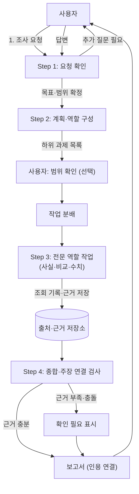

# AI 리서치 멀티에이전트 시스템 선행사례 및 구축 방안 조사

> 이 문서는 [공용 기준 보고서](../../../research/topics/03_AI_리서치_멀티에이전트_시스템_선행사례_및_구축방안_조사.md)의 개인 작업 사본입니다. 공용 내용이 바뀌면 기준 문서를 우선합니다.

- 담당: R04 원민 (프론트엔드 / 사용자 흐름), 검토 반영 작업
- 버전: 0.2 (0.1 초안 검토 후 수정)
- 상태: 확인 요청
- 작성일: 2026-11-11
- 갱신일: 2026-11-11
- 조사일: 2026-11-11 (웹 검색 결과 요약 기준, 원문 정독은 미완료)
- 출처: [Co-STORM 논문 (arXiv 2408.15232)](https://arxiv.org/pdf/2408.15232v1.pdf), [STORM 오픈소스](https://github.com/stanford-oval/storm), [GPT Researcher 저장소](https://github.com/assafelovic/gpt-researcher), [GPT Researcher LangGraph 멀티에이전트 문서](https://docs.gptr.dev/docs/gpt-researcher/multi_agents/langgraph), [GPT Researcher 에이전트 프레임워크 문서 (Tavily)](https://docs.tavily.com/docs/gpt-researcher/agent_frameworks), [11월 11일 리서치·기획·WBS 계획](../../../project/2026-11-11_리서치_기획_WBS_계획.md), [R05 백엔드 데이터 흐름 초안](../../R05/workspace/2026-11-11_리서치_백엔드_데이터_흐름_초안.md), [R05 출처 저장 방식 초안](../../R05/workspace/2026-11-11_리서치_출처_저장_방식_초안.md)

> 이 문서는 조사 기준 문서입니다. 확정 설계가 아니며, 11월 13일 기획서·WBS 작성의 근거 자료로 사용합니다. 확정된 설계는 `docs/design/`에 따로 기록합니다.

---

## 0. 0.1 초안 검토 결과 (수정 이력)

0.1을 다시 읽고 다음 문제를 확인했습니다. 0.2에서 모두 반영했습니다.

| 번호 | 0.1의 문제 | 0.2 수정 |
|---|---|---|
| 1 | **검증 없는 경쟁 제품 주장.** Perplexity Pro Search가 "1~3개 선택지 모달"을 제공한다는 내용을 확인할 공식 자료 없이 적었습니다. 검색 결과도 기능 귀속(Pro Search인지 Copilot인지)이 엇갈려 확정할 수 없었습니다. | 해당 내용을 **미확인**으로 내리고, 비교 표에서 제외했습니다. 확인 전까지 Perplexity는 사용자 흐름 참고 대상으로만 둡니다. |
| 2 | **GPT Researcher를 "모호성 질문 없음"으로 단정.** 검색 결과 GPT Researcher 문서에는 계획 이후 사용자 피드백을 받는 human-in-the-loop 설정(`include_human_feedback`)이 있고, Planner·Reviewer·Reviser 등 역할이 나뉘어 있습니다. | 사실 확인 범위를 "**계획 이후** 사람 검토 지점이 있음"으로 고쳤습니다. 차별점 주장은 "사전 질문을 **조사 시작 전** 전면에 두는 것"으로 좁혔습니다. 두 차이를 구분해 표기합니다. |
| 3 | **Co-STORM 설명이 부정확.** 0.1은 "대화형 인터뷰로 목차를 만든다"고 적었지만, Co-STORM은 사용자가 여러 LM 에이전트의 토론을 지켜보며 간헐적으로 개입하고, 토론 중 **마인드맵**이 갱신되며, 종료 후 인용 보고서를 만드는 구조입니다. | 설명을 원 논문 요약에 맞춰 고쳤습니다. 사전 질의응답이 아니라 **토론 참여형 탐색**이라는 점을 명시합니다. |
| 4 | **R05 상태 코드와 "100% 일치"는 근거가 없음.** R05 초안에는 READY, CLARIFYING 등 상태 코드가 없고, 흐름도와 "확인할 책임"만 있습니다. | 상태 코드 목록을 삭제하고, "R05 흐름 초안과 상태 용어를 맞추는 작업은 R05 최소 데이터 항목 제안 이후 진행"으로 바꿨습니다. |
| 5 | **검색 API(Tavily, Serper)를 근거 없이 후보로 제시.** | 특정 제품명은 "후보 예시, 비교 미수행"으로 낮췄습니다. 비용과 한도는 R02 확인 항목으로 둡니다. |
| 6 | **출처가 홈페이지 수준.** 조사일, 열람 방식, 확인 범위가 없어 문서 관리 규칙 §7(질문·결론·근거·URL·조사자·조사일·미확인)을 충족하지 않았습니다. | 각 주장에 근거 출처를 연결하고, 조사일과 확인 방식을 적었습니다. 원문 정독을 하지 않은 항목은 그 사실을 표시했습니다. |
| 7 | **"쿼리별 페르소나" 같은 제안과 확인된 사실이 섞임.** 예: "가장 신뢰도가 높다", "이탈을 방지한다" 같은 정량적 표현은 근거가 없습니다. | 확인된 사실 / 팀 제안 / 미확인을 분리했습니다. 효과 주장은 "가설"로 표기했습니다. |
| 8 | **범위 이탈.** 0.1 본문이 중고거래 시장 비교처럼 WBS에서 제외된 내용을 일부 암시했습니다. | 중고거래는 **시연 후보의 데이터 접근 가능성**만 다룬다는 WBS 기준을 따릅니다. |
| 9 | **역할 분담이 WBS와 어긋남.** WBS는 R03이 "요청 명확화·조사 분해·역할 구성 비교", R04가 "사용자 흐름 조사", R02가 "운영·데이터 접근 제약", R05가 "오케스트레이션 구현 가능성"을 맡습니다. 0.1은 이를 섞었습니다. | 담당 영역을 WBS 표와 맞췄습니다. |

---

## 1. 조사 목적과 핵심 질문

1. **질문 1 (요청 명확화)**: 선행 시스템은 모호한 요청을 언제, 어떤 방식으로 구체화하는가?
2. **질문 2 (계획과 역할)**: 하위 질문 분해와 에이전트 역할은 고정할 것인가, 요청마다 구성할 것인가?
3. **질문 3 (출처와 종합)**: 수집한 출처는 보고서의 주장과 어떻게 연결되는가?
4. **질문 4 (MVP 흐름)**: `chaja-you` MVP에서 구현 가능하고 차별점이 되는 화면과 흐름은 무엇인가?

---

## 2. 핵심 발견 요약

**확인된 사실 (근거 있음)**

- **Co-STORM**은 사용자가 여러 LM 에이전트의 토론을 관찰하고 필요할 때 개입하는 구조이며, 토론 내용은 **마인드맵**으로 정리되고, 종료 후 인용 보고서를 만듭니다. 논문은 EMNLP 2024 본회의에 채택되었다고 검색 결과에 나옵니다. ([arXiv 2408.15232](https://arxiv.org/pdf/2408.15232v1.pdf), [STORM 저장소](https://github.com/stanford-oval/storm))
- **GPT Researcher**는 계획 에이전트가 하위 질문을 만들고, 실행 에이전트가 각 질문의 자료를 찾는 구조입니다. LangGraph 버전 문서에는 편집자(개요 작성), 하위 주제별 연구자, 작성자, 발행자와 함께 **검토자·수정자 반복 루프**가 있습니다. 설정에 따라 **계획 이후 사용자 피드백**을 받을 수 있습니다. ([GPT Researcher LangGraph 문서](https://docs.gptr.dev/docs/gpt-researcher/multi_agents/langgraph), [Tavily 문서](https://docs.tavily.com/docs/gpt-researcher/agent_frameworks))

**팀 제안 (검증 필요)**

- 조사 착수 전 1~2회의 구조화된 추가 질문을 MVP의 필수 단계로 둡니다. 이 방식이 결과 품질을 높인다는 근거는 아직 없습니다. 중요한 것은 **시작 전 질문**과 **계획 후 검토**의 차이입니다. 조사 시작 전에 질문하면 잘못된 방향의 검색 비용을 줄일 수 있다는 가설로 둡니다.
- 1차 MVP에서는 완전 동적 에이전트 생성 대신 **고정 역할 템플릿 3종 + 하위 질문에 맞춘 선택**을 검토합니다. 안정성 근거는 아직 없고, 구현 난도를 낮추기 위한 선택입니다.
- 근거 연결은 **조회 기록 → 근거 → 보고서 주장**의 구조를 제안합니다. R05 출처 저장 초안과 맞춥니다.
- 진행 상황을 보여 주는 타임라인은 사용자 체감 대기 경험을 줄일 것으로 보이나, 사용성 검증은 하지 않았습니다.

**미확인**

- Perplexity의 추가 질문 기능이 어떤 모드에서 어떤 조건으로 나타나는지.
- 검색 API의 무료 한도, 요금, 레이트 리밋.
- 특정 사이트의 자동 수집 허용 범위.

---

## 3. 선행 시스템 비교 (확인 범위 표기)

| 기준 | Stanford STORM / Co-STORM | GPT Researcher | Perplexity (미확인) | chaja-you MVP 제안 |
|---|---|---|---|---|
| 요청 명확화 | Co-STORM은 토론 참여형 탐색. 사용자가 토론에 개입 | 계획 이후 사용자 피드백 설정 가능 (조사 시작 전 질문은 확인 안 됨) | 추가 질문 기능이 있다는 2차 자료가 있으나 공식 확인 불가 | 조사 시작 전 1~2회 질문을 제안. 효과는 검증 필요 |
| 계획·과제 분해 | 아웃라인(목차)과 하위 질문 생성 | Planner가 하위 질문 생성, 실행 에이전트가 자료 수집 | 미확인 | 계획 단계를 분리하고, 사용자가 범위를 확인하는 지점을 둠 |
| 역할 구성 | 관점별 가상 전문가 역할 | 고정된 역할 파이프라인 + 검토 루프 | 미확인 | 고정 역할 템플릿 기반, 확장 여부는 MVP 이후 결정 |
| 출처 연결 | 인용 보고서 생성 | 자료와 링크를 연결해 참고 문헌 생성 | 인용 표시가 있음 (세부 방식 미확인) | 조회 기록 단위 출처 + 주장 연결 (R05 초안) |
| 결과 종합 | 토론 결과와 목차를 결합 | 섹션별 작성 후 검토·수정 | 미확인 | 상충 정보는 '확인 필요'로 분리 표기 (팀 제안) |
| 진행 가시성 | 토론 과정 자체가 노출 | 단계별 로그 출력 | 미확인 | 진행 타임라인 (팀 제안, 사용성 검증 필요) |

---

## 4. 파이프라인 제안 (팀 제안, 확정 아님)

- **Step 1 (요청 확인)**: 대상, 기간, 원하는 결과 형식 중 빠진 항목만 묻습니다. 질문 수 상한은 2회입니다.
- **Step 2 (계획·역할)**: 하위 질문을 3~5개로 나눕니다. 역할은 템플릿에서 고르고, 사용자가 확인할 수 있게 보여 줍니다.
- **Step 3 (수집)**: 자료를 읽은 기록과 검색 결과만 본 기록을 구분합니다 (R05 초안 기준).
- **Step 4 (종합)**: 주장마다 근거가 있는지 검사합니다. 근거가 없으면 문장을 지우지 않고 '확인 필요'로 표시합니다.

---

## 5. 차별화 후보와 역할별 시사점

### 5.1 차별화 후보 (검증 전)

1. **요청 확인 단계의 배치**: 조사 시작 전에 범위를 좁히는 흐름. 기존 사례와 같은 기능이 있을 수 있으므로, **사용 흐름과 질문 설계**로 차별화되는지 확인해야 합니다.
2. **진행 과정의 가시성**: 어떤 역할이 어떤 자료를 보고 있는지 보여 주는 방식.
3. **상충 정보 표기**: 자료끼리 다를 때 한쪽으로 단정하지 않고 양쪽 근거를 함께 보여 주는 방식.

### 5.2 역할별 시사점 (WBS 기준)

- **R01 지효 (팀장)**: 위 차별화 후보 중 MVP에 넣을 것을 결정하고, 11월 13일 기획서에 포함 여부를 정합니다.
- **R02 상옥 (인프라)**: 검색·수집 도구의 무료 한도, 비용, 레이트 리밋, 캐시 필요성을 확인합니다. 확인 전까지 특정 도구를 정하지 않습니다.
- **R03 두나 (에이전트)**: 요청 확인 질문 수, 하위 질문 분해 기준, 고정 역할 3종의 정의를 비교 자료로 정리합니다.
- **R04 원민 (프론트엔드)**: 입력 → 추가 질문 → 진행 타임라인 → 보고서·출처 보기의 화면 흐름을 설계하고, 인용 클릭 시 출처를 보여 주는 방식을 검토합니다.
- **R05 다혁 (백엔드)**: 요청·하위 작업·조회 기록·근거·보고서의 최소 데이터 항목을 정리합니다. 상태 코드 목록은 이 작업 이후에 정합니다.

---

## 6. 미확인 사항과 다음 단계

**미확인**

- Perplexity 추가 질문 기능의 현재 동작 (공식 문서 확인 필요).
- 검색 API 요금, 무료 한도, 레이트 리밋 (R02).
- 자동 수집 대상 사이트의 이용 조건과 봇 차단 정책.
- GPT Researcher의 현재 버전 기준 에이전트 구성 (저장소 최신 버전 확인 필요).
- 추가 질문이 결과 품질을 높이는지는 시험하지 않았습니다 (가설).

**다음 단계**

- **11월 11일 오후**: 이 문서의 차별화 후보 3개를 팀 체크인에서 확인합니다.
- **11월 12일**: R02 확인 결과를 반영하고, 기획서의 MVP 포함·제외 목록에 옮깁니다.
- **11월 13일**: 제출용 기획서와 WBS에 확정 내용만 옮기고, 이 문서는 근거 자료로 연결합니다.
