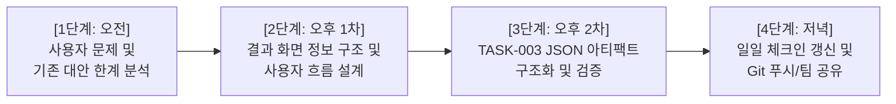

# 11월 12일 R04 업무 수행계획안

- 담당: R04 원민 (프론트엔드 / 사용자 흐름)
- 상태: 초안
- 작성일: 2026-11-12
- 갱신일: 2026-11-12
- 출처: [CURRENT](../../../CURRENT.md), [TASK-003](../../../artifacts/tasks/TASK-003.json), [TASK-003 R01 작업 의도](../../../human/task-intents/TASK-003.md), [SPEC-FOCUS-001](../../../artifacts/specs/focus_apps.json)

---

## 1. 오늘 할 일 (한 줄 요약)

**앱 탐색 시나리오(APP-A·B)를 바탕으로 사용자의 실제 문제와 기존 대안의 한계를 도출하고, 판단 근거·출처가 연결된 최종 결과 화면의 정보 구조를 정리하여 기획 근거([TASK-003](../../../artifacts/tasks/TASK-003.json))를 완성함.**

---

## 2. 팀 상황 및 업무 맥락

- **제출 마감**: 11월 13일 기획서(SUB-01) 및 WBS(SUB-02) 공식 제출.
- **오늘의 팀 목표**: 11월 12일 TASK-002~006을 병행 정리하고, TASK-007에서 제출본 범위를 수렴한 뒤 기획서 초안 작성 착수.
- **첫 검증 도메인**: 안드로이드 집중 앱 탐색 및 비교 (`SPEC-FOCUS-001`).
  - **APP-A (지정 비교)**: "안드로이드 오프라인 뽀모도로 타이머 (PomoToki vs Focus To-Do, 무계정 선호)"
  - **APP-B (신규 발굴)**: "안드로이드 평일 저녁 특정 사이트 2개 무료 차단 앱 찾기"
  - **APP-C (동적 분기)**: 지정 앱 미충족 시 자동으로 대안 앱 발굴로 전환
- **R04 핵심 역할**:
  - `TASK-003`: 사용자 문제, 기존 대안 한계, 결과 화면 정보 구조 및 사용 흐름 도출.
  - R04의 결과물이 도출되어야 R01 팀장의 `TASK-007 (제출본 MVP 수렴)` 및 `TASK-008 (기획서 작성)` 진행 가능.

---

## 3. R01(팀장) 작업 의도 핵심 기준

1. **단순 UI/기능 나열 지양**:
   - `사용자 문제 → 필요한 정보와 판단 → 결과 화면 내용 → 사용자의 다음 행동`의 인과관계 확립.
2. **기존 대안과의 차별점 명확화**:
   - 기존 앱스토어 검색, 일반 검색, 범용 AI(ChatGPT 등)로 해결할 때 생기는 실제 불편과 한계를 같은 조건으로 비교.
   - 찾아you가 제공하는 판단 근거, 출처, 미확인 항목 분리 표기의 가치를 증명.
3. **결과 화면의 필수 정보 포함**:
   - 어떤 후보가 조건을 충족하는가 (충족/미충족/미확인)
   - 왜 그렇게 판단했는가 (판단 근거와 출처)
   - 필수 조건과 선호 조건의 구분
   - 사용자가 직접 추가 확인해야 할 사항 (미확인 항목)

---

## 4. 시간대별 4단계 상세 수행계획

### [1단계: 오전] 사용자 문제 및 기존 대안 한계 분석
- **APP-A (지정 비교)**:
  - 사용자 상황: 오프라인(비행기/독서실) 환경에서 계정 없이 즉시 쓸 수 있는 뽀모도로 타이머 필요.
  - 기존 대안 한계: 앱스토어 설명란만으로는 실제 네트워크 단절 시 동작 여부, 회원가입 강제 여부를 확인 불가하여 직접 설치·시행착오 필요.
- **APP-B (신규 발굴)**:
  - 사용자 상황: 공부 중 특정 웹사이트 2개를 평일 저녁에 무료로 차단하고 싶음.
  - 기존 대안 한계: "무료 설치"로 표시되어 있어도 실제 '예약 차단' 기능은 인앱 결제/유료 구독을 요구하는 경우가 많음.
- **찾아you 차별점**:
  - 설치 전 필수 조건 충족 여부를 에이전트가 직접 팩트체크하여 출처와 함께 제공.

### [2단계: 오후 1차] 결과 화면 정보 구조 및 사용자 흐름 설계
- **요청 입력 흐름**:
  - 사용자 입력 → 필수 조건(플랫폼, 기능, 무료 여부)과 선호 조건(계정 없음) 분류/명확화.
- **진행 상태 가시화**:
  - 에이전트 작업 타임라인 (어떤 에이전트가 무슨 앱의 스펙/리뷰를 검증 중인지 표시).
- **결과 화면 핵심 정보 구조 (IA)**:
  - 후보별 판정 배지 (`충족` / `미충족` / `미확인`)
  - 조건별 판단 근거 및 출처 스니펫
  - 미확인/주의사항 분리 표기 영역
  - 사용자의 다음 행동 유도 (설치 바로가기, 대안 검색 전환)

### [3단계: 오후 2차] TASK-003 JSON 아티팩트 구조화 및 검증
- `docs/artifacts/tasks/TASK-003.json`의 `result` 필드 작성:
  - `claims`: 사용자 문제, 기존 대안 비교, 결과 화면 정보 구조, 차별화 가설
  - `evidence`: 근거 경로 및 출처 링크 매핑
  - `verification`: 완료 조건 검증 내용
  - `uncertainties` & `decision_requests`: 미확인 사항 및 팀장 결정 요청 항목
- `uv run --no-project python tools/project_docs.py` 실행하여 프로젝션 자동 갱신 및 무결성 검사 (`--check`).

### [4단계: 저녁] 일일 체크인 갱신 및 Git 푸시/팀 공유
- `docs/members/R04/daily/2026-11-12.md` 저녁 체크인 작성.
- `akaraywon` 브랜치 커밋 및 푸시, Google Drive 폴더 동기화.
- R01 팀장의 TASK-007(제출본 MVP 수렴) 진행 지원.
