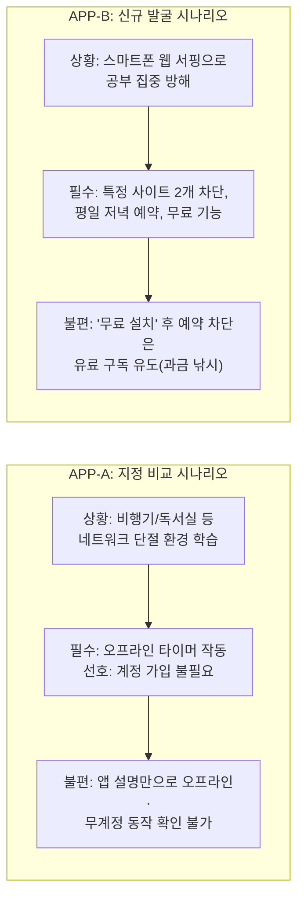

# 사용자 문제 및 기존 대안 한계 분석 (APP-A·B)

- 담당: R04 원민 (프론트엔드 / 사용자 흐름)
- 상태: 초안
- 작성일: 2026-11-12
- 갱신일: 2026-11-12
- 출처: [TASK-003](../../../artifacts/tasks/TASK-003.json), [TASK-003 R01 작업 의도](../../../human/task-intents/TASK-003.md), [SPEC-FOCUS-001](../../../artifacts/specs/focus_apps.json), [찾아you 기획서 초안](../../../artifacts/planning/기획서_초안.json)

---

## 1. 분석 개요 및 목적

본 문서는 **TASK-003(사용자 문제·기존 대안·결과 화면 정리)**의 1단계 작업으로, 첫 도메인인 '안드로이드 집중 앱 탐색·비교'의 두 가지 대표 시나리오(**APP-A 지정 비교**, **APP-B 신규 발굴**)를 바탕으로 다음을 분석함.

1. 사용자가 겪는 실제 문제(불편과 위험)가 무엇인가?
2. 기존 대안(앱스토어 검색, 웹 검색, 범용 AI)은 이 문제를 왜 완전하게 해결하지 못하는가?
3. 찾아you가 제공해야 하는 차별적 가치와 필수 정보는 무엇인가?

---

## 2. 시나리오별 사용자 문제 심층 분석

### 2.1 APP-A (지정 앱 비교): "오프라인 뽀모도로 타이머"

> **사용자 요청**: *"안드로이드에서 인터넷 없이 공부하려고 해. PomoToki와 Focus To-Do 중 오프라인에서 뽀모도로 타이머를 쓸 수 있는 앱을 비교해줘. 가능하면 계정 없이 쓰고 싶어."*

* **사용자 상황 및 맥락**:
  * 데이터 통신이 불가능하거나 방해 금지를 위해 비행기 탑승 모드를 켜둔 상태에서 공부하려는 수험생/학습자.
  * 복잡한 소셜 로그인이나 개인정보 제공 없이 즉시 타이머 기능만 가볍게 사용하고 싶음.
* **사용자가 겪는 실제 문제(Pain Points)**:
  1. **설명서의 모호성**: 앱스토어 소개글에는 '클라우드 동기화', '통계', '협업' 등 화려한 온라인 기능만 강조되어 있어, **정작 인터넷이 끊겼을 때 타이머 카운트다운과 알림이 온전히 작동하는지** 알기 어려움.
  2. **강제 회원가입의 피로**: 앱을 설치하고 실행하자마자 로그인/회원가입 화면이 화면을 막아서며 오프라인 단독 사용이 불가능한 경우가 많음.
  3. **직접 설치·테스트의 낭비**: 사용자가 두 앱을 모두 직접 설치하고 비행기 모드를 켠 뒤 타이머를 눌러보는 '수동 검증'을 거쳐야만 진실을 알 수 있음.
* **사용자 판단에 반드시 필요한 핵심 정보**:
  * 오프라인 상태에서 타이머 시작/종료/알림이 정상 동작하는가? (필수 조건)
  * 회원가입/로그인 없이 첫 실행부터 타이머를 쓸 수 있는가? (선호 조건)
  * 클라우드 동기화나 백업 등 오프라인에서 비활성화되는 부가 기능은 무엇인가?

---

### 2.2 APP-B (신규 발굴): "평일 저녁 웹사이트 2개 무료 예약 차단"

> **사용자 요청**: *"공부 중에 안드로이드 폰으로 웹사이트를 자꾸 열게 돼. 내가 지정한 사이트 2개를 평일 저녁에 무료로 차단할 수 있는 앱을 찾아줘."*

* **사용자 상황 및 맥락**:
  * 시험 기간 평일 저녁(19:00~23:00) 특정 유혹 사이트(유튜브, 웹툰 등 2개)만 차단하고 카카오톡/전화는 유지하고 싶음.
  * 유료 결제(월 구독)를 원치 않으며, 무료 기본 기능만으로 목적을 달성하고자 함.
* **사용자가 겪는 실제 문제(Pain Points)**:
  1. **'무료 설치'와 '무료 기능'의 괴리 (다크 패턴)**: 스토어에서 '무료'로 표시되어 있어 설치했더니, 앱 차단은 무료지만 **'웹사이트 차단'이나 '요일/시간대 예약 차단'은 프로(Pro/Premium) 유료 구독자 전용**으로 묶여 있는 경우가 태반임.
  2. **기술적 제약과 권한 불안**: 웹사이트 차단을 위해 안드로이드 '접근성(Accessibility) 권한'이나 'VPN 프로필' 등록을 요구하는데, 이 앱이 안전한지, 내가 쓰는 모바일 브라우저(크롬, 삼성인터넷 등)에서도 차단이 먹히는지 설치 전에는 알 수 없음.
  3. **후보군 탐색의 어려움**: 앱 이름을 모르므로 키워드(스크린타임, 집중, 차단)로 검색해야 하는데 광고 앱과 무관한 앱이 상위에 쏟아져 나와 진짜 조건에 맞는 앱을 찾기까지 30분 이상 소요됨.
* **사용자 판단에 반드시 필요한 핵심 정보**:
  * 무료 버전에서 '요일 및 시간 예약'이 가능한가? (필수 조건)
  * 무료 버전에서 '웹사이트'를 최소 2개 이상 등록할 수 있는가? (필수 조건: 무료 한도 확인)
  * 어떤 브라우저에서 동작하며, 어떤 권한(접근성 등)을 필수로 요구하는가?

---

## 3. 기존 대안과의 동일 조건 비교 분석

동일한 사용자 요청(APP-A, APP-B)을 기존 대안 3가지 방식으로 해결하려 할 때 발생하는 한계를 대조함.

| 비교 기준 | ① 스토어 검색 (Google Play) | ② 웹/블로그 검색 (Google/Naver) | ③ 범용 AI (ChatGPT/Claude) | ④ 찾아you (chaja-you) |
|---|---|---|---|---|
| **조사 방식** | 키워드 검색 후 리뷰·설명 일일이 확인 | "오프라인 뽀모도로", "무료 사이트 차단 앱" 검색 | 프롬프트 입력 후 단일 텍스트 답변 수령 | 조건 분해 → 에이전트 병렬 조사 → 근거 종합 |
| **APP-A 결과 (PomoToki vs Focus To-Do)** | 설명글에 "오프라인" 단어가 없거나 검색 순위 광고에 밀려 파악 불가 | 블로그 광고글/추천글이 많아 '계정 없는 오프라인 작동' 여부 검증 불가 | "두 앱 모두 훌륭합니다"라며 일반론 서술, 오프라인 무계정 여부는 환각(추정) 답변 | **PomoToki**: 오프라인 지원 및 무계정 명시 확인 **Focus To-Do**: 오프라인 지원 확인, 무계정 여부는 '미확인'으로 솔직 표기 |
| **APP-B 결과 (무료 사이트 2개 예약 차단)** | "무료 다운로드" 앱만 수십 개 나열, 설치 전 예약 차단 유료 여부 확인 불가 | 1~2년 전 오래된 리뷰 글이라 요금제 정책 변경(무료→유료화) 반영 못 함 | "AppBlock이나 Stay Focused를 쓰세요"라고 추천하나 무료 버전 세부 한도는 부정확 | **AppBlock**: 무료판 예약 3개/사이트 5개 확인 **Stay Focused**: 무료 예약 제공 여부 불명확하여 '검증 보류' 처리 |
| **판단 근거 및 출처** | 제공 안 됨 (개발자 마케팅 문구뿐) | 비공식 개인 블로그/홍보성 글 다수 | 출처 링크 없음 또는 환각 링크 | 개발사 공식 도움말, 요금제 표, 권한 안내 URL 직결 |
| **미확인 사항 표기** | 없음 (모르면 무응답) | 없음 | 모르는 내용도 그럴듯하게 단정 | **확인된 사실과 미확인 조건을 분리하여 사용자 주의 고지** |
| **사용자 시행착오 비용** | **매우 큼** (직접 2~3개 설치 후 테스트 필요) | **큼** (수많은 홍보글 필터링 피로) | **중간** (AI 말만 믿고 깔았다가 낭패) | **최소화** (설치 전 조건 충족 여부 확인 완료) |

---

## 4. 찾아you가 제공해야 하는 차별적 해결 가치

R01 작업 의도에 부합하는 찾아you의 3대 핵심 가치:

1. **조건별 3단계 판정 체계 (`충족` / `미충족` / `미확인`)**:
   - 기존 도구처럼 "추천한다/안 한다"로 뭉뚱그리지 않고, 사용자의 세부 조건마다 명확한 판정 부여.
   - 예: Focus To-Do → `오프라인 타이머: 충족`, `계정 없는 사용: 미확인 (추가 확인 필요)`.
2. **검증 가능한 공식 출처 스니펫 매핑**:
   - 블로그 뜬소문이나 AI의 지어낸 말이 아닌, 개발사 공식 페이지([PomoToki FAQ](https://www.pomotoki.com/), [AppBlock Premium 안내](https://appblock.app/premium/))의 실제 문구를 발췌문으로 제시하여 신뢰 확보.
3. **설치 전 기술적 제약·위험 사전 경고**:
   - "이 앱은 접근성 권한이 필요합니다", "삼성 브라우저 지원 여부는 미확인 상태입니다" 등 설치 후 겪게 될 장애물을 미리 고지.

---

## 5. 결과 화면 정보 구조(IA)로 이어지는 핵심 연결고리

R01 의도인 **`사용자 문제 → 필요한 정보와 판단 → 결과 화면 내용 → 사용자의 다음 행동`**의 인과관계를 정의함.

| 단계 | APP-A (지정 비교) | APP-B (신규 발굴) |
|---|---|---|
| **1. 사용자 문제** | 오프라인/무계정 동작 여부를 설치 전에는 알 수 없음 | 무료 버전에서 예약 웹사이트 차단이 가능한지 알 수 없음 |
| **2. 필요한 판단** | 두 앱 중 오프라인 타이머와 무계정을 모두 지원하는 쪽이 어디인가? | 발굴된 앱 중 유료 결제 없이 평일 저녁 사이트 2개 차단이 되는 앱은 무엇인가? |
| **3. 결과 화면 내용** | - 비교표: 오프라인(양쪽 충족) vs 무계정(PomoToki 충족, Focus To-Do 미확인) - 1차 추천: PomoToki - 근거: 공식 문서 스니펫 및 출처 URL | - 1차 추천 후보: AppBlock (무료 한도: 예약 3개, 사이트 5개 충족) - 보류 후보: Stay Focused (무료 범위 미확인 표기) - 주의사항: 안드로이드 접근성 권한 필요 안내 |
| **4. 사용자의 다음 행동** | 의심 없이 PomoToki 설치 링크 클릭 (시행착오 종료) | AppBlock 설치 링크 클릭 또는 권한 요구사항 확인 후 결정 |

---

## 6. 결론 및 2단계(결과 화면 설계) 착수 제언

- **결론**:
  - 찾아you의 경쟁력은 '앱을 많이 찾는 것'이 아니라, 사용자가 설치 전에 가장 알고 싶어 하는 **'세부 제약 조건(오프라인, 무계정, 무료 예약 한도)을 팩트체크하여 설치 실패 비용을 없애주는 것'**에 있음.
- **2단계 착수 방향**:
  - 위 연결고리를 바탕으로, 사용자가 한눈에 조건을 비교하고 신뢰할 수 있는 **결과 화면의 카드/테이블 필드 구조(Field Specification) 및 와이어프레임 흐름**을 오후 1차 작업으로 설계함.
