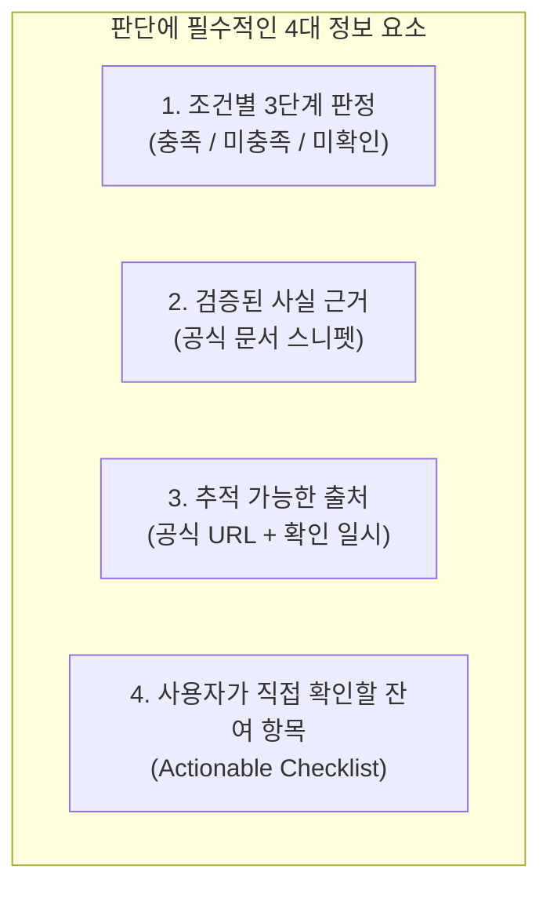
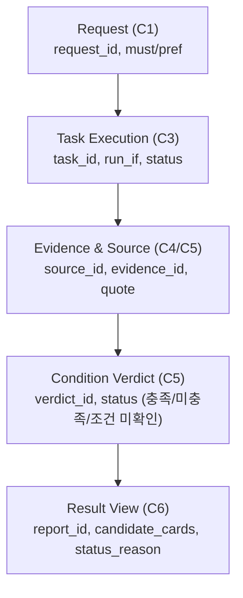

# 사용자 문제·판단 기준 및 기존 대안 한계 분석 (APP-A·B·C)

- 담당: R04 원민 (프론트엔드 / 사용자 흐름)
- 상태: 개정 (팀장 피드백 HRESP-20261112-02, 팀원 R03·R05 협의 의견 및 회의록 종합 반영본)
- 작성일: 2026-11-12
- 갱신일: 2026-11-12
- 출처 및 참조 문서:
  - [TASK-003 정본](../../../artifacts/tasks/TASK-003.json)
  - [TASK-003 R01 작업 의도](../../../human/task-intents/TASK-003.md)
  - [TASK-006 초안](../../../artifacts/tasks/TASK-006.json)
  - [SPEC-FOCUS-001](../../../artifacts/specs/focus_apps.json)
  - [찾아you 기획서 초안](../../../artifacts/planning/기획서_초안.json)
  - [HRESP-20261112-02 (R01 팀장 TASK-003 검토)](../../../human/responses/HRESP-20261112-02_TASK-003_R04_검토.md)
  - [HRESP-20261112-03 (R01 팀장 TASK-005 검토)](../../../human/responses/HRESP-20261112-03_TASK-005_R03_검토.md)
  - [2026-11-12 오전 회의록](../../../meetings/2026-11-12_오전_회의록.md) (동적/고정 분리, I/O 정합성, APP-A·B·C 분기 및 상태 분리)
  - [2026-11-11 강사 피드백 회의록](../../../meetings/2026-11-11_강사_피드백.md) (무료 다운로드 다크패턴, 데이터 접근성 제약)
  - [2026-11-11 앱 탐색·기획 방향 회의록](../../../meetings/2026-11-11_앱탐색_기획방향_회의록.md) (기존 앱 비교 vs 신규 발굴 2모드 확정)
  - [R03 일일 작업 및 협의 의견 (Danmi)](../../R03/daily/2026-11-12.md) (I/O 파이프라인 정합, 3대 상태 분리, APP-C 3분기, APP-B 결정 대기)

---

## 0. 개정 배경 및 반영 원칙

본 문서는 R01 팀장의 2차 검토 의견(`HRESP-20261112-02`), R03 플래너 담당자(Danmi)의 I/O 연결 및 분기 피드백, R05 백엔드 데이터 계약, 그리고 프로젝트 공식 회의록(`docs/meetings/`) 내용을 통합하여 사용자 문제 분석과 화면-데이터 구조를 정렬한 보고서입니다.

1. **사실·가설·미확인의 엄격한 구분**: 공식 문서에서 확인된 '관찰된 사실'과 아직 대규모 실증되지 않은 '사용자 수요/차별화 가설', 조사 불가한 '미확인 사항'을 명확히 분리합니다.
2. **미측정 효과 표현 완화**: "완전히 제거", "매우 큼" 등 단정적 표현을 지양하고 "시행착오 감소 기대 가설", "관찰된 불편" 등으로 객관화합니다.
3. **회의록 핵심 기획 사항 인용**:
   - `2026-11-11_앱탐색_기획방향_회의록.md`: 이미 알고 있는 앱 간의 지정 비교(APP-A)와 조건에 맞는 새로운 앱 발굴(APP-B)의 투 트랙 접근.
   - `2026-11-11_강사_피드백.md`: 스토어의 '무료 설치'와 실제 인앱 '무료 기능' 사이의 괴리(과금 유도 다크패턴) 및 외부 데이터 스크래핑 제약.
   - `2026-11-12_오전_회의록.md`: 동적 워크플로와 고정 항목의 경계 설정 및 대안 발굴 상태 투명성.
4. **3대 상태(작업 실패 / 조건 미확인 / 부분 결과)의 엄격한 분리**: 도구 실패, 정보 부재, 확인 한도 초과를 서로 다른 화면 경험으로 분리합니다.
5. **FR-03 대안 발굴 상태의 투명한 고지**: 대안 발굴을 단순한 버튼으로 고정하지 않고, **대안 발굴의 시작(C1)·생략(C2)·보류(C3) 이유**가 사용자에게 텍스트로 보이도록 합니다.
6. **I/O 데이터 계약 정렬**: `request_id` → `task_id` (`run_if`) → `source_id`/`evidence_id` → `candidate_id`·`condition_id`별 `verdict_id` → `result_view` 체계로 프론트엔드-플래너-백엔드를 연결합니다.
7. **APP-B의 최종 필수 여부 분리**: APP-B의 최종 MVP 필수 포함 여부는 팀장(R01)의 결정 대기 항목으로 유지합니다.

---

## 1. 사용자 실제 문제와 내려야 할 핵심 판단

사용자는 단순히 "인기 앱 순위"나 "방대한 기능 목록"을 원하는 것이 아닙니다. 자신의 특수한 제약 조건(오프라인, 무료 한도, 특정 OS 권한 등)을 충족하는지 **설치 전에 확실히 알고 '어떤 앱을 설치할지' 확신을 갖고 판단**하고자 합니다. (사용자 수요 가설)

### 1.1 APP-A (지정 비교 시나리오: 이미 비교할 앱이 주어진 경우)

* **사용자 상황 (예시)**: 비행기 안, 통신 음영 지역 독서실, 데이터 절약 환경에서 공부하려는 수험생.
* **사용자가 내려야 하는 핵심 판단 질문**:
  1. *"PomoToki와 Focus To-Do 중 인터넷을 완전히 끈 상태(비행기 모드)에서 뽀모도로 타이머와 알림이 실제로 정상 작동하는 앱은 어느 쪽인가?"* (필수 조건 충족 판정)
  2. *"설치 후 첫 실행 시 회원가입이나 소셜 로그인을 강제하지 않고 바로 타이머를 쓸 수 있는 앱은 어느 쪽인가?"* (선호 조건 충족 판정)
  3. *"오프라인에서 작동하지 않는 부가 기능(예: Todoist 클라우드 동기화, 백업)이 내 공부에 지장을 주는가?"* (제약 수용 여부 판단)

### 1.2 APP-B (신규 발굴 시나리오: 새로운 앱 후보를 찾아야 하는 경우)
> *참고*: APP-B의 최종 MVP 필수 포함 여부는 현재 팀장(R01) 결정 대기 상태이며, 본 절은 발굴 모드가 실행될 경우의 사용자 판단 흐름을 다룹니다.

* **사용자 상황 (예시)**: 공부 시간(평일 저녁)에 스마트폰 웹 서핑(유튜브, 인스타그램 웹)으로 집중이 흐트러지는 수험생.
* **사용자가 내려야 하는 핵심 판단 질문**:
  1. *"수많은 차단 앱 중 내가 지정한 특정 웹사이트 2개를 '무료 버전'에서 차단할 수 있는 앱이 실제로 존재하는가?"* (필수 기능 및 무료 한도 판정)
  2. *"매번 수동으로 켤 필요 없이 '평일 저녁(시간/요일 예약)' 차단 기능이 무료 버전에 포함되어 있는가, 아니면 유료 구독을 강제하는가?"* ([2026-11-11 강사 피드백] 무료 다운로드 뒤 숨겨진 결제벽 여부 판정)
  3. *"이 앱이 내 스마트폰의 어떤 권한(접근성, VPN 등)을 요구하며, 내가 주로 쓰는 모바일 브라우저에서도 정상 작동하는가?"* (기술적 위험 및 기기 호환성 판단)

---

## 2. 기존 대안으로 해결되는 부분과 해결되지 않는 한계

기존 탐색 도구를 일방적으로 평가절하하지 않고, **기존 도구로도 충분히 해결되는 영역을 있는 그대로 인정**한 뒤, **사용자가 겪는 한계와 관찰된 불편**을 객관적으로 대조합니다.

### 2.1 대안별 객관적 비교

| 비교 영역 | ① 앱스토어 검색 (Google Play) | ② 일반 웹 검색 (Google/Naver 블로그) | ③ 범용 AI (ChatGPT/Claude 등) | 찾아you 차별화 가설 |
|---|---|---|---|---|
| **충분히 해결되는 부분 (기존 대안의 장점)** | • 앱 이름 검색 시 즉시 다운로드 가능 • 기본 스크린샷 및 UI 디자인 확인 • 전반적인 사용자 평점 및 리뷰 수 확인 | • 실제 사용자의 생생한 실사용 후기 열람 • 구체적인 앱 설정 화면 캡처 확인 • 주관적인 장단점 체감 정보 획득 | • 두 앱의 개념적 차이점 비교 요약 • 뽀모도로 기법 및 시간 관리 팁 안내 • 자연스러운 대화형 인터페이스 | • 기존 도구들이 잘하는 일반 정보 탐색은 그대로 두고, **검증하기 어려운 세부 제약 조건 팩트체크에 집중** |
| **해결되지 않는 한계 (관찰된 불편)** | • **복합 조건 필터링 부재**: "오프라인 가능", "예약 차단 무료" 등 조건 검색 불가 • **마케팅 문구의 모호성**: 온라인 부가기능만 강조되어 오프라인 단독 작동 여부 미기재 • **과금 유도 다크패턴**: '무료 다운로드' 후 인앱 핵심 예약 기능 유료화 ([2026-11-11 강사 피드백]) | • **정보의 비최신성**: 1~2년 전 리뷰가 상위에 노출되어 최근 유료화 정책 변경을 미반영 • **광고/제휴성 포스팅 과다**: 단점이나 세부 제약(무료 한도)을 숨기는 경향 • **비교 탐색 시간 소요**: 원하는 두 조건을 대조한 글을 찾기까지 긴 탐색 시간 소요 | • **환각(Hallucination)**: 오프라인 동작이나 무료 제공 여부를 알지 못하면서도 그럴듯하게 단정 지어 답변 • **출처 부재/허위**: 답변의 근거가 되는 공식 개발사 문서나 정책 링크를 명확히 제시하지 못함 | • **조건별 3단계 판정**: `충족`/`미충족`/`미확인` 분리 • **공식 출처 직결**: 개발사 공식 도움말·요금제 원문 스니펫 제시 • **미확인 사항 분리 표기**: 확인 안 된 사실은 솔직히 미확인 처리 |
| **사용자 시행착오 비용 (추정)** | 직접 2~3개 앱을 설치하고 비행기 모드 실행 및 결제벽을 마주해야 함 | 수많은 블로그를 클릭하며 광고글을 걸러내고 최신 날짜를 확인해야 함 | AI 답변만 믿고 설치했다가 실제 동작이 달라 다시 삭제하는 번복 발생 | 설치 전 필수 조건 충족 여부와 미확인 주의사항을 미리 알고 선택 (시행착오 감소 기대) |

---

## 3. 사용자가 판단하기 위해 추가로 필요한 정보·근거 및 상태 정의

사용자가 시행착오 없이 최종 설치 여부를 결정하려면, 단순한 "추천 문장"이 아니라 신뢰할 수 있는 4대 정보 요소와 3개 시스템 상태의 구분이 필요합니다.

### 3.1 조건별 3단계 상태 판정 (`verdict_id`)
* **충족 (Pass)**: 공식 문서, 릴리스 노트, 정책 페이지를 통해 명확히 확인된 경우.
  * *예 (APP-A)*: PomoToki → 오프라인 뽀모도로 타이머 지원 (`충족`), 계정 없는 로컬 사용 지원 (`충족`).
* **미충족 (Fail)**: 해당 기능이 없거나 유료 결제가 필수임이 공식 확인된 경우.
  * *예 (APP-B)*: 특정 앱이 사이트 차단 기능을 프로 요금제 전용으로 분류한 경우 → 무료 예약 차단 (`미충족`).
* **조건 미확인 (Unverified)**: 공식 문서상 언급이 없거나, 최신 버전에서 변경 가능성이 있어 단정할 수 없는 경우.
  * *예 (APP-A)*: Focus To-Do → 오프라인 지원은 확인되었으나, 첫 실행 시 계정 생성 없이 타이머 진입이 가능한지는 공식 문서에서 확인되지 않음 → 계정 없는 사용 (`조건 미확인`).

### 3.2 핵심 상태의 3대 분리 원칙 (Danmi R03 의견 반영)

시스템은 다음 세 가지 상태를 화면과 데이터상에서 엄격히 분리하여 사용자에게 제공해야 합니다.

1. **작업 실패 (Task Failure)**:
   - 네트워크 단절, 스크래핑 차단, API 타임아웃 등 도구 실행 자체가 실패한 경우.
   - *화면 표기*: "일시적인 네트워크 오류로 조사를 완료하지 못했습니다. (재시도 안내)"
2. **조건 미확인 (Condition Unverified)**:
   - 외부 문서는 정상적으로 수집했으나, 문서 내에 사용자가 요구한 세부 조건(예: 로그인 건너뛰기 가능 여부, 특정 브라우저 호환성)이 명시되어 있지 않은 경우.
   - *화면 표기*: "공식 문서에서 계정 없는 사용 지원 여부를 확인할 수 없습니다. (설치 후 직접 확인 필요)"
3. **부분 결과 (Partial Result)**:
   - 조사 확인 한도(Timeout/Retry limit)에 도달하여 추가적인 대안 발굴을 중단하고, 현재까지 확인된 내용만으로 종료한 경우.
   - *화면 표기*: "조사 시간 한도(2분) 도달로 추가 대안 발굴을 중단하고 현재까지 확인된 결과를 안내합니다."

### 3.3 판단 근거와 출처
* **근거 형식**: AI의 요약문이 아니라, 개발사가 공식적으로 게시한 도움말·요금제·약관의 **핵심 원문 스니펫(Snippet, `evidence.quote`)** 인용.
* **출처 정보**: 공개된 공식 웹사이트 URL, Google Play 앱 세부정보 URL, 확인 일시(Timestamp).

### 3.4 사용자가 추가로 확인해야 할 잔여 내용 (Actionable Checklist)
* 텍스트 문서로 검증할 수 없는 하드웨어/OS 권한 및 실시간 환경 종속 사항은 사용자에게 직접 확인할 내용으로 전달.
  * *예*: "AppBlock은 안드로이드 접근성 권한이 필수입니다. 크롬 브라우저 차단은 확인되었으나, 삼성 인터넷 및 네이버 앱 내 웹뷰 차단 여부는 기기별 설정에 따라 다를 수 있으므로 설치 후 직접 확인해 주세요."

---

## 4. 결과 정보 구조 및 파이프라인(TASK-006 / R03 / R05) I/O 연계

R05 백엔드 데이터 계약과 R03 플래너의 실행 구조를 바탕으로, 시스템 내부 ID와 사용자 화면 인터페이스를 일대일로 연결한 정보 구조입니다.

### 4.1 화면-백엔드-플래너 필드 매핑 명세

| 화면 정보 블록 | 화면 표시 항목 | 연결 시스템 계약 (TASK-006 / R03 ID) | 설명 및 처리 기준 |
|---|---|---|---|
| **1. 요청 요약** | 요청 제약 배지 | `request.must_conditions`, `preferences` | 필수(오프라인, 무료), 선호(무계정) 조건 분리 표시 |
| **2. 진행 & 분기 상태** | **대안 발굴 상태 배지** | `task.run_if`, `status`, `status_reason` | **시작 / 생략 / 보류 사유**가 사용자에게 텍스트로 보임 |
| **3. 조건별 판정** | 판정 상태 배지 | `condition_verdict.status` (`verdict_id`) | `충족(Pass)`, `미충족(Fail)`, `조건 미확인(Unverified)` |
| | 근거 원문 스니펫 | `evidence.quote` (`evidence_id`) | 개발사 공식 문서의 원문 발췌 텍스트 |
| | 공식 출처 링크 | `source.url`, `retrieved_at` (`source_id`) | 공식 URL 링크 및 확인 일시 |
| **4. 미확인 & 잔여 주의사항** | 직접 확인할 사항 | `result_view.unverified_items` | 권한 요구(접근성), 미확인 브라우저 호환성 등 액션 아이템 |
| **5. 다음 행동** | 설치/대안 액션 | `result_view.next_actions` | 공식 스토어 설치 링크 바로가기, 조건 완화 재탐색 등 |

---

### 4.2 시나리오별 결과 표시 상세 (FR-03 대안 발굴 3분기 사유 반영)

#### [APP-A 지정 비교 결과 예시]
* **대안 발굴 상태**: `[대안 발굴 생략]`
  * *사유 표시*: "지정된 후보 앱(PomoToki)이 사용자의 필수 조건(오프라인)을 충족하여 추가 대안 발굴을 생략합니다."
* **후보 1: PomoToki** (`추천`)
  * `오프라인 타이머`: **[충족]** (근거: "PomoToki는 완전한 로컬 데이터 저장을 지원하여 오프라인에서 동작합니다." / 출처: https://www.pomotoki.com/)
  * `계정 없는 사용`: **[충족]** (근거: "로그인 없이 즉시 타이머를 시작할 수 있습니다.")
* **후보 2: Focus To-Do** (`비교 후보`)
  * `오프라인 타이머`: **[충족]** (근거: FAQ "Android 타이머는 로컬에서 카운트됩니다.")
  * `계정 없는 사용`: **[조건 미확인]** (공식 문서 미언급. 설치 시 로그인 건너뛰기 가능 여부 확인 필요)

#### [APP-B 신규 발굴 결과 예시 (팀장 최종 결정 대기)]
* **대안 발굴 상태**: `[후보 발굴 완료]`
  * *사유 표시*: "사용자 요청에 특정 앱이 지정되지 않아, 조건에 부합하는 차단 앱 후보 2개를 신규 발굴하여 검증했습니다."
* **후보 1: AppBlock** (`추천 후보`)
  * `평일 저녁 예약`: **[충족]** (무료판 스케줄 최대 3개 제공 / 출처: https://appblock.app/premium/)
  * `웹사이트 2개 차단`: **[충족]** (무료판 스케줄당 최대 5개 사이트 지원)
  * `무료 사용`: **[충족]** (기본 예약 기능 무료 확인)
  * `사용자 확인 필요`: 안드로이드 접근성 권한 필수, 크롬 외 브라우저는 직접 확인 필요.

#### [APP-C 동적 분기 및 보류 결과 예시 (R03 협의 3분기 반영)]

* **APP-C1 (대안 발굴 시작)**:
  * **상태**: `[대안 발굴 시작]`
  * **사유 표시**: *"지정된 후보(PomoToki, Focus To-Do) 모두 사용자의 필수 조건(오프라인)을 만족하지 못하여 새로운 대안 앱 발굴 작업을 시작했습니다."*
* **APP-C2 (대안 발굴 생략)**:
  * **상태**: `[대안 발굴 생략]`
  * **사유 표시**: *"지정된 후보(PomoToki)가 필수 조건을 충족함이 확인되어 추가 대안 발굴을 생략하고 결과를 안내합니다."*
* **APP-C3 (대안 발굴 보류 - 미확인 부분 결과로 종료)**:
  * **상태**: `[대안 발굴 보류 및 부분 결과 안내]`
  * **사유 표시**: *"조사 확인 한도(2분) 도달 및 무료 정책 공식 확인 불가로 추가 대안 발굴을 보류하고, 현재까지 확인된 부분 결과만으로 종료합니다. 판정되지 않은 항목은 사용자의 직접 확인이 필요합니다."*

---

## 5. MVP 요구사항(FR-01~FR-04)과의 직결성 및 근거

| 기능 요구사항 | 본 분석에서 도출된 근거 및 역할 | 결과 화면 정보 구조 반영 항목 |
|---|---|---|
| **FR-01 (요청 구조화 및 조건 분리)** | 사용자의 요청에서 **필수 조건(오프라인, 무료)과 선호 조건(무계정)**을 명확히 구분하지 않으면 피상적인 추천이 발생함. 누락된 제약은 확인 질문으로 보완. | 결과 화면의 `요청 제약 배지` 및 `필수/선호 조건 구분 태그` |
| **FR-02 (계획 및 역할 배정)** | APP-A는 발굴 생략, APP-B는 발굴 후 검증, APP-C는 조건부 발굴 등 워크플로가 달라져야 불필요한 도구 호출 낭비를 줄임. | 진행 상태 화면의 `에이전트별 작업 단계 가시화` |
| **FR-03 (조건부 실행 및 상태 투명성)** | **대안 발굴의 시작(C1)·생략(C2)·보류(C3) 이유**가 화면에 명시되어야 사용자가 탐색 흐름을 신뢰함. 확인 한도 초과 시 부분 결과로 안전 종료. | 결과 화면의 `대안 발굴 상태 배지 및 사유 설명 블록` |
| **FR-04 (근거 연결 및 판정 표기)** | 기존 도구의 환각을 방지하고 설치 실패 비용을 줄이기 위해 **충족·미충족·미확인 3단계 상태와 공식 원문 스니펫을 직결**함. | 결과 화면의 `조건별 판정 배지`, `원문 스니펫`, `공식 URL`, `미확인 주의사항` |

---

## 6. 미확인 사항 및 결정 요청 (Uncertainties & Decision Requests)

1. **APP-B(신규 발굴) MVP 필수 포함 여부 (결정 요청)**:
   - APP-A(지정 비교)와 APP-C(조건부 발굴)만으로도 동적 구성 검증이 가능한지, 아니면 APP-B를 MVP에 필수 포함해야 하는지 R01 팀장의 최종 확인 필요.
2. **확인 한도(Timeout/Retry) 구체적 수치 (미확인 사항)**:
   - 외부 웹 수집 지연 시 부분 결과로 전환하기 위한 시간 한도(예: 60초 vs 120초)와 재시도 횟수 기준에 대한 백엔드(R05) 및 플래너(R03)와의 수치 합의 필요.
3. **외부 스토어/웹 데이터 스크래핑 제약 (미확인 사항)**:
   - `2026-11-11 강사 피드백`에서 지적된 Google Play 스크래핑 차단 위험과 공식 API 부재에 따른 R02의 데이터 소스 확보 검토 결과 반영 필요.
