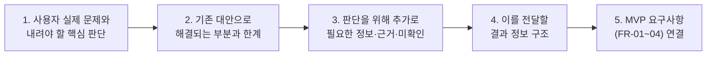

# 사용자 문제·판단 기준 및 기존 대안 한계 분석 (APP-A·B)

- 담당: R04 원민 (프론트엔드 / 사용자 흐름)
- 상태: 초안 (팀장 피드백 1차 반영 개정본)
- 작성일: 2026-11-12
- 갱신일: 2026-11-12
- 출처: [TASK-003](../../../artifacts/tasks/TASK-003.json), [TASK-003 R01 작업 의도](../../../human/task-intents/TASK-003.md), [SPEC-FOCUS-001](../../../artifacts/specs/focus_apps.json), [찾아you 기획서 초안](../../../artifacts/planning/기획서_초안.json), 팀장 피드백(2026-11-12)

---

## 0. 개정 배경 및 피드백 반영 방향

팀장(R01) 피드백에 따라 화면 레이아웃 자체보다 **"사용자가 실제로 내려야 하는 핵심 판단"**, **"기존 대안으로 충분히 해결되는 부분과 해결되지 않는 한계"**, **"판단에 필요한 구체적 정보·근거"**, 그리고 **"MVP 요구사항(FR-01~FR-04)과의 직결성"**에 초점을 맞추어 전면 보완함.



---

## 1. 사용자 실제 문제와 내려야 할 핵심 판단

사용자는 단순히 "앱 목록"을 원하는 것이 아니라, **자신의 구체적인 제약 조건을 만족하는지 설치 전에 확인하고 '어떤 앱을 설치할지' 확신을 갖고 판단**하고자 함.

### 1.1 APP-A (지정 비교 시나리오)

* **사용자 상황**: 비행기 안, 인터넷이 안 되는 독서실, 데이터 절약 모드 등 네트워크가 단절된 환경에서 공부하려는 학습자.
* **사용자가 내려야 하는 핵심 판단**:
  1. *"PomoToki와 Focus To-Do 중 인터넷을 완전히 끈 상태(비행기 모드)에서 뽀모도로 타이머와 알림이 실제로 정상 작동하는 앱은 어느 쪽인가?"* (필수 조건 판정)
  2. *"설치 후 첫 실행 시 회원가입이나 소셜 로그인을 강제하지 않고 바로 타이머를 쓸 수 있는 앱은 어느 쪽인가?"* (선호 조건 판정)
  3. *"오프라인에서 작동하지 않는 부가 기능(예: Todoist 연동, 백업)이 내 학습에 치명적인가?"* (제약 수용 여부 판단)

### 1.2 APP-B (신규 발굴 시나리오)

* **사용자 상황**: 공부 시간(평일 저녁)에 스마트폰 웹 서핑(유튜브, 인스타그램 웹 등)으로 집중이 흐트러지는 수험생.
* **사용자가 내려야 하는 핵심 판단**:
  1. *"수많은 차단 앱 중 내가 지정한 특정 웹사이트 2개를 '무료 버전'에서 차단할 수 있는 앱이 실제로 존재하는가?"* (필수 기능 및 무료 한도 판정)
  2. *"매번 켤 필요 없이 '평일 저녁(시간/요일 예약)' 차단 기능이 무료 버전에 포함되어 있는가, 아니면 유료 결제(월 구독)를 강제하는가?"* (핵심 조건 유료화 여부 판정)
  3. *"이 앱이 내 스마트폰의 어떤 권한(접근성, VPN 등)을 요구하며, 내가 주로 쓰는 모바일 브라우저(크롬, 삼성인터넷)에서도 정상 작동하는가?"* (기술적 위험 및 호환성 판단)

---

## 2. 기존 대안으로 해결되는 부분과 해결되지 않는 한계

기존 대안을 폄하하거나 기획을 무리하게 정당화하지 않고, **기존 도구로도 충분히 해결되는 영역을 있는 그대로 인정**한 뒤, **사용자가 실제로 막히는 병목(한계)**을 객관적으로 분리함.

### 2.1 대안별 객관적 비교

| 비교 영역 | ① 앱스토어 검색 (Google Play) | ② 일반 웹 검색 (Google/Naver 블로그) | ③ 범용 AI (ChatGPT/Claude 등) | 찾아you의 차별적 해결 영역 |
|---|---|---|---|---|
| **충분히 해결되는 부분<br/>(기존 대안의 장점)** | • 앱 이름 검색 시 즉시 다운로드 가능<br/>• 기본 스크린샷 및 UI 디자인 확인<br/>• 전반적인 사용자 평점 및 리뷰 수 확인 | • 실제 사용자의 생생한 사용 후기 열람<br/>• 구체적인 앱 설정 방법 및 화면 캡처 확인<br/>• 대략적인 장단점 체감 | • 두 앱의 개념적 차이점 비교 요약<br/>• 뽀모도로 기법 및 시간 관리 팁 안내<br/>• 자연스러운 문장으로 읽기 쉬운 설명 | • 기존 도구들이 잘하는 일반 정보 탐색은 그대로 활용하고, **검증하기 어려운 제약 조건 팩트체크에 집중** |
| **해결되지 않는 한계<br/>(사용자 병목)** | • **조건 검색 불가**: "오프라인 가능", "예약 차단 무료" 등 복합 조건 필터링 부재<br/>• **마케팅 문구의 모호성**: 온라인 부가기능만 강조되어 오프라인 단독 작동 여부 미기재<br/>• **다크 패턴**: '무료 다운로드'로 유인 후 핵심 기능 유료 구독 강제 | • **정보의 비최신성**: 1~2년 전 리뷰가 상위에 노출되어 최근 유료화 정책 반영 못 함<br/>• **광고/제휴성 포스팅 과다**: 단점이나 세부 제약(무료 한도)을 숨기는 경향<br/>• **비교 검색의 피로**: 정확히 내가 원하는 두 조건을 대조한 글을 찾기까지 긴 시간 소요 | • **환각(Hallucination)**: 오프라인 동작이나 무료 제공 여부를 알지 못하면서도 그럴듯하게 단정 지어 답변<br/>• **출처 부재/허위**: 답변의 근거가 되는 공식 개발사 문서나 정책 링크를 명확히 제시하지 못함 | • **조건별 분리 판정**: `충족`/`미충족`/`미확인` 명확화<br/>• **공식 출처 직결**: 개발사 공식 도움말·요금제 원문 스니펫 제시<br/>• **미확인 사항 분리 표기**: 확인 안 된 사실은 솔직히 미확인 처리 |
| **사용자 시행착오 비용** | **매우 큼**: 직접 2~3개 앱을 설치하고 비행기 모드 실행 및 결제벽을 마주해야 함 | **큼**: 수많은 블로그를 클릭하며 광고글을 걸러내고 최신 날짜를 확인해야 함 | **중간**: AI 답변만 믿고 설치했다가 실제 동작이 달라 다시 삭제하는 번복 발생 | **최소화**: 설치 전 필수 조건 충족 여부와 미확인 주의사항을 미리 알고 선택 |

---

## 3. 사용자가 판단하기 위해 추가로 필요한 정보·근거

사용자가 시행착오 없이 최종 설치 여부를 결정하려면, 단순한 "추천 텍스트"가 아니라 다음 4가지 핵심 요소가 갖추어진 정보가 제공되어야 함.


### 3.1 조건별 3단계 상태 판정 (`충족` / `미충족` / `미확인`)
* **충족 (Pass)**: 공식 문서, 릴리스 노트, 정책 페이지를 통해 명확히 확인된 경우.
  * *예 (APP-A)*: PomoToki → 오프라인 뽀모도로 타이머 지원 (`충족`), 계정 없는 로컬 사용 지원 (`충족`).
* **미충족 (Fail)**: 해당 기능이 없거나 유료 결제가 필수임이 공식 확인된 경우.
  * *예 (APP-B)*: 특정 앱이 사이트 차단 기능을 프로 요금제(월 4,900원) 전용으로 분류한 경우 → 무료 예약 차단 (`미충족`).
* **미확인 (Unverified)**: 공식 문서상 언급이 없거나, 최신 버전에서 변경 가능성이 있어 단정할 수 없는 경우.
  * *예 (APP-A)*: Focus To-Do → 오프라인 지원은 확인되었으나, 첫 실행 시 계정 생성 없이 타이머 진입이 가능한지는 공식 문서에서 확인되지 않음 → 계정 없는 사용 (`미확인`).

### 3.2 판단 근거와 출처
* **근거 형식**: AI가 생성한 문장이 아니라, 개발사가 공식적으로 게시한 도움말·요금제·약관의 **핵심 원문 스니펫(Snippet)**을 인용.
* **출처 정보**: 공개된 공식 웹사이트 URL, Google Play 앱 세부정보 URL, 확인 일시(Timestamp).

### 3.3 사용자가 추가로 확인해야 할 잔여 내용 (주의사항)
* 시스템이 텍스트 문서로 검증하지 못한 **하드웨어/OS 종속적 환경**은 사용자에게 직접 확인할 내용으로 전달.
  * *예 (APP-B)*: "AppBlock은 접근성(Accessibility) 권한을 필수로 요구합니다. 크롬 브라우저 차단은 공식 확인되었으나, 삼성 인터넷 및 네이버 앱 내부 브라우저 차단 여부는 기기별 설정에 따라 다를 수 있으므로 설치 후 직접 확인이 필요합니다."

---

## 4. 이를 전달할 결과 정보 구조 (Information Architecture)

위에서 도출한 판단 요소들을 화면에서 사용자에게 전달하기 위한 **필수 필드 및 정보 구조**를 정의함.

### 4.1 결과 정보 구조 필드 명세

| 정보 블록 | 필드명 | 유형 | 설명 및 예시 |
|---|---|---|---|
| **1. 헤더 요약** | `request_summary` | 텍스트 | 사용자 요청의 핵심 제약 요약 (플랫폼, 필수 조건, 선호 조건) |
| | `recommendation_badge` | 배지 | `최우선 추천` / `대안 후보` / `조건 미충족` |
| **2. 조건별 판정 매트릭스** | `condition_name` | 텍스트 | 검증 대상 조건 (예: 오프라인 타이머, 무료 예약 차단) |
| | `condition_type` | 태그 | `필수 조건` vs `선호 조건` |
| | `verdict` | 상태 배지 | `충족 (Pass)` / `미충족 (Fail)` / `미확인 (Unverified)` |
| | `evidence_snippet` | 텍스트 | 판정의 근거가 된 공식 문서 원문 발췌 |
| | `source_url` | 링크 | 근거 원천의 공식 URL 및 확인 일시 |
| **3. 설치 전 주의사항** | `unverified_items` | 불릿 목록 | 문서상 확인되지 않아 사용자가 직접 확인해야 할 항목 |
| | `technical_requirements`| 불릿 목록 | 필수 권한(접근성, 배터리 최적화 예외), 호환 브라우저 등 |
| **4. 다음 행동 유도** | `next_action` | 액션 버튼 | `Google Play 설치 바로가기`, `대안 앱 발굴 전환` 등 |

### 4.2 시나리오별 결과 정보 구조 예시

#### [APP-A 지정 비교 결과 예시]
```text
[요청 요약]: 안드로이드 / 필수: 오프라인 뽀모도로 / 선호: 계정 없음
--------------------------------------------------------------------------------
■ 1차 추천: PomoToki (선호 조건까지 완벽 충족)
  • 오프라인 뽀모도로 타이머: [충족] 
    - 근거: "PomoToki는 완전한 로컬 데이터 저장을 지원하여 인터넷 연결 없이 타이머가 작동합니다."
    - 출처: https://www.pomotoki.com/ (2026-11-11 확인)
  • 계정 없는 사용: [충족]
    - 근거: "로그인 없이 즉시 타이머를 시작할 수 있으며, Todoist 연동 시에만 계정이 필요합니다."
  • 다음 행동: [Google Play 스토어로 이동]

■ 비교 후보: Focus To-Do (필수 충족, 선호 미확인)
  • 오프라인 뽀모도로 타이머: [충족]
    - 근거: 개발사 FAQ "Android 타이머는 네트워크가 없어도 로컬에서 카운트됩니다."
  • 계정 없는 사용: [미확인] (공식 문서 미기재)
    - 사용자 주의: 첫 실행 시 로그인 유도 팝업이 뜰 수 있으므로 건너뛰기 가능 여부 확인 필요.
--------------------------------------------------------------------------------
```

#### [APP-B 신규 발굴 결과 예시]
```text
[요청 요약]: 안드로이드 / 필수: 특정 사이트 2개 차단 / 필수: 평일 저녁 예약 / 필수: 무료
--------------------------------------------------------------------------------
■ 발굴 추천 1위: AppBlock (무료 버전 한도 내 조건 충족)
  • 평일 저녁 요일/시간 예약: [충족] (무료판 스케줄 최대 3개 제공)
  • 웹사이트 2개 차단: [충족] (무료판 스케줄당 최대 5개 사이트 등록 지원)
  • 무료 사용 가능 여부: [충족] (인앱 결제 없이 기본 기능 사용 확인)
    - 출처: https://appblock.app/premium/ (2026-11-11 확인)
  • 사용자가 설치 후 확인할 사항:
    - 안드로이드 '접근성(Accessibility) 권한' 부여 필요
    - 크롬 외 서드파티 브라우저 사용 시 차단 동작 여부 직접 확인 필요
  • 다음 행동: [Google Play 스토어로 이동]

■ 보류 후보: Stay Focused (무료 범위 불명확)
  • 상태: [검증 보류 - 추가 확인 필요]
  • 사유: 예약 차단 기능은 확인되었으나, 무료판 제공 여부와 유료 구독 강제 여부가 공식 문서에서 불명확함.
--------------------------------------------------------------------------------
```

---

## 5. MVP 요구사항(FR-01~FR-04)과의 직결성 및 근거

본 분석에서 도출된 사용자 문제와 결과 정보 구조는 `SPEC-FOCUS-001`의 핵심 기능 요구사항을 도출하는 직접적 근거가 됨.

| 기능 요구사항 | 본 분석에서 도출된 근거 및 역할 | 결과 화면 정보 구조 반영 항목 |
|---|---|---|
| **FR-01<br/>(요청 구조화 및 조건 분리)** | 사용자의 모호한 요청에서 **필수 조건(오프라인, 무료 예약)과 선호 조건(계정 없음)**을 엄격히 분리하지 않으면 기존 AI처럼 엉뚱한 추천을 하게 됨. 누락된 정보는 확인 질문으로 해결. | 결과 화면의 `헤더 요약` 및 `필수/선호 조건 구분 태그` |
| **FR-02<br/>(계획 및 역할 배정)** | APP-A(지정 비교)는 후보 발굴을 건너뛰고 스펙 대조만 수행하며, APP-B(신규 발굴)는 후보 발굴 후 무료 한도 검증을 추가해야 사용자 시행착오를 줄일 수 있음. | 진행 상태 화면의 `에이전트별 작업 단계 가시화` |
| **FR-03<br/>(조건부 실행 및 추적)** | 두 앱이 모두 조건을 만족하지 못할 경우(APP-C), 즉시 대안 발굴로 전환되어야 사용자가 빈손으로 이탈하지 않음. | 결과 화면의 `대안 앱 발굴 전환 버튼` |
| **FR-04<br/>(근거 연결 및 판정 표기)** | 기존 도구의 가장 큰 문제인 환각과 과금 낚시를 없애기 위해 **충족·미충족·미확인 3단계 상태와 공식 출처 원문 스니펫을 직결**해야 사용자가 안심하고 설치를 결정할 수 있음. | 결과 화면의 `조건별 판정 배지`, `원문 스니펫`, `공식 URL`, `미확인 주의사항` |

---

## 6. 결론

1. 찾아you의 존재 이유는 **기존 검색 엔진이나 AI가 대신해주지 못하는 "복합 제약 조건(오프라인 여부, 무료 기능의 실제 한도)의 팩트체크"**를 수행하여 사용자의 설치 실패 및 시간 낭비를 완전히 제거하는 데 있음.
2. 따라서 결과 화면은 화려한 그래픽보다 **조건별 충족·미충족·미확인 판정 배지, 공식 원문 근거, 설치 전 주의사항(권한 등)**을 투명하게 제공하는 정보 구조를 갖추어야 함.
3. 이 분석 내용은 `TASK-003.json`의 최종 결과(`result`)로 구조화되어 기획서 2~4장의 확고한 사용자 문제 및 차별화 근거로 사용됨.
