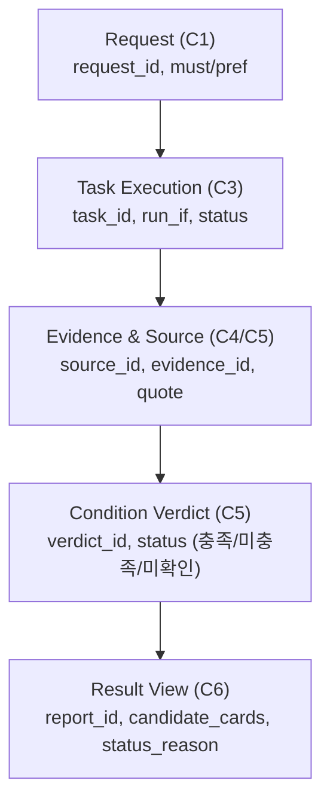

# 사용자 문제·판단 기준 및 기존 대안 한계 분석 (APP-A·B·C)

- 담당: R04 원민 (프론트엔드 / 사용자 흐름)
- 상태: 초안 (팀장 2차 피드백 및 R05 데이터 연결 의견 반영 개정본)
- 작성일: 2026-11-12
- 갱신일: 2026-11-12
- 출처: [TASK-003](../../../artifacts/tasks/TASK-003.json), [TASK-003 R01 작업 의도](../../../human/task-intents/TASK-003.md), [TASK-006 초안](../../../artifacts/tasks/TASK-006.json), [SPEC-FOCUS-001](../../../artifacts/specs/focus_apps.json), [찾아you 기획서 초안](../../../artifacts/planning/기획서_초안.json), 팀장 피드백(2026-11-12 11:40), R05 협의 의견

---

## 0. 피드백 반영 및 개정 원칙

1. **사실·가설·미확인의 엄격한 구분**: 관찰된 사실(공식 문서에 명시된 내용)과 사용자 수요/차별화 가설(아직 정량 검증되지 않은 가설), 미확인 사항을 분리함.
2. **미측정 효과 표현 완화**: "완전히 제거", "매우 큼" 등 단정적 표현을 지양하고 "시행착오 감소 기대 가설", "관찰된 불편" 등으로 객관화함.
3. **FR-03 대안 발굴 상태의 투명한 표시**: 대안 발굴을 단순한 버튼으로 고정하지 않고, **대안 발굴의 시작·생략·보류 이유**가 사용자에게 보이도록 흐름을 재설계함 (APP-C 대응).
4. **TASK-006 데이터 계약(ID) 연결**: R05 백엔드 데이터 흐름(`request_id` → `task_id` → `source_id`/`evidence_id` → `verdict_id` → `result_view`)과의 화면 인터페이스 정합성을 확보함.

---

## 1. 사용자 실제 문제와 내려야 할 핵심 판단

사용자는 단순히 "앱 목록"을 원하는 것이 아니라, **자신의 구체적인 제약 조건을 만족하는지 설치 전에 확인하고 '어떤 앱을 설치할지' 확신을 갖고 판단**하고자 함. (사용자 수요 가설)

### 1.1 APP-A (지정 비교 시나리오)

* **사용자 상황 (예시)**: 비행기 안, 인터넷이 안 되는 독서실, 데이터 절약 모드 등 네트워크가 단절된 환경에서 공부하려는 학습자.
* **사용자가 내려야 하는 핵심 판단 질문**:
  1. *"PomoToki와 Focus To-Do 중 인터넷을 완전히 끈 상태(비행기 모드)에서 뽀모도로 타이머와 알림이 실제로 정상 작동하는 앱은 어느 쪽인가?"* (필수 조건 판정)
  2. *"설치 후 첫 실행 시 회원가입이나 소셜 로그인을 강제하지 않고 바로 타이머를 쓸 수 있는 앱은 어느 쪽인가?"* (선호 조건 판정)
  3. *"오프라인에서 작동하지 않는 부가 기능(예: Todoist 연동, 백업)이 내 학습에 지장을 주는가?"* (제약 수용 여부 판단)

### 1.2 APP-B (신규 발굴 시나리오)

* **사용자 상황 (예시)**: 공부 시간(평일 저녁)에 스마트폰 웹 서핑(유튜브, 인스타그램 웹 등)으로 집중이 흐트러지는 수험생.
* **사용자가 내려야 하는 핵심 판단 질문**:
  1. *"수많은 차단 앱 중 내가 지정한 특정 웹사이트 2개를 '무료 버전'에서 차단할 수 있는 앱이 실제로 존재하는가?"* (필수 기능 및 무료 한도 판정)
  2. *"매번 켤 필요 없이 '평일 저녁(시간/요일 예약)' 차단 기능이 무료 버전에 포함되어 있는가, 아니면 유료 결제(월 구독)를 강제하는가?"* (핵심 조건 유료화 여부 판정)
  3. *"이 앱이 내 스마트폰의 어떤 권한(접근성, VPN 등)을 요구하며, 내가 주로 쓰는 모바일 브라우저에서도 정상 작동하는가?"* (기술적 위험 및 호환성 판단)

---

## 2. 기존 대안으로 해결되는 부분과 해결되지 않는 한계

기존 대안을 일방적으로 폄하하지 않고, **기존 도구로도 충분히 해결되는 영역을 있는 그대로 인정**한 뒤, **사용자가 실제로 겪는 불편과 한계(가설)**를 객관적으로 분리함.

### 2.1 대안별 객관적 비교

| 비교 영역 | ① 앱스토어 검색 (Google Play) | ② 일반 웹 검색 (Google/Naver 블로그) | ③ 범용 AI (ChatGPT/Claude 등) | 찾아you 차별화 가설 |
|---|---|---|---|---|
| **충분히 해결되는 부분 (기존 대안의 장점)** | • 앱 이름 검색 시 즉시 다운로드 가능 • 기본 스크린샷 및 UI 디자인 확인 • 전반적인 사용자 평점 및 리뷰 수 확인 | • 실제 사용자의 생생한 사용 후기 열람 • 구체적인 앱 설정 방법 및 화면 캡처 확인 • 대략적인 장단점 체감 | • 두 앱의 개념적 차이점 비교 요약 • 뽀모도로 기법 및 시간 관리 팁 안내 • 자연스러운 문장으로 읽기 쉬운 설명 | • 기존 도구들이 잘하는 일반 정보 탐색은 그대로 활용하고, **검증하기 어려운 세부 제약 조건 팩트체크에 집중** |
| **해결되지 않는 한계 (관찰된 불편)** | • **조건 검색 불가**: "오프라인 가능", "예약 차단 무료" 등 복합 조건 필터링 부재 • **마케팅 문구의 모호성**: 온라인 부가기능만 강조되어 오프라인 단독 작동 여부 미기재 • **과금 유도 다크패턴**: '무료 다운로드' 후 핵심 예약 기능 유료화 | • **정보의 비최신성**: 1~2년 전 리뷰가 상위에 노출되어 최근 유료화 정책 변경을 미반영 • **광고/제휴성 포스팅 과다**: 단점이나 세부 제약(무료 한도)을 숨기는 경향 • **비교 탐색 시간 소요**: 원하는 두 조건을 대조한 글을 찾기까지 탐색 시간 필요 | • **환각(Hallucination)**: 오프라인 동작이나 무료 제공 여부를 알지 못하면서도 그럴듯하게 단정 지어 답변 • **출처 부재/허위**: 답변의 근거가 되는 공식 개발사 문서나 정책 링크를 명확히 제시하지 못함 | • **조건별 3단계 판정**: `충족`/`미충족`/`미확인` 분리 • **공식 출처 직결**: 개발사 공식 도움말·요금제 원문 스니펫 제시 • **미확인 사항 분리 표기**: 확인 안 된 사실은 솔직히 미확인 처리 |
| **사용자 시행착오 비용 (추정)** | 직접 2~3개 앱을 설치하고 비행기 모드 실행 및 결제벽을 마주해야 함 | 수많은 블로그를 클릭하며 광고글을 걸러내고 최신 날짜를 확인해야 함 | AI 답변만 믿고 설치했다가 실제 동작이 달라 다시 삭제하는 번복 발생 | 설치 전 필수 조건 충족 여부와 미확인 주의사항을 미리 알고 선택 |

---

## 3. 사용자가 판단하기 위해 추가로 필요한 정보·근거

사용자가 시행착오 없이 최종 설치 여부를 결정하려면, 단순한 "추천 텍스트"가 아니라 다음 4가지 핵심 요소가 갖추어진 정보가 제공되어야 함.

### 3.1 조건별 3단계 상태 판정 (`충족` / `미충족` / `미확인`)
* **충족 (Pass)**: 공식 문서, 릴리스 노트, 정책 페이지를 통해 명확히 확인된 경우.
  * *예 (APP-A)*: PomoToki → 오프라인 뽀모도로 타이머 지원 (`충족`), 계정 없는 로컬 사용 지원 (`충족`).
* **미충족 (Fail)**: 해당 기능이 없거나 유료 결제가 필수임이 공식 확인된 경우.
  * *예 (APP-B)*: 특정 앱이 사이트 차단 기능을 프로 요금제 전용으로 분류한 경우 → 무료 예약 차단 (`미충족`).
* **미확인 (Unverified)**: 공식 문서상 언급이 없거나, 최신 버전에서 변경 가능성이 있어 단정할 수 없는 경우.
  * *예 (APP-A)*: Focus To-Do → 오프라인 지원은 확인되었으나, 첫 실행 시 계정 생성 없이 타이머 진입이 가능한지는 공식 문서에서 확인되지 않음 → 계정 없는 사용 (`미확인`).

### 3.2 판단 근거와 출처
* **근거 형식**: AI가 생성한 문장이 아니라, 개발사가 공식적으로 게시한 도움말·요금제·약관의 **핵심 원문 스니펫(Snippet)**을 인용.
* **출처 정보**: 공개된 공식 웹사이트 URL, Google Play 앱 세부정보 URL, 확인 일시(Timestamp).

### 3.3 사용자가 추가로 확인해야 할 잔여 내용 (주의사항)
* 시스템이 텍스트 문서로 검증하지 못한 **하드웨어/OS 종속적 환경**은 사용자에게 직접 확인할 내용으로 전달.
  * *예 (APP-B)*: "AppBlock은 접근성(Accessibility) 권한을 필수로 요구합니다. 크롬 브라우저 차단은 공식 확인되었으나, 삼성 인터넷 및 네이버 앱 내부 브라우저 차단 여부는 기기별 설정에 따라 다를 수 있으므로 설치 후 직접 확인이 필요합니다."

---

## 4. 이를 전달할 결과 정보 구조 및 TASK-006 데이터 연계

R05의 [TASK-006 백엔드 데이터 계약](../../../artifacts/tasks/TASK-006.json)을 반영하여, 백엔드 엔티티 ID와 화면 필드를 일대일로 연결한 정보 구조임.

### 4.1 화면-백엔드 필드 매핑 명세

| 화면 정보 블록 | 화면 표시 항목 | 연결 백엔드 계약 (TASK-006 ID) | 설명 및 예시 |
|---|---|---|---|
| **1. 요청 요약** | 요청 제약 배지 | `request.must_conditions`, `preferences` | 플랫폼(안드로이드), 필수(오프라인), 선호(무계정) |
| **2. 진행 & 분기 상태** | **대안 발굴 상태 배지** | `task.run_if`, `status`, `failure_reason` | **시작 / 생략 / 보류 사유**가 사용자에게 텍스트로 보임 |
| **3. 조건별 판정** | 판정 상태 배지 | `condition_verdict.status` | `충족(Pass)`, `미충족(Fail)`, `미확인(Unverified)` |
| | 근거 원문 스니펫 | `evidence.quote` | 개발사 공식 문서의 원문 발췌 텍스트 |
| | 공식 출처 링크 | `source.url`, `retrieved_at` | 공식 URL 링크 및 확인 일시 |
| **4. 미확인 & 잔여 주의사항** | 직접 확인할 사항 | `result_view.unverified_items` | 권한 요구(접근성), 미확인 브라우저 호환성 등 |
| **5. 다음 행동** | 설치/대안 액션 | `result_view.next_actions` | Google Play 설치 바로가기, 수동 재탐색 등 |

---

### 4.2 시나리오별 결과 표시 예시 (FR-03 대안 발굴 사유 반영)

#### [APP-A 지정 비교 결과 예시]
* **대안 발굴 상태**: `[대안 발굴 생략]` (사유: 지정 후보인 PomoToki가 필수 조건을 충족하여 추가 발굴을 진행하지 않음)
* **후보 1: PomoToki** (`1차 추천`)
  * `오프라인 타이머`: **[충족]** (근거: "PomoToki는 완전한 로컬 데이터 저장을 지원하여 오프라인에서 동작합니다." / 출처: https://www.pomotoki.com/)
  * `계정 없는 사용`: **[충족]** (근거: "로그인 없이 즉시 타이머를 시작할 수 있습니다.")
* **후보 2: Focus To-Do** (`비교 후보`)
  * `오프라인 타이머`: **[충족]** (근거: FAQ "Android 타이머는 로컬에서 카운트됩니다.")
  * `계정 없는 사용`: **[미확인]** (공식 문서 미언급. 설치 시 로그인 건너뛰기 가능 여부 확인 필요)

#### [APP-B 신규 발굴 결과 예시]
* **대안 발굴 상태**: `[후보 발굴 완료]` (사유: 사용자 요청에 지정 앱이 없어 신규 차단 앱 2개 발굴 및 검증 수행)
* **후보 1: AppBlock** (`1차 추천 후보`)
  * `평일 저녁 예약`: **[충족]** (무료판 스케줄 최대 3개 제공 / 출처: https://appblock.app/premium/)
  * `웹사이트 2개 차단`: **[충족]** (무료판 스케줄당 최대 5개 사이트 지원)
  * `무료 사용`: **[충족]** (기본 예약 기능 무료 확인)
  * `사용자 확인 필요`: 안드로이드 접근성 권한 필수, 크롬 외 브라우저는 직접 확인 필요.
* **후보 2: Stay Focused** (`검증 보류`)
  * `상태`: **[미확인 부분 결과로 보류]** (사유: 예약 차단은 있으나 무료판 지원 한도가 공식 문서에서 확인되지 않음)

#### [APP-C 동적 분기 및 보류 결과 예시 (팀원 R05 의견 반영)]
* **APP-C1 (대안 발굴 시작)**:
  * 상태: `[대안 발굴 시작]`
  * 사유 표시: "지정된 PomoToki, Focus To-Do 두 앱 모두 필수 조건을 만족하지 못하여 새로운 대안 앱 2종 발굴 작업을 시작했습니다."
* **APP-C2 (대안 발굴 생략)**:
  * 상태: `[대안 발굴 생략]`
  * 사유 표시: "지정된 PomoToki가 필수 오프라인 조건을 충족하여 추가 대안 발굴을 생략합니다."
* **APP-C3 (대안 발굴 보류 - 미확인 부분 결과)**:
  * 상태: `[대안 발굴 보류 및 부분 결과 안내]`
  * 사유 표시: "조사 시간 한도(2분) 도달 및 무료 정책 확인 불가로 대안 발굴을 중단하고, 현재까지 확인된 부분 결과만 제공합니다. 확인되지 않은 항목은 사용자의 직접 확인이 필요합니다."

---

## 5. MVP 요구사항(FR-01~FR-04)과의 직결성 및 근거

| 기능 요구사항 | 본 분석에서 도출된 근거 및 역할 | 결과 화면 정보 구조 반영 항목 |
|---|---|---|
| **FR-01 (요청 구조화 및 조건 분리)** | 사용자의 요청에서 **필수 조건(오프라인, 무료)과 선호 조건(무계정)**을 명확히 구분하지 않으면 겉핥기식 추천이 발생함. 누락된 정보는 확인 질문으로 해결. | 결과 화면의 `요청 제약 배지` 및 `필수/선호 조건 구분 태그` |
| **FR-02 (계획 및 역할 배정)** | APP-A는 발굴 생략, APP-B는 발굴 후 검증, APP-C는 조건부 발굴 등 워크플로가 달라져야 탐색 낭비를 줄임. | 진행 상태 화면의 `에이전트별 작업 단계 가시화` |
| **FR-03 (조건부 실행 및 상태 투명성)** | **대안 발굴의 시작·생략·보류 이유**가 화면에 명시되어야 사용자가 왜 추가 검색이 일어났거나 생략되었는지 납득함. 한도 도달 시 미확인 부분 결과로 안전 종료. | 결과 화면의 `대안 발굴 상태 배지 및 사유 설명 블록` |
| **FR-04 (근거 연결 및 판정 표기)** | 기존 도구의 환각을 방지하고 설치 실패 비용을 줄이기 위해 **충족·미충족·미확인 3단계 상태와 공식 원문 스니펫을 직결**함. | 결과 화면의 `조건별 판정 배지`, `원문 스니펫`, `공식 URL`, `미확인 주의사항` |

---

## 6. 결론 및 TASK-003 반영 사항

1. 찾아you의 차별점은 대단한 기능 목록이 아니라, **사용자가 설치 전에 꼭 알아야 할 세부 제약(오프라인 여부, 무료 기능 한도)의 팩트체크와 투명한 미확인/보류 사유 고지**에 있음.
2. 본 분석 결과를 `docs/artifacts/tasks/TASK-003.json` 정본의 `result` 필드에 구조화하여 기획서 2~4장의 확고한 근거로 등록함.
