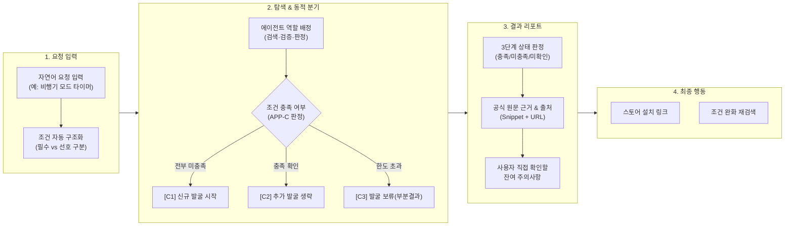

# 사용자 흐름 및 결과 화면 정보구조(IA) 설계 (APP-A·B·C)

- 담당: R04 원민 (프론트엔드 / 사용자 흐름)
- 상태: 완료 (기획서 2~4장 투영 정본 초안)
- 작성일: 2026-11-12
- 갱신일: 2026-11-12
- 출처 및 참조 문서:
  - [TASK-003 정본](../../../artifacts/tasks/TASK-003.json)
  - [사용자 문제 및 기존 대안 한계 분석 보고서](2026-11-12_사용자_문제_및_기존_대안_한계_분석.md)
  - [TASK-006 초안 (백엔드 데이터 계약)](../../../artifacts/tasks/TASK-006.json)
  - [SPEC-FOCUS-001 (집중 앱 사례)](../../../artifacts/specs/focus_apps.json)
  - [찾아you 기획서 초안](../../../artifacts/planning/기획서_초안.json)
  - [2026-11-12 오전 회의록](../../../meetings/2026-11-12_오전_회의록.md) (I/O 파이프라인 정합, 3대 상태 분리, 대안 발굴 3분기)
  - [2026-11-11 강사 피드백 회의록](../../../meetings/2026-11-11_강사_피드백.md) (인앱 결제벽 다크패턴 방지, 스크래핑 제약 고지)
  - [2026-11-11 앱 탐색·기획 방향 회의록](../../../meetings/2026-11-11_앱탐색_기획방향_회의록.md) (지정 비교 vs 신규 발굴)

---

## 1. 개요 및 기획서 2~4장 연결 목적

본 문서는 `TASK-003`의 핵심 산출물로서, **기획서 2장(사용자 문제), 3장(서비스 기능 구조), 4장(화면 및 사용자 여정)**에 직접 반영할 수 있도록 사용자 여정(Journey), 화면별 정보 구조(IA), 컴포넌트 와이어프레임, 백엔드 데이터 필드 매핑을 완결된 형태로 정의합니다.

### 핵심 설계 원칙
1. **판단 중심의 화면 전개**: 단순 앱 나열이 아니라 `조건 판정 → 근거/출처 확인 → 미확인 주의사항 인지 → 설치/행동 결정`으로 이어지는 의사결정 지원 UI.
2. **투명한 분기 및 상태 표기 (FR-03)**: 대안 발굴을 블랙박스나 단순 버튼으로 처리하지 않고, **시작(C1)·생략(C2)·보류(C3)** 이유를 화면에 텍스트와 배지로 즉시 설명.
3. **3대 상태 엄격 분리**: 도구 실패(`작업 실패`), 정보 부재(`조건 미확인`), 확인 한도 초과(`부분 결과`)를 화면 인터페이스에서 명확히 구분.
4. **I/O 데이터 정합성**: R03 플래너 및 R05 백엔드 계약(`request_id` → `task_id` → `source/evidence` → `verdict_id` → `result_view`)과 1:1 매핑.

---

## 2. 전체 사용자 여정 맵 (User Journey Map)



| 단계 | 사용자 행동 및 심리 | 시스템 동작 | 제공 화면 및 컴포넌트 |
|---|---|---|---|
| **1. 요청 입력** | 자신의 복합 제약(오프라인, 무계정, 무료)을 자연어로 입력. 오인식 방지를 원함. | 플랫폼, 필수 조건(Must), 선호 조건(Pref), 대상 앱 유무를 분리 파싱. | `RequestView`: 입력창, 조건 태그 배지, 조건 수정 모달 |
| **2. 탐색 & 분기** | 시스템이 제대로 찾고 있는지, 멈추지 않았는지 궁금해함. | 워크플로 실행, 실시간 에이전트 상태 업데이트, APP-C 조건부 대안 발굴 판단. | `ProgressView`: 에이전트 작업 타임라인, **대안 발굴 사유 배지** |
| **3. 결과 확인** | 환각 없이 진짜 무료인지, 비행기 모드에서 되는지 팩트를 확인하고자 함. | 조건별 3단계 판정(`충족`/`미충족`/`미확인`), 공식 원문 스니펫, 출처 URL, 미확인 주의사항 렌더링. | `ResultReportView`: 후보 카드, 판정 테이블, 근거 인용구, 주의사항 체크리스트 |
| **4. 최종 행동** | 헛수고 없이 바로 설치하거나, 조건이 안 맞으면 다른 대안을 모색함. | 공식 Google Play 스토어 바로가기 링크 제공, 조건 완화 재탐색 액션 유도. | `NextActions`: 설치 버튼, 미확인 항목 수동 점검 가이드, 재탐색 버튼 |

---

## 3. 화면별 정보 구조 (IA) 및 컴포넌트 와이어프레임

### 3.1 화면 1: 요청 입력 및 조건 확인 화면 (`RequestView`)

사용자가 입력한 문장에서 시스템이 추출한 제약 조건을 시각화하여, 잘못 파싱된 경우 사용자가 즉시 수정할 수 있도록 지원합니다.

```
+-------------------------------------------------------------------------------+
|  찾아you - 스마트 앱 조건 탐색 및 팩트체크 리서치                                 |
+-------------------------------------------------------------------------------+
|                                                                               |
|  [ 사용자 요청 입력창 ]                                                         |
|  "비행기 안에서 공부할 건데, 회원가입 없이 바로 되는 오프라인 뽀모도로 타이머 추천해줘"   |
|                                                                [ 탐색 시작 ]  |
|                                                                               |
|  [ 시스템 파싱 제약 조건 (클릭하여 수정 가능) ]                                   |
|  * 대상 플랫폼: [ Android (기본값) v ]                                          |
|  * 대상 앱: [ PomoToki ], [ Focus To-Do ] (지정 비교 모드: APP-A)               |
|  * 필수 조건 (Must): [ #오프라인_동작 ]                                         |
|  * 선호 조건 (Preference): [ #회원가입_불필요 ]                                 |
|                                                                               |
+-------------------------------------------------------------------------------+
```

* **주요 UI 컴포넌트**:
  - `InputBox`: 자연어 검색창.
  - `PlatformSelector`: 대상 OS 선택기 (Android 기본).
  - `ConditionTagGroup`: 필수 조건(붉은색/강조 배지)과 선호 조건(회색/보조 배지) 구분 태그.
  - `ModeBadge`: `[지정 비교 (APP-A)]` vs `[신규 발굴 (APP-B)]` 자동 전환 표시.

---

### 3.2 화면 2: 에이전트 조사 진행 및 동적 분기 화면 (`ProgressView`)

에이전트들의 실시간 조사 상태와 **대안 발굴 시작·생략·보류(FR-03)** 사유를 실시간으로 투명하게 고지합니다.

```
+-------------------------------------------------------------------------------+
|  조사 진행 중... (소요 시간: 18초)                                              |
+-------------------------------------------------------------------------------+
|                                                                               |
|  [ 에이전트 작업 파이프라인 ]                                                   |
|  (v) [요청 분석기]  필수 조건 1건, 선호 조건 1건 추출 완료                        |
|  (v) [문서 수집기]  PomoToki 공식 매뉴얼 및 Google Play 세부정보 수집 완료        |
|  (v) [문서 수집기]  Focus To-Do 공식 FAQ 수집 완료                              |
|  (*) [팩트 판정기]  오프라인 동작 여부 원문 대조 중...                           |
|                                                                               |
|  ---------------------------------------------------------------------------  |
|  [ 대안 발굴 동적 분기 상태 (FR-03) ]                                          |
|  상태: [ 대안 발굴 생략 (APP-C2) ]                                             |
|  사유: "지정 후보인 PomoToki가 오프라인 필수 조건을 충족하여 추가 발굴을 생략합니다." |
|  ---------------------------------------------------------------------------  |
|                                                                               |
+-------------------------------------------------------------------------------+
```

* **동적 분기 배지 3대 상태**:
  1. `[대안 발굴 시작 (APP-C1)]`: 지정 앱 모두 필수 미충족 시 전환 안내.
  2. `[대안 발굴 생략 (APP-C2)]`: 필수 조건 충족 확인 시 불필요한 호출 생략 안내.
  3. `[대안 발굴 보류 (APP-C3)]`: 시간 한도(2분) 도달 시 미확인 부분 결과로 종료 예고 안내.

---

### 3.3 화면 3: 최종 비교/발굴 결과 화면 (`ResultReportView`)

3단계 판정, 원문 스니펫 근거, 공식 출처, 미확인 주의사항이 결합된 핵심 결과 뷰입니다.

```
+-------------------------------------------------------------------------------+
|  찾아you 조사 리포트 - 안드로이드 오프라인 뽀모도로 타이머                         |
+-------------------------------------------------------------------------------+
|  요청 요약: 필수(오프라인 동작), 선호(회원가입 불필요) | 모드: 지정 비교 (APP-A)       |
|  분기 상태: [대안 발굴 생략] (지정 후보 PomoToki 필수 조건 충족)                 |
+-------------------------------------------------------------------------------+
|                                                                               |
|  [ 추천 1순위 후보 ]                                                           |
|  ### PomoToki (v3.2.1)                          [ Google Play 설치 바로가기 ]  |
|                                                                               |
|  +---------------------+----------+----------------------------------------+  |
|  | 검증 항목           | 판정     | 공식 근거 원문 (Snippet) & 출처 링크   |  |
|  +---------------------+----------+----------------------------------------+  |
|  | 오프라인 동작(Must) | [충족]   | "PomoToki는 완전한 로컬 데이터 저장을  |  |
|  |                     |          |  지원하여 오프라인에서 동작합니다."    |  |
|  |                     |          |  출처: https://pomotoki.com (공식 매뉴얼)| |
|  +---------------------+----------+----------------------------------------+  |
|  | 무계정 사용(Pref)   | [충족]   | "로그인 없이 즉시 타이머를 시작할 수   |  |
|  |                     |          |  있습니다."                            |  |
|  |                     |          |  출처: https://pomotoki.com/faq        |  |
|  +---------------------+----------+----------------------------------------+  |
|                                                                               |
|  ---------------------------------------------------------------------------  |
|                                                                               |
|  [ 비교 후보 ]                                                                |
|  ### Focus To-Do (v14.0)                         [ Google Play 설치 바로가기 ]  |
|                                                                               |
|  +---------------------+----------+----------------------------------------+  |
|  | 검증 항목           | 판정     | 공식 근거 원문 (Snippet) & 출처 링크   |  |
|  +---------------------+----------+----------------------------------------+  |
|  | 오프라인 동작(Must) | [충족]   | "Android 타이머는 로컬에서 카운트됩니다|  |
|  |                     |          |  출처: https://focustodo.cn/faq        |  |
|  +---------------------+----------+----------------------------------------+  |
|  | 무계정 사용(Pref)   | [미확인] | 공식 문서에 게스트 모드 언급 없음       |  |
|  |                     |          | 설치 후 직접 로그인 건너뛰기 확인 필요 |  |
|  +---------------------+----------+----------------------------------------+  |
|                                                                               |
|  ---------------------------------------------------------------------------  |
|  [ 사용자가 직접 확인할 잔여 주의사항 (Actionable Checklist) ]                |
|  [!] Focus To-Do는 클라우드 동기화 실패 시 알림 팝업이 뜰 수 있습니다.           |
|  [!] 기기 절전 모드에 따라 백그라운드 타이머 알림이 지연될 수 있으니            |
|      설치 후 '배터리 최적화 예외' 설정을 권장합니다.                          |
|                                                                               |
+-------------------------------------------------------------------------------+
```

---

## 4. TASK-006 백엔드/플래너 I/O 데이터 계약 필드 매핑

프론트엔드 컴포넌트는 임의의 데이터가 아니라, 백엔드와 플래너의 공식 스키마(`TASK-006`) ID 및 필드와 1:1로 대응됩니다.

| 프론트엔드 UI 컴포넌트 | 화면 표시 필드명 | 연결 시스템 계약 (TASK-006 / R03 ID) | 타입 및 허용 값 |
|---|---|---|---|
| **요청 헤더** | `requestId` | `request.request_id` | String (예: `REQ-20261112-01`) |
| | `platform` | `request.platform` | Enum (`android`, `ios`, `web`) |
| | `mustConditions` | `request.must_conditions` | Array<Condition> |
| | `preferences` | `request.preferences` | Array<Condition> |
| **진행 & 분기 상태** | `agentTimeline` | `task.status`, `task.agent_role` | `pending` / `running` / `completed` / `failed` |
| | **`alternativeBranchStatus`** | `task.run_if`, `status_reason` | **`started` / `skipped` / `suspended`** |
| | `statusReasonText` | `task.status_reason` | String (한국어 설명 문장) |
| **후보 결과 카드** | `candidateId` | `candidate.candidate_id` | String (예: `APP-POMOTOKI`) |
| | `candidateName` | `candidate.name` | String |
| | `storeUrl` | `candidate.store_url` | URL String |
| **조건별 판정 테이블** | `verdictStatus` | `condition_verdict.status` | **`충족(Pass)` / `미충족(Fail)` / `조건 미확인(Unverified)`** |
| | `evidenceQuote` | `evidence.quote` | String (공식 문서 원문 발췌문) |
| | `sourceUrl` | `source.url` | URL String |
| | `retrievedAt` | `source.retrieved_at` | ISO 8601 Timestamp |
| **미확인 주의사항** | `unverifiedChecklist` | `result_view.unverified_items` | Array<String> |
| **시스템 알림** | `systemFailureNotice` | `task.failure_reason` | String (`작업 실패` 시에만 표시) |

---

## 5. 시나리오별 화면 렌더링 명세 (APP-A, APP-B, APP-C)

### 5.1 APP-A (지정 비교 시나리오)
* **입력**: "안드로이드 오프라인 뽀모도로 타이머 PomoToki vs Focus To-Do, 무계정 선호"
* **분기 배지**: `[대안 발굴 생략 (APP-C2)]`
* **사유 문구**: "지정된 후보 앱 PomoToki가 필수 조건(오프라인 동작)을 공식 충족하여 추가 발굴을 진행하지 않고 즉시 결과를 제공합니다."
* **판정 결과**:
  - PomoToki: 오프라인(충족), 무계정(충족) → `1순위 추천`
  - Focus To-Do: 오프라인(충족), 무계정(조건 미확인) → `비교 후보`

### 5.2 APP-B (신규 발굴 시나리오)
> *참고*: APP-B 최종 MVP 필수 여부는 팀장(R01) 결정 대기 항목임.
* **입력**: "안드로이드 평일 저녁 특정 사이트 2개 무료 차단 앱 찾아줘"
* **분기 배지**: `[신규 후보 발굴 완료]`
* **사유 문구**: "요청에 특정 앱이 지정되지 않아, 조건에 맞는 상위 후보 2종을 발굴하여 무료 정책 팩트체크를 수행했습니다."
* **판정 결과**:
  - AppBlock: 무료판 스케줄 3개, 사이트 5개 차단(충족), 예약 차단 무료(충족) → `추천`
  - Stay Focused: 예약 차단 지원(충족), 무료판 허용 개수(조건 미확인) → `부분 결과 보류`

### 5.3 APP-C (동적 분기 시나리오 3종)
* **APP-C1 (신규 발굴 시작)**:
  - *상태 배지*: `[신규 대안 발굴 시작]`
  - *사유 문구*: "지정된 후보 2종 모두 오프라인 필수 조건을 만족하지 못하여 새로운 대안 앱 2종 발굴 단계로 자동 전환합니다."
* **APP-C2 (추가 발굴 생략)**:
  - *상태 배지*: `[추가 발굴 생략]`
  - *사유 문구*: "지정 후보 PomoToki가 필수 조건을 충족하여 추가적인 네트워크 탐색 호출을 생략하고 결과를 확정합니다."
* **APP-C3 (발굴 보류 및 미확인 부분 결과 종료)**:
  - *상태 배지*: `[대안 발굴 보류 및 부분 결과 안내]`
  - *사유 문구*: "조사 한도(2분) 도달 및 외부 스토어 무료 정책 확인 불가로 대안 발굴을 중단하고 현재까지 확인된 부분 결과만으로 리포트를 생성합니다. 미확인 조건은 사용자의 직접 확인이 필요합니다."

---

## 6. 결론 및 기획서 2~4장 투영 계획

1. **기획서 2장(문제 정의)**: 본 문서의 '대안별 한계 비교표'와 '사용자가 내려야 할 3대 판단 질문'을 있는 그대로 투영.
2. **기획서 3장(서비스 개요)**: 3대 상태 분리 원칙(`작업 실패`, `조건 미확인`, `부분 결과`)과 FR-01~04 기능 요구사항 연결 명세 투영.
3. **기획서 4장(화면 및 사용자 여정)**: 본 문서의 '사용자 여정 맵', '화면 1~3 와이어프레임', '대안 발굴 사유 배지'를 UI/UX 정본으로 반영.
4. 본 설계는 `TASK-003`의 두 번째 필수 산출물("기획서 2~4장에 넣을 사용 흐름과 결과 필드 목록")을 완전히 만족하며, R01 팀장의 `TASK-007 (제출본 MVP 수렴)`에 즉시 제공됩니다.
