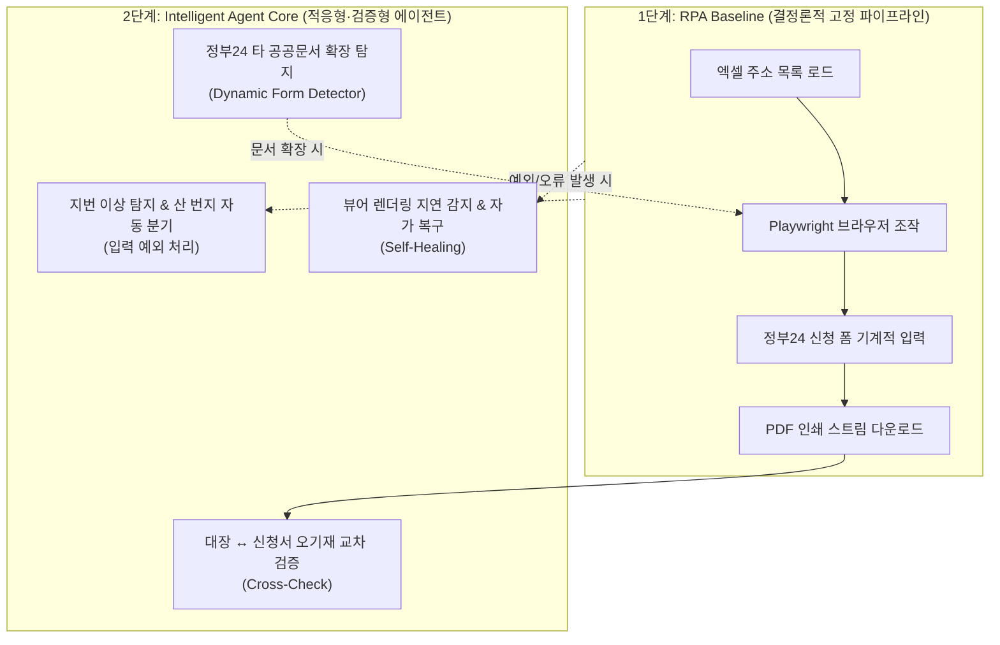

# [기획안 v0.2] 공공사업(도로점용) 인허가용 토지대장·지적도 원본 PDF 발급 자동화 및 패키징 에이전트

- 담당: R04 원민 (프론트엔드 / 사용자 흐름)
- 상태: v0.2 개정안 (팀장 피드백 및 현업 실무자 인터뷰 결과 반영본)
- 작성일: 2026-11-16
- 갱신일: 2026-11-16
- 버전 히스토리:
  - v0.1: 토지대장 중심 기획 초안
  - v0.15: 지적도(임야도) 1:1 페어링 발급 및 기술 검토 반영
  - **v0.2: 현업 인터뷰 기반 수치 보강, 도로점용허가 단일 타겟 한정, 사실/추정 분리, RPA 베이스라인 대비 에이전트 차별화, 단계별 PoC(1건→5건→30건) 로드맵 수립**
- 출처 및 참조 문서:
  - [TASK-019 (R04 기획안 문제 정의 구체화)](../../../artifacts/tasks/TASK-019.json)
  - [2026-11-16 멘토링 문제 정의 피드백 정리](../../../meetings/2026-11-16_멘토링_문제정의_피드백_정리.md)
  - [공공기관 토지대장·지적도 수집 자동화 기술검토 및 세부 해결안 v0.2](2026-11-16_R04_공공서류_수집자동화_기술검토_및_해결안.md)
  - [INTENT (사람 상위 의도)](../../../human/INTENT.md)
  - [CURRENT (프로젝트 현재 기준)](../../../CURRENT.md)

---

## 0. 기획 배경 및 피드백 반영 요약

본 기획안(v0.2)은 멘토 피드백 7대 공통 기준과 팀장 검토 의견, 그리고 **공공 인허가·제안 현업 실무자 인터뷰 결과**를 종합 반영하여 작성되었습니다.

> [!IMPORTANT]
> **v0.2 핵심 보완 사항**:
> 1. **인건비 수치 현실화 및 실무적 어려움 반영**: 근거가 불분명한 고액 인건비 주장을 전면 배제하고, 현업 실무자 의견에 기반하여 하급직원/알바 기준 '건당 20분 × 하루 10건 × 제비용' 산정 시 약 1,500만~2,000만 원 수준의 인건비 손실을 현실적으로 추산함. 더불어 단순 금액 계산만으로는 담을 수 없는 '집중기 업무 마비와 오타 발생에 따른 입찰 탈락 불안' 등 실무 현장의 정성적 고통을 반영함.
> 2. **검증 대상 인허가 특정**: 범용 인허가가 아닌 **「도로법 시행규칙 제26조에 따른 도로점용허가(신고)」** 1종을 첫 번째 검증 대상으로 명확히 좁히고 법적 제출 서류 규격을 확인함.
> 3. **사실(Fact)과 추정(Hypothesis)의 엄격한 분리**: 민간 플랫폼의 원본 미제공 원인, 정부24의 봇 차단 임계치, CDP PrintToPDF의 관공서 인정 여부 등을 검증 전 가설로 분리함.
> 4. **RPA Baseline 대비 에이전트의 당위성 확립**: 단순 반복 매크로는 RPA로 처리하되, **오류 탐지/자가 복구(Self-Healing), 대장-신청서 데이터 교차 검증, 그리고 정부24 내 타 공공문서로의 확장 탐지**에서 에이전트의 필수 역할을 정립함.
> 5. **단계적 Feasibility PoC 로드맵**: 대량 발급 이전에 **1건 정상 발급 PoC → 5건 반복 → 30건 배치** 단계별 검증 파이프라인을 구축함.

---

## 1. Target User & Field Interview (타겟 사용자와 현업 인터뷰)

### 1.1 타겟 사용자 정의
* **누구인가**: 중형 공공토목·도로점용 사업(평균 사업비 약 30억 원 규모)에 입찰 및 인허가 대행을 수행하는 중소 엔지니어링/건설 기업의 **인허가 행정 실무자 및 제안서 작성 담당자**
* **구체적 상황**:
  - 도로공사, 전선·가스관 매설 등 도로점용허가(신고)를 위해 지자체(시·군·구청)에 신청서를 접수할 때, 대상 구간 내 수십 필지의 필수 첨부 서류인 **토지대장과 지적도(임야도) 원본 PDF**를 첨부해야 함.

### 1.2 현업 실무자 인터뷰 결과 요약
* **Q1. 하루 또는 1회 처리 필지 수**:
  - 평시 하루 평균 10건 내외, 수주 및 착공 집중 시기에는 하루 최대 50건까지 발급 처리.
* **Q2. 건당 소요 시간**:
  - 사람이 직접 정부24 사이트에 접속하여 로그인, 본인인증, 폼 입력, 뷰어 대기, 인쇄 저장까지 **1건당 10~20분 소요** (1개소 당 도로점용신고서류 작성 기준).
* **Q3. 자주 발생하는 오류 및 재작업 (가장 큰 고통)**:
  - 사람이 직접 발급받고 엑셀 및 신청서에 데이터를 수기로 입력하다 보니 **오타, 오기, 지번 불일치**가 간헐적으로 발생함.
  - 도로점용 및 입찰 제출 기한이 촉박한 상황에서 정보 불일치로 서류 보완(반려) 요청을 받을 경우, **기업 신뢰도 하락 및 제시간 내 입찰/착공 불가라는 치명적 리스크** 직면.
* **Q4. 사업 및 조직 규모**:
  - 평균 30억 규모 중형사업 기준 입찰 경쟁 시 통상 14개사 참여, 100억대 대형 사업은 약 20개사 참여.
  - 제안서 작성 및 인허가 부수 업무를 포함해 연간 약 3억 원가량의 고정 비용 발생 (제안팀 인력 3명 상주, 외부 전문 디자이너 하청 약 800만 원 등).

---

## 2. Pain Point & Cost Hypothesis (고통과 인건비 손실 가설)

### 2.1 실제 사용자의 핵심 Pain Point
1. **극심한 수기 노동 시간**:
   - 1개소 도로점용 시 20필지만 되어도 (대장 20건 + 지적도 20건 = 총 40건 발급), 건당 15분 소요 시 **단순 서류 발급에만 무려 10시간의 순수 노동**이 투입됨.
2. **사람의 수기 입력으로 인한 정보 불일치 및 입찰 반려 불안**:
   - 지번, 면적, 축척, 소유자 정보를 일일이 눈으로 보고 옮겨 적는 과정에서 발생하는 오기재는 지자체 반려 및 입찰 탈락의 직접적 원인이 됨.
3. **직인 날인 원본 PDF 확보의 제도적 병목**:
   - 관공서는 법적 효력이 있는 공식 관인(직인) 및 16자리 문서확인번호가 인쇄된 PDF를 요구하므로, 외부 텍스트 데이터 서비스가 있어도 결국 사이트 직접 발급을 우회할 수 없음.

### 2.2 인건비 손실 추산 모델 및 단순 계산 불가의 실무적 고통 (현업 실무자 의견 반영)
* **현업 실무자 추산 기준 (하급직원 / 단기 계약직·알바 기준)**:
  - **업무 투입량**: 건당 약 20분 × 하루 평균 10건 = 하루 약 3.3시간(통상 근무 시간의 40% 이상) 소요.
  - **직접 비용 추산**: 이 단순 반복 발급 업무만을 전담 처리하기 위해 하급직원 또는 아르바이트/단기 계약직을 운용할 경우, 급여 및 4대 보험 등 법정 제비용을 포함해 **연간 대략 1,500만 ~ 2,000만 원 수준의 비용이 소모**되는 것으로 산정됨 (인터뷰 실무자 개인 의견).
* **단순 계산만으로는 산정할 수 없는 실무적인 어려움 (정성적 고통)**:
  - **집중기 업무 마비**: 수주 및 착공 집중 시기에는 하루 발급량이 최대 50건(16시간 이상 소요)으로 폭증하여 본업(설계 검토, 제안서 기획 등)이 완전히 마비됨.
  - **인지적 한계와 극심한 피로도**: 모니터를 수백 번 응시하며 수작업으로 지번을 치고, 뷰어를 기다리고, 파일명을 고쳐 쓰는 과정에서 실무자의 정신적 피로와 사기 저하가 극심함.
  - **오타로 인한 입찰 탈락 및 착공 지연 공포**: 수작업 입력 중 단 한 글자의 지번 오타나 정보 불일치가 발생하면, 촉박한 입찰 제출 시한 직전에 지자체 서류 보완/반려 요청이 발생해 수십억 규모 사업의 입찰 자격을 잃거나 사업 착공이 수주 이상 지연되는 치명적인 사업 리스크를 감수해야 함. 이는 단순 인건비 1,500만~2,000만 원을 초월하는 심리적·경영적 고통임.

---

## 3. Scope Narrowing: First Verification Target (첫 검증 대상)

모든 인허가를 포괄하지 않고, 가장 정형화되어 있고 빈도가 높은 단일 인허가로 범위를 특정함.

* **타겟 인허가**: **「도로법 시행규칙 제26조 (도로점용허가의 신청 등)」**
* **지자체 공식 제출 규격**:
  1. 도로점용허가 신청서 (별지 제18호 서식)
  2. 점용장소의 **토지대장** (토지 권리관계 및 지목·면적 증빙)
  3. 점용장소의 **지적도(또는 임야도)** (도로 접면 및 인접 경계 증빙)
  4. 공작물·설계도면 등 (별도 기술도면)
* **검증 범위**: 도로점용 신청서 작성에 필수적인 **[토지대장 1부 + 지적도 1부]의 1:1 세트 자동 발급 및 신청서 데이터 대조 패키징**.

---

## 4. Current Alternatives: Fact vs Hypothesis (기존 대안 분석)

| 비교 대안 | [사실] 해결되는 부분 | [사실] 해결되지 않는 잔여 고통 | [사실 vs 미확인] 유지 이유 분석 |
|---|---|---|---|
| **① 민간 부동산 서비스 (디스코, 밸류맵, 토지e음 등)** | • 필지별 지목, 면적, 공시지가 텍스트 데이터 조회 • 웹 지도상 지적도 시각적 열람 | • **관공서 제출 불가**: 직인 날인 원본 PDF 및 공식 도면 파일 미제공으로 수기 재발급 필수 | • [사실] 서비스 화면상 원본 PDF 다운로드 버튼 없음 • **[미확인 가설]** 대량 다운로드 미제공 원인이 공공 API 정책 때문인지, 개인정보보호 규정 때문인지는 미확인 |
| **② 정부24 직접 수기 발급** | • 관공서 제출 가능한 법적 유효 원본 PDF 발급 | • **시간 소모 및 오기재 리스크**: 1건당 10~20분 소요, 수기 입력 오타 발생, 반복 노무 | • [사실] 사용자 본인인증 및 매크로 방지 보안 체계 적용 중 |
| **③ 행정사 / 외주 대행** | • 내부 직원의 직접적인 수기 발급 노동 해소 | • 필지당 발급 수수료 발생, 1~2일 소요, 급한 입찰 마감 시 대응 불가 | • [사실] 대행 업체 역시 수작업 기반으로 처리하여 건당 비용 청구 |

> **남은 문제(Remaining Pain) 정의**:
> "민간 서비스로 데이터는 볼 수 있으나 관공서 제출용 공식 직인 PDF는 주지 않고, 정부24는 1건당 10~20분의 극심한 수기 노동과 오타 위험이 존재하여, 실무자가 시간 낭비와 입찰 반려 불안을 동시에 겪고 있다."

---

## 5. Problem Statement (문제 정의 한 문장)

> **"도로점용허가 사업을 수행하는 중소 엔지니어링 기업의 인허가 담당자가 관공서 제출용 토지대장·지적도 원본 PDF 세트를 준비할 때, 기존 대안들은 텍스트 데이터만 제공하고 원본 문서를 주지 않아, 결국 정부24에서 건당 10~20분씩 수기로 발급·입력하느라 극심한 시간 소모와 오기재로 인한 입찰 반려 불안을 겪고 있다."**

---

## 6. Solution Architecture: RPA Baseline vs Agent Role (에이전트 차별화)

멘토의 "왜 단순 매크로/RPA가 아니라 에이전트여야 하는가?"라는 질문에 대한 명확한 아키텍처적 해답:

### 6.1 Baseline: 고정 RPA 워크플로우의 한계
* 단순 RPA(Playwright 스크립트)는 성공적인 단일 시나리오(Happy Path)에서는 동작하지만:
  - 주소 체계 불일치(지번 변경, 분할/합병 필지),
  - 산 번지(임야대장) 분기 오류,
  - 정부24 뷰어 로딩 지연에 따른 빈 화면 다운로드,
  - 신청서 텍스트와 대장 간의 오타·오기재 문제를 스스로 해결하지 못함.

### 6.2 Agent가 반드시 필요한 3대 핵심 역할 (Value-Add)
1. **예외 탐지 및 자가 치유 (Self-Healing & Exception Handling)**:
   - 주소 입력 실패나 세션 지연 발생 시 고정 스크립트는 중단되지만, 에이전트는 오류 메시지를 파싱하여 주소 변환(구주소/도로명), 산 번지 자동 전환, 재시도 인터벌 조절을 자율 수행.
2. **신청서 ↔ 발급 문서 간 오기재 교차 검증 (Cross-Validation)**:
   - 인터뷰에서 도출된 최대 고통인 '오타·오기재로 인한 반려'를 해결하기 위해, 에이전트가 발급된 PDF 텍스트를 OCR/파싱하여 **도로점용신고서 초안 데이터와 대장/도면의 소유자·지번·면적이 일치하는지 자동 교차 검증**.
3. **타 공공문서 동적 탐지 및 확장성 (Extensibility)**:
   - 본 시스템은 토지대장·지적도 2종에 고정된 매크로가 아님.
   - 정부24 내 타 공공문서(건축물대장, 토지이용계획확인원 등)나 대법원 인터넷등기소로 확장할 수 있도록, 폼의 입력값(Input)과 출력값(Output)을 탐지하여 발급 워크플로우를 동적으로 구성하는 에이전트 아키텍처 지향.

---

## 7. Painkiller Features (진통제 핵심 기능 3종)

### FEAT-01. [입력 예외 보정 및 대장-지적도 1:1 페어링 큐 생성 에이전트]
* **Target Pain**: 주소 오기재 및 필지별 필요 서류 매칭에 드는 인지·시간 부담 해소.
* **Mechanism**: 엑셀/텍스트 목록 입력 시 PNU 코드를 매핑하고, 일반토지(`토지대장+지적도`)와 산 번지(`임야대장+임야도`)를 자동 판별하여 발급 우선순위 큐 생성.

### FEAT-02. [Human-in-the-Loop 1회 간편인증 연계 무결성 수집 에이전트]
* **Target Pain**: 건당 10~20분 소요되는 수기 인증·발급 반복 노무 제거.
* **Mechanism**: 실무자가 모바일(카카오/PASS 등)로 **최초 1회 인증**을 완료하면, 브라우저 조작 에이전트가 유효 세션을 인계받아 연속 신청. OZ Report 뷰어의 도면 캔버스 렌더링 완료 상태를 확인한 후 CDP PrintToPDF로 공식 문서 가로채기 저장.

### FEAT-03. [대장-신청서 교차 검증 및 지자체 규격 인허가 패키징 에이전트]
* **Target Pain**: 사람의 수기 데이터 입력 오타로 인한 입찰 보완/반려 리스크 방지.
* **Mechanism**: 발급된 PDF의 텍스트를 파싱하여 도로점용신청서와 정보 불일치 여부를 사전 검증하고, 지자체 제출 규격(`[순번]_[지번]_01_토지대장.pdf`, `[순번]_[지번]_02_지적도.pdf`)으로 명명하여 2페이지 병합본 및 원본 ZIP 생성.

---

## 8. Feasibility & Step-by-Step PoC Roadmap (기술적 타당성 및 단계별 로드맵)

### 8.1 기술 상태 명시: [구현안 설계 완료 / PoC 전 단계]
현재 아키텍처는 유효한 오픈소스 기술(Playwright, CDP, PyMuPDF)을 기반으로 정밀 설계되었으나, **실제 정부24 운영 환경에서의 검증 전 가설**들이 존재함.

| 핵심 기술 가설 | 확신 수준 | PoC 검증 계획 |
|---|---|---|
| **1) 세션 유지 및 1회 인증 인계** | 가설 (미검증) | 간편인증 후 브라우저 쿠키/세션이 10분 이상 유지되는지, 세션 연장 팝업 처리가 가능한지 1건 테스트 |
| **2) CAPTCHA 예방 (3~5초 지연)** | 가설 (미검증) | 헤드 모드와 휴먼 딜레이로 봇 차단을 우회할 수 있는지, 일일 몇 건부터 캡차가 발생하는지 한도 테스트 |
| **3) CDP PrintToPDF 결과물의 법적 유효성** | 가설 (미검증) | 브라우저 인쇄 스트림으로 추출한 PDF의 16자리 문서확인번호와 위변조 바코드가 실제 스캐너에서 유효 판정되는지 확인 |
| **4) 지적도 도면 Canvas 렌더링 안정성** | 가설 (미검증) | OZ Report 뷰어의 도면 렌더링 지연 시 빈 화면(Blank PDF) 저장 없이 100% 정상 캡처 가능한지 검증 |

### 8.2 단계별 PoC 로드맵
무모한 대량 발급을 지양하고, 점진적으로 리스크를 검증하는 4단계 파이프라인 수립:

1. **Step 1: 1건 성공 PoC (Day 1~3)**
   - *목표*: 테스트 필지 1건에 대해 사용자가 1회 인증하고, 토지대장·지적도 1세트를 자동으로 발급받아 공식 문서확인번호가 포함된 PDF로 정상 저장되는지 확인.
2. **Step 2: 5건 연속 반복 검증 (Day 4~7)**
   - *목표*: 5개 필지(일반 4, 산 번지 1)를 연속 발급하며 세션 끊김 여부, 딜레이 적절성, 산 번지 분기 로직 검증.
3. **Step 3: 30건 배치 및 예외 복구 검증 (Week 2)**
   - *목표*: 실무 현업 수준인 30건 배치 처리. CAPTCHA 발생 시점 파악, 오류 필지 발생 시 자가 복구 에이전트 동작 및 교차 검증 테스트.
4. **Step 4: 8주 MVP 통합 패키징 (Week 3~8)**
   - *목표*: 도로점용신청서 결합, [순번]_[지번] 자동 명명, PDF 병합, ZIP 다운로드 웹 UI 완성.

---

## 9. 멘토 3분 피칭 가이드 (v0.2 대응)

1. **Who (타겟)**: 평균 30억 규모 도로점용 공공사업에 참여하는 중소 엔지니어링 기업 인허가 실무자.
2. **Pain (고통)**: 하루 10~50건씩 요구되는 토지대장·지적도를 손으로 발급하느라 **건당 10~20분의 시간**이 소모되며, 알바/하급직원 기준 **연간 약 1,500만~2,000만 원의 인건비 및 제비용이 낭비**됨. 더 치명적인 것은 수기 입력 과정의 **오타·정보 불일치로 입찰 서류가 반려되어 수십억 사업 기회를 날릴 위험**이라는 실무적 공포가 실재함.
3. **Remaining Pain (기존 대안 한계)**: 민간 플랫폼은 데이터만 줄 뿐 직인 원본 PDF를 주지 못하고, 정부24는 극심한 수기 노동과 오타 위험을 방치함.
4. **Solution (해결책)**: 1회 간편인증 연계 RPA 베이스라인 위에, **[오류 자가 복구 + 대장/신청서 오타 교차 검증 + 타 공공문서 확장 탐지]를 수행하는 지능형 에이전트** 결합.
5. **Feasibility (타당성)**: 전면 자동화 환상을 배제하고, **1건 Feasibility PoC부터 시작해 5건 → 30건으로 점진 검증**하는 안정적 로드맵으로 8주 내 구현 완료.
