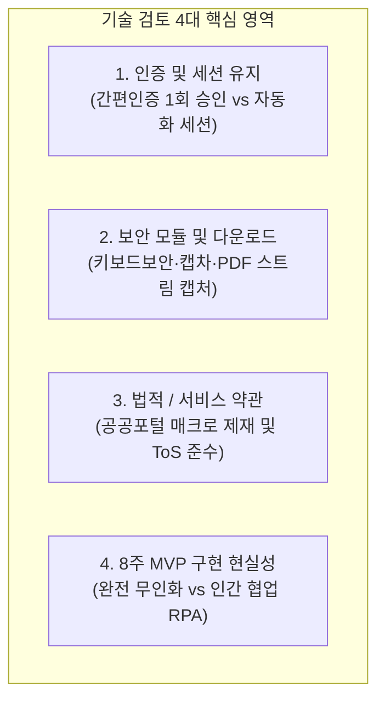

# [기획안] 공공사업 인허가용 토지대장·공공서류 PDF 자동 발급 및 패키징 멀티에이전트

- 담당: R04 원민 (프론트엔드 / 사용자 흐름)
- 상태: 초안 (2026-11-16 멘토링 피드백 공통 기준 반영 및 기술 검토 포함)
- 작성일: 2026-11-16
- 갱신일: 2026-11-16
- 출처 및 참조 문서:
  - [TASK-019 (R04 기획안 문제 정의 구체화)](../../../artifacts/tasks/TASK-019.json)
  - [2026-11-16 멘토링 문제 정의 피드백 정리](../../../meetings/2026-11-16_멘토링_문제정의_피드백_정리.md)
  - [INTENT (사람 상위 의도)](../../../human/INTENT.md)
  - [CURRENT (프로젝트 현재 기준)](../../../CURRENT.md)

---

## 0. 기획 배경 및 멘토 피드백 반영 원칙

2026-11-16 멘토 피드백의 공통 기준(7대 질문)에 따라, 단순한 "웹 크롤링/AI 기술 적용"이라는 기술 중심 접근을 철저히 배제하고, **실제 현업 사용자의 구체적 고통(Pain Point), 기존 대안으로 해결되는 부분과 남는 문제(Remaining Pain), 이를 직접 해소하는 진통제 기능(Painkiller Features), 그리고 기술적 실현 가능성 및 한계(Technical Feasibility & Risks)**를 면밀히 분석하여 구성함.

---

## 1. Target User (타겟 사용자)

* **정의**: **도로점용·공공토목·인허가 대행·토지개발 등 공공 인허가 사업을 수행하는 중소 엔지니어링/건설 기업의 인허가 행정 실무자 (또는 사업기획팀 담당자)**
* **구체적 상황**:
  - 도로공사, 관로 매설, 도로점용허가, 개발행위허가 등 공공기관에 사업 신청서를 제출할 때, 사업 대상 구간에 포함된 **수십~수백 개 필지의 '토지대장', '지적도', '토지이용계획확인원' 원본 PDF**를 의무 첨부 서류로 제출해야 함.
* **현재 행동 (Workaround)**:
  - 부동산 정보 서비스(디스코, 밸류맵, 토지e음 등)로 지번 목록을 확보한 뒤,
  - 실무자가 정부24 또는 일사편리(부동산통합민원) 웹사이트에 직접 접속하여,
  - 간편인증/공동인증서로 로그인 후 필지별로 건건이 민원 신청 → 발급 대기 → PDF 열람 및 수동 인쇄(다운로드) → 파일명 수정(`00동_00번지_토지대장.pdf`) → 폴더 정리를 수작업으로 반복함.

---

## 2. Pain Point (실제 사용자의 구체적 고통)

단순한 "일이 번거롭다"는 역량 부족이나 현상이 아니라, **시간, 비용, 불안, 인력 낭비**라는 실질적이고 구체적인 고통이 발생함.

1. **막대한 전담 인건비 소모 (비용 고통)**:
   - 사업 대상 필지가 많은 프로젝트(수십~수백 필지)의 경우 1개 프로젝트당 며칠 동안 하루 종일 단순 발급·저장 업무만 수행해야 함.
   - 중소기업 현장에서는 이 단순 반복 발급·문서 정리만을 전담하는 계약직 또는 보조 인력을 상시 운용하며, **매년 약 5,000만 ~ 6,000만 원의 인건비가 고정적으로 발생**함.
2. **데이터는 주는데 원본 문서는 안 주는 딜레마 (구조적 장애)**:
   - 현재 민간 발급대행사나 부동산 정보 서비스는 API나 엑셀 다운로드로 "토지 소유자/면적/지목 텍스트 데이터"는 제공하지만, **관공서 접수에 필수적인 '공식 직인 및 문서확인번호가 포함된 PDF 원본 공문서'는 제공하지 못함**.
   - 결국 데이터가 있어도 서류 제출을 위해 다시 정부24 사이트에 들어가 1건씩 수기로 발급받아야 함.
3. **인허가 접수 마감 직전의 누락 및 지연 불안 (심리적/사업적 리스크)**:
   - 100개 필지 중 단 1~2개 필지의 토지대장 누락이나 발급일자 오류 발생 시 지자체(시·군·구청) 도로과로부터 서류 보완 요청(반려)을 받아 사업 착공 일정이 수주~수개월 지연되는 치명적 손실 발생.

---

## 3. Current Alternative & Remaining Pain (기존 대안과 남는 문제)

### 3.1 기존 대안별 분석

| 비교 대안 | 해결되는 부분 (장점) | 대안이 현재 방식을 유지하는 이유 | 해결되지 않는 잔여 고통 (Remaining Pain) |
|---|---|---|---|
| **① 민간 부동산 정보 서비스 (디스코, 밸류맵, 토지e음 등)** | • 필지별 소유자·지목·공시지가 텍스트 데이터 일괄 열람 가능 • 지적도 지도 시각화 확인 | • 공공기관 원본 문서는 개인정보보호 및 공문서 위변조 방지 규정상 민간 API에 원본 PDF 대량 다운로드 엔드포인트를 제공하지 않음 | • **관공서 제출 불가**: 관공서는 관인(직인) 및 문서확인번호가 인쇄된 공식 PDF 원본만 인정하므로 결국 수기 재발급 필수 |
| **② 정부24 / 일사편리 직접 수기 발급** | • 법적 효력이 완전한 공식 원본 PDF 발급 가능 • 무료 또는 소액 수수료로 합법 발급 | • 매크로 방지, 보안 프로그램(AnySign, 위변조방지), 본인인증 강제로 대량 발급 자동화 차단 | • **극심한 시간 소모 & 인건비 낭비**: 필지 100건 발급 시 100번의 클릭·대기·저장 반복. 연간 5~6천만원 인력 낭비 |
| **③ 행정사 / 등기 발급 대행 외주** | • 기업 실무자의 직접적인 수기 노동 부담 해소 | • 외주 인력 역시 사람 손으로 하나씩 떼기 때문에 건당 수수료와 인건비 마진을 청구함 | • **건당 비용 부담**: 필지당 수천~수만 원 수수료 발생, 100필지 시 수십~백만 원 단위 지출. 긴 리드타임(1~2일 소요) |

### 3.2 잔여 페인포인트 (Remaining Pain 요약)
> **"데이터 조회는 민간 서비스로 해결되었으나, 관공서 제출용 '공식 PDF 원본 서류'는 오직 정부24 등 공공포털의 보안·인증 장벽 뒤에 갇혀 있어, 기업이 매년 5~6천만 원의 인건비를 들여 사람 손으로 1건씩 직접 떼어야만 하는 잔여 고통이 남아 있다."**

---

## 4. Problem Statement (문제 정의 한 문장)

> **"공공사업(도로점용 등)을 수행하는 중소 엔지니어링 기업의 인허가 담당자가 관공서 제출용 토지대장 원본 PDF를 대량 첨부해야 할 때, 기존 대안들은 텍스트 데이터만 제공하고 원본 문서를 주지 않아, 결국 정부24 등 공공포털에 직접 로그인해 건건이 수기로 발급·정리하느라 연간 5~6천만 원의 인건비 낭비와 접수 지연 불안을 겪고 있다."**

---

## 5. Painkiller Features (진통제 핵심 기능 3가지)

기술 그 자체가 아니라, 사용자의 고통(수기 반복 발급, 인건비 소모, 서류 누락)을 직접 줄이는 3대 핵심 기능:

### ① [필지 목록 기반 필수 인허가 서류 자동 매핑 및 신청 에이전트]
* **해결하는 고통**: 인허가 서식별로 어떤 서류가 몇 장 필요한지 일일이 대조하는 인지 부담 및 누락 방지.
* **동작**: 사용자가 사업 대상 필지 엑셀/텍스트(예: "서울시 OO구 OO동 산 12-1 외 35필지") 및 신청 유형(도로점용)을 입력하면, 에이전트가 필요한 공공 서류(토지대장, 지적도, 토지이용계획원 등) 발급 목록 큐(Queue)를 자동 생성.

### ② [Human-in-the-Loop 1회 인증 연계 및 원본 PDF 일괄 수집 에이전트]
* **해결하는 고통**: 필지마다 매번 본인인증/클릭을 반복해야 하는 5~6천만 원 규모의 단순 노무 인건비 제거.
* **동작**: 실무자가 스마트폰 간편인증(카카오/PASS 등)을 **최초 1회만 승인**하면, 브라우저 조작 에이전트가 유효 세션 내에서 정부24/일사편리 민원 신청을 연속 실행하고, 공식 직인이 포함된 원본 PDF 인쇄 스트림을 가로채어 로컬에 안전하게 자동 저장.

### ③ [인허가 제출 규격 자동 명명·검증 및 초안 패키징 에이전트]
* **해결하는 고통**: 다운로드된 난수형 파일명을 수작업으로 지번과 대조해 바꾸고 결합하는 작업 시간(반나절) 단축.
* **동작**: 수집된 PDF 내의 지번, 소유자명, 발급번호, 직인 정상 여부를 OCR/텍스트 파싱으로 검증하고, 지자체 인허가 규격(`[순번]_[지번]_[서류종류].pdf`)으로 자동 리네이밍 후 도로점용신청서 초안과 함께 제출용 ZIP 압축 패키지로 생성.

---

## 6. 면밀한 기술 검토 및 위험 분석 (Technical Feasibility & Risks)

공공기관 사이트 연계 및 PDF 수집 자동화는 기술적·법적 장벽이 높으므로 다음 4대 영역에 대한 면밀한 검토가 필수적임.

### 6.1 인증 및 세션 유지 (Authentication & Session)
* **현실적 장벽**: 정부24는 무인 API를 제공하지 않으며, 주기적으로 간편인증/공동인증 재확인을 요구함.
* **기술적 해결안 (Human-in-the-Loop)**:
  - 에이전트가 Headed 브라우저(Playwright 등)를 기동하여 정부24 로그인 페이지로 진입하고, 사용자의 모바일로 간편인증 푸시를 전송.
  - 사용자가 휴대폰에서 1회 인증(PIN/지문)을 완료하면, 에이전트가 활성화된 세션 쿠키(Session Token)를 인계받아 브라우저 컨텍스트 내에서 대량 발급 루프를 수행.
  - 세션 만료 시간(보통 10~30분) 내에 처리할 수 있도록 30~50건 단위 배치(Batch) 처리 구조 설계.

### 6.2 보안 모듈 및 공식 PDF 인쇄 캡처 (Anti-Bot & PDF Export)
* **현실적 장벽**:
  - 정부24는 Non-ActiveX 보안 프로그램(TouchEn nxKey, AnySign4PC, MarkAny 등)과 캡차(보안문자)가 적용될 수 있음.
  - 일반 웹 크롤링(curl, requests, Puppeteer headless)은 보안 모듈 미실행으로 페이지 진입이 원천 차단됨.
* **기술적 해결안**:
  - **Headed 브라우저 기반 RPA 에이전트**: 사용자의 로컬 OS 환경(Chrome/Edge)에서 실행되는 Headed 브라우저를 제어하여 보안 모듈이 정상 로드된 상태를 유지.
  - **가상 프린터 / CDP(Chrome DevTools Protocol) PrintToPDF 활용**: 민원신청 완료 후 '문서출력' 팝업에서 인쇄창이 호출될 때, CDP의 `Page.printToPDF` 또는 OS 레벨 가상 프린터 드라이버를 통해 공식 직인이 렌더링된 고화질 PDF 벡터 스트림을 직접 저장.
  - **캡차 발생 시 처리**: AI 윤리 및 시스템 가이드라인에 따라 캡차 우회 도구를 사용하지 않으며, 캡차 출현 시 사용자에게 1회 입력을 요청하는 상호작용 인터페이스 구현.

### 6.3 법적 적법성 및 이용약관 (Legal & Compliance)
* **검토 사항**:
  - 타인의 명의나 부정한 방법으로 공공데이터를 긁어오는 것은 전자정부법 및 정보통신망법 위반 소지가 있음.
  - 그러나 본 시스템은 **"정당한 인허가 신청 권한을 가진 기업 실무자 본인이 자신의 인증서로 위임받은 업무를 수행하는 Personal Copilot(업무 보조 도구)"**의 성격을 가짐.
  - 불특정 다수의 대량 스크래핑이 아니라, 사용자가 직접 신청하는 민원 업무의 브라우저 클릭 자동화에 해당함.

### 6.4 8주 MVP 구현 실현 가능성 (Feasibility Roadmap)
* **위험**: 8주 내에 정부24의 모든 보안/인쇄 변수를 100% 무인 자동화하는 것은 구현 위험이 매우 큼.
* **현실적 MVP 스코프 제안**:
  1. **Phase 1 (MVP)**:
     - 국가공간정보포털/공공데이터포털 Open API를 통한 필지 메타데이터(소유자 지목 등) 선검증.
     - 정부24 '토지대장' 1개 민원 서비스에 집중한 Headed 브라우저 1회 간편인증 연계 발급 자동화 프로토타입.
     - 다운로드된 PDF의 자동 검증 및 도로점용신청서 폴더 패키징.
  2. **Phase 2 (확장)**:
     - 일사편리, 세움터 등 지적도/건축물대장으로 대상 공공포털 확대.

---

## 7. Evidence / Unknowns (근거와 미확인 사항)

### 7.1 확인된 사실 (Evidence)
* 도로점용허가, 개발행위허가 등 공공사업 신청 시 토지대장 원본 첨부는 법적 의무 사항임.
* 민간 부동산 플랫폼(디스코 등)은 데이터 조회만 가능하며 관공서 제출용 직인 날인 원본 PDF를 제공하지 않음.
* 중소기업 현장에서 수기 발급 전담 인력 운영으로 연간 5~6천만 원의 인건비가 실제로 소모되고 있음.

### 7.2 아직 검증되지 않은 미확인 가설 (Unknowns)
* 정부24의 최신 보안 패치 주기와 브라우저 자동화 툴(Playwright) 간의 호환성 유지 비용.
* 지자체별로 토지대장 외에 요구하는 첨부서류(등기부등본, 지적도 등)의 우선순위 비중.
* 공공사업 중소기업 1개사당 월평균 토지대장 발급 건수 및 지불 용의 금액(SaaS 구독 모델 수용성).

---

## 8. 결론 및 멘토 피드백 대응 요약 (3분 피칭 가이드)

1. **Who**: 공공사업(도로점용 등) 인허가를 진행하는 중소 엔지니어링 기업.
2. **What Pain**: 데이터는 대행사로 보지만, 관공서 제출용 "원본 PDF"는 결국 정부24에서 손으로 1장씩 떼느라 **연간 5~6천만 원의 인건비**를 낭비하고 있음.
3. **Why Alternative Fails**: 민간 앱은 데이터만 줄 뿐 공문서 직인이 없고, 정부24는 인증/보안 장벽 때문에 대량 다운로드를 막아둠.
4. **Our Solution**: 실무자의 1회 간편인증과 결합한 **인허가 공공서류 자동 발급 & 패키징 멀티에이전트**.
5. **Feasibility**: 불법 해킹이나 무리한 크롤링이 아닌, 사용자 권한 기반의 Headed 브라우저 조작 및 인쇄 스트림 캡처로 8주 내 실현 가능한 안전한 자동화 구현.
