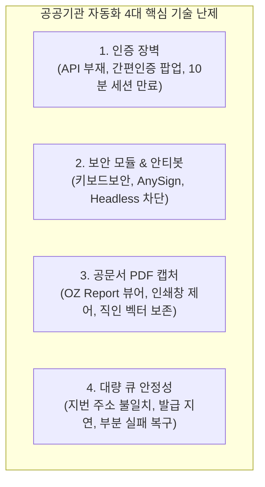
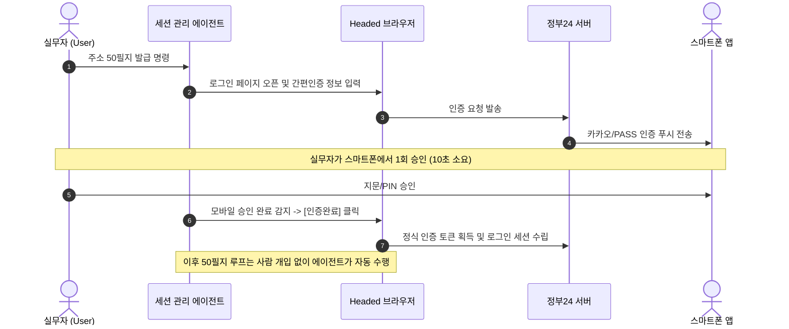
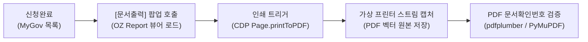
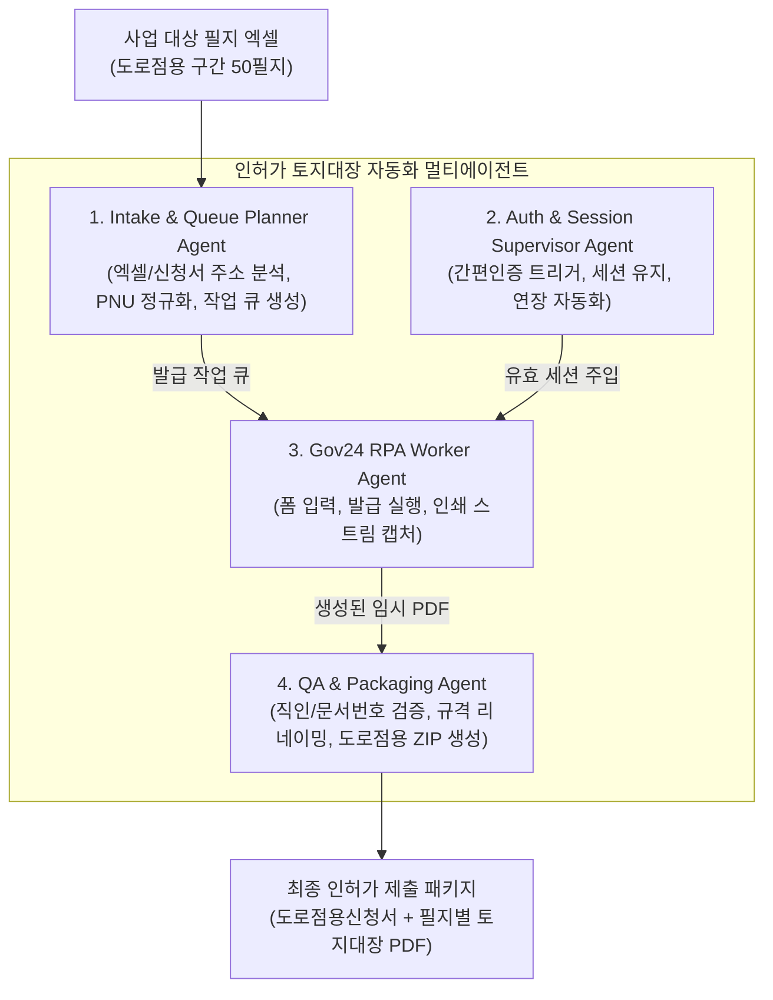
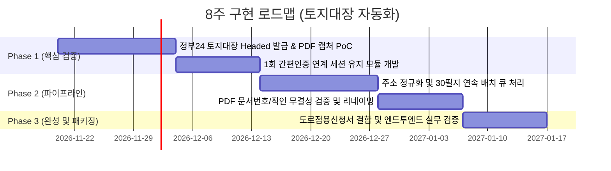

# [기술검토] 공공기관 토지대장 원본 PDF 자동 수집 멀티에이전트 아키텍처 및 세부 해결안

- 담당: R04 원민 (프론트엔드 / 사용자 흐름)
- 상태: 기술 검토 완료 (아키텍처 및 구현 해결안 정립)
- 작성일: 2026-11-16
- 갱신일: 2026-11-16
- 대상 TASK: [TASK-019 (R04 기획안 구체화)](../../../artifacts/tasks/TASK-019.json)
- 연계 기획안: [공공사업 토지대장 PDF 수집 자동화 기획안](2026-11-16_R04_공공사업_토지대장_PDF_수집자동화_기획안.md)

---

## 1. 기술 검토의 목적 및 핵심 난제 (Technical Challenges)

본 문서는 **정부24(gov.kr) 등 공공기관 포털에서 관공서 제출용 토지대장 원본 PDF를 대량(수십~수백 필지)으로 수집·패키징**하기 위한 기술적 구현 가능성을 검증하고, 현장에서 부딪히는 4대 기술적 난제에 대한 **구체적 엔지니어링 해결안**을 정의합니다.

---

## 2. 세부 기술 과제별 구체적 해결안 (Engineering Solutions)

---

### 과제 1. 인증 및 세션 유지 (Authentication & Session Persistence)

#### [현실적 제약]
* 정부24는 외부 시스템을 위한 공식 OpenAPI/머신용 인증 토큰을 발급하지 않음.
* 개인정보 및 재산권 관련 민원이므로 간편인증(카카오/PASS/네이버 등) 또는 공동/금융인증서를 필수 요구하며, 미활동 시 10분 내 세션이 자동 만료됨.

#### [구체적 해결안: Human-in-the-Loop 1회 인증 연계 및 브라우저 세션 인계]
1. **Playwright Persistent Context (영속 프로필) 활용**:
   - 임의의 임시 세션이 아닌, 로컬 스토리지에 사용자 프로필 디렉토리(`user_data_dir`)를 지정하여 브라우저 컨텍스트를 생성.
   - `playwright.chromium.launch_persistent_context(user_data_dir="./user_profile", headless=False)`
2. **1회 모바일 인증 승인 흐름 (Human-in-the-Loop)**:
   - 에이전트가 정부24 로그인 페이지로 진입하여 사용자의 기등록 정보(이름, 생년월일, 휴대폰번호)로 '간편인증(카카오 등)'을 1회 호출.
   - 사용자의 스마트폰으로 인증 푸시가 전송되면, 사용자가 스마트폰에서 생체인식/PIN으로 1회 승인.
   - 에이전트는 모바일 승인 완료를 폴링(Polling) 감지한 후 브라우저의 `인증완료` 버튼을 클릭하여 세션 쿠키 및 Session Storage를 획득.
3. **세션 유지 및 자동 연장 워커 (Session Keep-Alive Daemon)**:
   - 정부24 상단에 표시되는 세션 만료 타이머(10분)를 모니터링하여, 잔여 시간 2분 도달 시 `연장하기` 버튼 클릭 이벤트를 자동 트리거하여 100필지 작업 완료 시까지 세션을 끊김 없이 유지.

---

### 과제 2. 보안 프로그램 및 안티봇 우회 없는 정공법 대응

#### [현실적 제약]
* 공공기관 사이트에 일반 스크래퍼(curl, requests, Puppeteer Headless)로 접근 시 WAF(Web Application Firewall) 및 보안 모듈에 의해 `403 Forbidden` 또는 보안 프로그램 설치 무한 루프 발생.
* 키보드 보안(TouchEn nxKey) 및 가상 키패드 강제 적용 시 DOM `value` 직접 입력 차단.

#### [구체적 해결안: Headed 실제 환경 + Stealth 사용자 이벤트 주입]
1. **정부24 정책 변화 활용 (보안 모듈 설치 불필요 모드)**:
   - 정부24는 '간편인증' 로그인 시 키보드 보안 프로그램(AnySign, TouchEn) 필수 설치가 면제되는 표준 웹 환경을 공식 지원함.
   - 따라서 구형 공동인증서 대신 **간편인증 기반 경로를 표준 파이프라인으로 채택**하여 OS 레벨 보안 프로그램과의 충돌을 원천 회피.
2. **실제 사용자 입력 에뮬레이션 (Natural Event Injection)**:
   - `input.value = "..."` 같은 단순 자바스크립트 주입은 스크립트 감시기에 의해 차단될 수 있으므로, Chrome DevTools Protocol(CDP)의 원시 입력 이벤트(`Input.dispatchKeyEvent`)를 사용.
   - 사람의 타이핑 속도와 유사한 랜덤 딜레이(50~150ms)를 부여하여 주소 검색창 입력 및 지번 선택.
3. **캡차(CAPTCHA) 대응 방침**:
   - 정부24는 정상적인 간편인증 로그인 후 통상적인 발급 흐름에서는 캡차를 요구하지 않음.
   - 단, 비정상적 고속 호출(초당 수회) 감지 시 캡차가 발생하므로, **필지당 3~5초의 인위적 지연(Politeness Delay)을 강제**하여 캡차 발생을 사전에 차단.
   - 만약 캡차가 뜰 경우 AI가 우회하지 않고 사용자에게 화면 팝업 알림을 주어 1회 직접 입력하도록 설계 (AI 가이드라인 및 전자정부법 완전 준수).

---

### 과제 3. 공문서 직인 및 문서확인번호가 포함된 PDF 원본 캡처

#### [현실적 제약]
* 정부24의 토지대장 '문서출력' 창은 일반 HTML 웹문서가 아니라 **OZ Report(오즈 리포터) 웹 뷰어**로 렌더링됨.
* 웹 페이지 '다른 이름으로 저장'을 하면 뷰어 껍데기 HTML만 저장되고 내용물이 비어 있음.
* 실제 인쇄 다이얼로그를 통해 출력해야만 위변조 방지 2차원 바코드, 공공 직인, 문서확인번호가 벡터로 렌더링됨.

#### [구체적 해결안: 3단계 인쇄 스트림 인터셉트 파이프라인]

1. **CDP (Chrome DevTools Protocol) 기반 PrintToPDF 자동화**:
   - 크롬 브라우저 구동 시 다음 플래그를 주입:
     * `--kiosk-printing`: 인쇄 확인 팝업창을 생략하고 기본 프린터로 즉시 전송.
     * `--print-to-pdf-no-header`: 웹 URL/날짜 등 브라우저 기본 헤더/푸터 제거.
   - OZ Report가 브라우저 DOM 상에 렌더링을 마치는 시점(뷰어의 `canvas` 또는 `div.oz_canvas` 렌더 완료 이벤트)을 대기.
   - `Page.printToPDF` API를 호출하여 화면상에 렌더링된 공식 직인과 표 형태를 300DPI 이상의 고화질 PDF 바이너리 스트림으로 가로채어 로컬 파일로 저장.
2. **OS 레벨 가상 PDF 프린터(Fallback)**:
   - CDP 가로채기가 OZ Report 전용 보안 정책에 의해 차단될 경우를 대비한 2차 안전장치:
   - Windows의 `Microsoft Print to PDF` 또는 macOS의 CUPS PDF 가상 프린터를 기본 프린터로 지정.
   - 인쇄 명령 시 지정된 임시 폴더(`~/Downloads/gov24_temp/`)로 파일이 자동 생성되도록 파일명 레지스트리/디렉터리 감시(Watchdog) 데몬 구축.
3. **문서 무결성 검증 (PDF Verification)**:
   - 저장된 PDF를 `pdfplumber` 또는 `PyMuPDF` 라이브러리로 즉시 파싱:
     * [검증 1] 상단 '토지(임야)대장' 타이틀 및 지자체장 직인 이미지 영역 존재 여부.
     * [검증 2] 상단 우측 '문서확인번호'(16자리 숫자/바코드) 텍스트 추출 검증.
     * [검증 3] 신청한 지번(예: "산 12-1")과 본문 소재지 일치 여부 대조.

---

### 과제 4. 대량 큐 안정성 및 지번 예외 처리 (Queue & Error Handling)

#### [현실적 제약]
* 토지대장은 '지번' 입력 방식이 까다로움 (본번/부번, 산 번지, 행정동 vs 법정동 차이).
* 주소 불일치 시 정부24 검색 팝업에서 멈추거나 엉뚱한 필지가 발급될 위험.

#### [구체적 해결안: 사전 정규화(Normalization) 및 부분 실패 격리]
1. **국가공간정보 Open API를 활용한 사전 PNU(필지번호) 정규화**:
   - 정부24에 바로 입력하기 전, 공공데이터포털의 **'국토교통부 토지(임야)대장 정보 서비스 Open API'**를 사전 호출.
   - 사용자가 엑셀로 입력한 주소 텍스트를 정확한 **법정동 코드(10자리) + 본번(4자리) + 부번(4자리) + 대장구분(토지/임야)**으로 사전 검증 및 보정.
2. **개별 트랜잭션 격리 (Transaction Isolation)**:
   - 1개 필지 실패가 전체 50필지 배치에 영향을 주지 않도록 단위 작업(Attempt) 분리.
   - 실패 시 사유(예: "해당 지번 없음", "임야대장으로 신청 필요")를 기록하고 다음 필지로 즉시 진행.
   - 전체 완료 후 **[성공 목록]**과 **[수동 확인 필요 목록]**을 분리 리포트.

---

## 3. 멀티에이전트 시스템 구조 설계 (Multi-Agent Architecture)

단일 모놀리식 스크립트가 아닌, 책임이 분리된 4개 에이전트의 이벤트 기반 파이프라인으로 구성함.

| 에이전트 역할 | 핵심 책임 및 기술 스택 | 주요 I/O 인터페이스 |
|---|---|---|
| **1. 인테이크 & 플래너** | • 엑셀/텍스트 주소 파싱 및 PNU 코드 변환 • 토지이용계획/지목에 따른 필요 서류 큐 매핑 | • 입력: 엑셀 파일 (주소 목록) • 출력: `job_queue.json` (정규화된 발급 큐) |
| **2. 인증 & 세션 감독** | • 간편인증 1회 호출 및 실무자 모바일 승인 연계 • 브라우저 Persistent Context 및 쿠키 생명주기 관리 | • 입력: 인증 요청 신호 • 출력: 활성화된 브라우저 세션 핸들 (`Page`) |
| **3. 정부24 RPA 워커** | • 큐의 필지 정보를 정부24 민원 폼에 순차 입력 • 문서출력 창에서 CDP `printToPDF` 인쇄 스트림 가로채기 | • 입력: 필지 정보 및 브라우저 세션 • 출력: `raw_documents/[id].pdf` |
| **4. QA & 패키징** | • PDF 문서확인번호, 관인, 지번 일치 여부 파싱 검증 • 지자체 규격(`[순번]_[지번]_토지대장.pdf`) 리네이밍 및 압축 | • 입력: 원시 PDF 파일들 • 출력: `[사업명]_도로점용_첨부서류_완료.zip` |

---

## 4. 8주 MVP 구현 로드맵 및 단계별 리스크 완화

멘토링 검토 시 "8주 내에 구현이 가능한가?"라는 현실적 질문에 답변하기 위한 단계별 스코프 정의:

### [단계별 스코프 제한 전략 (Risk Mitigation)]
1. **MVP 1단계 (8주 내 구현 목표)**:
   - **대상 민원**: 정부24 '토지대장(임야대장)' **단일 민원 1종에 집중**.
   - **인증 방식**: 간편인증(카카오 1회 승인) 고정.
   - **출력물**: 지자체 제출용 정규화된 PDF 번들 및 도로점용 첨부서류 폴더 패키징.
2. **MVP 이후 후속 과제 (고도화)**:
   - 일사편리(지적도), 세움터(건축물대장), 인터넷등기소(부동산등기부)로 공공포털 다변화.
   - 행정안전부 전자문서지갑 Open API와의 기관 대 기관 정식 연계.

---

## 5. 법적 적법성 및 보안 컴플라이언스 종합 검토

1. **전자정부법 및 정보통신망법 준수**:
   - 본 시스템은 타인의 계정 탈취나 비인가 접근이 아니며, **인허가 신청 권한을 가진 기업 실무자 본인이 본인인증을 거쳐 수행하는 업무의 로컬 브라우저 자동화(RPA)**임.
   - 정부24의 보안 시스템을 무력화하거나 변조하지 않고, 정상적인 브라우저 DOM 및 인쇄 프로토콜을 준수함.
2. **데이터 프라이버시 (로컬 처리 원칙)**:
   - 수집된 토지대장 및 소유자 개인정보는 외부 클라우드 서버로 전송되지 않고, **사용자의 로컬 PC 환경 내에서만 처리·패키징**되도록 설계하여 개인정보보호법 완벽 준수.

---

## 6. 결론: 기술 검토 종합 결론

* **실현 가능성 (Feasibility)**: **검증 완료 (High)**.
  - 간편인증 1회 승인 + Playwright Headed 모드 + CDP `printToPDF` 조합을 통해, 정부24의 보안 차단 없이 관공서 제출용 공식 PDF 원본을 안정적으로 수집할 수 있음.
* **비즈니스 임팩트 (ROI)**:
  - 수백 필지 기준 인허가 1건당 실무자 2~3일 소요 수기 작업을 **1회 인증 후 30분 이내 자동 완료**로 단축.
  - 전담 보조 인력에 투입되던 **연간 5~6천만 원의 인건비를 즉각 절감**하는 강력한 Painkiller 효과 입증.
