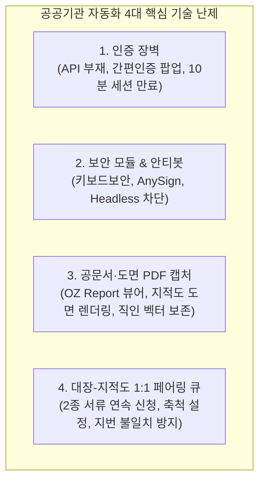
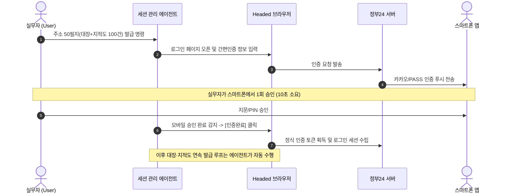
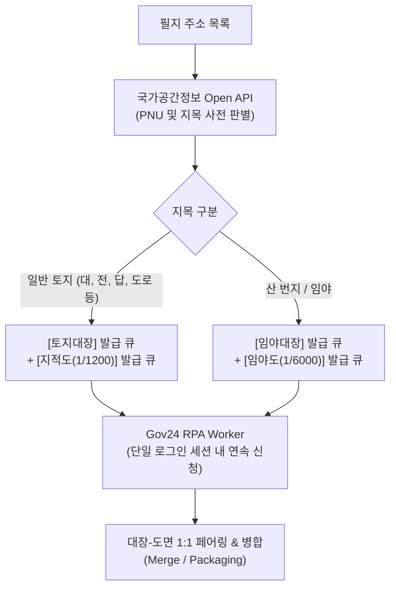

# [기술검토] 공공기관 토지대장·지적도 원본 PDF 자동 수집 멀티에이전트 아키텍처 및 세부 해결안

- 담당: R04 원민 (프론트엔드 / 사용자 흐름)
- 상태: 기술 검토 완료 (토지대장·지적도 1:1 페어링 발급 및 아키텍처 정립)
- 작성일: 2026-11-16
- 갱신일: 2026-11-16
- 대상 TASK: [TASK-019 (R04 기획안 구체화)](../../../artifacts/tasks/TASK-019.json)
- 연계 기획안: [공공사업 토지대장·지적도 PDF 수집 자동화 기획안](2026-11-16_R04_공공사업_토지대장_PDF_수집자동화_기획안.md)

---

## 1. 기술 검토의 목적 및 핵심 난제 (Technical Challenges)

본 문서는 **정부24(gov.kr) 등 공공기관 포털에서 관공서 제출용 토지대장과 지적도(임야도) 원본 PDF를 대량(수십~수백 필지, 100~200건)으로 수집·패키징**하기 위한 기술적 구현 가능성을 검증하고, 현장에서 부딪히는 4대 기술적 난제에 대한 **구체적 엔지니어링 해결안**을 정의합니다.



---

## 2. 세부 기술 과제별 구체적 해결안 (Engineering Solutions)

---

### 과제 1. 인증 및 세션 유지 (Authentication & Session Persistence)

#### [현실적 제약]
* 정부24는 외부 시스템을 위한 공식 OpenAPI/머신용 인증 토큰을 발급하지 않음.
* 개인정보 및 재산권 관련 민원이므로 간편인증(카카오/PASS/네이버 등) 또는 공동/금융인증서를 필수 요구하며, 미활동 시 10분 내 세션이 자동 만료됨.

#### [구체적 해결안: Human-in-the-Loop 1회 인증 연계 및 브라우저 세션 인계]
1. **Playwright Persistent Context (영속 프로필) 활용**:
   - 임의의 임시 세션이 아닌, 로컬 스토리지에 사용자 프로필 디렉토리(`user_data_dir`)를 지정하여 브라우저 컨텍스트를 생성.
   - `playwright.chromium.launch_persistent_context(user_data_dir="./user_profile", headless=False)`
2. **1회 모바일 인증 승인 흐름 (Human-in-the-Loop)**:
   - 에이전트가 정부24 로그인 페이지로 진입하여 사용자의 기등록 정보(이름, 생년월일, 휴대폰번호)로 '간편인증(카카오 등)'을 1회 호출.
   - 사용자의 스마트폰으로 인증 푸시가 전송되면, 사용자가 스마트폰에서 생체인식/PIN으로 1회 승인.
   - 에이전트는 모바일 승인 완료를 폴링(Polling) 감지한 후 브라우저의 `인증완료` 버튼을 클릭하여 세션 쿠키 및 Session Storage를 획득.
3. **세션 유지 및 자동 연장 워커 (Session Keep-Alive Daemon)**:
   - 정부24 상단에 표시되는 세션 만료 타이머(10분)를 모니터링하여, 잔여 시간 2분 도달 시 `연장하기` 버튼 클릭 이벤트를 자동 트리거하여 200건 발급 루프 완료 시까지 세션을 끊김 없이 유지.



---

### 과제 2. 보안 프로그램 및 안티봇 우회 없는 정공법 대응

#### [현실적 제약]
* 공공기관 사이트에 일반 스크래퍼(curl, requests, Puppeteer Headless)로 접근 시 WAF(Web Application Firewall) 및 보안 모듈에 의해 `403 Forbidden` 또는 보안 프로그램 설치 무한 루프 발생.
* 키보드 보안(TouchEn nxKey) 및 가상 키패드 강제 적용 시 DOM `value` 직접 입력 차단.

#### [구체적 해결안: Headed 실제 환경 + Stealth 사용자 이벤트 주입]
1. **정부24 정책 변화 활용 (보안 모듈 설치 불필요 모드)**:
   - 정부24는 '간편인증' 로그인 시 키보드 보안 프로그램(AnySign, TouchEn) 필수 설치가 면제되는 표준 웹 환경을 공식 지원함.
   - 따라서 구형 공동인증서 대신 **간편인증 기반 경로를 표준 파이프라인으로 채택**하여 OS 레벨 보안 프로그램과의 충돌을 원천 회피.
2. **실제 사용자 입력 에뮬레이션 (Natural Event Injection)**:
   - `input.value = "..."` 같은 단순 자바스크립트 주입은 스크립트 감시기에 의해 차단될 수 있으므로, Chrome DevTools Protocol(CDP)의 원시 입력 이벤트(`Input.dispatchKeyEvent`)를 사용.
   - 사람의 타이핑 속도와 유사한 랜덤 딜레이(50~150ms)를 부여하여 주소 검색창 입력 및 지번 선택.
3. **캡차(CAPTCHA) 대응 방침**:
   - 정부24는 정상적인 간편인증 로그인 후 통상적인 발급 흐름에서는 캡차를 요구하지 않음.
   - 단, 비정상적 고속 호출(초당 수회) 감지 시 캡차가 발생하므로, **발급 요청당 3~5초의 인위적 지연(Politeness Delay)을 강제**하여 캡차 발생을 사전에 차단.
   - 만약 캡차가 뜰 경우 AI가 우회하지 않고 사용자에게 화면 팝업 알림을 주어 1회 직접 입력하도록 설계 (AI 가이드라인 및 전자정부법 완전 준수).

---

### 과제 3. 토지대장 및 지적도 도면 원본 PDF 인쇄 캡처

#### [현실적 제약]
* 정부24의 토지대장 및 지적도 '문서출력' 창은 일반 HTML 웹문서가 아니라 **OZ Report(오즈 리포터) 웹 뷰어**로 렌더링됨.
* 특히 지적도는 토지 경계선 벡터 도면이 canvas에 그려지는 데 수초의 렌더링 지연이 발생함. 도면이 다 그려지기 전에 인쇄하면 빈 도면이 캡처될 위험.

#### [구체적 해결안: 3단계 인쇄 스트림 인터셉트 파이프라인]


1. **지적도 렌더링 완료 감지 (Canvas Render Wait)**:
   - OZ Report 뷰어 내부의 `div.oz_canvas` 또는 차트/도면 캔버스의 로딩 완료 이벤트(`oz_finish_rendering`)를 감시.
   - 지적선과 지번 라벨이 정상적으로 메모리에 올라온 시점에 인쇄 트리거 발동.
2. **CDP (Chrome DevTools Protocol) 기반 PrintToPDF 자동화**:
   - 크롬 브라우저 구동 시 다음 플래그를 주입:
     * `--kiosk-printing`: 인쇄 확인 팝업창을 생략하고 기본 프린터로 즉시 전송.
     * `--print-to-pdf-no-header`: 웹 URL/날짜 등 브라우저 기본 헤더/푸터 제거.
   - `Page.printToPDF` API를 호출하여 화면상에 렌더링된 공식 직인과 지적도 도면 형태를 300DPI 이상의 고화질 PDF 벡터 스트림으로 가로채어 로컬 파일로 저장.
3. **문서 무결성 검증 (PDF Verification)**:
   - 저장된 PDF를 `pdfplumber` 또는 `PyMuPDF` 라이브러리로 즉시 파싱:
     * [검증 1] 상단 '토지(임야)대장' 또는 '지적(임야)도 등본' 타이틀 확인.
     * [검증 2] 지자체장 관인 이미지 및 16자리 '문서확인번호' 텍스트 존재 확인.
     * [검증 3] 신청 지번과 도면/대장의 소재지 일치 여부 대조.

---

### 과제 4. 토지대장·지적도 1:1 페어링 큐 및 연속 발급 제어

#### [현실적 제약]
* 1개 필지당 토지대장(서비스코드 `13100000026`)과 지적도(서비스코드 `13100000027`)를 각각 따로 신청해야 함.
* 지목이 '임야'인 경우 토지대장이 아닌 **'임야대장'과 '임야도'**로 전환 신청해야 하는 분기 발생.

#### [구체적 해결안: 사전 지목 판별 및 2종 연속 신청 파이프라인]



1. **사전 지목 판별 및 큐 분기**:
   - 국가공간정보 Open API로 PNU 코드를 조회하여 해당 필지가 일반토지인지 산(임야)인지 사전에 100% 자동 판별.
   - 이에 따라 정부24 폼의 라디오 버튼(`토지대장` vs `임야대장`, `지적도` vs `임야도`)을 에이전트가 자동 전환하여 잘못된 신청으로 인한 반려를 사전 차단.
2. **단일 세션 내 연속 발급 루프**:
   - 필지 $N$에 대해:
     1) `정부24 토지대장 신청 폼` 작성 및 제출
     2) 곧바로 `정부24 지적도 신청 폼` 작성 및 제출 (축척 1/1200 기본값 자동 세팅)
     3) MyGov 발급완료 목록에서 두 건의 문서를 일괄 출력 캡처
3. **지자체 규격 자동 명명 및 페어링 병합 (Merge Option)**:
   - 산출물 파일 구조:
     * `[순번]_[지번]_01_토지대장.pdf`
     * `[순번]_[지번]_02_지적도.pdf`
   - 지자체 인허가 지침에 따라 1개 통합 PDF 제출을 요구할 경우, PyPDF2/pikepdf 모듈을 통해 두 문서를 2페이지 단일 PDF(`[순번]_[지번]_토지대장_지적도_통합.pdf`)로 자동 병합 지원.

---

## 3. 멀티에이전트 시스템 구조 설계 (Multi-Agent Architecture)

단일 모놀리식 스크립트가 아닌, 책임이 분리된 4개 에이전트의 이벤트 기반 파이프라인으로 구성함.

```mermaid
flowchart TD
    subgraph MultiAgentSystem ["인허가 토지대장·지적도 자동화 멀티에이전트"]
        A1["1. Intake & Queue Planner Agent<br/>(주소 파싱, PNU/지목 판별, 대장+지적도 1:1 큐 생성)"]
        A2["2. Auth & Session Supervisor Agent<br/>(1회 간편인증 연계, 10분 세션 자동 연장 데몬)"]
        A3["3. Gov24 RPA Worker Agent<br/>(대장·지적도 연속 폼 신청, OZ Report 뷰어 인쇄 스트림 캡처)"]
        A4["4. QA & Packaging Agent<br/>(직인/도면/문서번호 검증, 1:1 페어링 리네이밍, 도로점용 ZIP 패키징)"]
    end

    Input["사업 대상 필지 엑셀<br/>(도로점용 50필지)"] --> A1
    A1 -->|발급 작업 큐 (100건)| A3
    A2 -->|유효 세션 주입| A3
    A3 -->|원시 PDF 100장| A4
    A4 --> Output["최종 인허가 제출 패키지<br/>(도로점용신청서 + 필지별 대장·지적도 PDF 세트)"]
```

---

## 4. 8주 MVP 구현 로드맵 (Scope Management)

* **Phase 1 (1~2주차)**: 정부24 토지대장 & 지적도 2종 민원 대상 Headed 브라우저 폼 입력 및 CDP PrintToPDF 인쇄 캡처 PoC 검증.
* **Phase 2 (3~4주차)**: 실무자 1회 간편인증 연계 세션 관리 모듈 및 30필지(60건) 연속 배치 큐 처리.
* **Phase 3 (5~6주차)**: Open API 연계 사전 지목/축척 판별 및 수집된 대장·도면의 문서확인번호/직인 무결성 검증.
* **Phase 4 (7~8주차)**: 지자체 도로점용허가 규격(`[순번]_[지번]_01_대장.pdf`, `02_지적도.pdf`) 자동 리네이밍, 페어링 병합 및 신청서 결합 테스트.
* *(MVP 이후 확장)*: 일사편리(부동산통합민원), 세움터(건축물대장), 행정안전부 전자문서지갑 Open API 연계.

---

## 5. 결론: 지적도 통합에 따른 기술적·사업적 가치

1. **기술적 실현성**:
   - 지적도는 토지대장과 동일한 정부24 인프라 및 OZ Report 뷰어를 공유하므로, 도면 캔버스 로딩 대기 로직만 추가하면 동일한 Headed + CDP PrintToPDF 파이프라인으로 100% 수용 가능함.
2. **비즈니스 임팩트 (2배의 가치)**:
   - 인허가 실무자는 토지대장뿐만 아니라 지적도까지 항상 세트로 발급해야 하므로, 지적도 지원이 포함됨으로써 **수기 작업량이 200건에서 0건으로 완전히 사라지며, 연 5~6천만 원 인건비 절감의 Painkiller 효과가 완결**됨.
