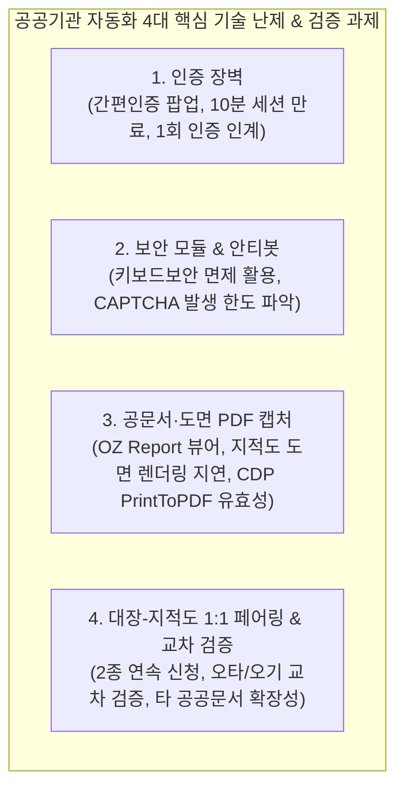
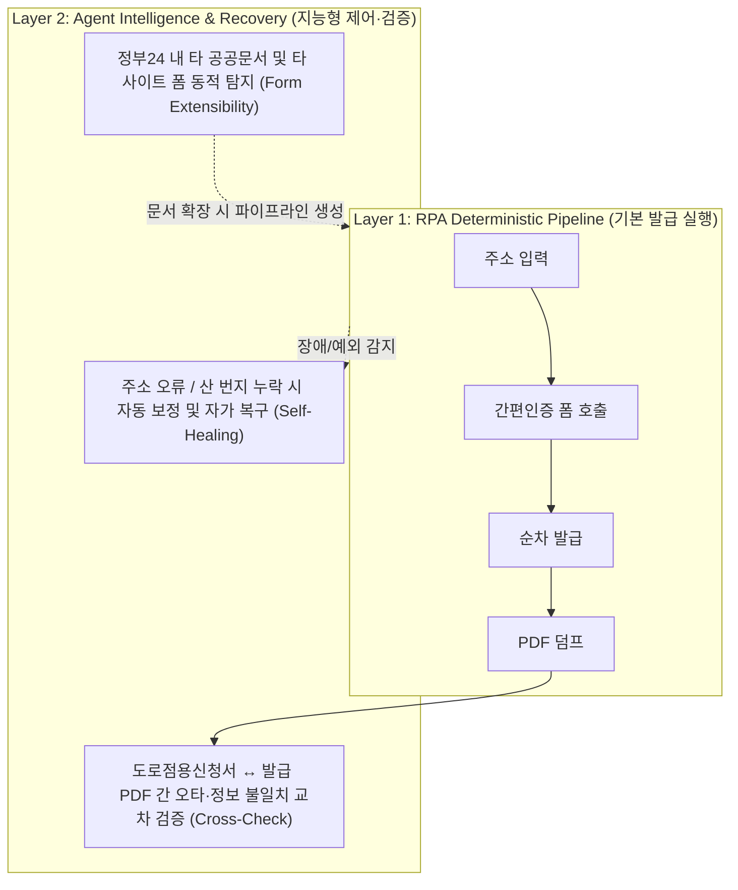

# [기술검토 v0.2] 공공기관 토지대장·지적도 원본 PDF 자동 수집 아키텍처 및 세부 기술해결안

- 담당: R04 원민 (프론트엔드 / 사용자 흐름)
- 상태: **구현안 설계 완료 / PoC 전 단계 (가설 검증 설계)**
- 작성일: 2026-11-16
- 갱신일: 2026-11-16
- 버전 히스토리:
  - v0.1: 아키텍처 초안 작성
  - v0.15: 지적도(임야도) 도면 렌더링 감지 및 1:1 페어링 추가
  - **v0.2: 팀장 피드백 반영 (핵심 기술 항목의 확신 수준 가설화, RPA Baseline 대비 에이전트 도입 영역 명확화, 1건→5건→30건 단계별 PoC 로드맵 구체화, 타 공공문서 확장 탐지 설계)**
- 대상 TASK: [TASK-019 (R04 기획안 구체화)](../../../artifacts/tasks/TASK-019.json)
- 연계 기획안: [공공사업(도로점용) 토지대장·지적도 수집 자동화 기획안 v0.2](2026-11-16_R04_공공사업_토지대장_PDF_수집자동화_기획안.md)

---

## 1. 기술 검토의 목적 및 핵심 난제 (Technical Challenges)

본 문서는 **정부24(gov.kr) 등 공공기관 포털에서 도로점용허가용 토지대장과 지적도(임야도) 원본 PDF를 대량으로 수집·패키징**하기 위한 엔지니어링 구현 가능성을 검토하고, 현업 인터뷰에서 도출된 핵심 문제(건당 10~20분 소요, 사람의 수기 입력 오타 발생)를 해결하기 위한 기술적 해결안과 PoC 검증 가설을 정의합니다.

---

## 2. 세부 기술 과제별 해결안 및 가설 검증 설계 (Engineering Solutions)

---

### 과제 1. 인증 및 세션 유지 (Authentication & Session Persistence)

#### [현실적 제약]
* 정부24는 외부 시스템 연동용 OpenAPI를 제공하지 않으며, 간편인증(카카오/PASS 등) 로그인 후 10분간 활동이 없으면 세션이 자동 만료됨.

#### [구체적 해결안: Human-in-the-Loop 1회 인증 연계 및 세션 인계]
1. **Playwright Persistent Context 활용**:
   - 로컬 스토리지에 사용자 프로필 디렉토리(`user_data_dir`)를 지정하여 브라우저 컨텍스트를 생성.
   - `playwright.chromium.launch_persistent_context(user_data_dir="./user_profile", headless=False)`
2. **1회 모바일 인증 승인 흐름 (Human-in-the-Loop)**:
   - 시스템이 정부24 로그인 페이지로 진입하여 사용자의 기등록 정보(이름, 생년월일, 휴대폰번호)로 '간편인증(카카오 등)'을 1회 호출.
   - 사용자가 스마트폰에서 생체인식/PIN으로 1회 승인하면, 시스템이 모바일 승인 완료를 폴링(Polling) 감지 후 브라우저의 `인증완료` 버튼을 클릭하여 세션 수립.
3. **세션 유지 및 자동 연장 워커 (Session Keep-Alive)**:
   - 정부24 상단 세션 타이머(10분)를 모니터링하여 잔여 2분 시 `연장하기` 버튼 클릭을 자동 트리거.

> [!WARNING]
> **[검증 가설 1 - 세션 지속성]**
> * *가설*: 1회 간편인증으로 수립된 브라우저 컨텍스트 내에서 세션 연장 버튼을 주기적으로 클릭하면 30건 이상의 연속 발급 배치(약 30~50분) 동안 재인증 없이 세션이 끊김 없이 유지될 것이다.
> * *PoC 검증*: 1건 성공 후 5건, 30건 연속 발급 시 세션 유지 여부 및 타임아웃 발생 여부 실측.

---

### 과제 2. 보안 프로그램 및 안티봇 대응 방침

#### [현실적 제약]
* 키보드 보안(TouchEn nxKey) 및 WAF(Web Application Firewall)에 의해 일반 헤드리스 스크래퍼는 차단됨.
* 비정상적인 초고속 조작 감지 시 정부24 자체 캡차(CAPTCHA)가 발생할 수 있음.

#### [구체적 해결안: 표준 간편인증 환경 + 사람과 유사한 지연 주입]
1. **정부24 표준 환경 활용 (보안 모듈 설치 면제)**:
   - 정부24 '간편인증' 로그인 시 키보드 보안 프로그램 필수 설치가 공식 면제되는 표준 웹 환경을 활용하여 OS 레벨 보안 프로그램과의 충돌 회피.
2. **자연스러운 이벤트 주입 (Natural Event Injection)**:
   - 단순 스크립트 감시를 피하기 위해 Chrome DevTools Protocol(CDP)의 원시 입력 이벤트(`Input.dispatchKeyEvent`)를 사용하며, 필지 전환 시 인위적인 대기 시간(3~5초)을 부여.
3. **캡차(CAPTCHA) 대응 원칙**:
   - AI는 어떠한 경우에도 캡차를 우회하거나 해킹하지 않음 (프로젝트 보안 가이드라인 준수).
   - 캡차 발생 시 시스템을 즉시 일시정지하고, 사용자에게 화면 알림을 보내 사용자가 직접 1회 입력하도록 Human-in-the-Loop 핸드오프 설계.

> [!WARNING]
> **[검증 가설 2 - CAPTCHA 발생 한도]**
> * *가설*: 헤디드(Headed) 브라우저 환경에서 3~5초의 인간적 지연(Politeness Delay)을 적용하면, 일상적인 업무량인 일 30건 배치 발급 시 캡차가 발생하지 않을 것이다.
> * *PoC 검증*: 발급 간격을 2초, 3초, 5초로 변경해가며 캡차가 처음 발생하는 연속 발급 임계 건수(Rate Limit)를 실측하여 안전 마진 도출.

---

### 과제 3. 토지대장 및 지적도 도면 원본 PDF 인쇄 캡처

#### [현실적 제약]
* 정부24의 '문서출력' 창은 일반 HTML이 아닌 **OZ Report(오즈 리포터) 웹 뷰어**로 렌더링됨.
* 특히 지적도는 토지 경계선 벡터 도면이 웹 캔버스(Canvas)에 완전히 그려질 때까지 수초의 로딩 시간이 걸려, 성급히 인쇄하면 '빈 도면(Blank PDF)'이 저장될 위험이 있음.

#### [구체적 해결안: 3단계 인쇄 스트림 인터셉트 파이프라인]

1. **지적도 렌더링 완료 감지 (Canvas Render Wait)**:
   - OZ Report 뷰어 내부의 `div.oz_canvas` 또는 차트/도면 캔버스의 로딩 완료 이벤트(`oz_finish_rendering`)를 폴링 감시하여 도면이 완전히 메모리에 올라온 시점에 인쇄 트리거 발동.
2. **CDP (Chrome DevTools Protocol) 기반 PrintToPDF 자동화**:
   - `--kiosk-printing` 및 `--print-to-pdf-no-header` 옵션을 주입하여 인쇄 팝업 없이 `Page.printToPDF` API로 300DPI급 벡터 PDF 직접 저장.

> [!WARNING]
> **[검증 가설 3 - CDP PrintToPDF 결과물의 관공서 유효성]**
> * *가설*: CDP PrintToPDF로 가로챈 PDF의 지자체 관인 이미지 및 16자리 '문서확인번호', 위변조방지 바코드는 지자체 담당 공무원의 공문서 진위 확인기(정부24 문서확인 서비스)에서 100% 정상 유효 문서로 판정될 것이다.
> * *PoC 검증*: 테스트 필지 1건을 CDP로 추출한 후, 정부24 '문서확인' 메뉴(발급번호 입력)에서 실제 진위 확인 통과 여부를 직접 대조 검증.

---

### 과제 4. 토지대장·지적도 1:1 페어링 및 신청서 데이터 교차 검증

#### [현실적 제약]
* 필지당 토지대장(코드 `13100000026`)과 지적도(코드 `13100000027`)를 각각 따로 신청해야 함.
* 실무자가 엑셀 및 신청서에 데이터를 옮겨 적는 과정에서 **오타 및 지번 오기재**가 발생하여 입찰 서류가 반려되는 치명적 고통 존재 (인터뷰 Q3).

#### [구체적 해결안: 사전 판별 큐 + 사후 교차 검증 파이프라인]
1. **사전 지목 판별 및 큐 분기**:
   - PNU(필지고유번호) 조회를 통해 일반토지(`토지대장+지적도`)와 산 번지(`임야대장+임야도`)를 사전 판별하여 발급 라디오 버튼 자동 전환.
2. **신청서 ↔ 발급 문서 데이터 교차 검증 (Cross-Validation)**:
   - PDF 추출 직후 `PyMuPDF`로 텍스트를 파싱하여, 도로점용신청서 엑셀 상의 [소재지, 지번, 면적, 소유자명]과 발급된 토지대장/지적도 상의 실제 정보가 일치하는지 자동 대조. 불일치 시 실무자에게 즉시 경고.
3. **지자체 규격 자동 명명 및 병합 (Merge Option)**:
   - `[순번]_[지번]_01_토지대장.pdf`, `[순번]_[지번]_02_지적도.pdf` 분리본 및 지자체 요구 시 2페이지 단일 병합 PDF 동시 생성.

---

## 3. RPA Baseline vs Intelligent Agent Architecture (에이전트 역할 정립)

멘토의 "왜 단순 고정 RPA가 아니라 에이전트여야 하는가?"라는 질문에 대한 기술적 구분:

### 3.1 단순 RPA Baseline
* 주소가 정형화되어 있고 뷰어가 지연 없이 열리는 '이상적 상황(Happy Path)'의 반복 클릭은 단순 Playwright 스크립트로 충분함.

### 3.2 Agent의 필수적 역할 (RPA 상위 레이어)
1. **예외 자가 치유 (Self-Healing Agent)**:
   - 주소 검색 실패(구주소 vs 도로명 미스매칭), 뷰어 캔버스 로딩 지연, 일시적 세션 불안정 발생 시 스크립트를 중단하지 않고, 에러 원인을 분석하여 폼 재입력 및 딜레이 조절을 자율 수행.
2. **인허가 무결성 검증 에이전트 (QA Agent)**:
   - 인터뷰에서 확인된 '오타·오기로 인한 입찰 실패 리스크'를 방지하기 위해, 발급된 서류의 내용과 신청서 작성 데이터를 정밀 대조하여 사람의 실수를 사전에 차단.
3. **타 공공문서 동적 탐지 및 확장성 (Extensibility Agent)**:
   - 건축물대장, 토지이용계획확인원 등 정부24 내 타 민원이나 대법원 인터넷등기소(등기부등본)로 확장 시, 웹 페이지의 입력 필드(Input)와 결과 양식(Output)을 시각적/구조적으로 탐지하여 워크플로우를 자동 구성하는 표준 API화 에이전트.

---

## 4. 단계별 Feasibility PoC 로드맵 (Step-by-Step PoC Plan)

무리한 전면 개발을 피하고, 기술적 가설을 하나씩 입증해 나가는 4단계 로드맵:

| 단계 | 검증 목표 | 주요 측정 지표 (Metrics) | 리스크 발생 시 대응책 |
|---|---|---|---|
| **Step 1 (1건 PoC)** | 1필지(대장+지적도 1세트) 자동 신청 및 제출 가능 PDF 정상 확보 | • 간편인증 1회 연계 성공 여부 • 뷰어 도면 렌더링 정상 캡처 여부 • 정부24 '문서확인번호' 진위 확인 통과 | CDP PrintToPDF 대신 브라우저 가상 프린터 드라이버(PDF Creator) 대안 검토 |
| **Step 2 (5건 반복)** | 세션 유지 및 딜레이 안정성 검증 (일반 4건 + 산 번지 1건) | • 10분 세션 연장 성공 여부 • 산 번지(임야대장) 폼 자동 분기 성공률 • 캔버스 로딩 지연에 따른 빈 도면 발생 0건 | 지연 시간(Wait Time) 1초 단위 점진 증가 튜닝 |
| **Step 3 (30건 배치)** | 실무 규모 배치 발급 및 예외 복구, 신청서 교차 검증 | • 30건 연속 발급 시 CAPTCHA 출현 시점 • 오류 필지 발생 시 자가 복구율 • 신청서-대장 오타 교차 검증 정확도 | 캡차 출현 시 휴먼 핸드오프 팝업 알림 연동 |
| **Step 4 (8주 MVP)** | 도로점용신청서 결합 및 [순번]_[지번] 자동 명명 패키징 UI | • 실무자 최종 제출 소요 시간 단축률 (건당 15분 → 1분 미만) | 웹 기반 로컬 실행 GUI (Electron 또는 Streamlit) 제공 |

---

## 5. 결론: 기술적 상태 및 다음 액션

* **현재 상태**: 구현 설계 완료 / PoC 전 단계
* **다음 즉시 실행 액션**:
  - Step 1 (1필지 대상 토지대장+지적도 1세트 1회 인증 발급 및 정부24 문서확인번호 검증) 스크립트 작성 및 단일 실행 feasibility 확인.
