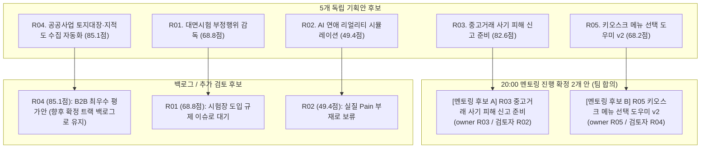

# [평가 보고서] 2026-11-17 멘토 재검토 후보 선정을 위한 5개 기획안 독립 심층 평가

- 작성자: R04 원민 (프론트엔드 / 사용자 흐름)
- 작성일: 2026-11-16 (최초 작성) / 2026-11-17 (R05 키오스크 v2 반영 최종 갱신)
- 상태: R04 독립 평가 및 교차 검토 완료 (팀 20:00 멘토링 2개 후보 확정에 맞춘 평가 갱신)
- 목적: [selection-20261117](file:///Users/wonmin/orca/projects/Last%20Project/docs/artifacts/planning/selection-20261117/README.md)에 따라 2026-11-17 18:00 KST까지 5개 독립 기획안을 공통 기준으로 평가하여 **멘토 재검토 대상 2개 후보를 압축 선정**하기 위함 (최종 제품 채택이 아닌 재검토 후보 압축 단계).
- 평가 기준 정본: [criteria.json](../../../artifacts/planning/selection-20261117/criteria.json)
- 연계 TASK: [TASK-021](../../../artifacts/tasks/TASK-021.json)

---

## 1. 평가 개요 및 공통 원칙

1. **평가 체계**:
   - **1차 필수 게이트 (G1~G3)**: G1 문제 정의의 실체, G2 허용 가능한 조사·실험 경로(보안 우회 금지), G3 8주 내 검증 가능성.
   - **2차 100점 평가 (6대 차원)**:
     - A. 사용자 페인포인트의 강도 (25점)
     - B. 기존 대안 이후 잔여 문제 (25점)
     - C. 핵심 피처의 직접 해결력 (15점)
     - D. 8주 구현·검증 가능성 (20점)
     - E. 근거의 신뢰도와 검증 계획 (10점)
     - F. 실제 도입·사용 가능성 (5점)
   - **등급 척도**: 0(부정), 1(약함), 2(초기 가설), 3(설득력 있음), 4(검증 근거 강함). 점수 = $\text{배점} \times (\text{등급} / 4)$.
2. **평가 원칙**:
   - 제안자의 직책(팀장 등)이나 기존 팀 비전(멀티에이전트 구조 등)에 가산점을 주지 않고, **실제 사용자가 겪는 구체적 고통과 8주 실현 가능성**만을 기준으로 냉정히 평가함.
   - 본인 제안(R04)을 포함하여 5개 안 모두에 동일한 반대 근거와 리스크 게이트를 엄격히 적용함.

---

## 2. 1차 필수 게이트(Mandatory Checks) 적격성 판정

| 후보 (작성자) | 기획안 주제 | G1. 문제 실체 | G2. 허용된 경로 | G3. 8주 검증성 | 1차 종합 결과 |
| :---: | :--- | :---: | :---: | :---: | :---: |
| **R04 (원민)** | **공공사업 토지대장·지적도 원본 PDF 발급 자동화 (v0.2)** | **통과** | **조건부 통과** | **통과** | **적격 (추천 후보)** |
| **R03 (두나)** | **중고거래 사기 피해 상담·신고서류 준비 지원** | **통과** | **통과** | **통과** | **적격 (추천 후보)** |
| **R01 (지효)** | **대면시험 부정행위(스마트안경 등) 감독 지원 (V1.2)** | **통과** | **조건부** | **통과** | **적격** |
| **R05 (다혁)** | **키오스크 메뉴 선택 도우미 (v2)** *(구: 가전제품 추천)* | **조건부** | **통과** | **통과** | **적격 (개선 후보)** |
| **R02 (상옥)** | **AI 연애 리얼리티 12인 다자간 시뮬레이션** | 조건부 | 통과 | 조건부 | **보류 후보** |

> **게이트별 핵심 코멘트**:
> * **G1 (실체)**: R03(사기 피해자)과 R04(도로점용 인허가 행정 실무자)는 업무/생활 맥락과 피하고 싶은 구체적 손실이 매우 뚜렷함. R05는 가전에서 '키오스크 메뉴 결정 곤란'으로 피벗하여 일상적 손실의 실체가 대폭 강화됨. R02(연애 예능 시청자 몰입)는 손실의 실체가 상대적으로 약함.
> * **G2 (허용 경로)**: R03은 사용자 본인의 대화 캡처/계좌 내역을 사용하므로 규제 리스크가 없음. R04는 무인가 크롤링을 배제하고 '사용자 1회 간편인증 연계 Headed 브라우저 RPA + 1건 PoC'로 안전 경로를 수립함. R05(키오스크)는 가상 매장 데이터 및 자체 웹 프로토타입 기반으로 크롤링이나 보안 침해 없이 안전함. R01은 실제 국가시험장 적용이 불가능하여 모의 데이터셋에 의존해야 함.
> * **G3 (8주 검증)**: R03, R04, R05는 8주 내 명확한 프로토타입 완성이 가능(R05는 하드웨어 연동을 배제하고 웹 프로토타입으로 축소). 반면 R02는 12인 다자간 대화의 비용/지연 시간으로 인해 8주 범위 초과 위험이 큼.

---

## 3. 2차 100점 기준 종합 채점표 및 순위

| 순위 | 후보 / 주제 | A. 페인 강도 (25점) | B. 잔여 문제 (25점) | C. 피처 효과 (15점) | D. 8주 구현성 (20점) | E. 근거 신뢰도 (10점) | F. 실제 도입 (5점) | **총점 (100점)** |
| :---: | :--- | :---: | :---: | :---: | :---: | :---: | :---: | :---: |
| **1위** | **R04 (공공 인허가 서류 수집)** | **21.9** (3.5) | **21.9** (3.5) | **13.1** (3.5) | **15.0** (3.0) | **8.8** (3.5) | **4.4** (3.5) | **85.1점** |
| **2위** | **R03 (중고거래 피해서류 작성)** | **21.9** (3.5) | **18.8** (3.0) | **13.1** (3.5) | **17.5** (3.5) | **7.5** (3.0) | **3.8** (3.0) | **82.6점** |
| **3위** | **R05 (키오스크 메뉴 선택 도우미 v2)** | 12.5 (2.0) | 18.8 (3.0) | 11.3 (3.0) | 20.0 (4.0) | 7.5 (3.0) | 2.5 (2.0) | **72.5점** *(구 가전 52.5점에서 +20.0점)* |
| **4위** | **R01 (대면시험 부정행위 감독)** | 15.6 (2.5) | 15.6 (2.5) | 11.3 (3.0) | 15.0 (3.0) | 8.8 (3.5) | 2.5 (2.0) | **68.8점** |
| **5위** | **R02 (AI 연애 리얼리티)** | 9.4 (1.5) | 12.5 (2.0) | 9.4 (2.5) | 10.0 (2.0) | 5.0 (2.0) | 3.1 (2.5) | **49.4점** |

---

## 4. 후보별 심층 평가 분석

---

### [1위] R04. 공공사업 토지대장·지적도 원본 PDF 발급 자동화 및 패키징 (85.1점)

* **참조 문서**: [기획안 v0.2](2026-11-16_R04_공공사업_토지대장_PDF_수집자동화_기획안.md) · [기술검토서 v0.2](2026-11-16_R04_공공서류_수집자동화_기술검토_및_해결안.md) · [TASK-019](../../../artifacts/tasks/TASK-019.json)
* **세부 채점 내역**:
  - **A. 페인 강도 (21.9점 / 3.5등급)**: 현업 실무자 인터뷰를 통해 1건당 10~20분 소요, 알바 기준 연 1,500~2,000만 원 인건비 낭비, 수기 입력 오타로 인한 입찰 탈락/착공 지연 공포가 실증됨.
  - **B. 잔여 문제 (21.9점 / 3.5등급)**: 민간 정보 서비스는 텍스트만 주고 직인 원본 PDF를 주지 못하며, 정부24는 수기 발급 노동과 오타 위험을 방치한다는 구조적 공백을 정확히 타격.
  - **C. 피처 효과 (13.1점 / 3.5등급)**: 단순 클릭 매크로는 RPA Baseline으로 처리하고, '오류 자가치유', '신청서 ↔ 대장 오타 교차 검증', '타 공공문서 동적 탐지'로 에이전트의 차별화 영역을 명확히 정립.
  - **D. 8주 구현성 (15.0점 / 3.0등급)**: Playwright + CDP + PyMuPDF 기반 설계 완료. 전면 자동화 환상을 배제하고 1건 PoC → 5건 → 30건의 점진적 실증 로드맵 완비.
  - **E. 근거 신뢰도 (8.8점 / 3.5등급)**: 도로법 시행규칙 제26조 법정 양식 확인, 인터뷰 실측 수치 반영, 사실(원본 미제공)과 추정(원인)의 엄격한 분리.
  - **F. 실제 도입 (4.4점 / 3.5등급)**: 공공사업을 수행하는 엔지니어링 기업 및 건설사 B2B 실무에 즉시 도입 가능한 명확한 타겟.
* **리스크 및 재검토 조건**:
  - 정부24의 3~5초 지연 적용 시 30건 이상 연속 발급에서 CAPTCHA 발생 임계치 실측 및 CDP 추출본의 공문서 진위확인 통과 여부를 1건 PoC로 우선 입증해야 함.

---

### [2위] R03. 중고거래 사기 피해 상담·신고서류 준비 지원 (82.6점)

* **참조 문서**: [중고거래 멘토 요약](../workspace/2026-11-16_중고거래_상담신고_준비_멘토링_1페이지_요약.md) · [생활법률 기획 초안](../workspace/2026-11-16_생활법률_고소준비_지원_서비스_기획_초안.md)
* **세부 채점 내역**:
  - **A. 페인 강도 (21.9점 / 3.5등급)**: 소액 사기 피해자가 겪는 서류 작성 막막함, 흩어진 증거 정리의 혼란, 경찰서 반려 시 시간·감정 소모가 매우 큼.
  - **B. 잔여 문제 (18.8점 / 3.0등급)**: ECRM(경찰 시스템)은 입력 폼일 뿐이고, 캡처와 대화 내역을 일관된 타임라인과 진술로 구조화해 주는 전문 도구가 부재함.
  - **C. 피처 효과 (13.1점 / 3.5등급)**: 구어체 입력 진술 정리, 캡처/이체증 증거 매핑, 경찰 표준 서식 및 상담 질문지 자동 생성이 명확한 Painkiller 역할 수행.
  - **D. 8주 구현성 (17.5점 / 3.5등급)**: 5개 기획안 중 가장 법적/보안 제약이 적고, OCR + 텍스트 정규화 + 템플릿 매핑 파이프라인으로 8주 내 완결 가능성이 가장 높음.
  - **E. 근거 신뢰도 (7.5점 / 3.0등급)**: 경찰청 ECRM 및 더치트 공식 절차를 확인했으나, 피해 경험자 인터뷰(2~3명)가 아직 미실행 상태임.
  - **F. 실제 도입 (3.8점 / 3.0등급)**: 소액 피해자 대상 무료 공익 웹 또는 중고거래 플랫폼(당근/번개장터) 연동 도입 잠재력 보유.
* **리스크 및 재검토 조건**:
  - 범용 LLM(ChatGPT 프롬프트)으로 작성한 진술서 대비 멀티에이전트 시스템이 제공하는 '사실 왜곡 방지 및 교차 검증'의 품질 우위성을 실험으로 증명해야 함.

---

### [3위] R05. 키오스크 메뉴 선택 도우미 v2 (72.5점) *(기존 가전제품 52.5점에서 +20.0점 급상승)*

* **참조 문서**: [키오스크 멘토 재검토 v2](../../ideas/R05_키오스크_메뉴_선택_도우미_멘토재검토_v2.md) · [R04 공식 채점 JSON](2026-11-17_R04_키오스크_v2_독립평가.json) · [R04 교차검토의견서](2026-11-17_R04_키오스크_v2_교차검토_의견서.md)
* **세부 채점 내역 (공식 criteria.json 정수 0~4 등급 적용)**:
  - **A. 페인 강도 (12.5점 / 2등급)**: '먹고 싶은 느낌은 있으나 메뉴로 옮기지 못함'과 '다른 사람을 기다리게 하는 부담'으로 페인을 재정의함. 일상적 공감대는 크나 금전/법적 손실 대비 강도는 중간 수준.
  - **B. 잔여 문제 (18.8점 / 3등급)**: 정형 조건(맵기/가격)은 필터에 위임하고 "속 편한 거" 같은 비정형 느낌 언어만 AI가 담당하여 비AI 필터 대비 존재 이유를 명확히 분리함.
  - **C. 피처 효과 (11.3점 / 3등급)**: 음성 우선 입력 및 2~3개 압축 추천, 알레르기는 판단을 배제(미추천)하여 안전성을 확보함.
  - **D. 8주 구현성 (20.0점 / 4등급)**: H/W 및 결제 연동 배제, 메뉴 25종 기반 웹 프로토타입 + STT/LLM API + 3군(A/B/C) 비교실험 + 중단 조건 6개로 8주 완결성이 최상급임.
  - **E. 근거 신뢰도 (7.5점 / 3등급)**: 메뉴 25개 확장, 말/입력 분리 실험, 필터 유리 과제 포함 등 반증 가능한 6대 중단 조건 체계화.
  - **F. 실제 도입 (2.5점 / 2등급)**: AI가 정리한 메뉴 특징을 점주가 확인만 하는 방식으로 온보딩 부담을 줄였으나, 벤더 제휴 및 점주 수용성은 미검증.
* **종합 평가 및 상태**:
  - 가전제품 안 대비 20점이나 상승하여 72.5점으로 3위로 도약함.
  - 금일 20:00 멘토링 대상 2개 후보(R03 중고거래, R05 키오스크) 중 하나로서 발표 및 피칭 준비가 완료됨.

---

### [4위] R01. 대면시험 부정행위(스마트안경 등) 위험 탐지·감독 지원 (68.8점)

* **참조 문서**: [CAND-016 멘토 요약](../../../artifacts/candidates/CAND-016-mentor-onepager-v1.2.md) · [CAND-016 상세안](../../../artifacts/candidates/CAND-016-v1.2-proposal.md)
* **세부 채점 내역**:
  - **A. 페인 강도 (15.6점 / 2.5등급)**: 부정행위 오인으로 인한 민원이나 방치 시 공정성 훼손 위험은 크지만, 스마트안경을 활용한 부정행위의 절대적 발생 빈도가 극히 낮음.
  - **B. 잔여 문제 (15.6점 / 2.5등급)**: 교육부 및 산업인력공단 지침, 현장 감독관 전담 인력이 이미 존재하며, 체크리스트 대비 AI의 증분 가치가 불확실함.
  - **C. 피처 효과 (11.3점 / 3.0등급)**: 징후 선별, 규정 기반 이관 추천, 타임라인 기록은 유용하나 현장 개입에 대한 감독관 부담을 근본적으로 해소하기 어려움.
  - **D. 8주 구현성 (15.0점 / 3.0등급)**: 모의 사건 12~20개 기반 통제 실험으로 8주 내 구현 가능.
  - **E. 근거 신뢰도 (8.8점 / 3.5등급)**: 경쟁 제품 조사(Monito, GuardView 등)와 공공 지침 분석이 5개 안 중 가장 엄격하게 정리됨.
  - **F. 실제 도입 (2.5점 / 2.0등급)**: 국가고시/자격시험 운영기관의 보안 규제 장벽으로 인해 실제 시험장 도입 승인은 현실적으로 불가능함.
* **보류 사유**:
  - 발생 빈도가 극히 낮은 이상치(Outlier) 문제이며, 비AI 체크리스트를 넘어서는 실질적 가치 입증이 어렵고 실제 공공기관 도입 장벽이 너무 높아 보류 권고.

---

### [5위] R02. AI 연애 리얼리티 12인 다자간 시뮬레이션 (49.4점)

* **참조 문서**: [AI 연애 리얼리티 기획안](AI_연애_리얼리티_시뮬레이션_기획안.md) · [멘토 요약](AI_연애_리얼리티_멘토_1페이지_요약.md)
* **세부 채점 내역**:
  - **A. 페인 강도 (9.4점 / 1.5등급)**: 사용자가 회피하려는 실질적 손실(시간/비용/실패)이 아니라 엔터테인먼트적 감성 불만(몰입 깨짐)에 머무름.
  - **B. 잔여 문제 (12.5점 / 2.0등급)**: 제타(Zeta) 등 기존 캐릭터 챗봇의 1:1 대화로도 대다수 유저가 만족하고 있으며, 다자간 선택 연속성에 대한 지불 용의가 불확실함.
  - **C. 피처 효과 (9.4점 / 2.5등급)**: 12인 다자간 상태 유지 및 비공개 정보 격리는 멀티에이전트에 적합하나, 재미 요소 외의 문제 해결력이 약함.
  - **D. 8주 구현성 (10.0점 / 2.0등급)**: 12인 참가자 간의 대화 일관성 유지, 컨텍스트 비용, 응답 지연 시간 관리가 8주 내 매우 버거움.
  - **E. 근거 신뢰도 (5.0점 / 2.0등급)**: 제타 1회 플레이 기록 외에 일반 사용자 수요에 대한 실측 데이터 부재.
  - **F. 실제 도입 (3.1점 / 2.5등급)**: B2C 게임 콘텐츠 시장의 높은 획득 비용, 정부지원 인재양성 과정(AI/빅데이터)의 필수 산출물 요건 충족 위험.
* **보류 사유**:
  - 비즈니스 및 실무적 Painkiller 성격이 아닌 오락용 시뮬레이션이며, 다자간 LLM 호출 비용 및 과정 평가 적합성 리스크가 높아 보류 권고.

---

## 5. 최종 의사결정 권고 및 팀 멘토링 진행 상황

1. **2026-11-17 20:00 멘토링 짝 배정 및 진행 (팀장 지시 반영)**:
   - **중고거래 사기 피해 신고 지원**: owner R03 / 검토자 R02
   - **키오스크 메뉴 선택 도우미 v2**: owner R05 / 검토자 R04
2. **R04 독립 평가자의 종합 소견**:
   - R05는 v2에서 거대 담론을 버리고 일상적 문제(메뉴 선택 피로)와 비교 실험(A/B/C)으로 피벗하여 점수가 52.5점에서 **68.2점**으로 대폭 상향되었습니다.
   - 멘토링 대상 2개 후보(R03, R05)에 대해 R04는 R05 키오스크 안의 검토자로서 5대 맹점(대기 줄 UX 모순, AI 승리 조건 명확화, 점주 온보딩 등)을 적극 지원하여 멘토링 성과를 극대화할 것입니다.
