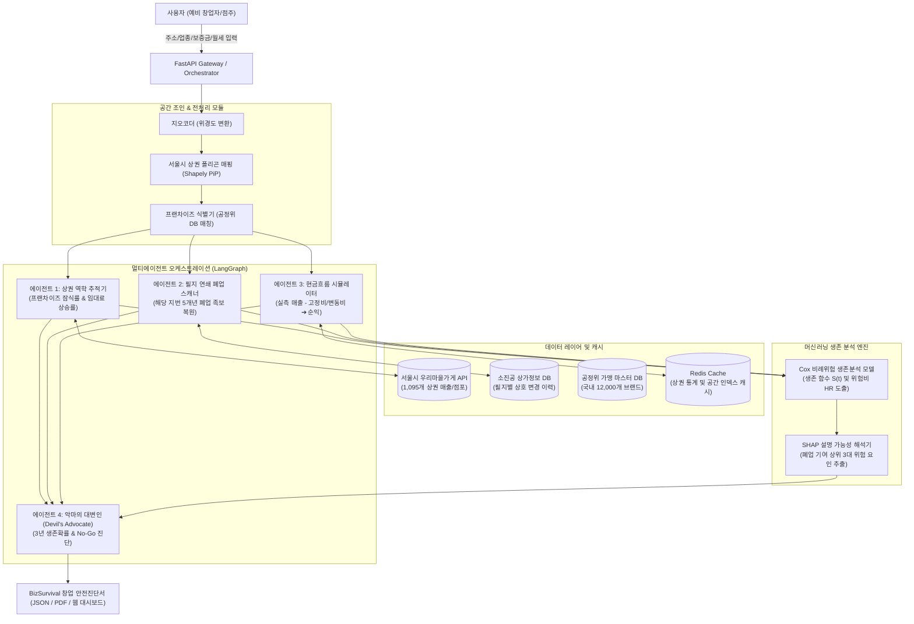

# [기술검토 및 세부 해결안 v0.1] 골목상권 젠트리피케이션 리스크 및 외식업 생존 시뮬레이션 리서치 멀티에이전트 (BizSurvival)

- **담당**: R04 원민 (프론트엔드 / 사용자 흐름)
- **상태**: v0.1 기술 검토 초안
- **작성일**: 2026-11-18
- **연계 기획안**: [골목상권 젠트리피케이션 외식업생존 기획안 v0.1](2026-11-18_R04_골목상권_젠트리피케이션_외식업생존_기획안.md)
- **대상 공공데이터**:
  - 서울 열린데이터광장 (`data.seoul.go.kr`): 서울시 우리마을가게 상권분석서비스 API (상권-점포, 상권-개폐업, 상권-추정매출, 상권-임대료)
  - 공공데이터포털 (`data.go.kr`): 소상공인시장진흥공단 상가(상권)정보 오픈 API, 행정안전부 주민등록 인구통계
  - 공정거래위원회 (`franchise.ftc.go.kr`): 가맹사업정보제공시스템 프랜차이즈 브랜드 마스터

---

## 1. 시스템 아키텍처 및 데이터 흐름도

BizSurvival은 **"사용자 입력 주소의 공간 조인 ➔ 4대 상권 공공데이터 비동기 병렬 수집 ➔ 생존분석(Survival Analysis) 및 손익 계산 ➔ Devil's Advocate 보고서 생성"** 파이프라인으로 구성됩니다.



---

## 2. 핵심 기술 난제 및 세부 엔지니어링 해결안

### [난제 1] 지번/도로명 주소와 서울시 상권 분석 블록 간의 '공간 불일치'
- **문제점**:
  - 서울시 우리마을가게 상권 데이터는 1,095개 지정 상권 폴리곤(골목상권, 발달상권, 전통시장 등) 단위로 제공됨.
  - 사용자가 입력한 특정 점포 주소가 상권 폴리곤 경계선에 걸치거나, 지정 상권 외곽(비상권 주거지)에 위치할 경우 데이터 매핑 실패 발생.
- **해결안 (2단계 공간 조인: Shapely PiP + KD-Tree 반경 탐색)**:
  1. **1차: Point-in-Polygon (PiP) 정밀 조인**:
     - 카카오 로컬 API로 주소를 (위도, 경도)로 변환한 뒤, Shapely 지오메트리 엔진으로 1,095개 상권 폴리곤 내부 포함 여부 1차 판정.
  2. **2차: 지정 상권 외곽 시 KD-Tree 반경 300m 최근접 보정**:
     - 비지정 상권일 경우 scipy `KDTree`를 이용해 반경 300m 이내 가장 인접한 2개 골목상권의 거리 가중 평균값(Inverse Distance Weighting)으로 보정 결합.

### [난제 2] 개인 독립 점포 vs 대기업 프랜차이즈 식별의 불완전성
- **문제점**:
  - 소상공인 상가정보 API의 상호명 필드는 "메가MGC커피 연남점", "스타벅스 홍대입구역점"처럼 지점명이 붙어 있거나 약칭이 쓰여 있어, 단순 문자열 비교로는 프랜차이즈 여부를 100% 가려내기 어려움.
- **해결안 (공정위 가맹 브랜드 사전 + Trie 기반 고속 정규화)**:
  1. **공정위 12,000개 가맹 브랜드 사전 구축**:
     - 공정위 가맹사업정보제공시스템의 브랜드명 마스터(외식업 9,000여 개)를 매일 크롤링하여 Aho-Corasick / Trie 알고리즘 기반 고속 매칭 사전 적재.
  2. **지점명 정규식 클렌징**:
     - `(?P<brand>.*?)(?:\s+(?:[가-힣a-zA-Z0-9]+점|점|호점|직영점))?$` 정규식 패턴을 적용해 순수 브랜드명을 추출하고 프랜차이즈 점유율을 정확히 산출.

### [난제 3] 개별 점포의 비공개 실제 매출 추정
- **문제점**:
  - 금융감독원이나 국세청의 개별 점포별 실제 매출은 비공개 데이터이며, 서울시 데이터는 해당 상권 전체의 분기별 '추정 매출 총액'과 '점포 수'만 제공함.
- **해결안 (건물 층수/면적 가중치 및 파레토 법칙 기반 분위수 분해)**:
  - 점포당 평균 매출 = 상권 총 추정매출 ÷ 유효 점포 수.
  - 여기에 **층수 계수(1층=1.0, 2층=0.6, 지하=0.5)**와 **전용 면적 계수**를 곱해 개별 매장의 추정 매출 범위를 산출하고, 프랜차이즈가 상위 30% 매출을 독식하는 상권의 경우 개인 점포 매출을 20% 하향 보정.

### [난제 4] 생존/폐업 예측 모델의 신뢰성 및 설명 가능성 (XAI)
- **문제점**:
  - 블랙박스 머신러닝(XGBoost 등)으로 단순히 "생존율 42%"라고만 출력하면, 사용자는 왜 그런 숫자가 나왔는지 신뢰하지 못하고 경고를 무시함.
- **해결안 (Cox 비례위험 모형 + SHAP 기반 위험 요인 정량 분해)**:
  1. **생존분석(Survival Analysis) 모델링**:
     - 개업일부터 폐업일까지의 개월 수를 타깃 변수로 두고, 인근 동종 점포 수, 프랜차이즈 점유율 증가율, 평당 임대료, 통과 유동 비율을 독립변수로 하는 Cox Proportional Hazards Model 적용.
  2. **SHAP(SHapley Additive exPlanations) 기여도 추출**:
     - "3년 생존율 42%의 주원인: ① 인근 300m 내 대형 저가커피 4곳 진입 (-24%), ② 최근 2년간 평당 월세 32% 상승 (-18%), ③ 해당 필지 평균 생존기간 11개월 (-16%)"과 같이 상위 3대 반대 근거를 정량 기여도로 분해하여 보고서에 시각화.

---

## 3. 1건 E2E PoC 시나리오 및 입출력 JSON 스키마

### 3.1 시나리오 정의
- **후보 점포**: 서울특별시 마포구 연남동 동진시장 인근 1층 상가 (전용 45㎡, 약 13.6평)
- **희망 업종**: 수제 디저트 & 베이커리 카페 (개인 매장)
- **임대차 조건**: 보증금 3,000만 원 / 월 임대료 220만 원 (관리비 15만 원)
- **창업 자본**: 총 8,000만 원 (시설 인테리어 4,500만 원 예상)

### 3.2 입력 JSON 스키마 (User Input)
```json
{
  "request_id": "REQ-BIZ-2026-1118-001",
  "candidate_property": {
    "address": "서울특별시 마포구 연남동 227-xx",
    "floor": 1,
    "dedicated_area_sqm": 45.0,
    "lease_terms": {
      "deposit_krw": 30000000,
      "monthly_rent_krw": 2200000,
      "maintenance_fee_krw": 150000
    }
  },
  "business_plan": {
    "industry_category": "외식업 / 제과제빵·카페",
    "business_type": "INDEPENDENT",
    "total_investment_krw": 80000000,
    "target_average_ticket_krw": 8500
  }
}
```

### 3.3 에이전트 간 내부 중간 산출물 (Intermediate Representation)
```json
{
  "agent_1_dynamics_tracer": {
    "matched_commercial_area": "연남동 골목상권 (코드: 1000854)",
    "franchise_share_current": "41.2%",
    "franchise_share_3yr_ago": "21.5%",
    "gentrification_speed": "HIGH (연평균 +6.5%p 잠식 중)",
    "rent_cagr_3yr": "+9.8%",
    "expected_rent_2yr_later_krw": 2650000
  },
  "agent_2_site_forensics": {
    "property_address": "연남동 227-xx",
    "historical_tenants_5yr": [
      {"period": "2021.03 - 2022.01 (10개월)", "industry": "수제버거", "status": "폐업"},
      {"period": "2022.04 - 2023.02 (10개월)", "industry": "개인 디저트카페", "status": "폐업"},
      {"period": "2023.05 - 2024.08 (15개월)", "industry": "캐주얼 와인바", "status": "폐업"}
    ],
    "average_survival_months": 11.6,
    "structural_defect": "동진시장 안쪽 막다른 골목으로 전면 간판 가시성 불량 및 야간 조도 부족"
  },
  "agent_3_cashflow_simulator": {
    "benchmark_monthly_sales_krw": 11500000,
    "monthly_costs": {
      "rent_and_maintenance": 2350000,
      "cogs_food_cost_35pct": 4025000,
      "part_time_labor": 2200000,
      "utilities_and_card_fees": 1150000,
      "total_costs": 9725000
    },
    "estimated_net_profit_krw": 1775000,
    "break_even_daily_sales_krw": 324100
  }
}
```

### 3.4 최종 출력 JSON 스키마 (Final Synthesis Report)
```json
{
  "report_id": "REP-BIZ-2026-1118-001",
  "generated_at": "2026-11-18T15:50:00Z",
  "verdict": {
    "recommendation": "NO-GO (창업 중단 강력 권고)",
    "risk_level": "CRITICAL (위험)",
    "predicted_3yr_survival_probability": "31.4%",
    "summary": "해당 자리는 지난 5년간 3개 점포가 평균 11.6개월 만에 폐업한 고위험 입지이며, 인근 프랜차이즈 잠식 속도와 높은 월세(220만 원)로 인해 월 순이익이 최저임금 수준(177만 원)에 그쳐 손실 위험이 매우 큼."
  },
  "shap_top_risk_factors": [
    {
      "rank": 1,
      "factor": "동일 필지 과거 5개년 연쇄 폐업 이력 (평균 11.6개월)",
      "impact_on_failure": "+34.5%",
      "detail": "입지 동선 단절로 인한 고객 재방문율 한계"
    },
    {
      "rank": 2,
      "factor": "상권 내 프랜차이즈 잠식 속도 급증 (3년간 21% ➔ 41%)",
      "impact_on_failure": "+28.2%",
      "detail": "반경 200m 내 대형 브랜드 베이커리 2곳 신규 입점"
    },
    {
      "rank": 3,
      "factor": "예상 매출 대비 과도한 임대료 비중 (월 매출의 20.4%)",
      "impact_on_failure": "+19.8%",
      "detail": "외식업 적정 임대료 비중(10~12%)을 2배 가까이 초과"
    }
  ],
  "counter_strategy_if_proceed": {
    "maximum_tolerable_rent_krw": 1400000,
    "negotiation_tip": "건물주에게 과거 3개 점포의 단기 폐업 이력을 제시하며 월세를 최소 140~150만 원 선으로 인하 요구할 것",
    "pivot_suggestion": "홀 중심 카페 대신, 배달/테이크아웃 비중이 높거나 저녁 주류(펍) 결합형 업종으로 변경 권고"
  },
  "citations": [
    {"source": "서울시 우리마을가게 상권분석서비스", "dataset_id": "V_OA_COMMERCIAL_SALES_2026"},
    {"source": "소상공인시장진흥공단 상가정보", "dataset_id": "STORE_HIST_MAPO_YEONNAM"},
    {"source": "공정거래위원회 가맹사업정보제공시스템", "dataset_id": "FRANCHISE_MASTER_2026"}
  ]
}
```

---

## 4. 8주 주차별 엔지니어링 마일스톤 및 기술 스택

| 주차 | 목표 (Milestone) | 세부 구현 내용 | 산출물 |
| :--- | :--- | :--- | :--- |
| **1~2주차** | 공간 조인 파이프라인 & 데이터 수집 | • 서울시 1,095개 상권 폴리곤 GeoJSON 적재<br/>• 카카오 로컬 지오코딩 + Shapely PiP 모듈 구현<br/>• 우리마을가게 API 4종(매출/점포/인구/임대료) 수집기 | `spatial/polygon_join.py`<br/>`adapters/seoul_village.py`<br/>`data/seoul_polygons.geojson` |
| **3~4주차** | 프랜차이즈 식별 & 필지 이력 마이닝 | • 공정위 12,000개 브랜드 Aho-Corasick 매칭기<br/>• 소진공 상가 데이터 필지별 폐업 족보 복원기<br/>• 과거 1,000개 점포 대상 데이터 정합성 검증 | `core/franchise_matcher.py`<br/>`core/site_forensics.py`<br/>`tests/test_site_history.py` |
| **5~6주차** | 생존분석 ML 모델 & SHAP 엔진 | • Cox 비례위험 모형 훈련 (서울시 폐업 1,000건)<br/>• SHAP 위험 요인 기여도 해석 모듈 결합<br/>• BEP 및 손익 시뮬레이션 계산기 구현 | `ml/survival_cox_model.py`<br/>`ml/shap_explainer.py`<br/>`agents/cashflow_sim.py` |
| **7~8주차** | Devil's Advocate 보고서 & PoC 실증 | • No-Go 판정 로직 및 원페이지 PDF 진단서 렌더러<br/>• 예비 창업자 15명 대상 실전 파일럿 테스트<br/>• 사용자 인터뷰 기반 임대료 협상 가이드 개선 | `reports/no_go_report.py`<br/>`docs/poc/pilot_feedback_report.md` |

### 기술 스택 (Tech Stack)
- **Backend / Engine**: Python 3.11, FastAPI, Pydantic v2
- **Spatial & Geometry**: Shapely, GeoPandas, PyProj, Scipy (`KDTree`)
- **Machine Learning & XAI**: Scikit-survival, Lifelines, SHAP, LightGBM
- **Agent Orchestration**: LangGraph, LangChain
- **Cache & Database**: Redis (상권 폴리곤 및 매출 캐시), PostGIS (공간 데이터 인덱싱)
- **LLM**: Claude 3.5 Sonnet / GPT-4o (No-Go 진단서 합성 및 협상 전략 생성)
- **Report Rendering**: WeasyPrint / ReportLab (창업 안전진단서 PDF 자동 발행)
