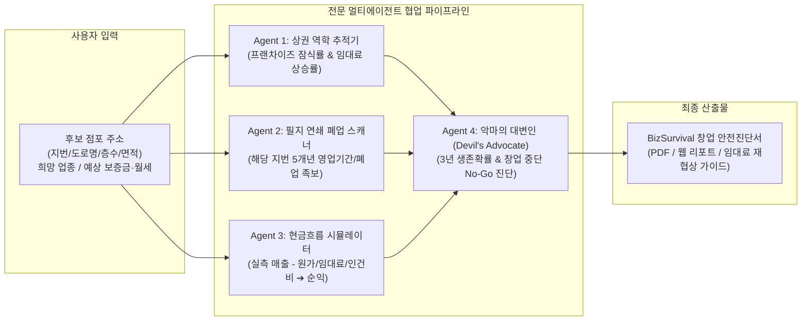
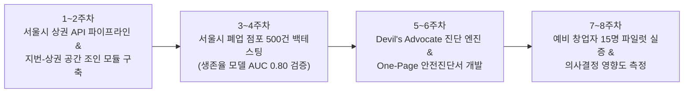

# [기획안 v0.1] 골목상권 젠트리피케이션 리스크 및 외식업 생존 시뮬레이션 리서치 멀티에이전트 (BizSurvival)

- **담당**: R04 원민 (프론트엔드 / 사용자 흐름)
- **상태**: v0.1 기획 초안
- **작성일**: 2026-11-18
- **기획 대상**: 서울시 우리마을가게 상권분석서비스, 소상공인시장진흥공단 상가정보, 행정안전부 인구통계 연계 외식업 창업 입지 생존율 진단 멀티에이전트 시스템
- **출처 및 참조 문서**:
  - 서울 열린데이터광장 서울시 우리마을가게 상권분석서비스 오픈 API (`https://data.seoul.go.kr/`)
  - 공공데이터포털 소상공인시장진흥공단 상가(상권)정보 오픈 API (`https://www.data.go.kr/`)
  - 공공데이터포털 행정안전부 주민등록 인구통계 API (`https://www.data.go.kr/`)
  - [공공데이터 활용 리서치 멀티에이전트 서비스 아이디어 10선](2026-11-18_R04_공공데이터_활용_리서치_멀티에이전트_서비스_아이디어_10선.md)
  - [BizSurvival 기술검토 및 세부 해결안](2026-11-18_R04_골목상권_젠트리피케이션_외식업생존_기술검토_및_해결안.md)

---

## 0. 기획 배경 및 문제의식

대한민국 외식업은 자영업자의 30% 이상을 차지하는 대표적인 생계형 창업 분야입니다. 그러나 통계청 및 중소벤처기업부 조사에 따르면 **외식업 창업 후 1년 내 폐업률은 약 20%, 3년 내 폐업률은 50%, 5년 내 폐업률은 70%**에 육박합니다. 특히 5,000만~1.5억 원의 퇴직금이나 청년 대출로 창업하는 소자본 창업자가 다음과 같은 치명적인 정보 비대칭과 함정에 빠지고 있습니다:

1. **"유동인구 착시"에 속은 무덤 자리 계약**:
   - 포털이나 상가 중개인은 "역세권이라 하루 유동인구 5만 명"이라며 장밋빛 미래만 강조합니다.
   - 하지만 그 인구의 대다수가 지하철역으로 이동하는 '단순 통과 유동인구(Commuter)'이거나 직장인 출퇴근 통로일 뿐, 매장에 머물러 소비하는 '체류 유동인구'가 아님을 인지하지 못한 채 비싼 권리금을 주고 입점하여 수개월 만에 적자에 허덕입니다.
2. **골목상권 젠트리피케이션(Gentrification)과 임대료 폭등의 역습**:
   - 특색 있는 개인 카페나 식당을 열어 피땀 흘려 상권을 키워놓으면, 1~2년 뒤 대기업 프랜차이즈와 드럭스토어가 상권을 잠식하면서 건물주가 임대료를 30~50%씩 일방적으로 인상합니다.
   - 영세 개인 매장은 임대료 인상을 버티지 못하고 권리금도 회수하지 못한 채 쫓겨나는 악순환이 반복됩니다.
3. **해당 점포 필지의 "연쇄 폐업 이력" 은폐**:
   - 공인중개사는 "전 세입자가 건강상 이유로 나갔다"고 말하지만, 실제로는 지난 5년간 해당 자리에서 카페 3번, 분식집 2번이 1년도 못 버티고 폐업한 이른바 '저주받은 자리(동선 단절, 간판 가시성 불량)'인 경우가 부지기수입니다.
   - 공공데이터에는 개폐업 이력이 남아있으나, 예비 창업자가 이를 주소 단위로 역추적하기란 불가능에 가깝습니다.

본 기획은 **서울시 우리마을가게 상권분석 API와 소상공인시장진흥공단 상가정보, 행안부 인구통계**를 연계하여, 창업 계약 전 **"유동인구 질적 분해 ➔ 반경 500m 프랜차이즈 잠식 속도 ➔ 해당 필지 연쇄 폐업 이력 ➔ 냉정한 3년 생존율 및 손익분기점"을 시뮬레이션하고 반대 근거(Devil's Advocate) 중심의 진단서를 발급하는 리서치 멀티에이전트(BizSurvival)**를 제안합니다.

---

## 1. Target User & Field Pain Points (타겟 사용자와 현업의 고통)

### 1.1 타겟 사용자 정의
- **1차 사용자 (Core User)**:
  - 퇴직금, 청년 창업 대출금(5,000만~1.5억 원)으로 외식업(카페, 베이커리, 분식, 주점 등) 창업을 준비하는 **소자본 예비 창업자**
  - 현재 매장을 운영 중이나 매출 하락 및 임대료 인상 압박으로 업종 전환이나 폐업 시점을 고민하는 **한계 소상공인 점주**
- **2차 의사결정자 및 유관기관 (Buyer / Partner)**:
  - 서울신용보증재단, 서민금융진흥원 소상공인 창업 대출 심사역 (부실 대출 방지용 상권 평가서 활용)
  - 소상공인 전문 상권분석 컨설턴트 및 공인중개사

### 1.2 사용자 상황 및 업무 흐름 (As-Is vs To-Be)

```mermaid
flowchart TD
    subgraph AsIs["현재 창업 입지 결정 흐름 (As-Is)"]
        A1["중개업소 방문 및 '유동인구 많다'는 말 청취"] --> A2["포털 지도 로드뷰 및 1~2회 주말 현장 관찰"]
        A2 --> A3["권리금 수천만 원 지불 및 상가 임대차 계약"]
        A3 --> A4["개업 후 통과 유동인구 착시 및 매출 부진 직면"]
        A4 --> A5["1~2년 뒤 임대료 인상 or 매출 적자로 폐업 (1억 원 전액 손실)"]
    end

    subgraph ToBe["BizSurvival 도입 후 (To-Be)"]
        B1["후보 매장 지번/도로명 주소 & 업종 입력"] --> B2["멀티에이전트 4중 교차 입지 리서치 (5분)"]
        B2 --> B3["통과 유동 vs 체류 유동 분해 + 필지 과거 5개년 폐업 족보 추적"]
        B3 --> B4["인근 프랜차이즈 잠식률 및 3년 예상 임대료 상승 시뮬레이션"]
        B4 --> B5["냉정한 3년 생존율 & 손익분기점(BEP) 반대 근거 진단서 출력"]
        B5 --> B6["위험 매장 계약 회피 (No-Go) or 적정 월세/업종 재협상"]
    end
```

### 1.3 구체적 정량/정성 Pain Points
1. **창업 실패 시 평생 모은 종잣돈 1억 원 매몰 및 신용불량**:
   - 보증금(3,000만~5,000만 원), 인테리어/주방설비(4,000만~7,000만 원), 권리금(2,000만~5,000만 원) 등 1억 원 안팎이 1~2년 만에 소진되며 개인 파산 위기 직면.
2. **기존 무료 상권분석 도구의 한계 (장밋빛 수치 나열)**:
   - 서울시 상권분석서비스나 네이버 부동산은 "분기 매출 2억 원, 유동인구 3만 명"과 같은 거시적 평균치만 보여줄 뿐, "그중 프랜차이즈가 얼마를 가져가고 내 개인 매장이 얼마를 벌 수 있는지"를 알려주지 않음.
3. **정보의 완전한 비대칭성 (공인중개사-건물주 vs 초보 창업자)**:
   - 해당 점포가 왜 자주 매물로 나오는지, 건물주가 재계약 시 임대료를 얼마나 올리는 성향인지 전혀 알지 못한 채 '호구 계약' 체결.

---

## 2. Existing Alternatives & Remaining Pain (기존 대안과 남는 고통)

| 기존 대안 | 제공하는 가치 | 한계점 및 사용자가 여전히 겪는 고통 (Remaining Pain) |
| :--- | :--- | :--- |
| **서울시 우리마을가게 상권분석 웹사이트** | 서울시 골목/발달 상권별 매출, 개폐업, 인구 무료 공개 | • 개별 지번(필지) 단위가 아닌 **넓은 상권 블록 단위 집계**로 내 특정 점포의 위험을 알 수 없음 • "창업하지 마라"는 **냉정한 반대 근거(Devil's Advocate) 경고 기능 부재** |
| **민간 상권분석 솔루션** (오픈업, 나이스비즈맵 등) | 카드 매출 기반 정밀 추정치 및 점포별 매출 분석 | • 월 수만~수십만 원의 유료 구독료 발생 • 매출 추정치는 제공하나, **"젠트리피케이션 잠식 속도"와 "임대료 상승에 따른 순익 붕괴 시점" 시뮬레이션 불가** |
| **창업 컨설팅 / 가맹거래사 외주** | 현장 실사 및 맞춤형 입지 타당성 보고서 | • **건당 150만~300만 원의 높은 비용** 소요 • 일부 기획 부동산/컨설팅 업체는 권리금 수수료를 위해 창업을 무조건 부추기는 이해 상충(Moral Hazard) 발생 |

> **핵심 차별화 영역 (Painkiller Seam)**:
> 장밋빛 매출만 나열하는 기존 도구와 달리, **"이 자리에서 창업하면 왜 2년 내 망하는지(No-Go)"를 공공데이터(과거 필지 폐업 족보, 프랜차이즈 잠식률, 임대료 인상 추세)로 적나라하게 증명해 주는 '냉정한 창업 안전진단관'** 역할을 수행함.

---

## 3. Problem Statement (문제 정의 한 문장)

> **"생계형 외식업 예비 창업자가 수천만~1억 원 이상의 전 재산을 투입하면서도, 유동인구 착시와 인근 프랜차이즈 잠식 속도, 해당 필지의 연쇄 폐업 이력을 입체적으로 진단하지 못해 '개업 후 1~2년 내 폐업 및 보증금 매몰'의 비극을 반복하고 있다."**

---

## 4. Solution & Key Features (솔루션 및 4대 핵심 피처)

### [FEAT-01] 상권 역학 및 젠트리피케이션 추적기 (Dynamics Tracer)
- **데이터 소스**: 서울 열린데이터광장(우리마을가게 점포/매출 API), 소상공인진흥공단 상가정보
- **핵심 기능**:
  - 반경 500m 내 개인 독립 점포 수 대비 대기업 프랜차이즈 점포 수 비율의 최근 3개년 변화 추세(젠트리피케이션 속도 지수) 계산.
  - 상권 전체의 평당 평균 임대료 3개년 연평균 상승률(CAGR) 및 향후 2년 예상 임대료 추정.

### [FEAT-02] 필지·건물 연쇄 폐업 이력 스캐너 (Site Forensics)
- **데이터 소스**: 소상공인 상가정보(상호 변경 이력), 국세청 사업자등록 개폐업 통계, 건축물대장
- **핵심 기능**:
  - 해당 특정 지번(건물/호수)에서 최근 5년간 개업하고 폐업한 **점포들의 족보(Genealogy)와 평균 생존 개월 수** 복원.
  - "이 자리는 최근 4년간 3번의 일반음식점이 들어왔으나 평균 생존 기간은 11.2개월이었음"과 같은 입지 치명 결함 경고 표출.

### [FEAT-03] 실측 매출 기반 현금흐름 시뮬레이터 (CashFlow Simulator)
- **데이터 소스**: 서울시 우리마을가게 분기별 추정매출 API, 외식업 경영실태조사 원가율 통계
- **핵심 기능**:
  - 해당 골목상권 동종 업종의 **상위 20% / 중간 50% / 하위 30% 실측 카드 매출 분포** 매핑.
  - 사용자가 입력한 예상 월세 + 식자재 원가율(업종별 33~38%) + 인건비 + 플랫폼 수수료를 차감한 **'월 순이익 곡선' 및 손익분기점(BEP) 필요 일매출** 역산.

### [FEAT-04] 반대 근거 중심 창업 안전진단서 (Devil's Advocate Auditor)
- **핵심 기능**:
  - 머신러닝 생존 분석 모델 기반 **"3년 내 생존 확률(Survival Probability)"** 정량 산출.
  - 3대 핵심 위협 요인(프랜차이즈 경쟁 과열, 임대료 감당 불가, 해당 필지 저주)을 바탕으로 **"창업 중단(No-Go) 권고" 또는 "적정 월세 인하 요구 금액"** 제시.
  - 초보 창업자가 공인중개사나 건물주와 협상할 때 활용할 수 있는 **"임대차 계약 시 특약 조항 체크리스트"** 발행.

---

## 5. Truth, Hypothesis, Counter-evidence, Unknowns (사실/가설/반대근거/미확인 분리)

| 구분 | 주요 내용 | 검증 방안 및 통제 계획 |
| :--- | :--- | :--- |
| **사실 (Fact)** *이미 입증된 사실* | • 서울시 우리마을가게 API는 서울시 전역 골목상권 1,000여 개의 분기별 실측 카드 매출, 유동인구, 개폐업 점포 수를 오픈 API로 전수 제공함. • 외식업 폐업의 1순위 사유는 '매출 부진 대비 고정비(임대료·인건비) 과다'임. • 상가건물임대차보호법상 10년간 계약갱신요구권이 보장되나, 초기 임대료가 과도하게 높으면 갱신권은 의미가 없음. | 서울시 열린데이터광장 API 데이터 정합성 및 법령 확인 완료. |
| **가설 (Hypothesis)** *검증이 필요한 전제* | • 과거 동일 필지의 5개년 평균 영업 개월 수는 신규 입점 매장의 생존 기간과 0.7 이상의 높은 양의 상관관계를 가질 것이다. • 예비 창업자에게 'No-Go(창업 중단)' 판정을 내렸을 때, 60% 이상이 계약을 재검토하거나 임대료 인하 협상에 나설 것이다. | 서울시 25개 자치구 폐업 상가 1,000개 표본을 대상으로 과거 이력과 실제 폐업 간의 회귀 분석 검증. |
| **가장 강한 반대 근거 (Counter-evidence)** | • 외식업 성공은 입지뿐만 아니라 '점주의 조리 역량, 브랜딩, 바이럴 마케팅(인스타그램 맛집)'에 크게 좌우되므로, 저주받은 자리라도 대박이 나는 예외가 존재함. • 예비 창업자는 이미 인테리어 컨셉에 감정적으로 매몰되어 있어 AI가 No-Go를 외쳐도 창업을 강행하는 확증 편향(Confirmation Bias)이 강함. | "맛이나 바이럴이 평균 수준(업계 중간 50%)일 때의 통계적 생존율"임을 명시하고, 극단적 성공 사례에 편향되지 않도록 냉정한 하방 리스크(Downside Risk) 강조. |
| **미확인 사항 (Unknowns)** | • 서울시 데이터는 '행정동/골목상권' 단위로 묶여 있어, 완벽한 '개별 호수(101호 vs 102호)' 단위의 미시적 동선 차이를 포착하는 데 한계 존재. • 배달 전문 매장의 경우 홀 매장과 달리 유동인구나 가시성의 영향이 적어 모델 보정이 필요함. | 홀 중심 일반 외식업(카페/식당/주점)을 Phase 1 타깃으로 집중 정의. |

---

## 6. 8-Week MVP Validation Plan & Kill Criteria (8주 MVP 검증 계획 및 중단 조건)

### 6.1 8주 MVP 검증 로드맵

- **1~2주차: 상권 데이터 파이프라인 및 지오코딩 공간 결합**
  - 서울시 우리마을가게 상권 API(매출, 개폐업, 유동인구, 임대료) 수집기 구현.
  - 카카오 로컬 API 지오코딩 및 서울시 1,095개 상권 폴리곤 매핑.
- **3~4주차: 서울시 실제 폐업 점포 500건 백테스팅 (Back-testing)**
  - 2022~2024년 실제 1년 내 폐업한 점포 500곳과 3년 이상 생존 점포 500곳의 개업 당시 데이터를 모델에 투입하여 폐업 조기 경보 정확도(AUC) 검증.
- **5~6주차: 악마의 대변인(Devil's Advocate) 리포터 구현**
  - 손익분기점(BEP) 역산 엔진, 젠트리피케이션 위험도 스코어링, PDF 안전진단서 자동 생성기 구축.
- **7~8주차: 예비 창업자 및 소상공인 15명 실전 파일럿 검증**
  - 실제 상가 계약을 앞둔 예비 창업자 15명에게 진단서 제공 후 계약 의사결정 변화(계약 보류, 조건 변경 등) 정량 측정.

### 6.2 중단 조건 (Kill Criteria)
다음 3가지 조건 중 하나라도 충족될 경우 프로젝트를 즉시 중단(Kill/Pivot)합니다:
1. **[생존율 예측 판별력 미달]** 1,000건 백테스팅 결과, 생존/폐업 분류 모델의 판별력(AUC-ROC)이 0.70 미만으로 단순 무작위 예측과 큰 차이가 없을 때.
2. **[사용자 행동 변화 실패]** 파일럿에 참여한 예비 창업자 15명 중 '위험(No-Go)' 진단을 받은 10명 전원이 "AI 말을 믿을 수 없어 원래대로 계약하겠다"고 답하여 실질적 리스크 방어 가치를 증명하지 못할 때.
3. **[공공 API 제공 중단]** 서울시 우리마을가게 상권분석서비스의 매출 및 개폐업 상세 데이터 개방 정책이 축소되거나 비공개로 전환될 때.

---

## 7. Business Impact & Value Proposition (도입 가치)

1. **소자본 창업자의 1억 원 매몰 방지**: 무덤 자리 입점을 사전 차단하여 퇴직금과 청년 자본의 허탈한 증발을 물리적으로 방어.
2. **냉정한 상가 임대료 협상 레버리지 제공**: "이 상권의 프랜차이즈 잠식률과 과거 폐업률을 볼 때 적정 월세는 180만 원"이라는 객관적 공공데이터 지표로 건물주와의 월세 인하 협상력 확보.
3. **서민금융/보증재단 부실 대출율 감소**: 소상공인 정책 대출 심사 시 사전 스크리닝 도구로 연계하여 정책 자금의 회수 건전성 제고.
