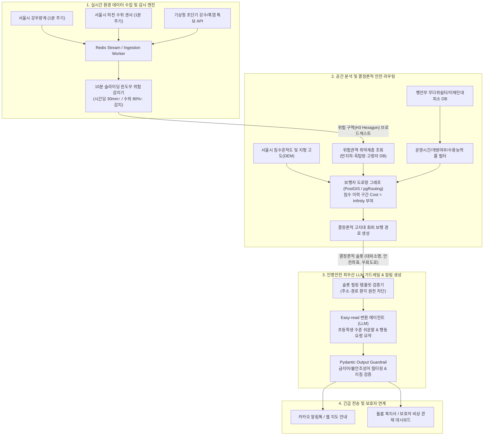

# [기술검토] 기후재난(침수·폭염) 취약구역 모니터링 및 실시간 맞춤 대피소 가이드 리서치 멀티에이전트 (SafeShelterPulse)

> **문서 상태**: Draft v0.1  
> **작성일**: 2026-11-18  
> **작성자**: R04 (이원민 - 프론트엔드 / 사용자 흐름 담당)  
> **관련 기획안**: [기후재난 취약구역 모니터링 및 실시간 맞춤 대피소 가이드 기획안](file:///Users/wonmin/orca/projects/Last%20Project/docs/members/R04/workspace/2026-11-18_R04_기후재난_침수폭염_맞춤대피소가이드_기획안.md)  
> **문서 목적**: SafeShelterPulse의 4대 핵심 기술 난제(센서 스트리밍 임계치 감지, 쉼터 가용성 검증, 침수흔적도 회피 보행 라우팅, 인명 안전 환각 제로 가드레일)를 선제적으로 검토하고 엔지니어링 해결안 및 8주 MVP E2E PoC 스키마를 정의함.

---

## 1. 시스템 아키텍처 및 데이터 파이프라인

SafeShelterPulse는 **초단기 환경 센서 모니터링 → 지리공간 기반 위험 분석 → 결정론적 안전 대피소 선별 및 보행 라우팅 → 취약계층 친화적 이지리드(Easy-read) 행동 요령 발송**의 4단계 파이프라인으로 동작합니다.



---

## 2. 4대 핵심 기술 난제 및 구체적 엔지니어링 해결안

### 난제 1: 1분 단위 초단기 센서 스트리밍 수집 및 병목 없는 슬라이딩 윈도우 임계치 감지
- **문제점**:
  - 국지성 게릴라 호우 시 수십 개의 자치구 강우량계와 하천 수위계에서 1분마다 수천 건의 데이터가 쏟아져 들어옴.
  - 단순 RDBMS 쿼리로 매분 임계치를 계산하면 DB 커넥션 풀 고갈 및 락(Lock) 경합이 발생하여 골든타임(5~10분) 내 경보가 지연됨.
- **해결안**:
  1. **인메모리 타임시리즈 슬라이딩 윈도우**:
     - Redis Sorted Set(`ZSET`)을 사용하여 센서 ID별로 최근 30분간의 수위 및 강우량 타임스탬프를 관리.
     - `ZADD sensor:{id} {timestamp} {value}`로 실시간 적재 후 `ZREMRANGEBYSCORE`로 30분 초과 데이터 자동 만료.
  2. **복합 파생 지표 비동기 감지**:
     - 단순 절대값뿐만 아니라 **상승 속도(10분간 수위 상승률 $\Delta h / \Delta t$)** 및 **누적 강우량(최근 15분 합계 $\ge 15\text{mm}$)** 복합 트리거를 Lua 스크립트로 원자적(Atomic) 판정.
     - 임계치 초과 이벤트 발생 시 H3 공간 인덱스(Level 8~9, 반경 약 100~400m) 단위로 Pub/Sub 토픽(`hazard:flood:{h3_index}`)을 발행하여 하위 라우팅 엔진에 즉시 전달.

### 난제 2: 무더위쉼터 및 임시대피시설의 실시간 가용성 및 신뢰도 검증
- **문제점**:
  - 공공데이터포털의 '무더위쉼터' DB는 대부분 정적 데이터이며, 실제로는 주말·공휴일 미운영 경로당이거나 야간 개방을 하지 않는 관공서가 다수 포함되어 있어 헛걸음 위험이 큼.
  - 침수 대피시설의 경우 지하시설이 지정되어 있거나 수용 한도를 초과할 가능성이 존재함.
- **해결안**:
  1. **운영 룰베이스 동적 시점 필터링**:
     - 대피 시각(현재 요일, 현재 시각, 법정 공휴일 여부)을 파싱하여 운영 시간 외 시설은 1차 후보군에서 즉시 제외.
     - 유형별 가중치 적용: 24시간 개방 관공서(동주민센터 등) > 주간 복지관 > 일반 경로당.
  2. **지자체 담당자 긴급 상태 오버라이드 캐시**:
     - 침수 위험 단계 격상 시 관제 화면에서 클릭 한 번으로 특정 대피소의 상태(`OPEN`, `FULL`, `FLOODED`)를 Redis Key에 오버라이드할 수 있는 REST 엔드포인트 제공.
     - 기본 공공데이터 메타와 실시간 오버라이드 플래그를 결합하여 최종 가용 시설 리스트 도출.

### 난제 3: 침수흔적도 및 지형 경사도를 반영한 안전 보행 회피 라우팅
- **문제점**:
  - T맵, 카카오맵 등 일반 내비게이션은 도로 거리 및 소요 시간만 고려하여, 폭우 시 물이 차오르는 저지대 하천변 도로, 지하차도, 빗물받이 역류 구간을 최단 경로로 안내하는 치명적 한계가 있음.
- **해결안**:
  1. **침수 위험 페널티 그래프 구축 (PostGIS + pgRouting)**:
     - OpenStreetMap(OSM) 보행자 보도 네트워크에 서울시 침수흔적도(과거 침수 침적 폴리곤) 및 지하차도 좌표를 공간 조인.
     - 위험 구간에 속한 에지(Edge)의 가중치를 무한대($Cost = \infty$)로 설정하여 다익스트라(Dijkstra) 또는 A* 알고리즘에서 탐색 제외.
  2. **수치표고모델(DEM) 기반 고지대 우선 알고리즘**:
     - 노드별 고도(Elevation) 데이터를 매핑하여, 이동 시 고도가 낮아지는 음(-)의 경사면에는 페널티를 부여하고, 안전한 고지대 능선 보행로에 가산점을 부여하는 커스텀 Cost 함수 적용:
       $$Cost(e) = Length(e) \times (1 + \alpha \cdot FloodRisk(e)) + \beta \cdot \max(0, Altitude_{start} - Altitude_{end})$$

### 난제 4: 인명 안전을 위한 환각(Hallucination) 제로 가드레일 및 이지리드(Easy-read) 생성
- **문제점**:
  - 생성형 AI(LLM)가 대피소 위치, 우회 경로, 비상 연락처를 임의로 지어낼 경우(환각) 대피자가 잘못된 위험 지역으로 이동하여 인명 사고가 발생할 수 있음.
- **해결안**:
  1. **슬롯 필링(Slot-filling) 결정론적 격리 원칙**:
     - **대피소 이름, 정확한 도로명 주소, 위도/경도 지도 링크, 필수 우회 지점**은 GIS 엔진이 확정한 JSON 데이터를 문자열 템플릿에 1:1로 직접 바인딩(No LLM).
  2. **LLM 역할 한정 (언어 변환 및 심리적 안정 유도)**:
     - LLM은 기계적이고 어려운 공공 재난 용어(예: "호우경보 발효에 따른 침수우려지역 사전 대피 권고")를 독거노인·이동약자가 직관적으로 이해할 수 있는 14포인트 이상 쉬운 어조의 한국어("어르신, 비가 너무 많이 와서 도림천이 넘칠 수 있습니다. 지금 슬리퍼 대신 운동화를 신으시고 길 건너 신림동 주민센터 2층으로 올라가세요.")로 변환하는 작업에만 사용.
  3. **Pydantic 스키마 기반 엄격한 출력 검증**:
     - 원본 대피소 주소와 LLM 생성 알림 내 주소가 일치하지 않거나, 금지어(예: "천천히", "지하로")가 포함된 경우 즉시 폴백(Fallback) 템플릿 문구로 대체 발송.

---

## 3. E2E PoC 시나리오 및 입출력 JSON 스키마

### PoC 시나리오
- **상황**: 2022년 8월 8일 20:30, 서울시 관악구 신림동 일대 시간당 80mm 집중호우 발생, 도림천 수위 급상승(위험 수위 85% 도달).
- **대상자**: 관악구 신림로 인근 반지하 거주 독거노인 김순자 어르신(76세, 보행 다소 불편).
- **트리거**: 10분간 강우량 25mm 급증 및 도림천 수위 임계치 초과 이벤트 감지.

#### [Input JSON] 위험 감지 센서 및 취약가구 프로필
```json
{
  "event_id": "EVT-20260811-001",
  "timestamp": "2026-08-11T20:30:00+09:00",
  "hazard_type": "INUNDATION",
  "severity_level": "CRITICAL",
  "trigger_source": {
    "sensor_id": "SEOUL-RAIN-GWANAK-04",
    "location_name": "관악구 신림동 도림천 수위계",
    "metrics": {
      "rainfall_10min_mm": 24.5,
      "rainfall_1hour_cumulative_mm": 86.0,
      "water_level_ratio": 0.88,
      "water_level_trend": "SURGING"
    }
  },
  "target_beneficiary": {
    "user_id": "USER-GWA-7721",
    "name": "김순자",
    "age": 76,
    "residence_type": "SEMI_BASEMENT",
    "mobility_profile": {
      "level": "WHEELCHAIR_OR_WALKER",
      "max_walkable_distance_m": 450,
      "stair_accessible": false
    },
    "current_coordinates": {
      "lat": 37.47952,
      "lon": 126.92881
    },
    "guardian_contact": {
      "name": "박영희(생활지원사)",
      "phone": "010-XXXX-5678"
    }
  }
}
```

#### [Output JSON] GIS 결정론적 라우팅 및 LLM Easy-read 알림 결과
```json
{
  "dispatch_id": "DSP-20260811-9982",
  "generated_at": "2026-08-11T20:30:12+09:00",
  "status": "SUCCESS",
  "evacuation_plan": {
    "assigned_shelter": {
      "facility_id": "SHT-GWA-004",
      "facility_name": "신림동 주민센터 (2층 대회의실)",
      "facility_type": "CIVIC_CENTER",
      "address": "서울특별시 관악구 문성로 180",
      "is_verified_open": true,
      "current_occupancy": 14,
      "max_capacity": 60,
      "has_elevator": true,
      "coordinates": {
        "lat": 37.48110,
        "lon": 126.93025
      }
    },
    "safe_route": {
      "total_distance_meters": 280,
      "estimated_walking_time_minutes": 6,
      "elevation_gain_meters": 4.5,
      "hazard_avoidance": {
        "avoided_flood_polygons_count": 2,
        "avoided_underpasses": ["신림지하보차도"],
        "route_safety_verdict": "CLEAR_HIGH_GROUND"
      },
      "turn_by_turn_waypoints": [
        "집 현관에서 나와 도림천 방면(왼쪽)으로 절대 가지 마시고 오른쪽 언덕길로 직진",
        "신림현대아파트 정문 앞 횡단보도를 건너 주민센터 2층 엘리베이터 이용"
      ]
    }
  },
  "easy_read_notification": {
    "channel": "KAKAO_ALIMTALK",
    "target_phone": "010-XXXX-1234",
    "headline": "🚨 [긴급 침수 대피] 김순자 어르신, 지금 즉시 주민센터로 이동하세요!",
    "body_text": "어르신! 비가 너무 많이 와서 도림천 물이 넘치고 있습니다. 반지하 방에 계시면 매우 위험합니다.\n\n지금 신발을 꼭 신으시고, 현관에서 나와서 '오른쪽 언덕길'로 올라가세요. (도림천 쪽은 물이 차서 가시면 안 됩니다!)\n\n280미터 앞 '신림동 주민센터 2층'이 불 켜져 있고 안전합니다. 엘리베이터가 준비되어 있습니다.\n\n생활지원사 박영희 선생님께도 연락을 드렸으니 걱정 마시고 천천히 높은 곳으로 가세요.",
    "web_map_quick_link": "https://safepulse.kr/evac?token=9f82d1c"
  },
  "guardian_alert": {
    "notified": true,
    "recipient": "박영희(생활지원사)",
    "message": "[관제 알림] 담당 김순자 어르신 구역 침수 위험(88%). 주민센터 2층 대피 유도 발송 완료(보행 6분 소요 예상). 즉시 유선 연락 요망."
  }
}
```

---

## 4. 8주 MVP 개발 마일스톤 및 권장 기술 스택

### 기술 스택 선정
- **백엔드 및 API**: Python 3.11+, FastAPI (비동기 실시간 이벤트 수집 및 디스패치)
- **메시지 큐 & 인메모리**: Redis 7.2+ (Redis Stream 및 ZSET 슬라이딩 윈도우)
- **지리공간 데이터베이스 & 라우팅**: PostgreSQL 16 + PostGIS 3.4 + pgRouting (침수흔적도 폴리곤 및 보행 가중치 그래프)
- **에이전트 오케스트레이션**: LangChain / LangGraph + OpenAI GPT-4o-mini (Easy-read 변환 전용)
- **스키마 검증**: Pydantic v2 (결정론적 슬롯 필링 및 환각 차단)
- **알림 및 프론트엔드**: 카카오 알림톡 Biz API / 모바일 경량 Web GIS (Mapbox / Leaflet)

### 8주 개발 일정
| 주차 | 주요 마일스톤 | 산출물 및 검증 기준 |
| :--- | :--- | :--- |
| **1~2주차** | 데이터 파이프라인 및 지리공간 DB 구축 | 서울시 강우량/수위계 수집기, 서울시 침수흔적도·경사도 및 OSM 도로망 PostGIS 로드 |
| **3~4주차** | 실시간 위험 감지기 & 침수 회피 라우터 개발 | 10분 슬라이딩 윈도우 수위 상승률 알고리즘 완성, 침수흔적도 회피 보행 A* 라우팅 PoC |
| **5주차** | 쉼터 가용성 룰 엔진 & Pydantic 가드레일 | 대피소 운영 시간 필터, 주소/좌표 슬롯 바인딩 및 LLM Easy-read 변환 검증기 구현 |
| **6주차** | E2E 알림톡 연계 및 관제 대시보드 구축 | 카카오 알림톡 샌드박스 연동, 복지사/보호자 비상 관제 웹 화면(MVP) 개발 |
| **7주차** | 과거 침수 실측 데이터 기반 모의 훈련(Replay) | 2022년 8월 관악구/동작구 집중호우 센서 시계열 데이터 100% 재현 시뮬레이션 및 경로 정확도 검증 |
| **8주차** | 최종 필드 테스트, 한계점 보고서 작성 및 배포 | 사회복지사 및 노인복지관 사용자 테스트(10명 대상 가독성 평가), 0.1 버전 릴리즈 |

---

## 5. 결론 및 R04 제언

SafeShelterPulse는 기후재난이라는 극한의 상황에서 인명 안전을 지키는 서비스이므로, **"AI의 창의성보다는 100% 신뢰할 수 있는 결정론적 안전성(Determinism)"**이 최우선되어야 합니다.

대피소의 주소, 좌표, 회피 경로는 PostGIS의 방재 라우팅 알고리즘으로 엄격히 통제하고, 생성형 AI(LLM)는 디지털 취약계층의 문해력과 패닉 상황을 배려한 **이지리드(Easy-read) 언어 변환 인터페이스**로 국한하여 운용함으로써, 무결점의 안전성과 압도적인 사용자 친화성을 동시에 달성할 수 있습니다.
