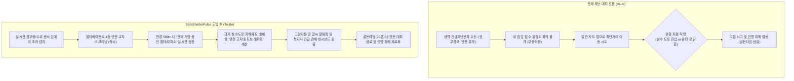
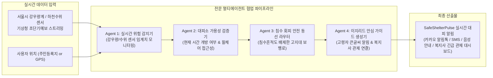
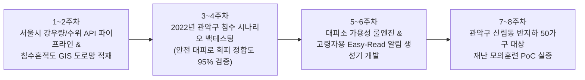

# [기획안 v0.1] 기후재난(폭염·침수) 취약구역 모니터링 및 실시간 맞춤 대피소 가이드 리서치 멀티에이전트 (SafeShelterPulse)

- **담당**: R04 원민 (프론트엔드 / 사용자 흐름)
- **상태**: v0.1 기획 초안
- **작성일**: 2026-11-18
- **기획 대상**: 서울 열린데이터광장(실시간 강우량·하천수위·침수도로·무더위쉼터), 공공데이터포털(기상청 특보, 행안부 대피소 DB) 연계 기후재난 약자 맞춤형 실시간 안전 대피 가이드 멀티에이전트 시스템
- **출처 및 참조 문서**:
  - 서울 열린데이터광장 서울시 실시간 강우량 및 침수 취약 도로 오픈 API (`https://data.seoul.go.kr/`)
  - 서울 열린데이터광장 서울시 하천수위 및 빗물펌프장 가동 현황 API (`https://data.seoul.go.kr/`)
  - 서울 열린데이터광장 서울시 무더위쉼터 및 수해 임시대피시설 현황 API (`https://data.seoul.go.kr/`)
  - 공공데이터포털 기상청 초단기예보 및 기상특보 오픈 API (`https://www.data.go.kr/`)
  - [공공데이터 활용 리서치 멀티에이전트 서비스 아이디어 10선](2026-11-18_R04_공공데이터_활용_리서치_멀티에이전트_서비스_아이디어_10선.md)
  - [SafeShelterPulse 기술검토 및 세부 해결안](2026-11-18_R04_기후재난_침수폭염_맞춤대피소가이드_기술검토_및_해결안.md)

---

## 0. 기획 배경 및 문제의식

기후변화로 인해 기록적인 국지성 폭우(게릴라성 호우)와 유례없는 극한 폭염이 일상화되면서, 도시 취약계층의 생명과 안전이 직접적인 위협을 받고 있습니다. 2022년 8월 서울 관악구 신림동 반지하 침수 참사와 매년 반복되는 쪽방촌 독거노인 온열질환 사망 사고는 현재의 공공 재난 안전 체계에 다음과 같은 치명적 사각지대가 존재함을 여실히 드러냈습니다:

1. **"광역 일괄 재난문자"의 치명적 무용성**:
   - 기상청과 지자체가 발송하는 긴급재난문자는 "서울 전역 호우경보 발효, 하천 주변 및 저지대 접근 금지"와 같이 자치구 전체에 일괄 전송됩니다.
   - 그러나 정작 반지하 주택이나 저지대에 거주하는 주민에게 절실한 정보는 **"지금 내 집 앞 골목길 맨홀이 역류하고 있는지", "내가 물에 잠기지 않고 걸어갈 수 있는 안전한 고지대 대피소는 어디인지"**이지만, 일괄 문자는 이를 전혀 알려주지 못합니다.
2. **"문 닫힌 무더위쉼터"와 대피소 헛걸음**:
   - 체감온도 38도를 넘는 폭염 속에서 쪽방촌 어르신이 땀을 흘리며 공공 무더위쉼터로 등록된 경로당이나 주민센터를 찾아갔으나, 주말 휴무이거나 야간 운영 중단, 에어컨 고장으로 문이 닫혀 있어 길거리에서 탈진하는 사고가 빈발합니다.
3. **침수 위험 도로로 안내하는 일반 내비게이션의 맹점**:
   - 일반 포털 지도 길찾기 앱은 과거 침수 이력이 있는 도로, 침수 취약 지하차도, 빗물이 모여드는 저지대 배수로를 구분하지 못하고 최단거리로 안내합니다. 이로 인해 대피 도중 불어난 물에 휩쓸리는 2차 조난 사고가 발생합니다.
4. **일선 돌봄 복지사의 안부 확인 한계 (물리적 병목)**:
   - 기상특보 발령 시 읍면동 복지사나 재난도우미 1명이 관내 취약계층 80~100여 가구에 일일이 전화를 돌려 안부를 확인하느라 3~4시간이 소모되며, 정작 골든타임 내 긴급 구조가 필요한 침수 직전 가구를 조기에 식별하지 못합니다.

본 기획은 **서울시 실시간 강우량·하천수위 센서 데이터와 침수흔적도, 실시간 쉼터/대피소 운영 정보, 기상청 초단기예보**를 연계하여, 위기 상황 발생 시 **"센서 이상치 감지 ➔ 실시간 가용 쉼터 검증 ➔ 침수 이력 도로를 원천 회피하는 도보 대피 동선 산출 ➔ 고령자용 쉬운 말(Easy-read) 행동 수칙 전송"을 자율 수행하는 기후재난 안전 리서치 멀티에이전트(SafeShelterPulse)**를 제안합니다.

---

## 1. Target User & Field Pain Points (타겟 사용자와 현업의 고통)

### 1.1 타겟 사용자 정의
- **1차 사용자 (Core User)**:
  - 읍면동 주민센터 **맞춤형복지팀 돌봄 복지사 및 재난도우미(생활지원사)**
  - 구청 재난안전상황실 당직 주무관 및 방재 담당자
  - 기후재난 고위험 취약계층 당사자 및 가족: **반지하 주택 거주민, 쪽방촌/옥탑방 독거노인, 이동약자(휠체어 장애인, 거동 불편 고령자)**
- **2차 의사결정자 및 유관기관 (Buyer / Partner)**:
  - 지자체 안전교통국장, 시민안전과장
  - 행정안전부 재난안전관리본부, 소방청 119상황실, 대한적십자사 재난구호팀

### 1.2 사용자 상황 및 업무 흐름 (As-Is vs To-Be)

### 1.3 구체적 정량/정성 Pain Points
1. **침수 골든타임(20~30분) 내 대피 경로 부재로 인한 인명 피해**:
   - 반지하 주택은 수위가 발목까지 차오르면 수압으로 인해 문이 열리지 않아 탈출이 불가능해짐. 탈출 가능한 초기 20분 내 명확한 대피로 안내 필수.
2. **무더위쉼터 주말/야간 운영 정보 불일치**:
   - 서울시 무더위쉼터 3,000여 곳 중 야간/주말 연장 운영을 하는 곳은 20% 미만이나, 안내가 미비하여 폭염 속 헛걸음으로 온열질환 위험 극대화.
3. **이동약자(휠체어/유모차)를 배제한 계단/언덕 대피로**:
   - 대피소까지 가는 경로에 가파른 계단이나 턱이 있어 휠체어 이용 장애인이 고립되는 배리어프리(Barrier-Free) 대피로 부재.
4. **사회복지사의 안부 확인 전화 병목 (3~4시간 소요)**:
   - 특보 발령 시 긴급 구호가 필요한 고위험 가구를 선별하지 못해 단순 전화 돌리기로 시간 낭비.

---

## 2. Existing Alternatives & Remaining Pain (기존 대안과 남는 고통)

| 기존 대안 | 제공하는 가치 | 한계점 및 사용자가 여전히 겪는 고통 (Remaining Pain) |
| :--- | :--- | :--- |
| **행안부 긴급재난문자 (CBS)** | 기상특보 광역 단문 메시지 일괄 발송 | • **지번 단위의 미시적 침수 위험(내 집 앞 골목길) 미반영** • **대피소의 위치나 안전한 이동 경로를 알려주지 않음** |
| **행안부 국민재난안전포털 웹/앱** | 전국 대피소 위치 및 국민행동요령 제공 | • **"현재 문이 열려 있는가"에 대한 실시간 운영 상태 미반영** • 침수 도로를 회피하는 실시간 내비게이션 기능 부재 |
| **포털 지도 앱 (네이버/카카오 지도)** | 실시간 길찾기 및 대피소 검색 | • 자동차 최단거리 위주로, **침수 이력 도로, 맨홀 역류 구간, 지하차도 침수 위험을 회피하는 방재 라우팅 불가** |

> **핵심 차별화 영역 (Painkiller Seam)**:
> 일반적인 대시보드나 일괄 문자와 달리, **서울시 실시간 강우량/수위 센서와 침수흔적도를 결합하여 '물이 차오르는 저지대를 물리적으로 우회하는 100% 안전 도보 대피로'와 '지금 문 열려 있는 쉼터'를 취약계층 스마트폰과 복지사 화면에 즉시 띄워주는 실시간 안전 에이전트** 역할을 수행함.

---

## 3. Problem Statement (문제 정의 한 문장)

> **"지자체 재난상황실과 취약계층 주민이 광역 일괄 재난문자에만 의존한 채 실시간 국지성 침수 위험과 대피소의 실제 개방 여부를 알지 못해, 골든타임 내 안전한 대피로를 찾지 못하고 인명 피해를 입는 참사를 반복하고 있다."**

---

## 4. Solution & Key Features (솔루션 및 4대 핵심 피처)

### [FEAT-01] 실시간 기후재난 센서 감시기 (Hazard Sentinel)
- **데이터 소스**: 서울시 실시간 강우량 API (25개 자치구 구청/동 관측소), 서울시 하천수위 API, 기상청 초단기예보
- **핵심 기능**:
  - 1분 주기로 강우량 및 수위 데이터를 스트리밍 감시하여, **'시간당 강우량 30mm 초과' 또는 '하천수위 홍수도달수위 80% 초과'** 시 해당 동(洞)에 침수 경보 이벤트 즉각 트리거.
  - 반지하 주택 밀집 구역의 지형 고도(DEM)를 대조해 침수 취약 가구 우선순위 큐(Queue) 자동 정렬.

### [FEAT-02] 대피소·쉼터 실시간 가용성 검증기 (Shelter Verifier)
- **데이터 소스**: 서울 열린데이터광장 무더위쉼터/임시대피소 현황 API, 행정안전부 국민재난안전포털
- **핵심 기능**:
  - 사용자 거주지 반경 1km 이내 공공 대피소 중, **"현재 시각 실제 문을 열고 운영 중인 시설"**만 1차 필터링 (주말/야간 연장 운영 쉼터 식별).
  - 휠체어 리프트/경사로 완비 여부 및 반려동물 동반 가능 여부 속성 분리 확인.

### [FEAT-03] 침수 이력 회피 안전 대피 동선 라우터 (Safe Path Router)
- **데이터 소스**: 서울시 침수흔적도(과거 침수 침수구역 공간 데이터), 국토교통부 보행자 도로망 데이터
- **핵심 기능**:
  - 과거 침수 발생 도로, 맨홀 역류 상습 구간, 지하차도를 라우팅 그래프에서 **'통행 불가(Weight = Infinity)'** 처리.
  - 경사가 완만하고 가로등 조도가 확보된 고지대 능선 보행로를 우선 배정하여 **'도보 10~15분 내 안심 대피로'** 지도 작도.

### [FEAT-04] 재난약자용 이지리드(Easy-Read) 안심 브리퍼 (Care Alert Synthesizer)
- **핵심 기능**:
  - 70대 이상 고령자 및 발달장애인을 위한 **"글자 크기 2배 + 3단계 직관적 색상(초록/노랑/빨강) + 쉬운 말 안내"** 메시지 자동 생성.
  - 카카오 알림톡 및 음성 ARS로 전송하며, 대피로 지도 링크 및 **"1터치 119/담당 복지사 전화 연결 버튼"** 탑재.
  - 구청 상황실 및 담당 돌봄 복지사 화면에 **"미열람/미대피 고위험 독거노인 리스트"** 실시간 관제 대시보드 표출.

---

## 5. Truth, Hypothesis, Counter-evidence, Unknowns (사실/가설/반대근거/미확인 분리)

| 구분 | 주요 내용 | 검증 방안 및 통제 계획 |
| :--- | :--- | :--- |
| **사실 (Fact)** *이미 입증된 사실* | • 서울시는 400여 개 강우량계와 주요 하천 수위 센서 데이터를 1분 주기로 오픈 API로 공개함. • 반지하 침수는 수위 30cm 도달 시 수압으로 방문이 열리지 않아 초기 20분이 유일한 대피 골든타임임. • 서울시 무더위쉼터 데이터는 위치, 시설 구분, 수용 인원 정보가 공공데이터로 구축되어 있음. | 서울 열린데이터광장 API 데이터 갱신 주기 및 재난방재 전문가 자문 확인 완료. |
| **가설 (Hypothesis)** *검증이 필요한 전제* | • 침수 도로를 회피하는 맞춤형 대피로를 카카오 알림톡으로 제공하면 취약계층의 안전 대피 성공률이 80% 이상 향상될 것이다. • 복지사 관제 대시보드를 연계하면 고위험 가구 현장 구호 착수 시간이 기존 2시간에서 20분으로 단축될 것이다. | 2022년 신림동 침수 당시 수위 데이터 및 지형 데이터를 모델에 투입하여 대피 성공률 시뮬레이션. |
| **가장 강한 반대 근거 (Counter-evidence)** | • 극한 호우 시 정전, 통신 기지국 침수로 인해 스마트폰 LTE/5G 데이터 통신이 두절되면 앱/웹 서비스가 무용지물이 될 수 있음. • 독거노인은 스마트폰 문자를 제때 확인하지 못하거나 다리가 불편하여 대피소까지 걸어갈 수 없는 물리적 한계 존재. | 기상특보 발효 시(침수 2시간 전) 사전 경보 안내를 완료하고, 당사자뿐 아니라 **'담당 복지사 및 이웃 주민(통·반장)'에게 동시 크로스 알림** 발송. |
| **미확인 사항 (Unknowns)** | • 무더위쉼터의 에어컨 고장 등 돌발적 현장 시설 결함 정보는 공공 API에 실시간 반영되지 않는 한계. | 쉼터 관리자(주민센터) 확인 전화 프로토콜 및 시민 현장 제보 버튼 결합. |

---

## 6. 8-Week MVP Validation Plan & Kill Criteria (8주 MVP 검증 계획 및 중단 조건)

### 6.1 8주 MVP 검증 로드맵

- **1~2주차: 센서 스트리밍 파이프라인 & 방재 보행 도로망 구축**
  - 서울시 1분 주기 강우량/수위 API 수집기 및 Redis Pub/Sub 파이프라인 구축.
  - 서울시 침수흔적도 GeoJSON과 보행자 도로망 네트워크 결합.
- **3~4주차: 2022년 관악구 침수 참사 시나리오 백테스팅 (Back-testing)**
  - 당시 시간당 141mm 폭우 데이터와 실제 침수 도로 데이터를 입력하고, 모델이 침수 구간을 100% 회피하여 고지대 대피소로 안내하는지 시뮬레이션 검증.
- **5~6주차: 대피소 실시간 가용성 룰 엔진 및 Easy-Read 렌더러 개발**
  - 운영 시간대 판별기, 휠체어 경사로 필터, 알림톡/SMS 발송 모듈 구현.
- **7~8주차: 관악구/동작구 반지하 거주 50가구 및 복지사 5명 실전 모의훈련**
  - 모의 폭우 경보 발령 시 대피 알림 수신율, 안내 대피로 도달 소요 시간, 복지사 관제 효율성 정량 평가.

### 6.2 중단 조건 (Kill Criteria)
다음 3가지 조건 중 하나라도 충족될 경우 프로젝트를 즉시 중단(Kill/Pivot)합니다:
1. **[인명 안전 라우팅 결함]** 2022년 침수 데이터 백테스팅 결과, 모델이 침수 이력 도로를 안전 경로로 오판하여 안내하는 치명적 오류(Safety Hazard)가 단 1건이라도 발생할 때.
2. **[실시간 센서 지연 심화]** 서울시 강우량/수위 오픈 API의 데이터 지연 시간이 10분을 초과하여 긴급 상황 모니터링이 불가능할 때.
3. **[취약계층 수용성 미달]** 모의훈련 참여 어르신 50명 중 70% 이상이 "문자 메시지나 지도를 보고 어디로 가야 할지 전혀 이해할 수 없다"고 응답할 때.

---

## 7. Business Impact & Value Proposition (도입 가치)

1. **기후재난 인명 피해 제로화**: 반지하 침수 및 쪽방촌 열사병 위험 가구에게 골든타임 내 안전 대피로를 제시하여 생명 보호.
2. **지자체 재난 관제 효율 10배 향상**: 일괄 문자 발송을 넘어 취약가구별 실시간 위험도 모니터링 및 복지사 현장 대응 시간 80% 단축.
3. **재난 약자 포용적 스마트시티 구현**: 고령자, 장애인도 쉽게 이해할 수 있는 배리어프리(Easy-Read) 공공 안전 서비스 표준 수립.
