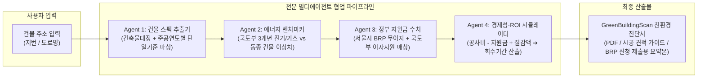
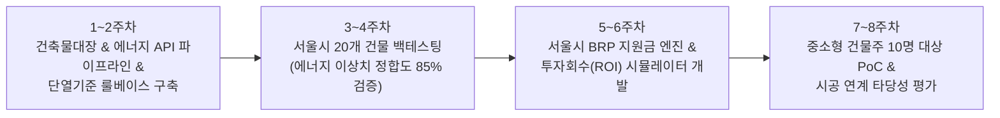

# [기획안 v0.1] 노후 건축물 에너지 소비 이상 진단 및 그린리모델링 보조금 매칭 리서치 멀티에이전트 (GreenBuildingScan)

- **담당**: R04 원민 (프론트엔드 / 사용자 흐름)
- **상태**: v0.1 기획 초안
- **작성일**: 2026-11-18
- **기획 대상**: 국토교통부 건축물대장 및 건물에너지 소비량 API, 서울시 BRP(건물에너지효율화사업) 연계 노후 건물 에너지 이상 진단 및 지원금 매칭 멀티에이전트 시스템
- **출처 및 참조 문서**:
  - 공공데이터포털 국토교통부 건축물대장정보 오픈 API (`https://www.data.go.kr/`)
  - 공공데이터포털 국토교통부 건물에너지 소비량(전기/가스/난방) 오픈 API (`https://www.data.go.kr/`)
  - 서울 열린데이터광장 서울시 건물에너지효율화사업(BRP) 융자지원 공고 및 에코마일리지 통계 (`https://data.seoul.go.kr/`)
  - [공공데이터 활용 리서치 멀티에이전트 서비스 아이디어 10선](2026-11-18_R04_공공데이터_활용_리서치_멀티에이전트_서비스_아이디어_10선.md)
  - [GreenBuildingScan 기술검토 및 세부 해결안](2026-11-18_R04_노후건축물_에너지진단_그린리모델링_기술검토_및_해결안.md)

---

## 0. 기획 배경 및 문제의식

전국 건축물 중 준공 후 15년 이상 경과된 노후 건축물의 비율은 75%를 넘어섰으며, 서울시의 경우 전체 온실가스 배출량의 약 68%가 '건물 부문'에서 발생하고 있습니다. 기후 위기 대응 및 탄소중립 정책에 따라 정부와 지자체는 매년 수천억 원 규모의 친환경 건축 지원금(그린리모델링 사업)을 편성하고 있으나, 민간 현장에서는 다음과 같은 정보 단절과 비용 낭비가 지속되고 있습니다:

1. **"깜깜이 관리비"로 방치되는 에너지 과소비 누수**:
   - 2000년대 이전에 건축된 중소형 꼬마빌딩(연면적 500~3,000㎡)은 단열 기준 미비와 노후 창호 기밀성 불량으로 인해, 동일 규모 신축 건물 대비 전기·가스 에너지를 30~50% 이상 과소비하고 있습니다.
   - 그러나 건물주와 임대관리인은 "건물이 낡아서 관리비가 많이 나오는가 보다" 하고 방치하며 매년 수백만~수천만 원의 냉난방비 손실을 감내하고 있습니다.
2. **복잡한 정부·지자체 그린리모델링 지원금(BRP, 이자지원)의 높은 정보 장벽**:
   - 국토부 민간 그린리모델링 사업(최대 4%p 대출이자 5년 지원)과 서울시 BRP(건물에너지효율화) 사업(최대 수천만~수억 원 무이자 융자 및 보조금) 등 파격적인 정책 지원이 존재합니다.
   - 하지만 매년 단열재 두께, 창호 에너지소비효율등급(1~3등급), 지원 한도 등의 요건이 바뀌고 신청 절차가 복잡하여 혜택을 놓치고 있습니다.
3. **정밀 에너지 진단 외주 비용의 높은 문턱**:
   - 공인 진단기관에 건물 실측 에너지 진단을 의뢰하면 건당 300만~800만 원의 비용과 수주의 시간이 소요되어, 중소형 건물주가 선뜻 진단을 받기 어렵습니다.
4. **시공사의 주먹구구식 견적과 투자회수율(ROI) 불신**:
   - 인테리어/창호 시공사는 "창호 바꾸면 따뜻해지고 기름값 아낀다"며 감에 의존해 영업하지만, 구체적으로 몇 년 만에 공사비를 회수할 수 있는지 객관적 수치(ROI)를 제시하지 못해 건물주가 의사결정을 내리지 못합니다.

본 기획은 **국토교통부 건축물대장 및 건물에너지 소비량 API와 서울시 BRP 지원 정책 공공데이터**를 연계하여, 주소 입력만으로 **"준공연도별 법정 단열 기준 역추적 ➔ 인근 유사 건물 대비 에너지 과소비 이상치(%) 산출 ➔ 최적 정부/지자체 보조금 매칭 ➔ 공사비 대비 투자회수 기간(ROI)"을 3분 만에 시뮬레이션하는 리서치 멀티에이전트(GreenBuildingScan)**를 제안합니다.

---

## 1. Target User & Field Pain Points (타겟 사용자와 현업의 고통)

### 1.1 타겟 사용자 정의
- **1차 사용자 (Core User)**:
  - 15년 이상 된 중소형 상가·근린생활시설(연면적 500~3,000㎡)을 소유한 **민간 개인/법인 건물주**
  - 중소형 빌딩 전문 **자산관리회사(PM, Property Manager)** 및 임대 관리 소장
  - 그린리모델링·단열창호 전문 **친환경 건축/설비 시공사 영업기획팀**
- **2차 의사결정자 및 유관기관 (Buyer / Partner)**:
  - 지자체 친환경건물과/기후환경본부 (BRP 지원금 예산 조기 집행 담당)
  - 한국부동산원 녹색건축처, 한국토지주택공사(LH) 그린리모델링 창조센터
  - 시중은행 ESG 녹색금융 및 친환경 시설개선 대출 심사역

### 1.2 사용자 상황 및 업무 흐름 (As-Is vs To-Be)

```mermaid
flowchart TD
    subgraph AsIs["현재 노후 건물 관리 흐름 (As-Is)"]
        A1["매달 고액의 전기·가스 관리비 고지서 수령"] --> A2["원인 미인지 (노후화로 당연시)"]
        A2 --> A3["시공사 방문 영업: '창호 바꾸시죠' (수천만 원 구두 견적)"]
        A3 --> A4["정부 지원금 존재 모름 & 투자회수 불신으로 공사 포기"]
        A4 --> A5["연간 수천만 원 냉난방비 지속 누수 및 자산가치 하락"]
    end

    subgraph ToBe["GreenBuildingScan 도입 후 (To-Be)"]
        B1["건물 주소 1줄 입력 (지번/도로명)"] --> B2["멀티에이전트 4중 에너지·규제 스크리닝 (3분)"]
        B2 --> B3["건축물대장 제원 + 준공 당시 단열 기준 자동 역추적"]
        B3 --> B4["인근 동종 건물 대비 에너지 과소비율(%) 정량 진단"]
        B4 --> B5["국토부/서울시 무이자 융자·보조금 매칭 & 투자회수(ROI) 산출"]
        B5 --> B6["정부 지원금 수령하여 최소 자부담으로 단열 공사 완료 & 관리비 35% 절감"]
    end
```

### 1.3 구체적 정량/정성 Pain Points
1. **연간 500만~2,000만 원 상당의 냉난방 에너지 누수 손실**:
   - 창호 기밀성 저하 및 외벽 단열 불량으로 겨울철 난방열 40%, 여름철 냉방열 30%가 외부로 유출되어 고스란히 관리비 부담으로 전가됨.
2. **수천만 원 상당의 지자체 무이자 융자 및 국비 이자지원 혜택 상실**:
   - 서울시 BRP 사업은 최대 6,000만~수억 원을 **무이자(0%) 융자 8년 분할 상환**으로 지원하지만, 건물주의 80% 이상이 이 제도의 존재 자체를 알지 못함.
3. **전문 진단 비용 부담 (건당 300만~800만 원)**:
   - 에너지관리공단이나 공인 진단업체에 실측 진단을 맡기기에는 초기 비용 부담이 커 진단 자체를 포기.
4. **건물 노후화에 따른 임차인 이탈 및 임대료 하락**:
   - 외풍이 심하고 관리비가 비싼 건물은 임차인(카페, 사무실, 병의원) 선호도가 떨어져 공실률 증가.

---

## 2. Existing Alternatives & Remaining Pain (기존 대안과 남는 고통)

| 기존 대안 | 제공하는 가치 | 한계점 및 사용자가 여전히 겪는 고통 (Remaining Pain) |
| :--- | :--- | :--- |
| **한국부동산원 '녹색건축포털(그린투게더)'** | 공공 에너지 소비량 조회 서비스 제공 | • 데이터 조회 절차가 복잡하고 **"인근 동종 건물과의 상대적 비교(이상치)"를 제공하지 않음** • **지원금(서울시 BRP/국토부)과의 자동 연계 매칭 및 ROI 계산 기능 부재** |
| **전문 에너지 진단 컨설팅사** | 현장 열화상 측정 및 정밀 에너지 감사 | • **건당 300만~800만 원의 높은 비용과 3~4주의 시간 소요** • 시공 견적 및 지원금 신청 행정 대행까지 원스톱으로 해결해주지 못함 |
| **창호/인테리어 시공업체 개별 견적** | 무료 현장 방문 실측 및 자재 견적 | • 시공 마진 중심의 영업으로, **"건물 전체 에너지 관점의 최적화"보다는 특정 고가 창호 설치만 권유** • 공사비 회수에 몇 년이 걸리는지 객관적 경제성 분석 불가 |

> **핵심 차별화 영역 (Painkiller Seam)**:
> 수백만 원의 진단비를 쓸 수 없는 중소형 건물주를 위해, **"주소 1줄"만 넣으면 공공데이터(건축물대장 + 월별 에너지 소비량)를 분석하여 '과소비 수준(%) - 추천 시공 부위 - 지자체 무이자 지원금 - 투자회수 기간(년)'을 3분 만에 무료로 진단**해 줌.

---

## 3. Problem Statement (문제 정의 한 문장)

> **"노후 중소형 빌딩 건물주와 자산관리자가 건물의 실제 에너지 과소비 수준을 객관적으로 진단하지 못하고 복잡한 정부·지자체 그린리모델링 지원 제도를 제때 찾지 못해, 매년 수천만 원의 냉난방비 누수와 지원금 혜택 상실을 겪고 있다."**

---

## 4. Solution & Key Features (솔루션 및 4대 핵심 피처)

### [FEAT-01] 건축물 제원 및 단열 기준 자동 역추적기 (Building Spec Parser)
- **데이터 소스**: 국토교통부 건축물대장 표제부/층별개요 오픈 API
- **핵심 기능**:
  - 주소 기반 고유 식별자(PK/PNU) 추출 및 준공연도, 허가일자, 연면적, 층수, 주용도, 구조 자동 파싱.
  - 건물이 허가받은 당시의 **법정 단열 기준(1979년, 1987년, 2001년, 2013년 등) 열관류율(U-value) 역추적**을 통해 외벽·창호 단열 취약 등급 판정.

### [FEAT-02] 실측 에너지 소비 이상치 벤치마커 (Energy Anomaly Benchmarker)
- **데이터 소스**: 국토교통부 건축물 에너지 소비량 API (월별 전기·도시가스·지역난방 사용량)
- **핵심 기능**:
  - 최근 3개년 월별 에너지 소비 패턴 추출 및 기상청 외기온도(난방도일 HDD / 냉방도일 CDD) 정규화.
  - **동일 자치구/유사 연면적/동일 용도 건물 100개소의 평균 에너지 사용량 대비 과소비율(%)** 정밀 산출 (예: "인근 건물 대비 겨울철 도시가스 42% 과소비").

### [FEAT-03] 정부·지자체 지원금 자동 매칭기 (Subsidy Matcher)
- **데이터 소스**: 서울 열린데이터광장 서울시 BRP 지원 기준, 국토부 민간 그린리모델링 사업 지침
- **핵심 기능**:
  - 건물의 용도 및 준공연도(15년 이상) 자격 검증 후, 적용 가능한 **'서울시 BRP 무이자(0%) 융자 지원 한도(최대 6,000만~수억 원, 8년 상환)'** 및 **'국토부 3~4%p 이자지원'** 자동 계산.
  - 지자체 친환경 인증 시 추가 부여되는 재산세 감면 등 세제 혜택 가이드 제공.

### [FEAT-04] 그린리모델링 경제성 및 투자회수율(ROI) 시뮬레이터 (ROI Calculator)
- **핵심 기능**:
  - 주요 공사 부위(로이단열창호 교체, 외단열 패널, 고효율 EHP 인버터)별 표준 공사비 산출.
  - `(총 공사비 - 지원금 수령액) ÷ 연간 에너지 비용 절감액` 수식을 통해 **'손익분기 투자회수 기간(Payback Period)'** 역산.
  - 시공사 비교 견적 시 활용할 수 있는 **"표준 자재 시방 체크리스트"** 및 서울시 BRP 신청용 **"에너지 진단 결과 사전 요약서(One-Page PDF)"** 발급.

---

## 5. Truth, Hypothesis, Counter-evidence, Unknowns (사실/가설/반대근거/미확인 분리)

| 구분 | 주요 내용 | 검증 방안 및 통제 계획 |
| :--- | :--- | :--- |
| **사실 (Fact)** *이미 입증된 사실* | • 국토교통부는 건축물대장 및 건축물별 월별 전기/가스 소비량 데이터를 오픈 API로 전수 공개하고 있음. • 서울시는 건물에너지효율화(BRP) 사업을 통해 연간 수백억 원의 무이자 융자를 고시·집행 중임. • 2000년대 이전 건물은 2018년 이후 신축 기준 대비 외벽/창호 법정 단열 기준이 3~5배 취약함. | 공공데이터포털 API 호출 테스트 및 서울시 기후환경본부 BRP 고시 공문 확인 완료. |
| **가설 (Hypothesis)** *검증이 필요한 전제* | • 외기 온도 보정(HDD/CDD)을 적용한 공공 에너지 소비량 분석만으로 전문 실측 진단 결과와 85% 이상 일치하는 이상치를 도출할 수 있을 것이다. • '무이자 융자 + 투자회수 5년 미만'을 정량 증명하면 건물주의 그린리모델링 공사 채택률이 3배 이상 증가할 것이다. | 실제 그린리모델링을 완료한 서울시 건물 20개소의 시공 전후 실측 데이터와 모델 예측치 백테스팅. |
| **가장 강한 반대 근거 (Counter-evidence)** | • 공공 에너지 소비량 데이터는 '건물 전체 계량기' 기준이므로, 특정 임차인(예: 암호화폐 채굴, 대형 베이커리 오븐 등)의 특이 소비로 인한 과소비를 건물 단열 결함으로 오판할 위험. • 건물주는 임대차 계약상 냉난방비를 임차인이 부담하므로, 공사비를 직접 투자할 유인이 부족할 수 있음(분할 인센티브 딜레마). | 건축물 주용도(근린생활/사무소/주거) 필터링 및 "공실률 감소 및 건물 자산가치 상승(매매가 프리미엄)" 관점의 경제성 지표를 함께 제시. |
| **미확인 사항 (Unknowns)** | • 과거 건물주가 자체적으로 창호 덧창 공사나 단열 보강을 부분적으로 진행했을 경우, 공부(건축물대장)상 기록되지 않아 모델이 이를 사전 인지하기 어려움. | 사용자 입력 단계에서 "최근 5년 내 창호/단열 개보수 여부" 1문항 체크박스로 모델 보정. |

---

## 6. 8-Week MVP Validation Plan & Kill Criteria (8주 MVP 검증 계획 및 중단 조건)

### 6.1 8주 MVP 검증 로드맵

- **1~2주차: 건축물대장 및 에너지 소비량 파이프라인 구축**
  - 국토부 건축물대장 표제부 API 및 월별 전기/가스 소비량 API 어댑터 개발.
  - 연도별 건축물 에너지절약설계기준 열관류율(U-value) 온톨로지 구축.
- **3~4주차: 과거 그린리모델링 완공 건물 20개소 백테스팅 (Back-testing)**
  - 실제 단열 공사를 진행한 서울시 중소형 빌딩 20곳의 시공 전 3개년 소비 데이터를 모델에 투입하여 이상치 진단 정확도 검증.
- **5~6주차: 서울시 BRP 지원금 매칭 및 ROI 계산 엔진 구현**
  - 무이자 융자 한도액 자동 계산기, 단열창호 표준 공사비 테이블, 투자회수 연수 산출 로직 완성.
- **7~8주차: 서울시 마포구/강남구 노후 빌딩 건물주 10명 대상 파일럿 실증**
  - 진단 보고서 제공 후 실제 그린리모델링 공사 검토 및 BRP 신청 의향 정량 측정.

### 6.2 중단 조건 (Kill Criteria)
다음 3가지 조건 중 하나라도 충족될 경우 프로젝트를 즉시 중단(Kill/Pivot)합니다:
1. **[에너지 이상치 오판율 초과]** 20개소 백테스팅 결과, 특이 업종(식당 등)으로 인한 왜곡을 보정하지 못해 오판율이 25%를 초과할 때.
2. **[건물주 수용성 기각]** 파일럿에 참여한 건물주 10명 중 8명 이상이 "임차인이 전기세를 내므로 5년 회수라도 내가 수천만 원을 들여 공사할 이유가 없다"고 응답하여 시장성 확보 실패 시.
3. **[공공 에너지 데이터 갱신 중단]** 국토교통부의 월별 건축물 에너지 소비량 오픈 API 제공 정책이 비공개로 전환될 때.

---

## 7. Business Impact & Value Proposition (도입 가치)

1. **건물당 연간 500만~2,000만 원 에너지 비용 절감**: 불필요한 열 누출을 막아 건물 운영 관리비 30~40% 절감.
2. **지자체 지원금을 통한 자부담 최소화**: 서울시 BRP 무이자(0%) 융자 및 국토부 지원을 결합하여 초기 목돈 부담 없이 8년 분할 상환으로 공사 실행.
3. **건물 자산가치 및 임대 경쟁력 제고**: 노후 건물의 냉난방 쾌적도 개선을 통해 공실률을 해소하고 친환경 건축물로서 매매 가치 상승.
