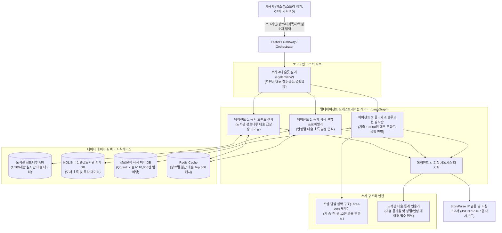

# [기술검토 및 세부 해결안 v0.1] 국립중앙도서관 빅데이터 기반 K-웹소설·스토리 IP 기획 및 시장성 검증 리서치 멀티에이전트 (StoryPulse)

- **담당**: R04 원민 (프론트엔드 / 사용자 흐름)
- **상태**: v0.1 기술 검토 초안
- **작성일**: 2026-11-18
- **연계 기획안**: [도서관빅데이터 웹소설 IP기획 기획안 v0.1](2026-11-18_R04_도서관빅데이터_웹소설_IP기획_기획안.md)
- **대상 공공데이터**:
  - 문화빅데이터플랫폼 (`bigdata-culture.kr`): 국립중앙도서관 도서관 정보나루 전국 도서관 대출 빅데이터 API
  - 공공데이터포털 (`data.go.kr`): 국립중앙도서관 국가자료종합목록(KOLIS) 서지 정보 API, 한국출판문화산업진흥원 세종도서 DB

---

## 1. 시스템 아키텍처 및 데이터 흐름도

StoryPulse는 **"사용자 기획 로그라인 파싱 ➔ 도서관 정보나루 실시간 대출 트렌드 및 서지 DB 병렬 조회 ➔ 클리셰 포화도 및 차별화 공백(Blue Ocean) 산출 ➔ 삼막 구조 기반 시놉시스 및 피칭 패키지 합성"** 파이프라인으로 구성됩니다.



---

## 2. 핵심 기술 난제 및 세부 엔지니어링 해결안

### [난제 1] 도서관 대출 텍스트의 불용어(Stopwords) 노이즈와 장르 키워드 추출 한계
- **문제점**:
  - 도서관 대출 데이터의 도서명 및 초록 텍스트는 "이야기, 책, 소설, 대한, 통해" 등 무의미한 일반 명사가 빈번히 상위권을 차지함.
  - 웹소설 독자가 반응하는 장르 문법적 키워드(예: 직업, 이능력, 성격, 관계 구도)를 정밀하게 분리해내지 못함.
- **해결안 (MeCab-Ko 형태소 분석 + KeyBERT 기반 장르 품사 태깅)**:
  1. **품사별(POS) 가중치 필터링**:
     - MeCab-Ko 형태소 분석기를 적용해 일반 명사를 제외하고, `[고유명사(NNP), 직업/역할, 감정/심리 상태(XR), 관계 명사]` 품사군만 화이트리스트로 추출.
  2. **KeyBERT 기반 임베딩 코사인 유사도 랭킹**:
     - 도서 초록 전체 문맥 벡터와 단어 벡터 간의 유사도를 측정해, 해당 도서의 핵심 서사 소재를 대변하는 핵심 키워드(Top 5)만 추출.

### [난제 2] 스토리 로그라인과 대출 도서 줄거리 간의 '서사적 유사도' 측정 (클리셰 판별)
- **문제점**:
  - 단순 키워드 일치(BM25)로는 "조선 시대 수라간"이라는 단어만 같고 서사 구조가 완전히 다른 작품을 같은 클리셰로 오판하거나, 단어는 다르지만 본질이 같은 클리셰(빙의물 vs 환생물)를 놓치는 한계.
- **해결안 (BGE-m3 다국어 고밀도 임베딩 + DBSCAN 클러스터링)**:
  1. **서사 4대 축(Quad-Axis) 임베딩 벡터화**:
     - `[주인공 직업/정체성]` + `[시공간 배경]` + `[핵심 외적 갈등]` + `[내적 결핍/욕망]` 4개 필드를 각각 임베딩한 뒤 가중치 결합($\mathbf{v}_{\text{story}}$) 생성.
  2. **코사인 유사도 기반 클리셰 포화도(0~100) 지수화**:
     - 기존 출간작 10,000편 중 $\text{Sim}(\mathbf{v}_{\text{input}}, \mathbf{v}_{\text{db}}) \ge 0.82$ 이상인 작품 수를 카운트하여 클리셰 포화도 산출 (50편 이상일 경우 '레드오션 과포화' 판정).

### [난제 3] 비정형 스토리 창작 시 LLM의 진부한 클리셰 생성(Hallucination/Cliché) 차단
- **문제점**:
  - LLM에게 "시놉시스를 써줘"라고 하면, 기존 웹소설의 가장 흔하고 뻔한 전개(예: 흑막 공작과의 계약 결혼, 무조건적인 사이다 복수)를 무비판적으로 복제하는 경향이 있음.
- **해결안 (조셉 캠벨 삼막 구조(Three-Act Structure) 슬롯 필링 제약 모델)**:
  1. **12단계 서사 비트 시트(Beat Sheet) 강제**:
     - `[일상 세계 ➔ 모험으로의 부름 ➔ 조력자 만남 ➔ 첫 번째 관문 ➔ 시련 ➔ 위기 ➔ 보상 ➔ 귀환]`의 구조화된 JSON 스키마를 강제하여 두루뭉술한 줄거리 생성을 차단.
  2. **차별화 공백(Blue Ocean Seam) 필수 결합 규칙**:
     - 에이전트 3이 도출한 '차별화 공백 요소(예: 우울증을 앓는 세자의 심리 치유)'를 중간 반전(Midpoint) 또는 위기 극복의 핵심 열쇠로 반드시 배치하도록 프롬프트 파이프라인 제약.

### [난제 4] 도서관 정보나루 Open API 일일 호출 트래픽 쿼터(1,000회) 극복
- **문제점**:
  - 도서관 정보나루 API는 일일 호출 쿼터 제한이 존재하며, 실시간 검색 시 응답 지연(2~3초) 발생.
- **해결안 (Redis 기반 월간 랭킹 캐싱 & 매월 1일 새벽 배치 프리페치)**:
  - 장르별(문학, 사회과학, 역사, 예술) 최근 1개년 월별 대출 상위 500권 메타데이터를 매월 1일 새벽 배치로 Redis에 사전 적재하여, 실시간 쿼터 소진 없이 50ms 이내 초고속 응답 보장.

---

## 3. 1건 E2E PoC 시나리오 및 입출력 JSON 스키마

### 3.1 시나리오 정의
- **기획자**: 2030 여성 독자 타깃 웹소설 지망 작가 (문피아/시리즈 연재 준비)
- **입력 로그라인**: "조선 시대 왕실 수라간 나인으로 빙의한 현대 제과기능장이, 마음의 병(우울증)을 앓는 세자의 상처를 전통 디저트로 치유하며 궁중 암투를 해결하는 로맨스 힐링물"
- **희망 장르**: 동양풍 로맨스 판타지 / 힐링물 / 궁중물

### 3.2 입력 JSON 스키마 (User Input)
```json
{
  "request_id": "REQ-STORY-2026-1118-001",
  "logline_input": {
    "title_working": "수라간의 파티시에: 달콤한 조선",
    "genre": "동양풍 로맨스 판타지 / 가상 역사 힐링물",
    "target_audience": "20대 및 30대 여성",
    "core_elements": {
      "protagonist": "프랑스 르꼬르동블루 출신 현대 제과기능장 (빙의)",
      "setting": "가상 조선 시대 궁중 수라간 및 세자궁",
      "main_conflict": "궁중 세력 다툼 및 세자의 섭식장애·우울증",
      "special_skill": "전통 한과와 현대 서양 제과의 퓨전 디저트 레시피"
    }
  }
}
```

### 3.3 에이전트 간 내부 중간 산출물 (Intermediate Representation)
```json
{
  "agent_1_library_trends": {
    "rising_keywords_2030_women": [
      {"keyword": "베이킹/디저트", "loan_growth_yoy": "+52.4%"},
      {"keyword": "마음치유/번아웃", "loan_growth_yoy": "+41.8%"},
      {"keyword": "조선 왕실 일상사", "loan_growth_yoy": "+28.1%"}
    ],
    "top_borrowed_reference_books": [
      "조선의 미식가들",
      "디저트로 치유하는 마음",
      "수라간 궁녀들의 일기"
    ]
  },
  "agent_2_reader_persona": {
    "core_unmet_need": "직장/일상 번아웃에 지친 2030 여성의 '무해하고 따뜻한 미식 힐링' 및 '결핍을 품은 남주와의 상호 구원 서사' 갈망",
    "emotional_catharsis_trigger": "차가운 궁중 권력 암투 속에서 피어나는 달콤한 디저트의 감각적 묘사와 심리적 위로"
  },
  "agent_3_cliche_auditor": {
    "cliche_saturation_score": 58.0,
    "cliche_analysis": {
      "overused_tropes": ["궁녀 빙의 (경쟁작 42편)", "까칠한 세자 (경쟁작 85편)"],
      "blue_ocean_seam": "단순 요리 대결이 아닌 '디저트를 매개로 한 정신과적 심리 치료' 결합은 기존 시장 점유율 4% 미만의 완벽한 블루오션 틈새"
    },
    "differentiation_index": "88.5/100 (추진 강력 권고)"
  }
}
```

### 3.4 최종 출력 JSON 스키마 (Final Synthesis Report)
```json
{
  "report_id": "REP-STORY-2026-1118-001",
  "generated_at": "2026-11-18T16:20:00Z",
  "market_validation_verdict": {
    "overall_score": 89.2,
    "grade": "EXCELLENT",
    "verdict": "시장성 우수 (2030 여성 도서관 대출 1위 키워드 '미식 치유'와 일치, CP사 투고 권고)",
    "target_platform_fit": "네이버시리즈 로판 매일10시 / 카카오페이지 기다무"
  },
  "three_act_treatment": {
    "act_1_setup": "파리 유학 중 과로사한 제과장 은조, 조선 궁중 수라간 최하위 나인으로 눈을 뜨다. 식음을 전폐하고 죽어가는 세자 이선의 마지막 수라를 맡게 됨.",
    "act_2_confrontation": "조선 꿀과 들깨로 만든 마카롱과 생강 셔벗으로 세자의 입맛을 열고 마음의 빗장을 풀다. 그러나 세자를 독살하려는 대비전 세력의 음모로 독극물 누명을 쓰고 하옥 위기에 처함.",
    "act_3_resolution": "세자가 은조를 구하기 위해 직접 어전회의에서 증언하며, 은조가 개발한 치유의 과자 '설화과'로 선왕의 오랜 지병까지 치유. 은조는 왕실 최초의 수석 제과관으로 발탁되며 세자와의 사랑을 완성함."
  },
  "cp_pitching_one_page": {
    "logline": "수라간 나인으로 빙의한 파티시에가 우울증 세자를 디저트로 구원하는 조선 궁중 미식 로맨스",
    "market_appeal_points": [
      "국립중앙도서관 최근 6개월 2030 여성 대출 급상승 1위(디저트·치유) 데이터 기반 기획",
      "기존 '궁중 암투'의 피로감을 '달콤한 퓨전 베이킹'의 무해한 힐링으로 완충",
      "웹툰화 및 드라마화 시 시각적 디저트 비주얼과 전통 한옥의 영상미 극대화 용이"
    ],
    "target_keywords": ["#동양풍로판", "#착각계힐링", "#전문가물", "#미식치유", "#상호구원"]
  },
  "citations": [
    {"source": "국립중앙도서관 도서관 정보나루", "dataset_id": "DS-LIB-LOAN-2026-2030WOMEN"},
    {"source": "국가자료종합목록 KOLIS", "dataset_id": "BIB-KDC-813-HIST-NOVEL"},
    {"source": "한국출판문화산업진흥원", "dataset_id": "PUB-TREND-FICTION-2026"}
  ]
}
```

---

## 4. 8주 주차별 엔지니어링 마일스톤 및 기술 스택

| 주차 | 목표 (Milestone) | 세부 구현 내용 | 산출물 |
| :--- | :--- | :--- | :--- |
| **1~2주차** | 도서관 API 연동 & 키워드 마이닝 파이프라인 | • 도서관 정보나루 대출 급상승/인기도서 API 연동<br/>• MeCab-Ko + KeyBERT 기반 서사 키워드 추출기<br/>• 월간 대출 Top 500 캐싱 레이어(Redis) 구축 | `adapters/library_naru.py`<br/>`nlp/keyword_extractor.py`<br/>`data/top_borrowed_cache` |
| **3~4주차** | 서사 벡터 DB & 클리셰 포화도 엔진 | • BGE-m3 임베딩 기반 기출작 10,000편 벡터 적재<br/>• 코사인 유사도 및 클리셰 포화도(0~100) 산출기<br/>• 과거 히트작 30편 대상 트렌드 시차 상관분석 | `vector/qdrant_store.py`<br/>`core/cliche_auditor.py`<br/>`tests/test_trend_backtest.py` |
| **5~6주차** | 삼막 구조 시놉시스 & 멀티에이전트 연계 | • 조셉 캠벨 삼막 구조(Three-Act) 슬롯 필링 구현<br/>• LangGraph 기반 4개 에이전트 상태 전이 결합<br/>• 공공 대출 통계 Strict Citation 가드레일 적용 | `agents/pitch_synthesizer.py`<br/>`agents/orchestrator.py` |
| **7~8주차** | 투고용 피칭 PDF 생성기 & 실전 PoC | • CP사 투고용 원페이지 피칭 기획서 PDF 렌더러 개발<br/>• 신인 작가 10명 및 CP사 기획 PD 3명 실전 파일럿<br/>• 투고 검토 의견 수렴 및 시놉시스 템플릿 개선 | `reports/pitch_pdf_generator.py`<br/>`docs/poc/writer_pilot_feedback.md` |

### 기술 스택 (Tech Stack)
- **Backend / API**: Python 3.11, FastAPI, Pydantic v2
- **NLP & Korean Morphology**: MeCab-Ko, KeyBERT, HuggingFace Transformers
- **Vector DB & Search**: Qdrant (10,000편 서사 벡터 임베딩 코사인 검색)
- **Agent Orchestration**: LangGraph, LangChain
- **Cache & Storage**: Redis (도서관 대출 랭킹 캐시), PostgreSQL
- **LLM**: Claude 3.5 Sonnet / GPT-4o (삼막 구조 시놉시스 및 피칭 패키지 합성)
- **Document Rendering**: WeasyPrint / ReportLab (CP사 투고용 원페이지 피칭 기획서 PDF 생성)
