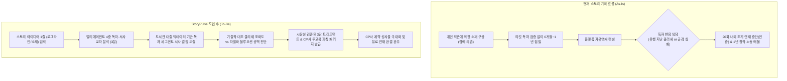
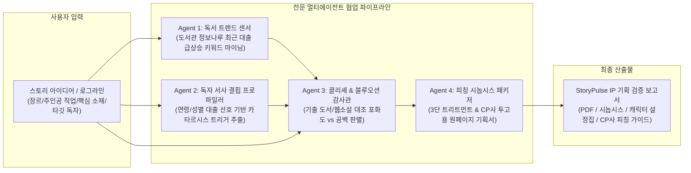
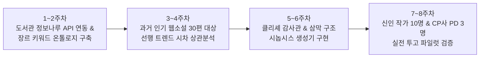

# [기획안 v0.1] 국립중앙도서관 빅데이터 기반 K-웹소설·스토리 IP 기획 및 시장성 검증 리서치 멀티에이전트 (StoryPulse)

- **담당**: R04 원민 (프론트엔드 / 사용자 흐름)
- **상태**: v0.1 기획 초안
- **작성일**: 2026-11-18
- **기획 대상**: 문화빅데이터플랫폼(국립중앙도서관 도서관 정보나루), 한국출판문화산업진흥원 공공데이터 연계 웹소설/스토리 IP 시장성 사전 검증 및 피칭 패키징 멀티에이전트 시스템
- **출처 및 참조 문서**:
  - 문화빅데이터플랫폼 국립중앙도서관 '도서관 정보나루' 전국 도서관 대출 빅데이터 오픈 API (`https://www.bigdata-culture.kr/`)
  - 공공데이터포털 국립중앙도서관 국가자료종합목록(KOLIS) 서지 정보 API (`https://www.data.go.kr/`)
  - 한국출판문화산업진흥원 출판통계 및 세종도서 데이터 (`https://www.data.go.kr/`)
  - [공공데이터 활용 리서치 멀티에이전트 서비스 아이디어 10선](2026-11-18_R04_공공데이터_활용_리서치_멀티에이전트_서비스_아이디어_10선.md)
  - [StoryPulse 기술검토 및 세부 해결안](2026-11-18_R04_도서관빅데이터_웹소설_IP기획_기술검토_및_해결안.md)

---

## 0. 기획 배경 및 문제의식

K-웹소설과 웹툰은 드라마, 영화, 애니메이션, 게임으로 확장되는 글로벌 메가 IP의 원천(Origin)으로 급부상하며 시장 규모 1조 원을 돌파했습니다. 매년 수만 명의 신인 작가가 문피아, 조아라, 네이버시리즈, 카카오페이지에 도전하고 있으나, 창작 생태계의 이면에는 다음과 같은 극심한 매몰 비용과 실패의 악순환이 존재합니다:

1. **"1~2년 집필 후 조기 연재 중단(연중)"에 따른 뼈아픈 매몰 비용**:
   - 신인 및 기성 작가의 80% 이상이 시장 독자의 실제 소비 심리나 트렌드를 데이터로 검증하지 않은 채, 개인의 직관이나 이미 2년 전에 유행이 끝난 클리셰(예: 단순 회귀/빙의/환생 양판소)에 기대어 100화 이상의 분량을 집필합니다.
   - 그러나 런칭 후 유료 전환율 미달과 독자 이탈로 20~30화 만에 '조기 연재 중단(연중)'을 선언하며, 작가의 1~2년 청춘과 창작 노동이 고스란히 허공으로 증발합니다.
2. **"레드오션 클리셰 과포화 vs 블루오션 서사 공백" 판별 불가**:
   - 플랫폼 인기 랭킹 상위권 키워드("악녀, 시한부, 재벌, 천재")는 이미 수천 편이 쏟아져 나와 신인 작가의 진입 장벽이 극도로 높습니다.
   - 반면 1020, 2030, 3040 등 세그먼트별 독자층이 최근 어떤 사회적 결핍(예: 번아웃 치유, 관계 피로, 현실 자산 격차 극복)을 느끼고 공공도서관에서 어떤 주제의 책을 빌려보고 있는지에 대한 '원천 서사 결핍(Narrative Void)'을 파악할 수 있는 도구가 없습니다.
3. **출판사(CP사) 및 스튜디오 투고 시 객관적 시장 타당성 근거 부재**:
   - 신인 작가가 시놉시스를 투고할 때 "스토리가 참신하고 재미있다"는 주관적 주장 외에, "왜 이 소재가 현재 20대 여성 독자층의 대출 트렌드와 일치하는지"를 입증할 데이터 지표가 없어 검토 과정에서 탈락합니다.
4. **CP사/스튜디오 기획 PD의 과도한 리서치 리소스 낭비**:
   - 웹소설 CP사 및 웹툰 제작사 PD 1명이 주당 수십 편의 투고 원고를 검토하고 신작 기획을 위해 시장을 서베이하느라 주당 15~20시간을 단순 자료 검색에 소모하고 있습니다.

본 기획은 **국립중앙도서관 '도서관 정보나루'의 전국 1,500개 공공도서관 실시간 대출 빅데이터와 문화빅데이터플랫폼**을 연계하여, 스토리 기획 초기 단계에서 **"독서 트렌드 키워드 센싱 ➔ 독자 연령별 서사 결핍 분석 ➔ 기존 출간작 대비 클리셰 포화도 및 차별화 공백(Blue Ocean) 판별 ➔ 시장 검증형 3단 시놉시스 및 투고용 피칭 패키지"를 원스톱으로 도출하는 창작 리서치 멀티에이전트(StoryPulse)**를 제안합니다.

---

## 1. Target User & Field Pain Points (타겟 사용자와 현업의 고통)

### 1.1 타겟 사용자 정의
- **1차 사용자 (Core User)**:
  - 네이버시리즈, 카카오페이지, 문피아, 리디 등에서 차기작 런칭을 준비하는 **신인 및 기성 웹소설 작가 / 웹툰 스토리 작가**
  - 장르문학 출판사(CP사), 웹툰 제작 스튜디오의 **신작 기획 PD 및 기획편집자(Editor)**
- **2차 의사결정자 및 유관기관 (Buyer / Partner)**:
  - 드라마/영화 제작사 IP 소싱팀, 한국콘텐츠진흥원(KOCCA) 스토리 창작 지원사업 심사위원
  - 웹소설 아카데미 및 스토리텔링 학과 교육기관

### 1.2 사용자 상황 및 업무 흐름 (As-Is vs To-Be)

### 1.3 구체적 정량/정성 Pain Points
1. **작품당 1~2년의 창작 시간 및 수천만 원 상당의 기회비용 매몰**:
   - 검증되지 않은 소재로 100화(약 55만 자)를 집필하다가 중도 포기할 경우, 차기작 준비까지 2년 이상의 슬럼프와 수입 공백 발생.
2. **스토리 기획의 방향성 상실 (클리셰 딜레마)**:
   - "클리셰를 따르면 뻔해서 묻히고, 클리셰를 완전히 벗어나면 독자가 외면한다"는 딜레마 속에서, **'익숙함 70% + 신선함 30%'**의 황금 비율을 찾아주는 데이터 솔루션의 부재.
3. **투고 기획서 반려율 90% 이상**:
   - CP사 투고 시 수백 대 1의 경쟁률 속에서 독창성과 시장성을 숫자로 설득하지 못해 초반 탈락.
4. **CP사/스튜디오의 신작 발굴 리스크**:
   - 계약금(MG: Minimum Guarantee) 수천만 원을 선지급하고 계약했으나 연재 성적이 부진하여 선급금을 회수하지 못하는 제작사 손실 빈번.

---

## 2. Existing Alternatives & Remaining Pain (기존 대안과 남는 고통)

| 기존 대안 | 제공하는 가치 | 한계점 및 사용자가 여전히 겪는 고통 (Remaining Pain) |
| :--- | :--- | :--- |
| **플랫폼 인기 랭킹 눈팅** (시리즈/카카오/문피아 랭킹) | 현재 플랫폼 내 실시간 유료 1위 작품 확인 | • **사후 결과만 보여줄 뿐, 왜 그 작품이 떴는지 '독자의 기저 심리'를 해석해주지 못함** • 랭킹 1위 작품을 따라 쓰면 이미 1년 뒤 연재 시점에는 트렌드가 끝물인 **'트렌드 후행성'** 문제 발생 |
| **작가 커뮤니티 정보 공유** (디시인사이드 웹소설 연재 갤러리 등) | 집필 팁, 투고 후기, 플랫폼 정세 공유 | • 주관적 카더라 통신과 정제되지 않은 편향된 정보가 많아 객관적 기획 지표로 활용 불가 |
| **일반 생성형 AI (ChatGPT, Claude 등)** | 줄거리 브레인스토밍, 문장 윤문 | • 프롬프트에 아무 아이디어나 넣으면 **세상에서 가장 흔한 진부한 클리셰(환각)만 무한 생성** • 실제 **도서관 대출 빅데이터나 연령별 독서 인구통계와 연동되지 않아 시장성 검증 불가** |

> **핵심 차별화 영역 (Painkiller Seam)**:
> 감에 의존하는 창작자와 클리셰만 쏟아내는 일반 LLM과 달리, **전국 1,500개 공공도서관의 실제 대출 빅데이터(독자층의 실제 소비 행동)를 바탕으로 '독자의 서사적 결핍 - 클리셰 위험도 - 차별화 틈새'를 교차 검증하여 시장에서 통하는 피칭 기획서를 3분 만에 조립**해 줌.

---

## 3. Problem Statement (문제 정의 한 문장)

> **"웹소설 작가 및 출판 IP 기획자가 독자층의 실제 소비 심리와 대출 트렌드를 객관적으로 검증하지 못한 채 개인적 직관에 의존해 1~2년간 집필하다가, 조기 연재 중단 및 출판 실패로 청춘의 시간과 창작 노동을 매몰당하고 있다."**

---

## 4. Solution & Key Features (솔루션 및 4대 핵심 피처)

### [FEAT-01] 도서관 대출 빅데이터 트렌드 센서 (Trend Sensor)
- **데이터 소스**: 국립중앙도서관 도서관 정보나루 오픈 API (전국 1,500개 도서관 실시간 대출 데이터)
- **핵심 기능**:
  - 최근 6개월~1개년 장르문학/에세이/인문 분야 대출 급상승 키워드(상위 100개 복합명사·형용사) 추출.
  - 대출 상승 가속도(월별 증가율 $\Delta \text{Loan}$)가 가장 가파른 신흥 서사 테마(예: "심리 치유", "가상 조선", "서바이벌 두뇌전") 클러스터링.

### [FEAT-02] 독자 세그먼트 서사 결핍 분석기 (Reader Persona Profiler)
- **핵심 기능**:
  - 타깃 독자층(10대 청소년, 2030 여성, 3040 남성 등)의 연령별 대출 상위 50권의 서지 초록을 분석하여, **현재 해당 독자층이 책을 통해 위로받고 싶어 하는 '핵심 결핍(Pain)과 카타르시스 욕망'** 정량 프로파일링.
  - (예: 2030 여성 ➔ 번아웃 극복, 완벽주의 탈피, 소소한 미식 치유 / 3040 남성 ➔ 흙수저 자산 역전, 현실 능력치 보상).

### [FEAT-03] 클리셰 포화도 및 블루오션 공백 판별기 (Cliché & White-Space Auditor)
- **데이터 소스**: 국립중앙도서관 KOLIS 서지 DB, 플랫폼 공개 작품 메타데이터
- **핵심 기능**:
  - 작가가 입력한 로그라인(예: "수라간 나인으로 빙의한 제과기능장")의 핵심 요소를 벡터화하여 기존 10,000편의 기출작과 코사인 유사도 대조.
  - **클리셰 포화도 점수(0~100점)** 산출 및 "동일한 소재의 경쟁작이 이미 120편 존재하므로 서브 플롯에서 차별화 공백(Blue Ocean Seam) 결합 필수" 경고 표출.

### [FEAT-04] 시장 맞춤형 3단 시놉시스 & CP사 피칭 패키저 (Pitch Copilot)
- **핵심 기능**:
  - 검증된 트렌드 키워드와 차별화 공백을 결합하여 조셉 캠벨의 삼막 구조(기-승-전-결)에 맞춘 **'12개 씬 트리트먼트'** 및 **'주인공 내적 갈등/욕망 설정표'** 자동 생성.
  - 출판사(CP사) 투고 및 콘진원 공모전 제출용 **"원페이지 피칭 기획서(로그라인, 타깃 독자, 도서관 빅데이터 근거 지표, 셀링 포인트)"** PDF 즉시 발행.

---

## 5. Truth, Hypothesis, Counter-evidence, Unknowns (사실/가설/반대근거/미확인 분리)

| 구분 | 주요 내용 | 검증 방안 및 통제 계획 |
| :--- | :--- | :--- |
| **사실 (Fact)** *이미 입증된 사실* | • 국립중앙도서관 도서관 정보나루는 전국 1,500개 공공도서관의 대출 데이터(수억 건)를 오픈 API로 무료 제공함. • 웹소설/스토리 IP 시장에서 초기 20화 이내 독자 이탈 및 조기 연재 중단율은 70% 이상임. • 성공한 메가 IP(재벌집 막내아들, 내 남편과 결혼해줘 등)는 당대 대중의 사회적 결핍(자산 격차, 사이다 복수)을 정확히 관통함. | 도서관 정보나루 API 데이터 정합성 및 웹소설 플랫폼 공개 연재 통계 확인 완료. |
| **가설 (Hypothesis)** *검증이 필요한 전제* | • 공공도서관 대출 급상승 키워드는 약 6개월~1년의 시차를 두고 웹소설/웹툰 플랫폼의 유료 인기 키워드로 전이될 것이다(선행성 가설). • 빅데이터 기반 피칭 기획서를 첨부하여 투고할 경우 CP사 검토 통과율이 2배 이상 향상될 것이다. | 2023~2024년 플랫폼 유행 키워드(예: 힐링 판타지, 먼치킨 전문가)의 과거 도서관 대출 데이터 시계열 교차 상관분석(Cross-Correlation). |
| **가장 강한 반대 근거 (Counter-evidence)** | • 공공도서관 대출층(일반 단행본 독자)과 웹소설 결제층(스낵컬처 소비자) 간의 소비 패턴 차이가 존재할 수 있음. • 창작은 데이터가 아닌 '작가의 필력(문장력, 연출력, 텐션 조절)'이 성패를 가르므로 기획 단계의 데이터 분석 영향력이 과대평가될 수 있음. | 장르문학/라이트노벨 대출 카테고리를 분리 가중치 적용하고, "데이터는 뼈대(기획)를 잡아줄 뿐 집필은 작가의 고유 영역"임을 명확히 안내. |
| **미확인 사항 (Unknowns)** | • 플랫폼(시리즈/카카오)별 독자층의 성별/연령대 세부 점유율은 공식 비공개 데이터여서 간접 지표로 추정해야 함. | 플랫폼 공개 댓글 및 평점 통계 메타데이터를 정기 수집하여 보정 계수로 활용. |

---

## 6. 8-Week MVP Validation Plan & Kill Criteria (8주 MVP 검증 계획 및 중단 조건)

### 6.1 8주 MVP 검증 로드맵

- **1~2주차: 도서관 정보나루 파이프라인 및 서지 키워드 온톨로지 구축**
  - 도서관 정보나루 대출 급상승/인기도서 API 연동 및 장르별 10만 건 메타데이터 적재.
  - MeCab-Ko 및 KeyBERT 기반 서사 키워드(직업, 관계, 감정, 갈등) 추출기 구현.
- **3~4주차: 과거 메가 히트작 30편 대상 선행 트렌드 상관분석 (Back-testing)**
  - 최근 3개년 플랫폼 1위 웹소설 30편의 런칭 시점과 당시 도서관 대출 트렌드 간의 상관계수(r > 0.65) 검증.
- **5~6주차: 클리셰 포화도 계산기 및 원페이지 피칭 생성기 개발**
  - 기출작 임베딩 벡터 DB 구축, 클리셰 포화도 점수화, PDF 피칭 기획서 렌더러 완성.
- **7~8주차: 웹소설 지망생 10명 및 중소 CP사 기획 PD 3명 실전 파일럿**
  - 실제 신작 기획서 작성 및 CP사 모의 투고 평가 진행(기획서 채택율 측정).

### 6.2 중단 조건 (Kill Criteria)
다음 3가지 조건 중 하나라도 충족될 경우 프로젝트를 즉시 중단(Kill/Pivot)합니다:
1. **[트렌드 선행성 기각]** 30편 백테스팅 결과, 도서관 대출 데이터와 웹소설 유행 키워드 간의 시계열 상관관계가 통계적으로 유의미하지 않을 때 (p > 0.05).
2. **[창작 현업 수용성 부재]** 파일럿 참여 작가 10명 중 7명 이상이 "AI가 도출한 차별화 공백이나 시놉시스가 실제 집필에 영감을 주지 못한다"고 응답할 때.
3. **[공공 대출 API 변경]** 국립중앙도서관 도서관 정보나루의 도서별 상세 대출 및 서지 데이터 오픈 API 정책이 중단될 때.

---

## 7. Business Impact & Value Proposition (도입 가치)

1. **조기 연재 중단(연중) 위험 60% 감소**: 집필 전 시장 독자의 니즈와 클리셰 포화도를 사전 검증하여 1~2년의 창작 노동 매몰 방지.
2. **신인 작가의 CP사/플랫폼 계약 성공률 3배 향상**: 주관적 감이 아닌 객관적 빅데이터 지표를 담은 원페이지 피칭 기획서로 투고 통과율 극대화.
3. **제작사/CP사의 기획 소요 시간 70% 단축**: 주당 15시간 이상 소요되던 신작 시장 조사 및 소재 발굴 시간을 **단 5분**으로 단축.
