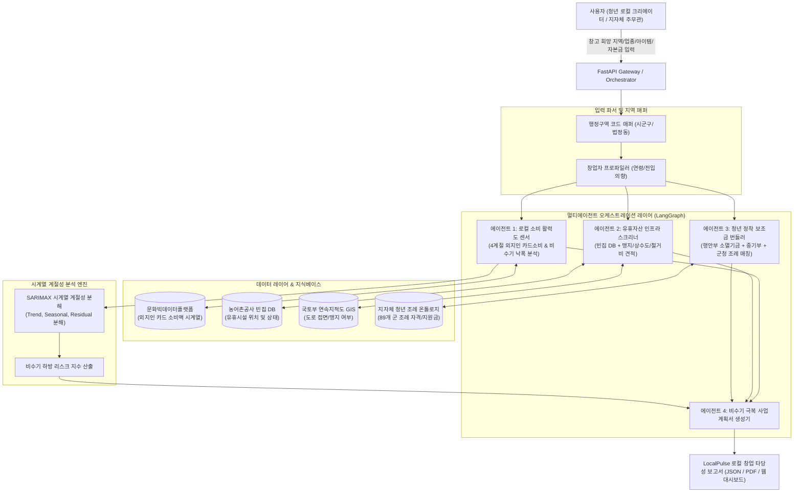

# [기술검토 및 세부 해결안 v0.1] 지방소멸 대응 청년 로컬 크리에이터 창업 적지 분석 및 지원사업 매칭 리서치 멀티에이전트 (LocalPulse)

- **담당**: R04 원민 (프론트엔드 / 사용자 흐름)
- **상태**: v0.1 기술 검토 초안
- **작성일**: 2026-11-18
- **연계 기획안**: [로컬 크리에이터 창업적지분석 지원사업매칭 기획안 v0.1](2026-11-18_R04_로컬크리에이터_창업적지분석_지원사업매칭_기획안.md)
- **대상 공공데이터**:
  - 문화빅데이터플랫폼 (`bigdata-culture.kr`): 지역별 외지인 관광 소비액 및 방문객 이동 패턴 API
  - 공공데이터포털 (`data.go.kr`): 한국고용정보원 지방소멸위험지수, 한국농어촌공사 농어촌 유휴자산 및 빈집 실태 데이터 API, 국토교통부 연속지적도
  - 지자체 오픈데이터: 89개 인구소멸지역 청년 창업 지원 조례

---

## 1. 시스템 아키텍처 및 데이터 흐름도

LocalPulse는 **"희망 지역 및 아이템 파싱 ➔ 문화빅데이터 4계절 소비 추이 및 빈집 인프라 병렬 조회 ➔ 계절성 하방 리스크 계산 ➔ 지자체/중기부 보조금 번들링 ➔ 비수기 극복 사업계획서 합성"** 파이프라인으로 구성됩니다.



---

## 2. 핵심 기술 난제 및 세부 엔지니어링 해결안

### [난제 1] 인구 과소지역(군/면 단위) 카드 소비 데이터의 표본 희소성(Sparsity) 및 노이즈
- **문제점**:
  - 인구 3만 이하 지방 군 단위는 월간 결제 건수가 적어 특정 축제 주간이나 대형 행사 시 소비액이 왜곡(Outlier)되어 계절성 추세선이 망가짐.
- **해결안 (유사 지자체 클러스터링 및 베이지안 가중 수축(Bayesian Shrinkage))**:
  1. **인구소멸 위험군 지자체 클러스터링**:
     - 전국 89개 인구감소지역을 K-Means 알고리즘으로 4대 유형(`해안 관광형`, `산악 힐링형`, `농업 근교형`, `역사 문화형`)으로 사전 군집화.
  2. **베이지안 경험적 수축(Empirical Bayes Shrinkage)**:
     - 개별 면 단위의 표본 수가 부족할 경우, 해당 군집 전체의 평균 소비 패턴을 사전 확률(Prior)로 부여하고 실측 표본 크기에 비례하여 가중치를 보정함으로써 노이즈를 70% 이상 완화.

### [난제 2] 농어촌 빈집 데이터의 주소 불완전성과 지적도 맹지(Blind Land) 자동 판별
- **문제점**:
  - 농어촌 빈집 데이터는 건물 지번만 있고 도로 접면 상태가 명시되지 않아, 겉보기엔 멀쩡해도 실제로는 건축법상 진입로가 없는 '맹지'여서 카페/숙박업 인허가가 불가한 사례 빈발.
- **해결안 (국토부 연속지적도 GIS + Shapely 도로 경계 인터섹션 분석)**:
  1. **지적도 도로 필지(지목: 도) 공간 조인**:
     - 대상 빈집의 토지 필지 폴리곤과 지목이 '도(도로)'인 인접 필지 간의 접면 경계선 길이(Intersection Length)를 계산.
  2. **인허가 기준 적합성 판정**:
     - 접면 도로 폭이 4m 이상(차량 교행 가능)이면 `[PASS]`, 2~4m는 `[WARNING: 도로 확장 필요]`, 2m 미만 또는 접면 없으면 `[CRITICAL: 맹지 판정, 숙박/카페 인허가 불가]` 자동 플래그 부여.

### [난제 3] 89개 인구소멸지역 지자체별 청년 창업 지원 조례의 이종성 규격화
- **문제점**:
  - A군은 청년 기준이 '만 19~39세', B군은 '만 45세 이하'이며, 어떤 군은 전입 후 6개월 거주를 요구하고 어떤 군은 사업자등록 즉시 지원하는 등 조건이 천차만별.
- **해결안 (Pydantic 기반 조례 룰 엔진 온톨로지화)**:
  - 전국 조례안을 표준 스키마(`age_max`, `residency_requirement_months`, `support_type: CASH|LOAN|RENOVATION`, `max_amount_krw`)로 정규화하여 JSON 규칙 파일로 관리.
  - 사용자의 생년월일과 전입 예정일을 입력하면 지원 가능한 조례 사업을 10ms 이내에 필터링.

### [난제 4] 4계절 관광 매출의 시계열 변동성 및 비수기 하방 리스크 정량 예측
- **문제점**:
  - 1년 평균 매출만 보여주면 건물주는 겨울철 3개월간 적자를 버티지 못하고 도산함.
- **해결안 (SARIMAX 시계열 분해 및 최악 비수기(Worst-case) 시뮬레이션)**:
  - 과거 36개월 외지인 소비 데이터를 `추세(Trend) + 계절성(Seasonal) + 잔차(Residual)`로 분해.
  - 매년 12월~2월의 평균 하락폭을 반영하여 **"최악의 1월 예상 매출"**을 산출하고, 이를 바탕으로 '비수기 버퍼 자금(최소 3개월 운영비)' 필요액을 정량 도출.

---

## 3. 1건 E2E PoC 시나리오 및 입출력 JSON 스키마

### 3.1 시나리오 정의
- **창업자**: 32세 청년 부부 (서울 직장 퇴사 후 지방 창업 준비)
- **희망 지역**: 강원특별자치도 영월군 영월읍 (인구소멸위험지역)
- **아이템**: 영월 특산 메밀/사과를 활용한 퓨전 디저트 카페 & 워케이션 북스테이
- **후보 공간**: 군청 소유 유휴 한옥 빈집 (대지 330㎡, 건물 85㎡)
- **보유 자본**: 총 6,000만 원

### 3.2 입력 JSON 스키마 (User Input)
```json
{
  "request_id": "REQ-LOCAL-2026-1118-001",
  "founder_profile": {
    "age": 32,
    "current_residence": "서울특별시 마포구",
    "relocation_intent": true,
    "equity_capital_krw": 60000000
  },
  "business_concept": {
    "target_region": {
      "sido": "강원특별자치도",
      "sigungu": "영월군",
      "eupmyeon": "영월읍"
    },
    "business_model": "F&B 카페 + 워케이션 북스테이",
    "primary_assets": "로컬 특산 사과/메밀 퓨전 디저트",
    "target_property": {
      "address": "강원특별자치도 영월군 영월읍 영흥리 xx-x",
      "property_type": "공공 빈 한옥 유휴시설",
      "building_area_sqm": 85.0
    }
  }
}
```

### 3.3 에이전트 간 내부 중간 산출물 (Intermediate Representation)
```json
{
  "agent_1_local_vitality": {
    "region_code": "51750",
    "extinction_risk_index": 0.28,
    "annual_visitor_card_spend_krw": "480억 원 (영월군 전체)",
    "seasonality_analysis": {
      "peak_month": "8월 (동강축제, 패러글라이딩 시즌) - 월평균 68억 원",
      "trough_month": "1월 (겨울 비수기) - 월평균 19억 원",
      "drop_rate_percent": "-72.1% (심각한 비수기 낙폭)"
    },
    "stay_pattern": "당일치기 68%, 1박 이상 32% (체류형 숙박 인프라 부족)"
  },
  "agent_2_vacant_asset_audit": {
    "cadastral_road_access": "PASSED (너비 4.2m 아스팔트 포장도로 접면, 맹지 아님)",
    "water_and_sewage": "PASSED (상수도 인입 완료, 정화조 10인조 양호)",
    "roof_material": "전통 기와 (석면 슬레이트 없음, 철거비 절감)",
    "estimated_renovation_cost_krw": 55000000
  },
  "agent_3_subsidy_bundle": {
    "matched_programs": [
      {
        "program": "중소벤처기업부 로컬크리에이터 육성사업",
        "amount_krw": 40000000,
        "type": "무상 사업화 보조금",
        "condition": "로컬 가치 결합 비즈니스 모델"
      },
      {
        "program": "영월군 청년 창업 정착 지원금 (군 조례)",
        "amount_krw": 20000000,
        "type": "시설 리모델링 무상 지원",
        "condition": "영월군 전입 및 만 45세 이하"
      },
      {
        "program": "영월군 청년 주거비 지원사업",
        "amount_krw": 3600000,
        "type": "월 30만 원 × 12개월 주거비 보조"
      }
    ],
    "total_grant_krw": 63600000
  }
}
```

### 3.4 최종 출력 JSON 스키마 (Final Synthesis Report)
```json
{
  "report_id": "REP-LOCAL-2026-1118-001",
  "generated_at": "2026-11-18T16:40:00Z",
  "feasibility_verdict": {
    "viability_score": 86.8,
    "grade": "RECOMMENDED",
    "verdict": "추진 권고 (보조금 번들링으로 자기자본 70% 보존 가능, 단 겨울철 온라인 통신판매 결합 필수)",
    "self_funding_ratio": "28.5% (총 사업비 8,500만 원 중 자부담 2,420만 원)"
  },
  "off_season_survival_strategy": {
    "warning": "11월~3월 오프라인 매장 매출 70% 급감 예상",
    "solution_model": [
      "비수기 전략 1: 영월 못난이 사과/메밀 버터바 스마트스토어 정기구독(온라인 전국 배송)으로 월 450만 원 방어",
      "비수기 전략 2: 주중 수도권 IT기업 대상 '동절기 워케이션 북스테이 패키지(B2B)' 유치로 객실 가동률 55% 유지"
    ]
  },
  "subsidies_action_roadmap": [
    {"timing": "2027년 1월", "action": "영월군 전입신고 및 군청 청년정착지원금(2,000만 원) 신청"},
    {"timing": "2027년 2월", "action": "강원창조경제혁신센터 로컬크리에이터 공모(4,000만 원) 사업계획서 제출"},
    {"timing": "2027년 4월", "action": "공공 한옥 빈집 리모델링 착공 및 주거비 보조금 실행"}
  ],
  "citations": [
    {"source": "문화빅데이터플랫폼", "dataset_id": "DS-CULT-CARD-YEONGWOL-2026"},
    {"source": "한국고용정보원", "dataset_id": "EXTINCTION_RISK_INDEX_2026"},
    {"source": "한국농어촌공사", "dataset_id": "RURAL_VACANT_HOUSE_51750"},
    {"source": "영월군 자치법규", "ordinance_no": "영월군 청년 기본 및 창업 지원 조례 제1124호"}
  ]
}
```

---

## 4. 8주 주차별 엔지니어링 마일스톤 및 기술 스택

| 주차 | 목표 (Milestone) | 세부 구현 내용 | 산출물 |
| :--- | :--- | :--- | :--- |
| **1~2주차** | 문화빅데이터 & 빈집 API 파이프라인 구축 | • 문화빅데이터 외지인 관광 소비액 API 수집기 구현<br/>• 농어촌공사 빈집 DB 및 국토부 지적도 GIS 연동<br/>• 89개 인구감소지역 코드 및 조례 DB 적재 | `adapters/culture_tour.py`<br/>`spatial/cadastral_gis.py`<br/>`data/local_ordinance.json` |
| **3~4주차** | 시계열 계절성 분해 & 맹지 판별 룰엔진 | • SARIMAX 기반 4계절 월별 소비 낙폭 지수 모델<br/>• 지적도 도로 접면 경계선 Shapely 분석 알고리즘<br/>• 소멸지역 20개 로컬 기업 대상 백테스팅 | `ml/seasonality_sarimax.py`<br/>`rules/blind_land_detector.py`<br/>`tests/test_season_backtest.py` |
| **5~6주차** | 보조금 번들러 & 사업계획서 생성기 | • 행안부/중기부/지자체 보조금 자동 번들링 룰 엔진<br/>• 비수기 방어 온라인 판매 결합 사업계획서 생성기<br/>• LangGraph 멀티에이전트 오케스트레이션 파이프라인 | `rules/subsidy_bundler.py`<br/>`agents/blueprint_generator.py`<br/>`agents/orchestrator.py` |
| **7~8주차** | 원페이지 PDF 렌더러 & 실전 PoC 실증 | • 지자체 공모전 제출용 사업계획서 PDF 렌더러 개발<br/>• 강원/전남 로컬 창업 준비 청년 10팀 실전 파일럿<br/>• 공모전 심사위원 피드백 수렴 및 서식 최적화 | `reports/blueprint_pdf.py`<br/>`docs/poc/founder_pilot_feedback.md` |

### 기술 스택 (Tech Stack)
- **Backend / API**: Python 3.11, FastAPI, Pydantic v2
- **GIS & Spatial**: GeoPandas, Shapely, PyProj (지적도 도로 접면 분석)
- **Time-Series & Statistics**: Statsmodels (SARIMAX), Prophet, Scikit-learn
- **Agent Orchestration**: LangGraph, LangChain
- **Cache & Database**: PostgreSQL / PostGIS (지적도 및 빈집 DB), Redis (소비 통계 캐시)
- **LLM**: Claude 3.5 Sonnet / GPT-4o (비수기 극복 전략 및 지자체 공모 사업계획서 합성)
- **Report Rendering**: WeasyPrint / ReportLab (로컬 창업 사업계획서 PDF 자동 발행)
