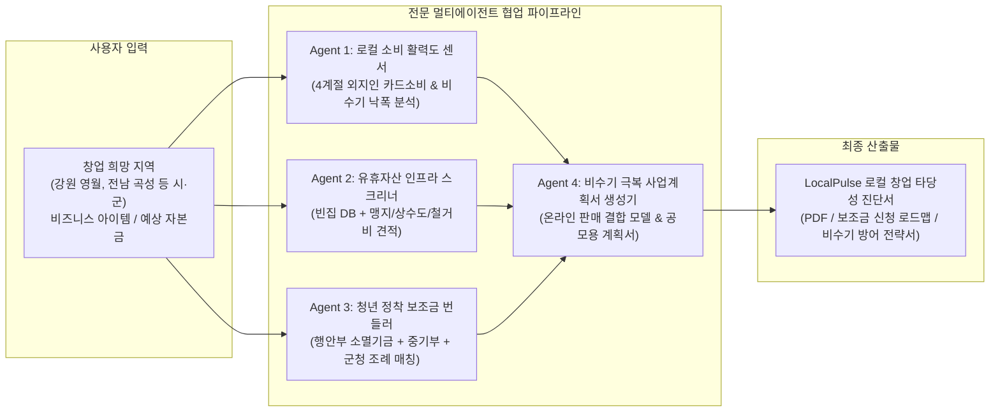
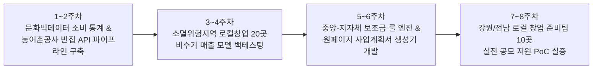

# [기획안 v0.1] 지방소멸 대응 청년 로컬 크리에이터 창업 적지 분석 및 지원사업 매칭 리서치 멀티에이전트 (LocalPulse)

- **담당**: R04 원민 (프론트엔드 / 사용자 흐름)
- **상태**: v0.1 기획 초안
- **작성일**: 2026-11-18
- **기획 대상**: 문화빅데이터플랫폼(관광 소비·워케이션 이동), 공공데이터포털(지방소멸위험지수, 농어촌 빈집 데이터), 지자체 청년 창업 지원 조례 연계 로컬 창업 성공 가능성 검증 멀티에이전트 시스템
- **출처 및 참조 문서**:
  - 문화빅데이터플랫폼 지역별 외지인 관광 소비액 및 방문객 이동 패턴 오픈 API (`https://www.bigdata-culture.kr/`)
  - 공공데이터포털 한국고용정보원 지방소멸위험지수 및 인구감소지역 통계 (`https://www.data.go.kr/`)
  - 공공데이터포털 한국농어촌공사 농어촌 유휴자산 및 빈집 실태 데이터 API (`https://www.data.go.kr/`)
  - 행정안전부 지방소멸대응기금 및 중소벤처기업부 로컬크리에이터 육성사업 공고
  - [공공데이터 활용 리서치 멀티에이전트 서비스 아이디어 10선](2026-11-18_R04_공공데이터_활용_리서치_멀티에이전트_서비스_아이디어_10선.md)
  - [LocalPulse 기술검토 및 세부 해결안](2026-11-18_R04_로컬크리에이터_창업적지분석_지원사업매칭_기술검토_및_해결안.md)

---

## 0. 기획 배경 및 문제의식

전국 228개 시·군·구 중 절반 이상(118곳)이 '지방소멸 위험지역'으로 지정되면서, 정부와 지자체는 청년 인구 유입을 위해 매년 수조 원의 **지방소멸대응기금과 청년 로컬크리에이터 창업 지원금**을 쏟아붓고 있습니다. '로컬 지향', '촌캉스', '워케이션' 트렌드에 힘입어 수많은 청년 창업가가 지방 소도시 창업에 도전하고 있으나, 현장에서는 다음과 같은 가혹한 현실에 부딪혀 실패를 거듭하고 있습니다:

1. **"낭만적 귀촌 창업"과 9개월간의 비수기 유동인구 절벽**:
   - 인스타그램이나 유튜브의 성공 사례만 보고 "바닷가 앞 한옥 카페", "숲속 스테이"라는 낭만적 기대감으로 연고 없는 지방 군 단위 지역에 내려갑니다.
   - 그러나 여름 휴가철 2~3개월의 반짝 성수기를 지나면 늦가을부터 초봄까지(10월~4월) 6~7개월간 외지인 발길이 완전히 끊기며, 현지 주민들의 소비력도 취약하여 매출이 80% 이상 폭락하는 '비수기 유동인구 절벽'을 버티지 못하고 1~2년 만에 폐업 및 역귀농합니다.
2. **지자체 빈집·유휴시설의 인프라 함정과 과다 공사비**:
   - 지자체 공고를 보고 저렴한 임대료의 빈집이나 폐교, 유휴 창고를 계약했으나, 실제로는 지적도상 맹지(진입로 없음), 상수도 미인입, 정화조 용량 초과, 1급 발암물질 슬레이트 지붕 철거비 등으로 인해 배보다 배꼽이 더 큰 수천만 원의 시설 개보수 비용이 발생합니다.
3. **부처별·지자체별로 파편화된 "청년 창업 보조금" 정보 비대칭**:
   - 중소벤처기업부(로컬크리에이터 바우처 최대 4,000만 원), 행정안전부(청년마을 사업, 지방소멸대응기금), 농림축산식품부(청년농촌보금자리), 각 군청 조례(정착 지원금 2,000만 원, 주거비 월 30만 원)가 제각각 쪼개져 있습니다.
   - 창업자가 각 부처 사이트를 일일이 뒤지지 못해 수령 가능한 최대 5,000만~1억 원 상당의 무상 보조금을 놓치고 자기 자본만 소진합니다.
4. **지자체 청년정책 담당자의 성과 관리 실패**:
   - 담당 공무원은 막대한 보조금을 집행하여 청년을 유치했으나, 1~2년 만에 지원금만 정산하고 야반도주하듯 떠나는 청년들로 인해 의회 감사 지적과 지원금 회수 분쟁에 시달립니다.

본 기획은 **문화빅데이터플랫폼(외지인 관광 소비액·체류 시간)과 공공데이터포털(지방소멸위험지수, 빈집 DB, 지자체 조례)**을 연계하여, 창업 희망 지역과 아이템을 입력하면 **"4계절 외지인 소비 패턴 ➔ 빈집 인프라 적합성 ➔ 지자체 정책 지원금 통합 매칭 ➔ 3개년 비수기 극복 사업계획서"를 원스톱으로 도출하는 로컬 창업 리서치 멀티에이전트(LocalPulse)**를 제안합니다.

---

## 1. Target User & Field Pain Points (타겟 사용자와 현업의 고통)

### 1.1 타겟 사용자 정의
- **1차 사용자 (Core User)**:
  - 서울/수도권을 벗어나 지방 소도시(인구소멸위험지역)에서 F&B, 게스트하우스, 공방, 복합문화공간, 워케이션 오피스 창업을 준비하는 **청년 로컬 크리에이터 및 로컬 스타트업 대표**
  - 인구감소지역 89개 지자체 청년정책과, 농촌활력과, 도시재생지원센터의 **청년 창업 및 정착 지원 담당 주무관/코디네이터**
- **2차 의사결정자 및 유관기관 (Buyer / Partner)**:
  - 중소벤처기업부 전국 창조경제혁신센터 로컬크리에이터 심사역
  - 행정안전부 지역청년마을 및 지방소멸대응기금 평가위원, 농협 청년농업·창업 지원센터

### 1.2 사용자 상황 및 업무 흐름 (As-Is vs To-Be)

```mermaid
flowchart TD
    subgraph AsIs["현재 로컬 창업 흐름 (As-Is)"]
        A1["낭만적 귀촌 결심 (단편적 유튜브/SNS 정보)"] --> A2["지자체 빈집/상가 덜컥 계약 (맹지/상수도 인프라 미확인)"]
        A2 --> A3["개인 자본 8,000만~1억 원 투입 인테리어"]
        A3 --> A4["성수기 2개월 후 9개월간 비수기 매출 절벽 직면"]
        A4 --> A5["보조금 정산 실패 & 월세 감당 불가로 1년 만에 폐업 및 역귀농"]
    end

    subgraph ToBe["LocalPulse 도입 후 (To-Be)"]
        B1["창업 희망 지역(시·군) 및 컨셉/아이템 1차 입력"] --> B2["멀티에이전트 4중 로컬 생태계 교차 분석 (3분)"]
        B2 --> B3["4계절 외지인 카드 소비액 + 비수기(겨울철) 매출 방어율 정량 진단"]
        B3 --> B4["공공 빈집 인프라(맹지/상수도) 스크리닝 & 정부/지자체 보조금 전수 매칭"]
        B4 --> B5["비수기 극복 온라인 판매 결합 모델 & 지자체 제출용 사업계획서 발행"]
        B5 --> B6["최대 7,000만 원 무상 지원금 수령 & 3년 이상 안정적 정착 성공"]
    end
```

### 1.3 구체적 정량/정성 Pain Points
1. **창업 실패 시 청년의 종잣돈 8,000만~1.5억 원 전액 매몰**:
   - 연고 없는 지방에서 인테리어 공사를 했다가 폐업할 경우, 권리금 회수는커녕 원상복구 비용까지 청년 개인의 부채로 남음.
2. **성수기 대비 비수기 매출 75~85% 급감 (Cash Flow 붕괴)**:
   - 여름철 월 2,500만 원 나오던 카페 매출이 겨울철 월 350만 원으로 곤두박질치며, 난방비와 최소 유지비도 감당하지 못함.
3. **최대 1억 원에 달하는 중앙-지자체 정책 보조금 혜택 누락**:
   - 부처별 공고 시기와 조건(연령 기준 만 39세 vs 45세, 주소지 이전 시점 등)이 달라 지원금을 놓치고 전액 대출에 의존.
4. **외지인에 대한 원주민 텃세 및 행정 정산 스트레스**:
   - 마을 주민과의 상생 모델 없이 진입했다가 민원에 시달리고, 복잡한 국고보조금 정산(e나라도움) 서류에 치여 본업 포기.

---

## 2. Existing Alternatives & Remaining Pain (기존 대안과 남는 고통)

| 기존 대안 | 제공하는 가치 | 한계점 및 사용자가 여전히 겪는 고통 (Remaining Pain) |
| :--- | :--- | :--- |
| **창조경제혁신센터 로컬크리에이터 지원사업** | 연간 1회 공모, 최대 4,000만 원 사업화 자금 지원 | • **창업 이전 단계에서 "이 지역이 정말 사업성이 있는가"를 데이터로 검증해주지 않음** • 서류 심사용 사업계획서 작성이 어려워 초기 청년들의 탈락률 높음 |
| **귀농귀촌종합센터 포털** | 농촌 주거 지원 및 귀농 교육 정보 | • **F&B, 문화콘텐츠, 워케이션 등 '상업적 로컬 비즈니스' 관점의 상권/관광 소비 데이터 분석 전무** • 빈집 정보의 업데이트가 느려 실제 매물 확인 불가 |
| **민간 상권분석 툴 (오픈업 등)** | 전국 카드 매출 추정치 제공 | • 수도권/대도시 중심 데이터로, **지방 군 단위 인구소멸지역의 '외지인 관광 소비 vs 현지인 소비' 분해 및 비수기 시뮬레이션 불가** |

> **핵심 차별화 영역 (Painkiller Seam)**:
> 낭만적 귀촌 교육만 제공하는 공공 포털과 달리, **문화빅데이터플랫폼의 실제 외지인 카드 소비 데이터와 빈집 인프라를 결합하여 '비수기에도 살아남을 수 있는 사업 모델인가'를 냉정하게 검증하고, '정부 보조금을 싹 모아서 자부담을 80% 줄여주는 실전 창업 코파일럿'** 역할을 수행함.

---

## 3. Problem Statement (문제 정의 한 문장)

> **"청년 로컬 크리에이터가 지원금과 낭만만 믿고 지방 창업에 뛰어들었다가, 비수기 유동인구 절벽과 빈집 인프라 결함, 파편화된 정책 자금 기준을 검증하지 못해 1~2년 만에 폐업하고 역귀농하는 악순환을 겪고 있다."**

---

## 4. Solution & Key Features (솔루션 및 4대 핵심 피처)

### [FEAT-01] 로컬 소비 활력도 및 비수기 센서 (Local Vitality Sensor)
- **데이터 소스**: 문화빅데이터플랫폼 지역별 외지인 관광 소비액 데이터, 방문객 체류 시간 및 이동 동선 통계
- **핵심 기능**:
  - 타깃 시·군의 최근 3개년 **4계절(봄/여름/가을/겨울) 월별 외지인 카드 매출 추이** 분석.
  - 최고 성수기(8월) 대비 최악 비수기(1월)의 **'매출 낙폭 비율(Seasonality Drop Rate, %)'** 정량 도출.
  - 당일치기 스쳐 지나가는 관광객 vs 1박 이상 머무는 '체류형 관광객'의 비중 및 1인당 평균 결제 단가 산출.

### [FEAT-02] 공공 유휴자산 및 빈집 인프라 스크리너 (Vacant Asset Screener)
- **데이터 소스**: 한국농어촌공사 농어촌 유휴자산 및 빈집 실태 데이터 API, 국토교통부 건축물대장 및 연속지적도
- **핵심 기능**:
  - 지자체 관내 공공 임대 가능 빈집/유휴시설의 지적도상 **도로 접면 여부(맹지 판별)** 자동 스크리닝.
  - 상수도 인입 여부, 건축 연도(석면 슬레이트 지붕 여부)를 파악하여 **'예상 인프라 기본 개보수 비용'** 사전 산출.

### [FEAT-03] 중앙-지자체 청년 정착 보조금 번들러 (Subsidy Bundler)
- **데이터 소스**: 행정안전부 지방소멸대응기금 투자계획, 중기부 로컬크리에이터 육성 공고, 지자체 청년 창업 지원 조례
- **핵심 기능**:
  - 창업자의 연령(만 19~39세/45세), 전입 의무 조건, 업종을 대조하여 수혜 가능한 **'최대 무상 보조금 패키지(예: 중기부 사업화 4,000만 원 + 군청 리모델링비 2,000만 원 + 주거비 월 30만 원)'** 자동 도출.
  - 보조금 신청 일정 및 필수 제출 요건 타임라인 자동 매핑.

### [FEAT-04] 3개년 생존성 평가 및 비수기 극복 사업계획서 생성기 (Survival Blueprint)
- **핵심 기능**:
  - 오프라인 매장 매출에만 의존하지 않고, 비수기(겨울철) 동안 로컬 특산물을 활용한 **'스마트스토어 가공식품 정기배송'**이나 **'기업 워케이션 B2B 유치 프로그램'**을 필수 결합한 3개년 현금흐름 시뮬레이션.
  - 지자체 청년 창업 공모전 및 중기부 로컬크리에이터 사업 신청 시 그대로 복사해 쓸 수 있는 **"표준 사업계획서 요약본(One-Page PDF)"** 자동 발행.

---

## 5. Truth, Hypothesis, Counter-evidence, Unknowns (사실/가설/반대근거/미확인 분리)

| 구분 | 주요 내용 | 검증 방안 및 통제 계획 |
| :--- | :--- | :--- |
| **사실 (Fact)** *이미 입증된 사실* | • 행정안전부는 전국 89개 시·군을 인구감소지역으로 지정하고 연간 1조 원의 지방소멸대응기금을 배분함. • 농어촌 지역 외식/숙박업은 4계절 기후에 따라 성수기 대비 비수기 매출 편차가 60~80%에 달함. • 농어촌공사 및 지자체는 빈집 및 유휴시설 현황을 공공데이터로 개방하고 있음. | 행정안전부 고시 및 문화빅데이터플랫폼 지역별 카드 소비 통계 확인 완료. |
| **가설 (Hypothesis)** *검증이 필요한 전제* | • 비수기 방어 모델(온라인 통신판매 + 워케이션 B2B)을 사업계획에 반영한 로컬 기업은 3년 생존율이 70% 이상 유지될 것이다. • 빅데이터 기반 타당성 분석 보고서를 첨부한 청년 창업팀은 지자체 지원사업 선정률이 2.5배 높아질 것이다. | 최근 3년간 지방소멸대응기금 지원을 받은 로컬 기업 50개소의 폐업 여부 및 매출 구조 추적 분석. |
| **가장 강한 반대 근거 (Counter-evidence)** | • 로컬 창업의 핵심 성공 요인은 데이터보다 '지역 토착 원주민과의 관계 형성(로컬 거버넌스, 이장님/번영회)'이 절대적인데, AI가 인간관계를 보장해줄 수 없음. • 빈집 데이터의 현장 불일치(소유주 변심으로 임대 거부, 상속인 연락 두절 등)가 잦음. | "주민 설명회 및 로컬 협의체 참여 가이드"를 체크리스트에 포함하고, 지자체가 소유권을 100% 확보한 '공공 유휴자산' 우선 매칭. |
| **미확인 사항 (Unknowns)** | • 인구 과소지역(인구 3만 이하 군 단위)의 경우 카드 결제 표본 수가 적어 통계적 분산(Noise)이 클 수 있음. | 3개년 누적 데이터 이동평균(Rolling Average) 및 인근 유사 지자체 클러스터 보정 적용. |

---

## 6. 8-Week MVP Validation Plan & Kill Criteria (8주 MVP 검증 계획 및 중단 조건)

### 6.1 8주 MVP 검증 로드맵

- **1~2주차: 공공데이터 파이프라인 및 지자체 조례 온톨로지 구축**
  - 문화빅데이터플랫폼 외지인 소비 데이터 API 연동 및 89개 인구소멸지역 계절성 지수 산출.
  - 농어촌공사 빈집 API 및 5대 소멸위험 시·군(영월, 곡성, 의성, 남해, 단양) 조례 적재.
- **3~4주차: 기존 로컬 창업 20곳 대상 계절성 백테스팅 (Back-testing)**
  - 실제 지방 소도시에서 3년 이상 생존한 우수 로컬 기업 10곳과 1년 내 폐업한 10곳의 매출 구조 대조(비수기 방어 모델 유효성 검증).
- **5~6주차: 보조금 매칭 알고리즘 및 표준 사업계획서 렌더러 개발**
  - 중기부/행안부/지자체 보조금 자동 번들링 로직 및 원페이지 사업계획서 렌더러 완성.
- **7~8주차: 로컬 창업 준비 청년 10팀 대상 실전 공모 지원 PoC**
  - 2027년도 로컬크리에이터 지원사업 신청서 작성에 LocalPulse를 적용하고 기획서 완성도 및 합격률 측정.

### 6.2 중단 조건 (Kill Criteria)
다음 3가지 조건 중 하나라도 충족될 경우 프로젝트를 즉시 중단(Kill/Pivot)합니다:
1. **[소비 데이터 신뢰성 결여]** 군 단위 외지인 카드 소비 데이터의 이상치(노이즈)가 35%를 초과하여 계절성 예측이 불가능할 때.
2. **[청년 창업자 유용성 기각]** 파일럿 참여 청년 10명 중 7명 이상이 "AI가 제시한 비수기 전략이나 보조금 정보가 현장 실정과 너무 동떨어져 있다"고 평가할 때.
3. **[공공 빈집 API 중단]** 농어촌공사의 빈집 실태 데이터 제공 정책이 지자체 비공개 방침으로 전환될 때.

---

## 7. Business Impact & Value Proposition (도입 가치)

1. **청년 로컬 창업 3년 생존율 40% ➔ 70% 제고**: 성수기 거품을 걷어내고 비수기 방어 모델을 사전 설계하여 청년의 1억 원 매몰 방지.
2. **창업 초기 자부담 70% 절감**: 중기부·행안부·군청 조례 지원금을 원스톱으로 번들링하여 건당 최대 6,000만~8,000만 원 무상 보조금 수혜 극대화.
3. **지자체 지방소멸대응기금 집행 건전성 확보**: 실패 확률이 낮은 검증된 청년 비즈니스를 유치하여 세금 낭비 방지 및 청년 정착률 향상.
