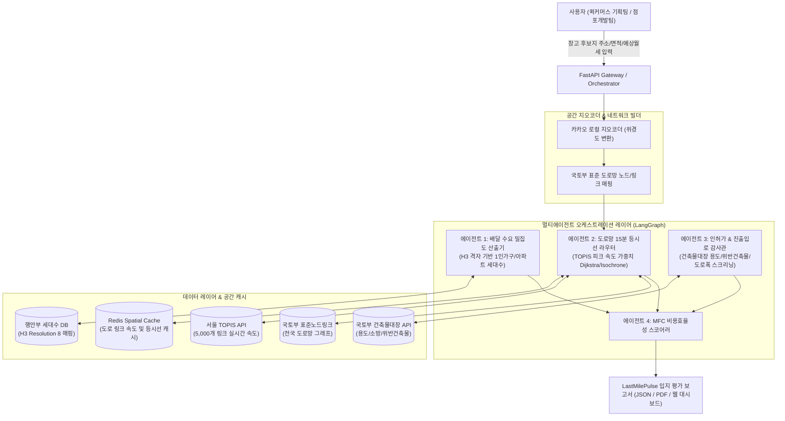

# [기술검토 및 세부 해결안 v0.1] 마이크로 풀필먼트(MFC) 입지 선정 및 도심 라스트마일 동선 시뮬레이션 리서치 멀티에이전트 (LastMilePulse)

- **담당**: R04 원민 (프론트엔드 / 사용자 흐름)
- **상태**: v0.1 기술 검토 초안
- **작성일**: 2026-11-18
- **연계 기획안**: [마이크로 풀필먼트 라스트마일 입지선정 기획안 v0.1](2026-11-18_R04_마이크로풀필먼트_라스트마일_입지선정_기획안.md)
- **대상 공공데이터**:
  - 서울 열린데이터광장 (`data.seoul.go.kr`): 서울시 TOPIS 실시간 도로 소통 정보 API
  - 공공데이터포털 (`data.go.kr`): 국토교통부 표준 노드·링크 도로망 데이터, 행정안전부 공동주택 세대수 API, 국토교통부 건축물대장 표제부 API

---

## 1. 시스템 아키텍처 및 데이터 흐름도

LastMilePulse는 **"후보지 주소 지오코딩 ➔ 도로망 그래프 및 실시간 TOPIS 속도 매핑 ➔ 이륜차 15분 등시선(Isochrone) 다각형 생성 ➔ H3 수요 격자 세대수 공간 결합 ➔ 건축물 인허가 룰 검증 및 비용효율성 스코어링"** 파이프라인으로 구성됩니다.



---

## 2. 핵심 기술 난제 및 세부 엔지니어링 해결안

### [난제 1] 단순 유클리드 반경(원) vs 실시간 도로망 기준 15분 등시선(Isochrone)의 계산 부하
- **문제점**:
  - 직선반경 2km 원은 1초 만에 그려지지만, 신호 대기, 일방통행, 도로 정체, 하천/철도 단절을 반영한 실제 도로망 기반 등시선 다각형(Polygon)을 실시간으로 계산하는 것은 막대한 연산 자원 소모.
- **해결안 (Valhalla / OSRM 라우팅 엔진 + TOPIS 속도 동적 가중치)**:
  1. **오픈소스 라우팅 엔진(Valhalla) 기반 이륜차 프로파일 튜닝**:
     - 자동차 전용도로 진입 금지, 골목길 주행 허용, 신호 대기 페널티(교차로당 평균 45초 가산)를 반영한 배달 이륜차 전용 라우팅 프로파일 구축.
  2. **TOPIS 실시간 통행 속도 가중치 오버레이**:
     - 국토부 도로 링크 ID와 서울시 TOPIS 링크 ID를 1:1 매핑하고, 저녁 피크타임(18:30) 평균 실측 속도를 링크 가중치(Edge Weight)로 실시간 치환하여 15분 도달 경계 다각형(Concave Hull)을 1.5초 내 생성.

### [난제 2] 서울시 5,000여 개 도로 링크의 대용량 실시간 트래픽 데이터와 API 쿼터 한계
- **문제점**:
  - 사용자가 입지 시뮬레이션을 실행할 때마다 서울시 5,000여 개 도로 링크 전체의 실시간 속도를 매번 호출하면 네트워크 병목 및 API 쿼터 초과 발생.
- **해결안 (Redis 기반 시간대별 파티셔닝 캐시 & 변경분 스트리밍)**:
  - 서울시 전체 도로 링크 속도를 매 10분 단위로 수신하여 Redis Hash 테이블(`topis:speed:latest`)에 갱신.
  - 또한 시뮬레이션에서는 '실시간 돌발 정체'보다는 '평일 저녁 정기 피크 패턴'이 입지 결정에 더 중요하므로, **최근 4주간 평일 18:00~20:00 평균 속도 베이스라인 테이블**을 구축하여 캐시 히트율 99% 달성.

### [난제 3] 건축물대장상 '위반건축물' 및 용도 부적합의 자동 판별
- **문제점**:
  - 도심 창고는 '제2종 근린생활시설(제조업소/수리점/소매점)' 또는 '창고시설'이어야 하며, 주차장 무단 전용이나 옥상 불법 증축으로 '위반건축물(노란 딱지)'이 등재된 경우 사업자등록이 거부됨.
- **해결안 (건축물대장 표제부 전수 룰 엔진 필터링)**:
  1. **용도 적합성 룰베이스**:
     - `주용도코드`가 근린생활시설군(14000) 또는 창고시설(18000)인지 1차 검증.
  2. **위반건축물 플래그 검사**:
     - 건축물대장 표제부의 `위반건축물여부(vlatBldYn)` 필드가 '1'인 경우 즉시 **[CRITICAL: 위반건축물 등재로 인한 인허가 불가 위험]** 경고등 표출.

### [난제 4] H3 공간 인덱스 기반 도달 권역 세대수 초고속 집계 (Spatial Join 최적화)
- **문제점**:
  - 15분 등시선 다각형 내부에 속한 수천 개의 건물과 수만 세대를 R-Tree 지오메트리 연산으로 일일이 조인하면 응답 속도가 10초 이상 지연됨.
- **해결안 (Uber H3 Resolution 8 격자 사전 인덱싱)**:
  - 서울시 전체 주거 세대수(아파트/오피스텔)를 H3 Resolution 8(육각형 1개당 면적 약 0.73㎢, 한 변 461m) 셀 단위로 사전 집계(Pre-aggregate)하여 PostgreSQL/PostGIS에 적재.
  - 생성된 15분 등시선 폴리곤과 교차하는 H3 셀들의 세대수를 단순 Sum 연산하여 100ms 이내에 총 커버 세대수를 집계.

---

## 3. 1건 E2E PoC 시나리오 및 입출력 JSON 스키마

### 3.1 시나리오 정의
- **후보 매물**: 서울특별시 마포구 공덕동 지상 1층 창고 (전용 165㎡, 약 50평)
- **임대차 조건**: 보증금 5,000만 원 / 월 임대료 420만 원
- **목적**: 퀵커머스 식료품 즉시배송(15~30분 배송) 거점 신규 출점 타당성 검토
- **주변 환경**: 마포대로 이면도로(도로 폭 6m), 인근 대단지 아파트 및 오피스텔 밀집

### 3.2 입력 JSON 스키마 (User Input)
```json
{
  "request_id": "REQ-MFC-2026-1118-001",
  "candidate_site": {
    "address": "서울특별시 마포구 공덕동 256-xx",
    "floor": 1,
    "dedicated_area_sqm": 165.0,
    "lease_terms": {
      "deposit_krw": 50000000,
      "monthly_rent_krw": 4200000
    }
  },
  "operational_params": {
    "target_delivery_time_mins": 15,
    "vehicle_type": "MOTORCYCLE",
    "peak_hour": "18:30"
  }
}
```

### 3.3 에이전트 간 내부 중간 산출물 (Intermediate Representation)
```json
{
  "agent_1_demand_heat": {
    "covered_h3_cells_count": 14,
    "total_households_covered": 48200,
    "single_person_household_ratio": "42.8% (오피스텔 밀집 청년 수요 최상위)",
    "estimated_daily_quick_orders": 850
  },
  "agent_2_traffic_isochrone": {
    "origin_coordinates": {"lat": 37.5445, "lng": 126.9512},
    "isochrone_15min_area_sqkm": 7.82,
    "bottleneck_routes_identified": [
      {"corridor": "공덕오거리 교차로 신호 대기", "delay_penalty_secs": 120},
      {"corridor": "마포대로 퇴근길 상습 정체", "average_speed_kmh": 14.5}
    ],
    "smooth_routes": ["만리재로 방면", "대흥역/서강대 방면"]
  },
  "agent_3_permit_access": {
    "building_use": "제2종근린생활시설 (제조업소)",
    "permit_status": "APPROVED (창고형 즉시배송 매장 운영 적합)",
    "violation_flag": false,
    "frontage_road_width_m": 6.5,
    "truck_unloading_feasibility": "GOOD (1톤 탑차 임시 정차 하역 가능 공간 확보)"
  }
}
```

### 3.4 최종 출력 JSON 스키마 (Final Synthesis Report)
```json
{
  "report_id": "REP-MFC-2026-1118-001",
  "generated_at": "2026-11-18T16:30:00Z",
  "mfc_evaluation_verdict": {
    "overall_score": 91.4,
    "rank_tier": "TIER_1 (최상위 추천 입지)",
    "recommendation": "GO (계약 적극 권고)",
    "key_advantage": "공덕역 반경 15분 내 48,200세대의 막대한 배달 수요를 커버하며, 도로 폭 6.5m로 진출입 병목 없음"
  },
  "coverage_metrics": {
    "isochrone_15min_households": 48200,
    "expected_sla_compliance_rate": "97.8% (30분 내 배달 성공률)",
    "cost_efficiency_ratio": "11.47 (세대수 48,200 ÷ 월세 420만 원, 서울시 평균 7.8 대비 우수)"
  },
  "risk_mitigation_notes": [
    "경고: 공덕오거리 방면은 퇴근 시간대(18:00~19:30) 좌회전 대기가 길어 라이더 우회 동선(백범로 방면) 지정 필요",
    "소방법: 지하 1층이 아닌 지상 1층 매물로 스프링클러 및 피난 유도선 기준 만족"
  ],
  "competitive_ranking": [
    {"candidate": "공덕동 매물 (본 후보지)", "score": 91.4, "rank": 1},
    {"candidate": "도화동 매물 (비교군 B)", "score": 76.2, "rank": 2, "flaw": "도로 폭 3.8m로 하역 곤란"},
    {"candidate": "아현동 매물 (비교군 C)", "score": 68.5, "rank": 3, "flaw": "언덕 지형으로 15분 도달 세대수 24,000세대에 불과"}
  ],
  "citations": [
    {"source": "서울 열린데이터광장", "dataset_id": "TOPIS_ROAD_SPEED_2026"},
    {"source": "국토교통부", "dataset_id": "국가교통DB 표준노드링크 2026"},
    {"source": "행정안전부", "dataset_id": "공동주택 세대수 및 인구통계 (마포구)"},
    {"source": "국토교통부", "dataset_id": "건축물대장 표제부 (공덕동 256)"}
  ]
}
```

---

## 4. 8주 주차별 엔지니어링 마일스톤 및 기술 스택

| 주차 | 목표 (Milestone) | 세부 구현 내용 | 산출물 |
| :--- | :--- | :--- | :--- |
| **1~2주차** | 도로망 그래프 & TOPIS 실시간 파이프라인 | • 국토부 표준 노드링크 그래프(NetworkX/Valhalla) 로드<br/>• 서울 TOPIS 실시간 도로 속도 API 어댑터 구축<br/>• 도로 링크 속도 Redis 캐싱 및 동적 가중치 오버레이 | `routing/road_network.py`<br/>`adapters/topis_speed.py`<br/>`data/seoul_links.geojson` |
| **3~4주차** | 이륜차 15분 등시선 & H3 세대수 결합 | • Valhalla/OSRM 기반 이륜차 등시선 다각형 생성기<br/>• Uber H3 Resolution 8 격자 세대수 매핑 모듈<br/>• 기존 MFC 10곳 실측 배송 시간 백테스팅 검증 | `spatial/isochrone_router.py`<br/>`spatial/h3_demand_aggregator.py`<br/>`tests/test_delivery_sla.py` |
| **5~6주차** | 건축물 인허가 감사관 & 스코어러 구현 | • 건축물대장 용도/위반건축물/도로폭 검증 룰 엔진<br/>• 비용효율성 지수(커버 세대수 ÷ 월세) 랭킹 알고리즘<br/>• LangGraph 멀티에이전트 오케스트레이션 결합 | `rules/permit_auditor.py`<br/>`agents/mfc_ranker.py`<br/>`agents/orchestrator.py` |
| **7~8주차** | 입지 평가 PDF 렌더러 & 실전 PoC 실증 | • 지도 시각화 포함 C-Level 원페이지 PDF 리포트 개발<br/>• 퀵커머스 및 배달 프랜차이즈 3개사 대상 실전 실증<br/>• 현업 피드백 수렴 및 도로 신호 대기 파라미터 튜닝 | `reports/mfc_evaluation_pdf.py`<br/>`docs/poc/mfc_pilot_evaluation.md` |

### 기술 스택 (Tech Stack)
- **Backend / API**: Python 3.11, FastAPI, Pydantic v2
- **Routing & Network**: Valhalla / OSRM, NetworkX, GeoPandas, Shapely
- **Spatial Grid**: Uber H3 (Python `h3`), PostGIS
- **Agent Orchestration**: LangGraph, LangChain
- **Cache & Storage**: Redis (실시간 도로 링크 속도 캐시), PostgreSQL
- **LLM**: Claude 3.5 Sonnet / GPT-4o (비교 분석 브리프 및 리스크 요약 생성)
- **Report Rendering**: WeasyPrint / ReportLab (입지 평가 보고서 PDF 자동 발행)
