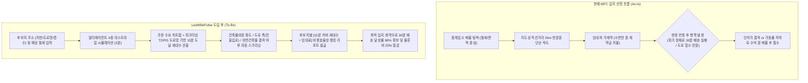
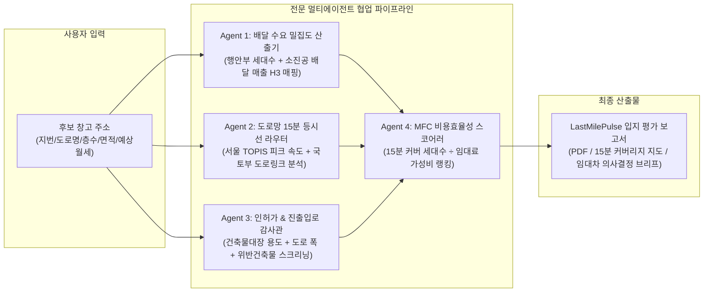
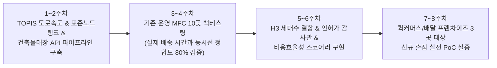

# [기획안 v0.1] 마이크로 풀필먼트(MFC) 입지 선정 및 도심 라스트마일 동선 시뮬레이션 리서치 멀티에이전트 (LastMilePulse)

- **담당**: R04 원민 (프론트엔드 / 사용자 흐름)
- **상태**: v0.1 기획 초안
- **작성일**: 2026-11-18
- **기획 대상**: 서울 열린데이터광장(TOPIS 실시간 도로 소통 정보, 도시데이터) 및 공공데이터포털(국토부 표준노드링크, 건축물대장, 배달 상권) 연계 도심 마이크로 풀필먼트 센터(MFC) 입지 평가 멀티에이전트 시스템
- **출처 및 참조 문서**:
  - 서울 열린데이터광장 서울시 TOPIS 실시간 도로 소통 정보 오픈 API (`https://data.seoul.go.kr/`)
  - 공공데이터포털 국토교통부 국가교통DB 표준 노드·링크 도로망 데이터 (`https://www.data.go.kr/`)
  - 공공데이터포털 행정안전부 주거 인구통계 및 공동주택 세대수 API (`https://www.data.go.kr/`)
  - 공공데이터포털 국토교통부 건축물대장 표제부 및 층별개요 API (`https://www.data.go.kr/`)
  - [공공데이터 활용 리서치 멀티에이전트 서비스 아이디어 10선](2026-11-18_R04_공공데이터_활용_리서치_멀티에이전트_서비스_아이디어_10선.md)
  - [LastMilePulse 기술검토 및 세부 해결안](2026-11-18_R04_마이크로풀필먼트_라스트마일_입지선정_기술검토_및_해결안.md)

---

## 0. 기획 배경 및 문제의식

1인 가구 증가와 배달 앱의 진화로 식료품, 생필품, 화장품, 헬스케어 제품을 주문 후 15분~30분 이내에 배송하는 **'퀵커머스(Quick-Commerce)' 및 도심 즉시배송 시장**이 폭발적으로 성장하고 있습니다. 배민B마트, 요마트, 올리브영 오늘드림 등 주요 이커머스 기업은 도심 거점인 **마이크로 풀필먼트 센터(MFC: Micro-Fulfillment Center)** 확보에 사활을 걸고 있으나, 현업의 입지 선정 실태는 다음과 같은 치명적 병목에 직면해 있습니다:

1. **"직선반경 2km"의 착시와 30분 배송 실패(SLA 위반)**:
   - 부동산 계약 시 지도상으로 "주문 밀집지로부터 반경 2km"라는 단순 반경원(Circle)만 보고 계약합니다.
   - 그러나 실제 도심 도로에는 일방통행, 중앙분리대, 상습 정체 교차로, 철도·하천 단절, 급경사 언덕 지형이 존재하여, 라이더의 실측 주행 시간이 25~35분을 초과하게 됩니다. 이로 인해 퀵커머스의 핵심 경쟁력인 '30분 배송 약속'이 깨지고 주문 취소와 고객 이탈이 발생합니다.
2. **도심 거점의 비싼 임대료 대비 좁은 진출입로 병목**:
   - 도심 1층/지하 창고는 월 임대료가 수백만~수천만 원에 달합니다.
   - 고비용을 감수하고 번화가 이면도로에 창고를 열었으나, 도로 폭이 4m 미만으로 협소하여 1톤 납품 탑차와 배달 오토바이가 엉키는 출차 병목이 발생하고, 인근 주민들의 소음/주차 민원으로 영업 중단 위기에 몰립니다.
3. **건축물 용도 및 소방법 등 인허가 결격 사유의 사후 발견**:
   - 도심형 배송 창고는 건축물대장상 '제2종 근린생활시설' 또는 '창고시설' 용도 적합성, 하역장 적재 기준, 소방 스프링클러 설치 여부를 사전에 충족해야 합니다.
   - 이를 법적으로 검토하지 않고 가계약했다가 구청 인허가가 반려되어 인테리어 비용 수천만 원과 계약금을 몰취당하는 손실이 빈번합니다.
4. **수요 밀집 지역과 창고 커버리지 간의 미스매칭**:
   - 주문이 폭발하는 2030 오피스텔 밀집지(야간 배달 다발)가 아닌, 고령자 비율이 높은 주택가에 창고를 열어 가동률 50% 미만으로 적자가 누적됩니다.

본 기획은 **서울 TOPIS 실시간 도로 소통 정보, 국토부 표준 노드링크, 행안부 세대수 통계, 건축물대장 API**를 연계하여, 도심 창고 후보지 주소 입력만으로 **"배달 수요 밀집도 ➔ 피크타임 실시간 도로망 기준 15분 등시선(Isochrone) 커버리지 ➔ 건축물 인허가 및 도로 폭 유효성 검증 ➔ 임대료 대비 배송 효율성 스코어"를 종합 평가하는 도심 물류 리서치 멀티에이전트(LastMilePulse)**를 제안합니다.

---

## 1. Target User & Field Pain Points (타겟 사용자와 현업의 고통)

### 1.1 타겟 사용자 정의
- **1차 사용자 (Core User)**:
  - 퀵커머스(배민B마트, 요마트 등) 및 도심 즉시배송 유통사 **물류 네트워크 기획팀, 점포개발팀, 부동산 개발 담당자**
  - 다점포 배달 전문 프랜차이즈 본사 개발팀 및 도심형 공유주방/공유창고 운영사
- **2차 의사결정자 및 유관기관 (Buyer / Partner)**:
  - 퀵커머스 운영 본부장, 물류 인프라 투자 전문 벤처캐피탈(VC)/부동산 펀드 운용역
  - 상업용 부동산 전문 중개법인(CBRE, 젠스타메이트 등) 물류 리서치 부서

### 1.2 사용자 상황 및 업무 흐름 (As-Is vs To-Be)

### 1.3 구체적 정량/정성 Pain Points
1. **직선거리 착시로 인한 30분 정시 배송 실패 (SLA 30% 이상 위반)**:
   - 교차로 신호 대기와 상습 정체 도로(예: 테헤란로, 마포대로 등)로 인해 실제 이륜차 주행 시간이 25분을 넘겨 배송 지연 클레임 속출.
2. **도심 거점당 1억~3억 원에 달하는 초기 셋업 비용 매몰**:
   - 보증금(5,000만~1억 원), 냉장/냉동 설비 및 인테리어(1억~2억 원)가 투입되나, 진출입로 병목이나 수요 부족으로 철수 시 원상복구 비용까지 이중 손실.
3. **건축물 용도 부적합으로 인한 행정처분 및 계약금 날림**:
   - 건축물대장상 근린생활시설이 아닌 주거용 건물이나 불법 증축 위반건축물에 입점했다가 시정명령 및 강제이행금 부과.
4. **점포개발팀의 수작업 현장 실사 리소스 과다**:
   - 후보지 1곳을 평가하기 위해 기획자가 직접 오토바이를 타고 코스를 돌아보며 2~3일씩 실사하느라 다수 후보군 비교 불가.

---

## 2. Existing Alternatives & Remaining Pain (기존 대안과 남는 고통)

| 기존 대안 | 제공하는 가치 | 한계점 및 사용자가 여전히 겪는 고통 (Remaining Pain) |
| :--- | :--- | :--- |
| **일반 지도 API (네이버/카카오 지도)** | 주소 검색 및 대중교통/자동차 단순 길찾기 | • **"피크시간대 실시간 정체 속도"가 반영된 이륜차 등시선(Isochrone) 다각형 산출 불가** • 반경 내 실제 **배달 유효 수요(1인가구/아파트 세대수)를 자동으로 집계해주지 못함** |
| **상업용 부동산 리서치 용역사** | 부동산 매물 조사 및 입지 분석 보고서 | • **건당 500만~1,500만 원의 고비용과 3~4주의 납기** 소요 • 정적인 부동산 정보 위주이며, **실시간 모빌리티 통행 속도와 결합된 물류 시뮬레이션 역량 부족** |
| **자체 GIS 개발팀 구축 (사내 분석)** | QGIS 등을 활용한 내부 데이터 매핑 | • 고액 연봉의 데이터 엔지니어/GIS 전문가 조직 유지 비용 발생 • 공공 인허가(건축물대장 위반 여부)와 실시간 도로 속도를 결합한 자동화 파이프라인 부재 |

> **핵심 차별화 영역 (Painkiller Seam)**:
> 수천만 원의 외주 용역을 줄 수 없는 유통/프랜차이즈 기획팀을 위해, **"후보 주소 1줄"만 넣으면 서울시 TOPIS 실시간 도로망 속도와 인구 세대수를 결합하여 '이륜차 15분 도달 가능 세대수'와 '건축물 인허가 통과 여부'를 3분 만에 무료/저비용으로 진단**해 줌.

---

## 3. Problem Statement (문제 정의 한 문장)

> **"퀵커머스 및 라스트마일 물류 기획팀이 고비용의 도심 창고를 계약하면서도, 실제 도로 상습 정체와 단절 지형, 배달 수요 밀집도, 건축물 소방 인허가 규제를 종합 시뮬레이션하지 못해 30분 배송 실패와 수천만 원의 임대료 낭비를 겪고 있다."**

---

## 4. Solution & Key Features (솔루션 및 4대 핵심 피처)

### [FEAT-01] 라스트마일 주문 수요 및 인구 밀집도 히트매퍼 (Demand Heatmapper)
- **데이터 소스**: 행정안전부 주민등록 인구통계(1인가구/청년층 비중), 공동주택 세대수 API, 소상공인진흥공단 배달 업종 매출 데이터
- **핵심 기능**:
  - 서울시 전역을 Uber H3(Resolution 8, 약 460m) 공간 격자로 분할하여 배달 주문 잠재 수요 지수(Demand Index) 산출.
  - 야간 즉시배송 수요가 높은 오피스텔·원룸 밀집 구역과 아파트 대단지를 고밀도 히트맵으로 시각화.

### [FEAT-02] TOPIS 실시간 도로망 기준 15분 등시선(Isochrone) 라우터 (Traffic Router)
- **데이터 소스**: 서울시 TOPIS 실시간 도로 소통 정보 API, 국토교통부 표준 노드·링크 도로망 데이터
- **핵심 기능**:
  - 피크시간대(저녁 18:00~20:00)의 실제 도로 링크별 차량 평균 통행 속도를 이륜차 주행 모델에 반영.
  - 후보지로부터 **"신호 대기 및 도로 정체를 반영하여 이륜차로 15분 이내에 물리적으로 도달 가능한 영역(15-min Isochrone Polygon)"**을 정확히 작도하고, 해당 영역 내부의 **실제 커버리지 세대수(Coverage Households)** 합산.

### [FEAT-03] 물류 거점 인허가 및 진출입 유효성 감사관 (Permit & Access Auditor)
- **데이터 소스**: 국토교통부 건축물대장 표제부/층별개요 API, 도로명주소 전자지도(도로 폭 정보)
- **핵심 기능**:
  - **건축물 용도 검증**: 건축물대장상 '제2종 근린생활시설' 또는 '창고시설' 적합 여부 및 무단 증축 '위반건축물' 등재 여부 자동 확인.
  - **도로 폭 및 출차 환경 검증**: 창고 전면 도로 폭(4m 미만 협소도로 경고), 1톤 화물차 상하차 주차 구역 확보 여부 스크리닝.

### [FEAT-04] 후보지 비교 평가 및 MFC 비용효율성 스코어러 (MFC Ranker)
- **핵심 기능**:
  - `(15분 내 커버리지 세대수 × 수요 지수) ÷ 월 임대료` 수식을 적용해 **'라스트마일 비용 효율성 지수(Cost-Efficiency Score, 0~100점)'** 도출.
  - 복수 후보지(A/B/C) 입력 시 한눈에 비교할 수 있는 **"최적 입지 추천 순위표"** 및 C-레벨 보고용 **"도심 MFC 투자 타당성 원페이지 리포트(PDF)"** 자동 발행.

---

## 5. Truth, Hypothesis, Counter-evidence, Unknowns (사실/가설/반대근거/미확인 분리)

| 구분 | 주요 내용 | 검증 방안 및 통제 계획 |
| :--- | :--- | :--- |
| **사실 (Fact)** *이미 입증된 사실* | • 서울시 TOPIS는 서울 전역 주요 도로의 실시간 통행 속도 및 상습 정체 구간 데이터를 오픈 API로 무료 제공함. • 퀵커머스 비즈니스는 30분 초과 배송 시 고객 재주문율이 40% 이상 급감함. • 건축물대장상 위반건축물로 등재된 건물은 영업신고 및 사업자등록이 제한됨. | 서울시 TOPIS API 데이터 정합성 및 건축법/물류시설법 인허가 기준 확인 완료. |
| **가설 (Hypothesis)** *검증이 필요한 전제* | • TOPIS 도로 속도 기반 15분 등시선 모델은 단순 반경원 방식 대비 실제 라이더 배송 도달 시간 오차를 70% 이상 줄일 것이다. • 비용효율성 지수 상위 20% 입지에 오픈한 창고는 평균 배송 소요 시간이 8분 단축될 것이다. | 실제 퀵커머스 운영 중인 거점 10곳(강남, 마포, 송파)의 라이더 배송 완료 GPS 로그와 등시선 모델 대조 백테스팅. |
| **가장 강한 반대 근거 (Counter-evidence)** | • 오토바이 배달 라이더는 신호 위반, 골목길 지름길 주행, 인도 주행 등 비정형 주행 패턴을 보이므로 공공 도로 링크 속도 모델과 실측 주행 시간 간에 괴리가 발생할 수 있음. • 도심 매물은 공급 자체가 극히 희소하여 최적 입지로 판정되어도 임대차 매물이 없어 계약이 불가능할 수 있음. | 이륜차 주행 특성을 반영해 자동차 속도 대비 골목길 가중치를 보정하고, "현재 시장에 출품된 실매물" 중심으로 1차 스크리닝 진행. |
| **미확인 사항 (Unknowns)** | • 아파트 단지 내부의 지상 차량 통제(지하주차장 진입 강제, 도보 배송 지연)로 인한 라스트 100m 병목 시간의 단지별 편차. | 대단지 아파트의 경우 단지 내 도보 배송 버퍼 시간(건당 4~6분)을 추가 가산하는 보정 계수 적용. |

---

## 6. 8-Week MVP Validation Plan & Kill Criteria (8주 MVP 검증 계획 및 중단 조건)

### 6.1 8주 MVP 검증 로드맵

- **1~2주차: 도로망 그래프 및 공공 API 파이프라인 구축**
  - 국토부 표준 노드·링크 기반 서울 도로망 그래프 구축 및 TOPIS 실시간 통행속도 가중치 매핑.
  - 행안부 공동주택 세대수 및 건축물대장 API 어댑터 개발.
- **3~4주차: 서울시 기존 운영 MFC 10곳 백테스팅 (Back-testing)**
  - 실제 강남/마포 권역 퀵커머스 물류 거점 10곳을 기준으로 피크타임 실측 배송 소요 시간과 15분 등시선 모델의 일치율(80% 이상) 검증.
- **5~6주차: H3 수요 결합 및 인허가 감사 룰 엔진 개발**
  - Uber H3 격자 기반 세대수 집계, 건축물대장 위반건축물/용도 판별기, PDF 리포트 생성기 완성.
- **7~8주차: 배달 전문 프랜차이즈 및 퀵커머스 기획팀 실전 PoC**
  - 신규 거점 후보지 5곳을 모델로 평가하고, 현업 기획자의 입지 의사결정 채택률 및 시간 단축률 측정.

### 6.2 중단 조건 (Kill Criteria)
다음 3가지 조건 중 하나라도 충족될 경우 프로젝트를 즉시 중단(Kill/Pivot)합니다:
1. **[도달 시간 예측 오차율 초과]** 10개 거점 백테스팅 결과, 이륜차 특수 주행 패턴으로 인해 15분 도달 영역 예측 오차율이 35%를 초과할 때.
2. **[기업 고객 실효성 기각]** 퀵커머스 점포개발 실무자 인터뷰 결과, "부동산 중개망을 통한 오프라인 발품이 우선이며 도로망 시뮬레이션은 입지 결정에 큰 영향을 주지 않는다"고 판단할 때.
3. **[TOPIS 도로 속도 API 중단]** 서울시 TOPIS 실시간 소통 정보 API 제공 정책이 비공개로 전환되거나 갱신 지연이 심화될 때.

---

## 7. Business Impact & Value Proposition (도입 가치)

1. **30분 배송 약속(SLA) 달성률 98% 확보**: 도로 정체와 단절 지형을 사전 회피하여 퀵커머스의 생명인 정시 배송 성공률 극대화.
2. **도심 거점당 1억 원 상당의 입지 실패 비용 방지**: 인허가 결격 및 수요 부족으로 인한 조기 철수와 시설 위약금 손실을 원천 차단.
3. **점포 개발 리서치 기간 80% 단축**: 수일씩 걸리던 오토바이 현장 실사와 세대수 조사를 **단 3분** 만에 객관적 데이터 리포트로 해결.
