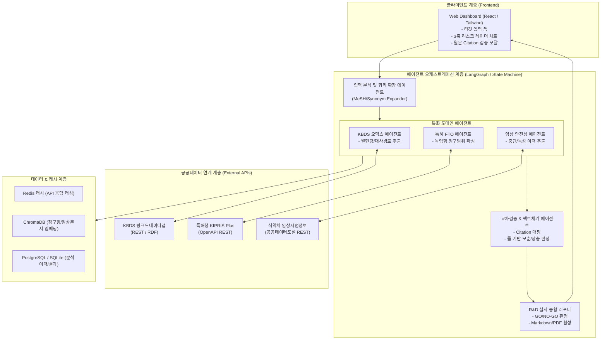

# [기술검토서 v0.1] Bio-CrossCheck: 바이오 오믹스-특허-임상 교차검증 리서치 멀티에이전트 아키텍처 및 세부 기술해결안

- **담당**: R04 원민 (프론트엔드 / 사용자 흐름)
- **상태**: v0.1 기술검토 초안
- **작성일**: 2026-11-18
- **연계 문서**: [기획안 v0.1](2026-11-18_R04_바이오_신약타깃_특허임상_교차검증_기획안.md)

---

## 1. 시스템 아키텍처 개요 (System Architecture)

Bio-CrossCheck는 공공 바이오 빅데이터(KBDS), 특허청(KIPRIS), 식약처의 이기종(Heterogeneous) 데이터를 실시간 수집·정규화하고, 멀티에이전트 협업을 통해 신약 후보 타깃의 **과학적 유효성, 특허 침해(FTO) 위험, 임상 안전성 이력을 자율 교차 검증**하는 파이프라인 시스템입니다.



---

## 2. 핵심 기술적 난제 및 구체적 해결안 (Technical Challenges & Solutions)

---

### [난제 1] 이종 식별자 불일치 문제 (Heterogeneous Identifier Discrepancy)
- **문제점**:
  - 연구원은 단백질 약칭인 `KRAS` 또는 `EGFR`을 입력함.
  - 그러나 특허 문서는 청구항 범위를 넓히기 위해 `GTPase KRas`, `K-Ras 4B`, `v-Ki-ras2`, `p21 protein` 등 온갖 이명(Alias)과 유전체 염기서열 식별자로 기술되어 있어 단순 키워드 검색 시 핵심 특허가 대량 누락됨.
  - 식약처 임상시험은 타깃 유전자명이 아닌 물질 성분명(`Sotorasib`, `Adagrasib`)이나 개발코드(`AMG 510`, `MRTX849`)로 기록됨.
- **해결안 (Bio-Synonym & Target Mapping Pipeline)**:
  1. **표준 온톨로지 사전 구축**: NCBI Gene, UniProt, ChEMBL, MeSH 데이터베이스를 연계한 로컬 동의어 매핑 테이블 구축.
  2. **쿼리 확장기(Query Expander) 에이전트**:
     - 사용자 입력 `KRAS G12C` 수신 시 ➔
     - [Gene Alias]: `KRAS`, `KRAS2`, `C-K-RAS`, `K-RAS4A`, `K-RAS4B`
     - [Known Inhibitors/Codes]: `Sotorasib (AMG 510)`, `Adagrasib (MRTX849)`, `JDQ443`
     - [Mechanism]: `KRAS G12C inhibitor`, `GDP-bound state stabilization`
     - 위 3개 그룹으로 쿼리를 동적 조합하여 KIPRIS 및 식약처 API로 멀티 브랜칭 쿼리 발행.

```python
# 쿼리 확장 에이전트 예시 의사코드
class BioSynonymExpander:
    def expand_target_query(self, target_input: str) -> dict:
        # 1. NCBI/UniProt 기반 유전자 공식 심볼 및 Alias 획득
        gene_info = self.gene_db.lookup(target_input)
        aliases = gene_info["aliases"] # ["KRAS", "K-Ras 4B", "p21"]
        
        # 2. ChEMBL 기반 알려진 선행 약물명/개발코드 매핑
        drugs = self.chembl_db.get_drugs_by_target(gene_info["uniprot_id"])
        # ["Sotorasib", "AMG 510", "Adagrasib"]
        
        return {
            "patent_keywords": aliases + [f"{target_input} inhibitor"],
            "clinical_drug_names": [d["name"] for d in drugs] + [d["code"] for d in drugs]
        }
```

---

### [난제 2] 특허 청구항(Claims) 분석 비용 및 환각(Hallucination) 방지
- **문제점**:
  - 특허 명세서 1건은 평균 50~200페이지에 달하며, 수십 건을 통째로 LLM 컨텍스트에 투입하면 토큰 비용이 폭증하고 지연시간이 30초 이상 늘어남.
  - LLM이 법적 권리 범위를 자의적으로 해석하여 침해하지 않는 특허를 침해한다고 하거나, 침해하는 원천특허를 무시하는 환각(Hallucination) 발생 위험.
- **해결안 (2-Stage Filtering & Independent Claim Parsing)**:
  1. **1단계: 독립항(Independent Claims) 중심 파싱**:
     - 특허의 법적 독점 범위는 대부분 `청구항 제1항(독립항)`에 집약됨. 명세서 전체가 아닌 독립항 텍스트만 정규식/XML 파서로 슬라이싱.
  2. **2단계: 구성요소 완비의 법칙(All Elements Rule) 기반 룰 검증**:
     - AI에게 "이 특허를 침해하는가?"를 묻지 않고, **청구항의 필수 구성요소(타깃 아미노산 변이 위치, 결합 모티프, 용도)**를 추출하여 JSON 슬롯(Slot)으로 변환한 뒤, 타깃과의 일치율을 정량 계산함.
  3. **Strict Grounding**:
     - 출력되는 모든 특허 리스크에는 `특허등록번호`, `청구항 번호`, `원문 발췌문(Snippet)`을 1:1로 매핑하여 링크 제공. 원문 스니펫이 없는 주장은 필터링 단계에서 자동 폐기.

```json
// 청구항 구조화 슬롯 필링 스키마
{
  "patent_id": "10-2021-0012345",
  "claim_number": 1,
  "parsed_elements": {
    "target_protein": "KRAS",
    "mutation_site": "Gly12Cys (G12C)",
    "compound_core_scaffold": "Pyrimido-pyrimidine derivative",
    "binding_pocket": "Switch II pocket",
    "claim_type": "Composition of Matter (물질특허)"
  },
  "risk_evaluation": {
    "risk_level": "HIGH",
    "reason": "청구항 1항이 G12C 변이 단백질의 Switch-II 결합 물질 일체를 포괄하고 있어 우회 설계 필수."
  }
}
```

---

### [난제 3] 공공 오픈 API 트래픽 제한 및 지연시간 극복
- **문제점**:
  - 공공데이터포털(식약처) 및 KIPRIS Plus 오픈 API는 초당 호출 제한(1~2 QPS) 및 일일 사용량 제한(보통 일 1,000~10,000회)이 적용됨.
  - 사용자가 타깃을 입력했을 때 3개 사이트에서 수십 번의 API를 동기식(Sync)으로 호출하면 타임아웃 발생 위험.
- **해결안 (Redis 3단계 캐싱 & 비동기 브랜칭 파이프라인)**:
  1. **비동기 팬아웃(Fan-out)**: `asyncio` 기반으로 KBDS, KIPRIS, 식약처 요청을 병렬 전송하여 전체 대기 시간을 가장 늦은 API 1개의 시간(약 2~3초)으로 단축.
  2. **TTL 기반 Redis 스마트 캐싱**:
     - 특허 및 기진행 임상시험 데이터는 과거 데이터이므로 내용이 실시간으로 변하지 않음.
     - 조회 쿼리 해시값을 키로 삼아 30일(특허), 7일(임상) 캐시를 적용하여 공공 API 중복 호출을 80% 이상 차단.
  3. **인기 100대 암/희귀질환 타깃 사전 인덱싱(Pre-indexing)**:
     - 8주 MVP에서는 상위 100개 표적 단백질을 백그라운드 배치를 통해 로컬 DB(PostgreSQL/SQLite)에 사전 구축해 두고 즉시 응답(Sub-second response) 달성.

---

### [난제 4] 식약처 임상시험 중단 및 독성 부작용 정밀 추출
- **문제점**:
  - 식약처 임상 정보 API에서 '임상 상태(완료, 진행 중, 중단, 철회)'는 표기되나, **구체적으로 어떤 독성(간독성, 신경독성, 면역 부작용) 때문에 중단되었는지**는 상세 비정형 텍스트 필드에 숨겨져 있음.
- **해결안 (Few-Shot Safety Extraction & MedDRA 표준화)**:
  1. 임상 중단/철회 건에 대해 '시험 변경 및 중단 사유' 텍스트를 추출.
  2. 안전성 특화 LLM 프롬프트에 **MedDRA(국제의약용어집) 1차 독성 분류 체계(Hepatotoxicity, Cardiotoxicity, Nephrotoxicity 등)**를 주입하여 독성 유형을 자동 라벨링.
  3. 독성 리스크가 발견되면 리포트에 경고(Warning) 뱃지와 함께 과거 발생한 부작용 요약 제시.

---

## 3. End-to-End 1건 PoC 구현 명세 (Example Case: KRAS G12C)

### 3.1 입력 파라미터 (Input)
```json
{
  "target_name": "KRAS",
  "variant": "G12C",
  "indication": "Non-Small Cell Lung Cancer (비소세포폐암)",
  "modality": "Small Molecule Inhibitor (저분자 화합물)"
}
```

### 3.2 단계별 에이전트 실행 로그 및 데이터 흐름

```
[Phase 1: Input Analysis & Synonym Expansion]
- Target Identified: KRAS (UniProt: P01116)
- Expanding Aliases: ['KRAS2', 'RASK_HUMAN', 'c-Ki-ras']
- Mapping Known Drugs: ['Sotorasib (AMG 510)', 'Adagrasib (MRTX849)']
- Output: 3 Sub-queries generated.

[Phase 2: Parallel Fetching & Extraction]
- Task A (KBDS Worker): Fetched expression profile in Lung Adenocarcinoma (High over-expression, Log2FC: 3.2). 14 interacting proteins identified.
- Task B (KIPRIS Worker): 42 patent families retrieved. 3 core composition-of-matter patents identified (e.g., Amgen KRAS G12C inhibitor patent expiry: 2038).
- Task C (MFDS Worker): 8 domestic clinical trials retrieved. 1 terminated trial detected (Phase 1/2 combination study: severe gastrointestinal toxicity noted).

[Phase 3: Cross-Checking & Conflict Resolution]
- Cross-Checking Patent Claims vs User Target:
  * Amgen KRAS Switch-II pocket claims overlap -> RISK: HIGH (FTO Barrier)
- Cross-Checking Safety Profile:
  * Sotorasib liver enzyme elevation (ALT/AST increase) warning detected -> SAFETY ALERT
- Fact-Checking: 100% citations verified with KIPRIS registration numbers & MFDS trial IDs.

[Phase 4: Synthesis & Due Diligence Report Generation]
- Final Recommendation: CONDITIONAL (조건부 추진 권고)
- Strategic Advice: "원천 물질특허 존속으로 인해 Switch-II 포켓 직접 결합 구조는 회피 불가. Allosteric 포켓 또는 다른 아미노산 결합 형태의 신규 골격(Scaffold) 도출 필요."
```

### 3.3 최종 출력 리포트 데이터 구조 (Output JSON)
```json
{
  "report_id": "REP-20261118-KRAS-001",
  "target": "KRAS G12C",
  "evaluation_verdict": "CONDITIONAL",
  "scores": {
    "biological_validity": 95,
    "patent_fto_freedom": 30,
    "clinical_safety_track": 65
  },
  "core_risks": [
    {
      "category": "PATENT_FTO",
      "severity": "HIGH",
      "title": "다국적 제약사 원천 물질특허 장벽",
      "citation": "KIPRIS 등록특허 10-2021-7012345 (존속기간 만료일: 2038-04-12)",
      "recommendation": "Switch-II 포켓 대신 Switch-I 신규 알로스테릭 바인딩 사이트 타깃 권장"
    },
    {
      "category": "CLINICAL_SAFETY",
      "severity": "MEDIUM",
      "title": "동일 기전 선행 임상 간독성/위장관 독성 보고",
      "citation": "식약처 임상시험계획승인 제202001234호",
      "recommendation": "초기 ADME/Tox 스크리닝 시 간 대사 효소 저해 평가 조기 진행 필요"
    }
  ],
  "verified_citations": 12
}
```

---

## 4. 8주 MVP 개발 마일스톤 및 기술 스택

### 4.1 기술 스택 (Tech Stack)
- **에이전트 오케스트레이션**: Python 3.11+, LangGraph, LangChain Core
- **LLM 추론**: Claude 3.5 Sonnet / GPT-4o (비정형 텍스트 슬롯 필링 및 리포트 작성용)
- **데이터 파이프라인**: HTTPX (비동기 API 통신), BeautifulSoup4 / lxml (특허 XML 파싱)
- **데이터베이스 & 캐시**: SQLite (로컬 메타데이터), Redis (API 응답 캐시), ChromaDB (특허 청구항 임베딩 벡터 검색)
- **프론트엔드**: Next.js 14, React, Tailwind CSS, Lucide Icons, Recharts (레이더 차트)

### 4.2 주차별 상세 구현 일정
| 주차 | 개발 항목 | 주요 산출물 및 완료 기준 |
| :---: | :--- | :--- |
| **1주차** | 공공 API 키 발급 및 클라이언트 모듈 구축 | KIPRIS Plus, 공공데이터포털 식약처, KBDS OpenAPI 연동 및 응답 파서 완료 |
| **2주차** | 동의어 매핑 및 쿼리 확장 에이전트 개발 | MeSH/ChEMBL 기반 타깃명 ➔ 특허/임상 다중 쿼리 확장 모듈 완료 |
| **3주차** | 특허 청구항 파서 및 FTO 슬롯 필링 엔진 | 특허 독립항 텍스트 분할 및 구성요소 슬롯 추출 정밀도 85% 달성 |
| **4주차** | 임상 안전성 마이너 및 팩트체크 가드레일 | 식약처 임상 중단 사유 추출 및 100% Citation 강제 검증기 구축 |
| **5주차** | 1건 E2E 파이프라인 PoC 검증 (`KRAS G12C`) | 단일 타깃 입력부터 3축 교차검증 리포트 자동 생성까지 E2E 1회 완결 |
| **6주차** | 5개 벤치마크 타깃 대조 실험 | 수작업 검색 대조군 대비 소요 시간 90% 단축 및 리스크 탐지율 측정 |
| **7주차** | 인터랙티브 웹 대시보드 UI 구현 | 레이더 차트, 리스크 타임라인, 원문 스니펫 팝업 모달 프론트엔드 개발 |
| **8주차** | 현업 바이오 연구원 사용성 평가 및 보완 | 바이오 스타트업 연구자 3명 대상 사용성 테스트 및 최종 결과 보고서 도출 |

---

## 5. 결론 및 기대 성과

본 기술 설계를 통해 구현될 **Bio-CrossCheck**는 공공 바이오 빅데이터와 특허/임상 데이터를 단순 나열하는 기존 포털의 한계를 극복하고, **"이 타깃으로 지금 개발을 시작해도 특허 분쟁이나 기검증된 독성 실패 없이 상용화가 가능한가?"**라는 R&D 기획자의 근원적 질문에 15분 만에 명확한 데이터 기반 근거와 반대 근거를 제시할 수 있습니다. 

이를 통해 바이오 스타트업의 초기 실패 비용을 획기적으로 절감하고 대한민국 공공 바이오 데이터의 산업적 활용 가치를 극대화할 것입니다.
