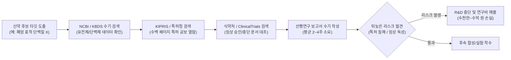
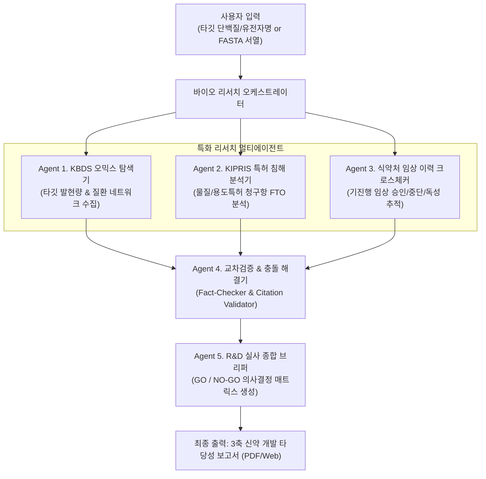

# [기획안 v0.1] 국가 바이오 연구 데이터(KBDS) 및 공공데이터 기반 신약 타깃-선행특허-임상시험 자동 교차검증 리서치 멀티에이전트 (Bio-CrossCheck)

- **담당**: R04 원민 (프론트엔드 / 사용자 흐름)
- **상태**: v0.1 기획 초안
- **작성일**: 2026-11-18
- **기획 대상**: 공공데이터(KBDS, 특허청 KIPRIS, 식약처 임상정보) 연계 신약 R&D 선행조사 멀티에이전트 시스템
- **출처 및 참조 문서**:
  - 국가바이오데이터스테이션 KBDS 연계 데이터맵 (`https://kbds.re.kr/linkedData/dataMap`)
  - 공공데이터포털 특허청 KIPRIS 특허정보 오픈 API (`https://www.data.go.kr/`)
  - 식품의약품안전처 의약품 임상시험 승인 정보 오픈 API (`https://www.data.go.kr/`)
  - [공공데이터 활용 리서치 멀티에이전트 서비스 아이디어 10선](2026-11-18_R04_공공데이터_활용_리서치_멀티에이전트_서비스_아이디어_10선.md)
  - [Bio-CrossCheck 기술검토 및 세부 해결안](2026-11-18_R04_바이오_신약타깃_특허임상_교차검증_기술검토_및_해결안.md)

---

## 0. 기획 배경 및 문제의식

신약 개발(Drug Discovery)은 막대한 비용(평균 1~2조 원)과 시간(10~15년)이 소요되며 성공 확률이 0.01%에 불과한 대표적인 고위험·고수익 산업입니다. 특히 유효 타깃(Target Gene/Protein)을 발굴하고 후보물질을 설계하는 **초기 탐색 단계(Discovery & Target Validation)**에서 다음과 같은 치명적인 병목이 발생합니다:

1. **지식의 사일로화(Silo)**: 생물학적 기전(오믹스 데이터), 법률적 권리(특허 청구항), 규제적 안전성(임상시험 실패 및 독성 이력) 데이터가 서로 다른 기관과 포맷으로 분절되어 있음.
2. **사후 발견에 따른 막대한 매몰 비용**: 실험실에서 수개월간 세포 실험과 동물 실험을 거쳐 타깃 유효성을 입증했으나, 뒤늦게 **"동일 타깃에 대한 원천 물질특허가 이미 등록되어 있어 사업화가 불가능(FTO 부재)"**함을 알게 되거나, **"과거 다국적 제약사가 임상 2상에서 간독성/심장독성으로 중단한 타깃"**임을 확인하여 수천만~수억 원의 연구비가 통째로 증발함.
3. **인력 및 비용 한계**: 대형 제약사는 라이선스 비용 수억 원의 전문 솔루션(Clarivate Cortellis 등)과 사내 변리사/임상전문가 조직을 보유하고 있으나, 국내 바이오 스타트업 및 대학 연구실은 비용 부담으로 인해 연구원이 수작업 구글링과 무료 포털을 헤매고 있음.

본 기획은 정부가 구축한 **KBDS(국가바이오데이터스테이션)**의 연구 데이터와 **공공데이터포털(특허청, 식약처)**의 오픈 API를 결합하여, 초기 R&D 단계에서 **신약 타깃의 과학적 유효성, 특허 침해 리스크, 임상 부작용 이력을 자동으로 교차 검증(Cross-Check)하는 전문 리서치 멀티에이전트 서비스**를 제안합니다.

---

## 1. Target User & Field Pain Points (타겟 사용자와 현업의 고통)

### 1.1 타겟 사용자 정의
- **1차 사용자 (Core User)**:
  - 신약 개발 바이오 스타트업의 **R&D 기획자 및 초기 연구원 (Discovery 단계)**
  - 대학 및 국공립 연구소의 **신약 타깃 발굴 연구책임자(PI) 및 포스닥 연구원**
- **2차 의사결정자 (Buyer / Approver)**:
  - 바이오텍 대표이사(CEO), 연구소장(CSO), 바이오 전문 벤처캐피탈(VC) 심사역 (기술성 실사/Due Diligence 담당)

### 1.2 사용자 상황 및 업무 흐름 (As-Is)

### 1.3 구체적 정량/정성 Pain Points
1. **과도한 선행조사 소요 시간 (평균 2~4주/건)**:
   - 타깃 유전자 1개에 대해 관련된 변이체, 결합 단백질, 유사 화합물 구조, 특허 청구항 100여 개, 국내외 임상 보고서 50여 건을 일일이 수작업으로 크로스체크하느라 연구 인력의 30% 이상이 단순 자료 취합에 소모됨.
2. **특허 침해(FTO) 분석의 비전문성과 외주 비용 부담**:
   - 연구원은 생물학 전문가이지만 법률적 '특허 청구항(Claims) 해석'에 취약함.
   - 특허법인에 선행기술조사를 외주 주면 **건당 300~500만 원, 3~4주**가 소요되므로, 아이디어 단계의 수십 개 후보 타깃마다 외주를 맡길 수 없음.
3. **임상 독성 실패 이력의 정보 파편화**:
   - 임상시험에서 '유효성 부족'으로 실패한 사례는 논문으로 잘 발표되지 않으며(Publication Bias), 식약처나 규제기관 보고서 구석에 '중단/철회'로만 남음.
   - 이를 모르고 동일 기전의 타깃을 다시 개발하다가 비임상 독성 단계에서 똑같이 실패하는 악순환 발생.

---

## 2. Existing Alternatives & Remaining Pain (기존 대안과 남는 고통)

| 기존 대안 | 제공하는 가치 | 한계점 및 사용자가 여전히 겪는 고통 (Remaining Pain) |
| :--- | :--- | :--- |
| **상용 바이오 인텔리전스** (Clarivate Cortellis, SciFinder) | 방대한 글로벌 파이프라인, 특허, 논문 데이터베이스 통합 검색 | • 연간 구독료가 **수천만 원~1억 원**에 달해 초기 스타트업 도입 불가능 • 검색 결과를 나열할 뿐, 내 후보물질 서열과 **"특허 청구항 침해 범위" 및 "임상 중단 독성 기전" 간의 충돌 여부를 자동 추론해주지 않음** |
| **변리사/특허법인 외주 조사** | 전문적인 특허 침해(FTO) 감정서 제공 | • **건당 300~500만 원, 3~4주 소요** • 연구 초기 스크리닝 단계의 수많은 타깃을 검토하기에는 비용/시간 감당 불가 |
| **국내 공공데이터 포털 직접 검색** (KBDS, KIPRIS, 식약처) | 정부가 무료로 제공하는 고품질 연구·특허·임상 오픈 API | • **데이터 사일로 현상**: KBDS(생물학 바이너리/FASTA/RDF), KIPRIS(법률 텍스트), 식약처(규제 서식 표) 포맷이 달라 연구원이 직접 엑셀로 노가다 대조를 수행해야 함 |

> **핵심 차별화 영역 (Painkiller Seam)**:
> 수억 원의 상용 DB를 살 수 없고 매번 외주를 줄 수 없는 중소 바이오텍을 위해, **무료 공공데이터(KBDS + 특허청 + 식약처)를 멀티에이전트가 자율 연계하여 15분 만에 '타깃 유효성 - 특허 침해 위험 - 임상 독성 이력'을 3차원으로 교차 분석한 1차 실사(Due Diligence) 리포트를 제공**함.

---

## 3. Problem Statement (문제 정의 한 문장)

> **신약 개발 초기 바이오 스타트업 연구자가 유망 타깃 물질을 발굴하려 하지만, 생물학적 기전 데이터(KBDS), 선행 특허(KIPRIS), 임상 안전성 이력(식약처)이 분절되어 있어, 선행 연구 조사에만 수 주가 소요되고 뒤늦은 특허 분쟁이나 기검증된 독성 실패로 수천만~수억 원의 초기 R&D 비용이 매몰되는 위험에 직면한다.**

- **관측 및 측정 지표**:
  1. 타깃 1건당 선행조사 소요 시간 (As-Is 3주 ➔ To-Be 15분)
  2. 선행 특허(FTO) 및 임상 부작용 핵심 리스크 사전 감지율 (목표 90% 이상)
  3. 연구 타당성 스크리닝 외주 비용 절감액 (건당 약 300만 원 절감 효과)

---

## 4. Painkiller Core Features (핵심 피처)

### [FEAT-01] KBDS 연계 타깃 오믹스 프로파일링 (Target Profiler)
- **줄일 고통**: 분산된 유전체/단백체 데이터 수동 검색 시간 단축.
- **기능 설명**: 사용자가 타깃 유전자/단백질(예: KRAS G12C, EGFR T790M)을 입력하면, KBDS 링크드데이터맵 API를 호출하여 타깃의 정상/암세포 발현 프로파일, 관련 대사 경로(Pathway), 상호작용 화합물 목록을 자동 정규화.
- **지표**: 타깃 프로파일 요약 소요 시간 30초 이내, 주요 대사경로 누락률 0건.

### [FEAT-02] KIPRIS 오픈 API 기반 선행특허 청구항(Claims) FTO 스크리닝 (Patent FTO Analyzer)
- **줄일 고통**: 수백 페이지 특허 공보 분석 부담 및 잠재적 특허 분쟁 위험.
- **기능 설명**: 특허청 KIPRIS API를 연동하여 해당 타깃 및 작용 기전과 관련된 국내외 특허를 수집하고, 독립항(청구항 1항)의 권리 범위를 자연어 처리하여 '물질특허 만료 여부', '용도특허 중복 여부'를 위험도(Low/Medium/High)로 등급화.
- **지표**: 관련 원천특허 식별 정확도 85% 이상, FTO 위험 등급 도출 시간 3분 이내.

### [FEAT-03] 식약처 임상시험 안전성 및 실패 이력 역추적기 (Clinical Safety Cross-Checker)
- **줄일 고통**: 과거 임상 실패(독성 부작용)를 인지하지 못해 발생하는 연구비 매몰 방지.
- **기능 설명**: 식약처 의약품 임상시험 승인 정보 API를 통해 동일 타깃/유사 화합물로 진행된 국내외 임상시험 이력을 전수 조사하고, 임상 중단·철회 사유(간독성, 유효성 미달 등)를 추출하여 경고 알림.
- **지표**: 기진행 임상시험 매칭률 95% 이상, 임상 중단/독성 사유 식별 정확도 90% 이상.

### [FEAT-04] R&D 실사 종합 리포트 및 GO / NO-GO 매트릭스 생성 (Due Diligence Reporter)
- **줄일 고통**: 파편화된 자료를 종합 기획서로 재작성하는 문서 작업 부담.
- **기능 설명**: 3개 에이전트의 분석 결과를 종합하여, **① 과학적 타당성(오믹스 근거), ② 특허 회피 가능성, ③ 임상 안전성 이력**을 레이더 차트와 함께 **[추진 권장(GO) / 조건부 회피 설계(CAUTION) / 중단 권고(NO-GO)]**로 종합 판정한 전문 PDF/웹 보고서 자동 생성.
- **가드레일**: 모든 주장에는 반드시 KBDS 데이터셋 ID, KIPRIS 특허등록번호, 식약처 임상승인번호 원문 링크(Citation)를 강제 표기하여 환각(Hallucination) 방지.

---

## 5. Evidence, Counterevidence, and Unknowns (사실, 반대 근거, 미확인)

| 항목 | 구분 | 내용 | 영향 및 대응책 |
| :--- | :---: | :--- | :--- |
| **공공 API 접근성** | **사실 (Fact)** | KBDS 데이터맵, 특허청 KIPRIS, 식약처 임상승인 데이터는 모두 공공 오픈 API 및 공개 데이터셋으로 제공됨. | 법적 크롤링 리스크 없이 합법적·안정적 데이터 파이프라인 구축 가능. |
| **특허 비정형성** | **반대 근거 (Counter)** | 특허 청구항의 권리 범위 해석은 고도의 법률적 판단 영역으로, AI가 100% 침해 여부를 보증할 수 없음. | "본 분석은 예비 스크리닝 목적이며, 최종 법적 판단은 변리사 검토가 필요함"이라는 면책 배너 및 판단 근거 청구항 원문 병기. |
| **KBDS 세부 데이터** | **미확인 (Unknown)** | KBDS 내 모든 연구 데이터가 OpenAPI로 실시간 제공되는지, 일부 대용량 데이터는 승인 후 다운로드 방식인지 확인 필요. | 8주 MVP에서는 공개 완료된 메타데이터 및 사전 색인된 RDF 데이터맵 중심으로 범위를 한정. |
| **스타트업 지불 용의** | **가설 (Hypothesis)**| 건당 300만 원의 외주 비용 대비, 월 30~50만 원 수준의 구독형 SaaS 리서치 도구에 대한 지불 용의가 충분할 것임. | 1차 PoC 완료 후 바이오 스타트업 3~5개사 심층 인터뷰를 통해 B2B 가격 수용도 검증. |

---

## 6. 8-Week MVP Validation Plan (8주 최소 검증 계획)

### 6.1 검증 로드맵 (단계별 Feasibility PoC)
- **1~2주차 (1건 E2E 파이프라인 PoC)**:
  - 검증 대상: 대표적 항암 표적 단백질 1종 (예: `KRAS G12C`)
  - 목표: 수동 조작 없이 단일 타깃 입력 ➔ KBDS 메타데이터 조회 ➔ KIPRIS 특허 10건 검색 ➔ 식약처 임상 5건 매핑 ➔ 1페이지 요약 리포트 자동 생성 검증.
- **3~4주차 (특허 청구항 FTO 분석 및 환각 방지 가드레일)**:
  - KIPRIS 특허 청구항 독립항 파싱 모듈 개발, 특허등록번호 1:1 Citation 검증 룰 구축.
- **5~6주차 (5개 벤치마크 타깃 비교 실험)**:
  - 성공 사례 2종, 특허 만료 사례 1종, 임상 독성 중단 사례 2종(총 5종) 데이터셋 구축.
  - **대조군 실험**: 기존 연구원의 수작업 검색 vs Bio-CrossCheck 에이전트 간의 검색 소요 시간 및 핵심 리스크 탐지율 비교.
- **7~8주차 (UI 프로토타입 완성 및 현업 연구자 평가)**:
  - 웹 기반 인터랙티브 결과 화면(레이더 차트, 특허 타임라인, 원문 모달) 구현.
  - 현업 바이오텍 연구원 3명 대상 사용성 테스트 및 피드백 수렴.

### 6.2 실패 및 중단 조건 (Kill Criteria)
1. KIPRIS 특허 오픈 API의 응답 속도 및 일일 트래픽 제한으로 실시간 서비스 구성이 불가능할 경우 ➔ 배치 사전 인덱싱 방식으로 아키텍처 피벗.
2. 특허 및 임상 데이터의 매핑 오류(False Negative)로 핵심 원천특허를 놓치는 비율이 20%를 초과할 경우 ➔ AI의 자율 판정을 중단하고 키워드 후보 필터링 보조 도구로 스코프 축소.
3. 현업 연구원 테스트에서 "결과 보고서를 신뢰할 수 없어 어차피 원문을 다 다시 찾아봐야 한다"는 응답이 다수일 경우 ➔ 리서치 에이전트 개발을 중단하고 단순 데이터 뷰어로 전환.

---

## 7. Business & Introduction Strategy (도입 및 기대 효과)

1. **R&D 비용 절감 및 타임라인 단축**:
   - 신약 후보 발굴 초기 스크리닝 기간을 **3주에서 1일 이내로 90% 이상 단축**.
   - 사전에 실패 타깃(특허 장벽, 독성 이력)을 회피함으로써 **건당 수천만~수억 원의 비임상 실험비 매몰 방지**.
2. **공공데이터의 고부가가치 산업적 활용**:
   - 정부가 막대한 예산을 들여 구축한 KBDS 바이오 데이터와 국가 특허/임상 데이터를 단순 조회를 넘어 **AI 기반 의사결정 인텔리전스**로 승화시키는 대표적 공공데이터 활용 선도 모델 구축.
3. **확장성 (B2B SaaS / 연구기관 연계)**:
   - 중소 바이오텍 대상 월 구독(SaaS) 모델, 바이오 전문 VC 대상 투자 심사 실사 패키지, 정부 R&D 과제 기획 사전 타당성 검토 도구로 확장 가능.
